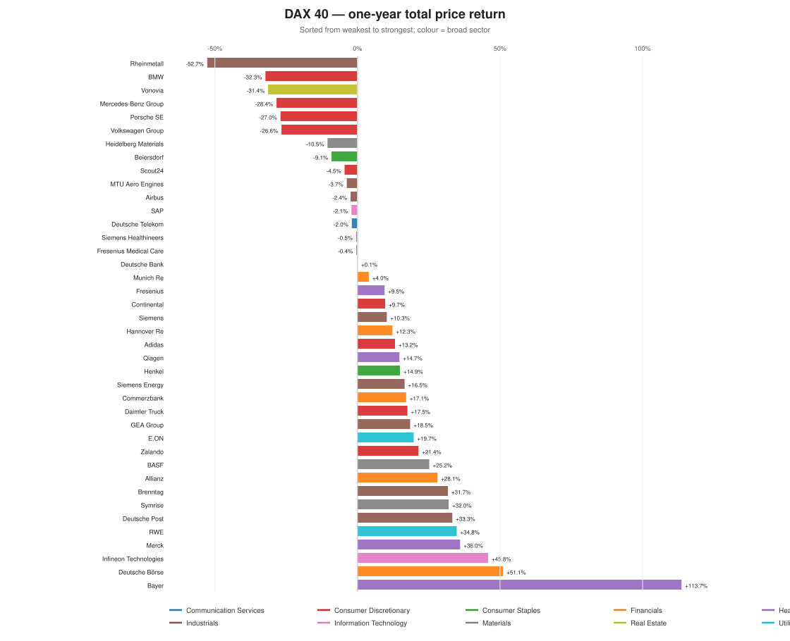
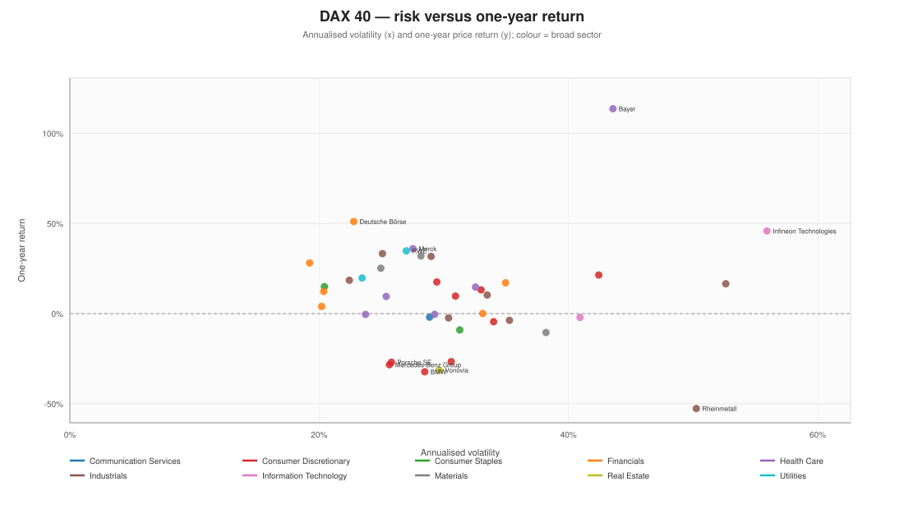

# DAX 40 companies

**As of:** 2026-11-09  
**Window:** 2025-11-11 to 2026-11-09

**25 of 40** companies delivered a positive one-year price return. The median was **+11.3%**, the interquartile range **-3.4% to +24.2%**.

## Full ranking

| # | Company | Sector | NACE | Last | 1D | 1M | YTD | 1Y | Vol | Max DD | From high | Trend | Beta |
| ---: | :--- | :--- | :--- | ---: | ---: | ---: | ---: | ---: | ---: | ---: | ---: | :--- | ---: |
| 1 | Bayer | Health Care | 21.20 | 56.62 | +1.9% | +29.4% | +53.0% | +113.7% | 43.6% | -30.9% | +0.0% | Uptrend | 0.88 |
| 2 | Deutsche Börse | Financials | 66.11 | 315.00 | -1.6% | +6.4% | +40.8% | +51.1% | 22.8% | -11.8% | -3.8% | Uptrend | 0.09 |
| 3 | Infineon Technologies | Information Technology | 26.11 | 48.63 | +6.3% | -17.4% | +28.9% | +45.8% | 55.9% | -48.0% | -44.7% | Downtrend | 1.90 |
| 4 | Merck | Health Care | 21.20 | 149.20 | +0.3% | +8.2% | +21.7% | +36.0% | 27.5% | -21.7% | -1.4% | Uptrend | 0.80 |
| 5 | RWE | Utilities | 35.11 | 58.60 | +1.7% | +1.1% | +29.5% | +34.8% | 27.0% | -12.8% | -5.5% | Uptrend | 0.44 |
| 6 | Deutsche Post | Industrials | 53.20 | 58.64 | +1.1% | +4.7% | +25.5% | +33.3% | 25.1% | -14.3% | -2.9% | Uptrend | 0.98 |
| 7 | Symrise | Materials | 20.53 | 94.36 | -2.1% | +2.3% | +37.0% | +32.0% | 28.2% | -12.2% | -7.8% | Uptrend | 0.38 |
| 8 | Brenntag | Industrials | 46.75 | 61.18 | -1.2% | -1.5% | +23.4% | +31.7% | 29.0% | -24.5% | -5.9% | Uptrend | 0.23 |
| 9 | Allianz | Financials | 65.12 | 457.00 | +1.3% | +9.6% | +17.0% | +28.1% | 19.2% | -12.4% | -1.7% | Uptrend | 0.74 |
| 10 | BASF | Materials | 20.14 | 53.85 | -0.8% | +4.2% | +21.2% | +25.2% | 24.9% | -14.5% | -4.0% | Uptrend | 0.23 |
| 11 | Zalando | Consumer Discretionary | 47.91 | 27.41 | -1.1% | +15.2% | +8.2% | +21.4% | 42.4% | -29.0% | -9.4% | Uptrend | 0.85 |
| 12 | E.ON | Utilities | 35.14 | 19.16 | +0.4% | +11.7% | +18.8% | +19.7% | 23.4% | -17.4% | -5.6% | Mixed | 0.43 |
| 13 | GEA Group | Industrials | 28.29 | 71.45 | +3.0% | +4.4% | +23.6% | +18.5% | 22.4% | -18.5% | +0.0% | Uptrend | 0.68 |
| 14 | Daimler Truck | Consumer Discretionary | 29.10 | 41.77 | +3.2% | +1.0% | +11.9% | +17.5% | 29.4% | -19.3% | -15.8% | Downtrend | 0.99 |
| 15 | Commerzbank | Financials | 64.19 | 39.70 | +3.9% | +4.7% | +10.0% | +17.1% | 35.0% | -18.9% | -7.1% | Uptrend | 1.42 |
| 16 | Siemens Energy | Industrials | 28.11 | 124.10 | +5.1% | -14.6% | +3.1% | +16.5% | 52.6% | -39.3% | -33.9% | Downtrend | 1.82 |
| 17 | Henkel | Consumer Staples | 20.52 | 83.70 | +0.6% | +12.4% | +20.3% | +14.9% | 20.4% | -26.8% | -0.3% | Uptrend | 0.43 |
| 18 | Qiagen | Health Care | 32.50 | 45.12 | -0.2% | +12.3% | +10.3% | +14.7% | 32.5% | -39.4% | -2.8% | Uptrend | 0.34 |
| 19 | Adidas | Consumer Discretionary | 14.14 | 178.45 | +2.2% | +19.1% | +5.6% | +13.2% | 33.0% | -24.5% | -5.0% | Mixed | 0.81 |
| 20 | Hannover Re | Financials | 65.12 | 289.00 | -1.4% | +9.8% | +8.6% | +12.3% | 20.4% | -19.3% | -5.7% | Uptrend | 0.25 |
| 21 | Siemens | Industrials | 28.29 | 271.00 | +2.8% | -0.4% | +13.3% | +10.3% | 33.5% | -22.2% | -6.5% | Uptrend | 1.60 |
| 22 | Continental | Consumer Discretionary | 29.31 | 72.50 | +3.1% | +4.9% | +6.7% | +9.7% | 30.9% | -23.2% | -4.6% | Uptrend | 1.13 |
| 23 | Fresenius | Health Care | 86.10 | 52.46 | -0.0% | +23.9% | +7.1% | +9.5% | 25.4% | -32.0% | -0.0% | Uptrend | 0.61 |
| 24 | Munich Re | Financials | 65.12 | 566.00 | -0.6% | +8.1% | +0.7% | +4.0% | 20.2% | -22.7% | -4.8% | Uptrend | 0.38 |
| 25 | Deutsche Bank | Financials | 64.19 | 32.47 | +2.9% | +8.5% | -1.9% | +0.1% | 33.1% | -26.8% | -9.2% | Uptrend | 1.55 |
| 26 | Fresenius Medical Care | Health Care | 86.90 | 40.97 | -3.0% | +9.3% | +0.5% | -0.4% | 29.3% | -18.1% | -8.7% | Mixed | 0.18 |
| 27 | Siemens Healthineers | Health Care | 26.60 | 43.16 | -3.4% | +10.3% | -3.9% | -0.5% | 23.7% | -29.0% | -8.3% | Uptrend | 0.73 |
| 28 | Deutsche Telekom | Communication Services | 61.10 | 26.16 | +1.0% | +5.9% | -5.4% | -2.0% | 28.9% | -30.0% | -23.3% | Downtrend | 0.41 |
| 29 | SAP | Information Technology | 58.29 | 211.65 | +0.4% | +10.5% | +1.6% | -2.1% | 40.9% | -41.2% | -3.1% | Uptrend | 0.91 |
| 30 | Airbus | Industrials | 30.30 | 206.00 | +4.9% | +9.7% | +3.5% | -2.4% | 30.4% | -27.7% | -6.4% | Uptrend | 1.24 |
| 31 | MTU Aero Engines | Industrials | 30.30 | 355.20 | +2.5% | +1.8% | -0.0% | -3.7% | 35.3% | -32.1% | -11.6% | Uptrend | 1.36 |
| 32 | Scout24 | Consumer Discretionary | 63.12 | 88.80 | -0.3% | +22.6% | +3.5% | -4.5% | 34.0% | -31.4% | -3.7% | Uptrend | 0.52 |
| 33 | Beiersdorf | Consumer Staples | 20.42 | 84.30 | -1.1% | +7.9% | -10.0% | -9.1% | 31.3% | -38.7% | -23.2% | Mixed | 0.51 |
| 34 | Heidelberg Materials | Materials | 23.51 | 180.15 | +3.7% | +26.6% | -19.2% | -10.5% | 38.2% | -41.5% | -24.6% | Mixed | 1.29 |
| 35 | Volkswagen Group | Consumer Discretionary | 29.10 | 70.20 | +0.5% | +3.2% | -32.2% | -26.6% | 30.6% | -38.7% | -35.4% | Downtrend | 0.98 |
| 36 | Porsche SE | Consumer Discretionary | 64.20 | 26.13 | +0.0% | +4.1% | -34.5% | -27.0% | 25.8% | -40.4% | -36.4% | Downtrend | 0.78 |
| 37 | Mercedes-Benz Group | Consumer Discretionary | 29.10 | 41.86 | +0.7% | +5.7% | -30.3% | -28.4% | 25.6% | -37.0% | -32.4% | Downtrend | 0.82 |
| 38 | Vonovia | Real Estate | 68.20 | 17.23 | +2.0% | +5.6% | -29.8% | -31.4% | 29.6% | -44.3% | -39.9% | Downtrend | 1.05 |
| 39 | BMW | Consumer Discretionary | 29.10 | 58.86 | -0.8% | +10.5% | -36.8% | -32.3% | 28.5% | -46.4% | -39.6% | Downtrend | 0.83 |
| 40 | Rheinmetall | Industrials | 25.40 | 845.40 | +4.0% | -10.0% | -45.8% | -52.7% | 50.3% | -57.7% | -56.0% | Downtrend | 1.18 |

## Leaders and laggards

**Top 5 by one-year return**

| Company | Sector | 1Y | YTD | Vol | Max DD |
| :--- | :--- | ---: | ---: | ---: | ---: |
| Bayer | Health Care | +113.7% | +53.0% | 43.6% | -30.9% |
| Deutsche Börse | Financials | +51.1% | +40.8% | 22.8% | -11.8% |
| Infineon Technologies | Information Technology | +45.8% | +28.9% | 55.9% | -48.0% |
| Merck | Health Care | +36.0% | +21.7% | 27.5% | -21.7% |
| RWE | Utilities | +34.8% | +29.5% | 27.0% | -12.8% |

**Bottom 5 by one-year return**

| Company | Sector | 1Y | YTD | Vol | Max DD |
| :--- | :--- | ---: | ---: | ---: | ---: |
| Porsche SE | Consumer Discretionary | -27.0% | -34.5% | 25.8% | -40.4% |
| Mercedes-Benz Group | Consumer Discretionary | -28.4% | -30.3% | 25.6% | -37.0% |
| Vonovia | Real Estate | -31.4% | -29.8% | 29.6% | -44.3% |
| BMW | Consumer Discretionary | -32.3% | -36.8% | 28.5% | -46.4% |
| Rheinmetall | Industrials | -52.7% | -45.8% | 50.3% | -57.7% |

## Performance versus own sector

A positive value means the company outperformed its equal-weighted sector index over the window.

| Company | Sector | 1Y return | Sector 1Y | Relative |
| :--- | :--- | ---: | ---: | ---: |
| Bayer | Health Care | +113.7% | +27.9% | +85.7% |
| Deutsche Börse | Financials | +51.1% | +20.0% | +31.1% |
| Zalando | Consumer Discretionary | +21.4% | -6.1% | +27.5% |
| Deutsche Post | Industrials | +33.3% | +6.8% | +26.4% |
| Brenntag | Industrials | +31.7% | +6.8% | +24.9% |
| Daimler Truck | Consumer Discretionary | +17.5% | -6.1% | +23.6% |
| Adidas | Consumer Discretionary | +13.2% | -6.1% | +19.2% |
| Infineon Technologies | Information Technology | +45.8% | +27.7% | +18.1% |
| Continental | Consumer Discretionary | +9.7% | -6.1% | +15.8% |
| Symrise | Materials | +32.0% | +17.1% | +14.8% |

| Company | Sector | 1Y return | Sector 1Y | Relative |
| :--- | :--- | ---: | ---: | ---: |
| Rheinmetall | Industrials | -52.7% | +6.8% | -59.5% |
| SAP | Information Technology | -2.1% | +27.7% | -29.9% |
| Siemens Healthineers | Health Care | -0.5% | +27.9% | -28.4% |
| Fresenius Medical Care | Health Care | -0.4% | +27.9% | -28.3% |
| Heidelberg Materials | Materials | -10.5% | +17.1% | -27.6% |
| BMW | Consumer Discretionary | -32.3% | -6.1% | -26.2% |
| Mercedes-Benz Group | Consumer Discretionary | -28.4% | -6.1% | -22.3% |
| Porsche SE | Consumer Discretionary | -27.0% | -6.1% | -20.9% |
| Volkswagen Group | Consumer Discretionary | -26.6% | -6.1% | -20.6% |
| Deutsche Bank | Financials | +0.1% | +20.0% | -19.9% |

## Risk versus return

## What the facts show

- The best one-year performer was **Bayer** (+113.7%); the weakest was **Rheinmetall** (-52.7%).
- **14 of 40** companies traded within 5% of their 52-week high.
- **25 of 40** companies were in an uptrend (above the 200-day SMA with the 50-day above the 200-day).
- The highest annualised volatility was **Infineon Technologies** (55.9%); the lowest was **Allianz** (19.2%).

> Company returns are price returns and exclude dividends. The window is approximately one year of trading sessions; short windows make company-level statistics noisy.
