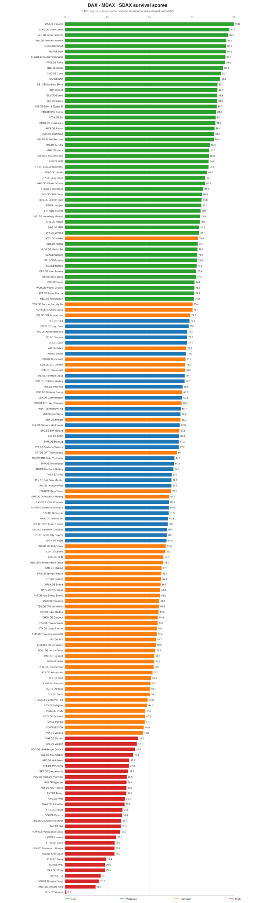
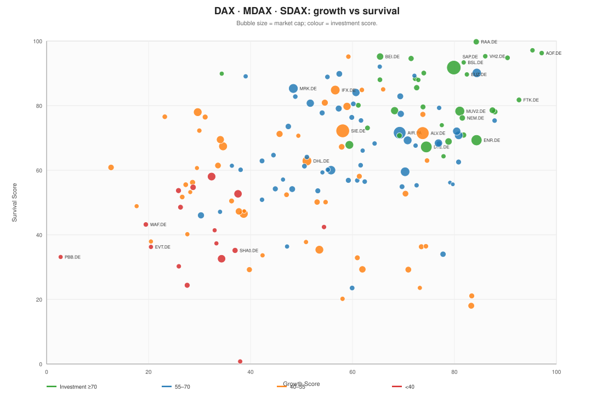
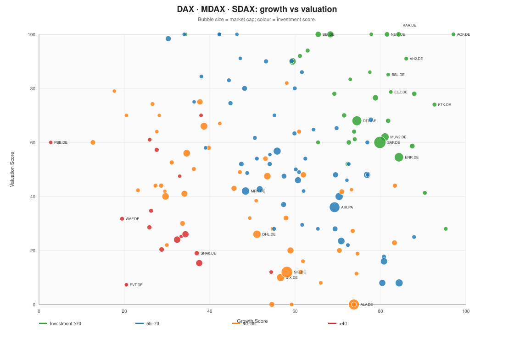

# DAX 40, MDAX and SDAX: corporate distress and long-term investment forecasting

*As of 2026-11-10 · model version 1.0 · statistical scorecard, not investment advice.*

## What this report answers

- **Bankruptcy/distress probability (1–3 years):** a relative survival score, Altman Z/Z″ zones, Ohlson O-score and a naive three-year extrapolation where the model is applicable.
- **Financial survival probability (1–5 years):** a sector-aware 0–100 survival score built from leverage, coverage, liquidity, profitability, earnings stability and sector-specific ratios.
- **Business growth potential (3–10 years):** a 0–100 growth score from revenue/EPS/FCF growth, ROIC−WACC, margin trends, R&D, order backlog and analyst estimates.
- **Expected investment return (1–5 years):** a valuation score plus bear/base/bull five-year scenario illustrations; a company can survive while its stock underperforms.

## Executive summary

### Highest survival scores

| Rank | Company | Ticker | Survival | Growth | Valuation | Investment | Band |
| ---: | :--- | :--- | ---: | ---: | ---: | ---: | :--- |
| 1 | Rational | RAA.DE | 99.8 | 84.3 | 100.0 | 93.6 | Low |
| 2 | Shelly Group | SLYG.DE | 97.1 | 95.3 | 28.0 | 75.7 | Low |
| 3 | Atoss Software | AOF.DE | 96.3 | 97.1 | 100.0 | 97.7 | Low |
| 4 | Friedrich Vorwerk | VH2.DE | 95.3 | 86.0 | 91.0 | 90.3 | Low |
| 5 | Beiersdorf | BEI.DE | 95.2 | 65.4 | 100.0 | 84.7 | Low |
| 6 | MLP | MLP.DE | 95.2 | 59.2 | 0.0 | 52.2 | Low |
| 7 | Elmos Semiconductor | ELG.DE | 94.8 | 90.4 | 41.3 | 77.0 | Low |
| 8 | Fuchs | FPE3.DE | 94.6 | 71.5 | 70.0 | 78.0 | Low |
| 9 | Basler | BSL.DE | 93.4 | 81.8 | 85.1 | 86.3 | Low |
| 10 | Cewe | CWC.DE | 92.1 | 65.3 | 28.0 | 62.2 | Low |

### Lowest survival scores

| Rank | Company | Ticker | Survival | Band | Debt/EBITDA | FCF margin | Data notes |
| ---: | :--- | :--- | ---: | :--- | ---: | ---: | :--- |
| 1 | Mutares | MUX.DE | 0.8 | High | — | — | sector-specific scorecard (holding); R&D not reported separa |
| 2 | Delivery Hero | DHER.DE | 18.0 | High | 36.88x | +0.5% | R&D not reported separately; order backlog not available; ne |
| 3 | Douglas Group | DOU.DE | 20.2 | High | 5.86x | +9.5% | R&D not reported separately; order backlog not available; be |
| 4 | TUI | TUI1.DE | 21.1 | High | 4.08x | +2.9% | R&D not reported separately; order backlog not available; be |
| 5 | Ströer | SAX.DE | 23.5 | High | 3.28x | +14.9% | R&D not reported separately; order backlog not available; be |
| 6 | PNE | PNE3.DE | 23.6 | High | 9.32x | -33.6% | sector-specific scorecard (utility); R&D not reported separa |
| 7 | Puma | PUM.DE | 24.4 | High | — | +3.1% | order backlog not available; net income negative; PE and EPS |
| 8 | Kion Group | KGX.DE | 29.2 | High | 4.50x | +0.3% | order backlog not available; beta unavailable; 1.0 assumed |
| 9 | Deutsche Lufthansa | LHA.DE | 29.2 | High | 4.65x | -4.2% | R&D not reported separately; order backlog not available; fr |
| 10 | Traton | 8TRA.DE | 29.3 | High | 5.89x | -0.2% | sector-specific scorecard (auto); leverage includes captive |

### Highest investment scores

| Rank | Company | Ticker | Investment | Growth | Survival | Valuation | 5y weighted return |
| ---: | :--- | :--- | ---: | ---: | ---: | ---: | ---: |
| 1 | Atoss Software | AOF.DE | 97.7 | 97.1 | 96.3 | 100.0 | +18.7% |
| 2 | Rational | RAA.DE | 93.6 | 84.3 | 99.8 | 100.0 | +14.8% |
| 3 | Friedrich Vorwerk | VH2.DE | 90.3 | 86.0 | 95.3 | 91.0 | +19.2% |
| 4 | Basler | BSL.DE | 86.3 | 81.8 | 93.4 | 85.1 | +10.3% |
| 5 | Nemetschek | NEM.DE | 85.5 | 81.5 | 76.2 | 100.0 | +9.7% |
| 6 | Beiersdorf | BEI.DE | 84.7 | 65.4 | 95.2 | 100.0 | +6.7% |
| 7 | Flatexdegiro | FTK.DE | 83.8 | 92.7 | 81.8 | 74.0 | +16.6% |
| 8 | Eckert & Ziegler Strahlen- und Medizintechnik | EUZ.DE | 83.5 | 82.4 | 89.7 | 78.7 | +8.0% |
| 9 | Scout24 | G24.DE | 82.0 | 87.9 | 78.1 | 78.0 | +19.2% |
| 10 | Adidas | ADS.DE | 80.8 | 68.3 | 78.4 | 100.0 | -1.1% |

### Lowest investment scores

| Rank | Company | Ticker | Investment | Growth | Survival | Valuation | 5y weighted return |
| ---: | :--- | :--- | ---: | ---: | ---: | ---: | ---: |
| 1 | Evotec | EVT.DE | 21.3 | 20.5 | 36.3 | 7.3 | -0.6% |
| 2 | Deutsche Pfandbriefbank | PBB.DE | 29.0 | 2.8 | 33.1 | 60.0 | +1.2% |
| 3 | Siltronic | WAF.DE | 30.3 | 19.5 | 43.2 | 31.8 | -3.7% |
| 4 | Schaeffler | SHA0.DE | 31.0 | 37.0 | 35.2 | 19.0 | -8.9% |
| 5 | Volkswagen Group | VOW3.DE | 31.3 | 34.3 | 32.6 | 26.0 | +15.2% |
| 6 | Energiekontor | EKT.DE | 32.1 | 33.3 | 37.4 | 25.2 | -10.0% |
| 7 | Thyssenkrupp | TKA.DE | 34.0 | 28.7 | 54.7 | 20.3 | +1.2% |
| 8 | 1&1 | 1U1.DE | 35.0 | 25.9 | 53.7 | 28.5 | +1.8% |
| 9 | BMW | BMW.DE | 35.4 | 37.5 | 52.7 | 15.3 | +0.6% |
| 10 | Salzgitter | SZG.DE | 35.5 | 26.3 | 48.6 | 34.7 | -0.4% |

## Methodology

The framework separates **survival**, **business growth** and **stock returns**. A company can have a high survival score and a low investment score if its shares already discount those strengths. The scores are relative scorecards, not calibrated probabilities or price targets.

### Survival score

For industrial companies the survival score uses the following weights; missing inputs are renormalised over the available components.

| Component | Weight | Definition |
| :--- | ---: | :--- |
| Altman Z″ | 25% | 6.56·WC/TA + 3.26·RE/TA + 6.72·EBIT/TA + 1.05·market cap/liabilities |
| Ohlson O-score | 20% | Ohlson (1980) model; operating cash flow as the FFO proxy |
| Interest coverage | 15% | EBIT / interest expense |
| Debt/EBITDA | 15% | Total debt / EBITDA; industrial debt for autos where available |
| Current ratio | 8% | Current assets / current liabilities |
| Cash / short-term debt | 5% | Cash and short-term investments / current debt |
| FCF margin | 7% | Free cash flow / revenue |
| Synthetic credit score | 5% | Coverage and leverage based; external ratings not used |

Altman Z″ zones: **safe ≥ 2.6**, **grey 1.1–2.6**, **distress < 1.1**. Ohlson probabilities are relative model outputs, not calibrated default probabilities. The naive three-year distress figure is `1 − (1 − p₁ᵧ)³` and assumes independence; it is shown only as a transparency aid.

### Sector-specific scorecards

| Model | Companies | Description |
| :--- | ---: | :--- |
| non_financial | 112 | Industrial/corporate scorecard with Altman Z″, Ohlson O-score, coverage, leverage, liquidity and FCF. |
| auto | 6 | Industrial scorecard with a captive-finance caveat; where available, industrial debt/EBITDA replaces total debt/EBITDA in the score. |
| bank | 8 | Bank scorecard: equity/assets, ROA, earnings stability, cost/income, loan-loss rate and revenue growth. |
| insurer | 4 | Insurer scorecard: equity/assets, ROA, earnings stability, policy-benefit ratio, expense ratio and revenue growth. |
| real_estate | 8 | Real-estate scorecard: equity/assets, interest coverage, debt/EBITDA, FFO/EBITDA margin, growth and earnings stability. |
| holding | 5 | Holding-company scorecard: equity/assets, ROA, earnings stability, debt/EBITDA, FCF/assets and EPS growth. |
| utility | 5 | Regulated-utility scorecard: coverage, debt/EBITDA, FCF margin, equity/assets, growth and earnings stability. |
| telecom | 4 | Telecom scorecard: coverage, debt/EBITDA, FCF margin, equity/assets, growth and earnings stability. |
| asset_light | 6 | Asset-light scorecard for negative-working-capital businesses: leverage, FCF margin, ROIC−WACC, growth and earnings stability. |
| financial_infrastructure | 1 | Exchange/clearing scorecard: coverage, debt/EBITDA, ROIC−WACC, FCF margin, growth and earnings stability. |

### Sector scorecard weights

| Model | Survival weights | Growth weights |
| :--- | :--- | :--- |
| non_financial / auto | Altman Z″ 25, Ohlson 20, coverage 15, debt/EBITDA 15, current ratio 8, cash/ST debt 5, FCF margin 7, credit score 5 | Revenue CAGR 20, ROIC−WACC 25, gross margin 15, FCF CAGR 10, EPS CAGR 10, R&D 10, backlog 5, analyst growth 5 |
| bank / insurer | Equity/assets 25, ROA 20, earnings stability 15, cost/income or expense ratio 15, loan losses or policy benefits 15, revenue growth 10 | Revenue CAGR 20, ROE−cost of equity 25, EPS CAGR 20, book value/share 15, dividend growth 10, expense trend 10 |
| real_estate | Equity/assets 20, coverage 20, debt/EBITDA 20, FFO margin 15, revenue growth 10, earnings stability 15 | Revenue CAGR 20, ROE−cost of equity 25, EPS CAGR 15, book value/share 15, FCF CAGR 10, dividend growth 15 |
| holding | Equity/assets 40, debt/EBITDA 15, FCF/assets 15, ROA 10, earnings stability 10, EPS growth 10 | EPS CAGR 25, book value/share 25, ROE−cost of equity 20, dividend growth 15, FCF CAGR 15 |
| utility / telecom | Coverage 20, debt/EBITDA 20, FCF margin 15, equity/assets 15, revenue growth 10, earnings stability 10, current ratio 10 | Revenue CAGR 20, ROIC−WACC 25, EPS CAGR 20, FCF CAGR 15, gross margin 10, dividend growth 10 |
| asset_light | Debt/EBITDA 25, coverage 15, FCF margin 20, ROIC−WACC 20, revenue growth 10, earnings stability 10 | Revenue CAGR 25, ROIC−WACC 25, FCF CAGR 20, EPS CAGR 15, gross margin 15 |
| financial_infrastructure | Coverage 25, debt/EBITDA 20, ROIC−WACC 20, FCF margin 15, revenue growth 10, earnings stability 10 | Revenue CAGR 20, ROIC−WACC 25, EPS CAGR 20, gross margin 15, FCF CAGR 10, dividend growth 10 |

### Growth score

Industrial growth weights: revenue CAGR 20%, ROIC−WACC 25%, gross-margin trend 15%, FCF CAGR 10%, EPS CAGR 10%, R&D/revenue 10%, order-backlog growth 5%, analyst forward revenue growth 5%. Financials replace FCF/R&D/backlog with ROE−cost of equity, book-value growth, dividend growth and expense-ratio trends. Missing components are renormalised.

### Valuation and investment score

Valuation compares the current multiple with the company's own FY2021–FY2025 history: PE, EV/EBITDA, P/FCF and FCF yield for industrials; PE, price/book and dividend yield for banks, insurers, holdings and real estate. A low score means the shares are expensive relative to their own history, not necessarily expensive in absolute terms. The investment score is **40% growth + 30% survival + 30% valuation**.

### WACC and scenarios

Risk-free rate: **3.27%** (German 10-year Bund); equity risk premium: **5.5%**; beta from the DAX price analysis where available (otherwise 1.0), clamped to 0.4–1.8. Cost of debt is interest expense / total debt, clamped to 1–10%; tax rate is the effective rate, clamped to 0–35%. Banks and insurers use the cost of equity as the hurdle rate. Five-year scenarios use historical and analyst growth, an exit multiple from the company's own history, and current dividend yield; bear/base/bull are weighted 25/50/25. Exit multiples are bounded around the current multiple to prevent a single historical median from producing implausible five-year re-rating or de-rating. Cyclical troughs with spot PE above 1.8× the historical median use average positive annual EPS as the starting basis.

### Score interpretation

| Score | Survival | Growth | Valuation | Investment |
| ---: | :--- | :--- | :--- | :--- |
| ≥ 70 | Low distress | Strong | Cheap vs own history | Attractive score |
| 55–70 | Moderate | Above average | Slightly cheap | Above average |
| 40–55 | Elevated | Average | Mid-range | Neutral |
| < 40 | High distress | Weak | Expensive vs own history | Unattractive score |

## Coverage and data quality

The dataset contains **159 companies** and **159 scored companies**, with TTM plus up to FY2021–FY2025 depending on listing history. A separate quarterly panel (`data/fundamentals_quarterly.tsv`, 2992 rows) stores up to 20 quarters of income, balance-sheet and cash-flow data for transparency; it is not used in the scorecard. Porsche SE has no quarterly revenue line, and a few individual quarters are incomplete at the source. Fundamentals come from stockanalysis.com (data by S&P Global Market Intelligence); prices and beta come from the existing CNBC pipeline. Qiagen reports in USD; all other companies report in EUR.

| Ticker | Company | Index | Model | Latest | Currency | Data notes |
| :--- | :--- | :--- | :--- | :--- | :--- | :--- |
| 1AST.DE | Asta Energy Solutions | SDAX | non_financial | TTM | EUR | R&D not reported separately; order backlog not available; beta unavailable; 1.0 assumed |
| 1SXP.DE | Schott Pharma | SDAX | non_financial | TTM | EUR | order backlog not available; beta unavailable; 1.0 assumed |
| 1U1.DE | 1&1 | SDAX | telecom | TTM | EUR | sector-specific scorecard (telecom); R&D not reported separately; order backlog not availa |
| 8TRA.DE | Traton | MDAX | auto | TTM | EUR | sector-specific scorecard (auto); leverage includes captive financial-services debt; indus |
| ACT0.DE | AlzChem Group | SDAX | non_financial | TTM | EUR | R&D not reported separately; order backlog not available; beta unavailable; 1.0 assumed |
| ADS.DE | Adidas | DAX 40 | non_financial | TTM | EUR | R&D not reported separately; order backlog not available |
| ADV.DE | Adtran Networks | SDAX | non_financial | TTM | EUR | order backlog not available; beta unavailable; 1.0 assumed |
| AFX.DE | Carl Zeiss Meditec | SDAX | non_financial | TTM | EUR | order backlog not available; beta unavailable; 1.0 assumed |
| AG1.DE | Auto1 Group | MDAX | non_financial | TTM | EUR | R&D not reported separately; order backlog not available; free cash flow negative in the l |
| AIR.PA | Airbus | DAX 40 | non_financial | TTM | EUR | order backlog not available |
| AIXA.DE | Aixtron | MDAX | non_financial | TTM | EUR | order backlog not available; beta unavailable; 1.0 assumed |
| ALV.DE | Allianz | DAX 40 | insurer | TTM | EUR | sector-specific scorecard (insurer); R&D not reported separately; order backlog not availa |
| AMV0.DE | Aumovio | MDAX | non_financial | TTM | EUR | order backlog not available; free cash flow negative in the latest period; net income nega |
| AOF.DE | Atoss Software | SDAX | asset_light | TTM | EUR | sector-specific scorecard (asset_light); order backlog not available; beta unavailable; 1. |
| AT1.DE | Aroundtown | MDAX | real_estate | TTM | EUR | sector-specific scorecard (real_estate); R&D not reported separately; order backlog not av |
| BAS.DE | BASF | DAX 40 | non_financial | TTM | EUR | order backlog not available |
| BAYN.DE | Bayer | DAX 40 | non_financial | TTM | EUR | order backlog not available; net income negative; PE and EPS CAGR not meaningful |
| BC8.DE | Bechtle | MDAX | non_financial | TTM | EUR | R&D not reported separately; order backlog not available; beta unavailable; 1.0 assumed |
| BEI.DE | Beiersdorf | DAX 40 | non_financial | TTM | EUR | order backlog not available |
| BFSA.DE | Befesa | SDAX | non_financial | TTM | EUR | R&D not reported separately; order backlog not available; beta unavailable; 1.0 assumed |
| BMW.DE | BMW | DAX 40 | auto | TTM | EUR | sector-specific scorecard (auto); leverage includes captive financial-services debt; score |
| BNR.DE | Brenntag | DAX 40 | non_financial | TTM | EUR | R&D not reported separately; order backlog not available |
| BOSS.DE | Hugo Boss | SDAX | non_financial | TTM | EUR | R&D not reported separately; order backlog not available; beta unavailable; 1.0 assumed |
| BSL.DE | Basler | SDAX | non_financial | TTM | EUR | order backlog not available; beta unavailable; 1.0 assumed |
| CBK.DE | Commerzbank | DAX 40 | bank | TTM | EUR | sector-specific scorecard (bank); R&D not reported separately; order backlog not available |
| COK.DE | Cancom | SDAX | non_financial | TTM | EUR | R&D not reported separately; order backlog not available; beta unavailable; 1.0 assumed |
| CON.DE | Continental | DAX 40 | non_financial | TTM | EUR | order backlog not available |
| CWC.DE | Cewe | SDAX | non_financial | TTM | EUR | R&D not reported separately; order backlog not available; free cash flow negative in the l |
| DB1.DE | Deutsche Börse | DAX 40 | financial_infrastructure | TTM | EUR | sector-specific scorecard (financial_infrastructure); R&D not reported separately; order b |
| DBAN.DE | Deutsche Beteiligungs | SDAX | holding | TTM | EUR | sector-specific scorecard (holding); R&D not reported separately; order backlog not availa |
| DBK.DE | Deutsche Bank | DAX 40 | bank | TTM | EUR | sector-specific scorecard (bank); R&D not reported separately; order backlog not available |
| DEQ.DE | Deutsche EuroShop | SDAX | real_estate | TTM | EUR | sector-specific scorecard (real_estate); R&D not reported separately; order backlog not av |
| DEZ.DE | Deutz | MDAX | non_financial | TTM | EUR | order backlog not available; beta unavailable; 1.0 assumed |
| DHER.DE | Delivery Hero | MDAX | non_financial | TTM | EUR | R&D not reported separately; order backlog not available; net income negative; PE and EPS |
| DHL.DE | Deutsche Post | DAX 40 | non_financial | TTM | EUR | R&D not reported separately; order backlog not available |
| DMP.DE | Dermapharm Holding | SDAX | non_financial | TTM | EUR | R&D not reported separately; order backlog not available; beta unavailable; 1.0 assumed |
| DOU.DE | Douglas Group | SDAX | non_financial | TTM | EUR | R&D not reported separately; order backlog not available; beta unavailable; 1.0 assumed |
| DRW3.DE | Drägerwerk | SDAX | non_financial | TTM | EUR | order backlog not available; beta unavailable; 1.0 assumed |
| DTE.DE | Deutsche Telekom | DAX 40 | telecom | TTM | EUR | sector-specific scorecard (telecom); R&D not reported separately; order backlog not availa |
| DTG.DE | Daimler Truck | DAX 40 | auto | TTM | EUR | sector-specific scorecard (auto); leverage includes captive financial-services debt; score |
| DUE.DE | Dürr | SDAX | non_financial | TTM | EUR | order backlog not available; beta unavailable; 1.0 assumed |
| DWS.DE | DWS Group | MDAX | bank | TTM | EUR | sector-specific scorecard (bank); R&D not reported separately; order backlog not available |
| EIN.DE | Einhell Germany | SDAX | non_financial | TTM | EUR | R&D not reported separately; order backlog not available; beta unavailable; 1.0 assumed |
| EKT.DE | Energiekontor | SDAX | utility | TTM | EUR | sector-specific scorecard (utility); R&D not reported separately; order backlog not availa |
| ELG.DE | Elmos Semiconductor | MDAX | non_financial | TTM | EUR | order backlog not available; beta unavailable; 1.0 assumed |
| ENR.DE | Siemens Energy | DAX 40 | non_financial | TTM | EUR | order backlog not available |
| EOAN.DE | E.ON | DAX 40 | utility | TTM | EUR | sector-specific scorecard (utility); R&D not reported separately; order backlog not availa |
| EUZ.DE | Eckert & Ziegler Strahlen- und Medizintechnik | SDAX | non_financial | TTM | EUR | R&D not reported separately; order backlog not available; beta unavailable; 1.0 assumed |
| EVD.DE | CTS Eventim | MDAX | non_financial | TTM | EUR | R&D not reported separately; order backlog not available; interest expense not reported; 4 |
| EVK.DE | Evonik Industries | MDAX | non_financial | TTM | EUR | order backlog not available; beta unavailable; 1.0 assumed |
| EVT.DE | Evotec | SDAX | non_financial | TTM | EUR | order backlog not available; interest expense not reported; 4.5% cost of debt assumed; fre |
| F3C.DE | SFC Energy | SDAX | non_financial | TTM | EUR | order backlog not available; beta unavailable; 1.0 assumed |
| FIE.DE | Fielmann Group | SDAX | non_financial | TTM | EUR | R&D not reported separately; order backlog not available; beta unavailable; 1.0 assumed |
| FME.DE | Fresenius Medical Care | DAX 40 | non_financial | TTM | EUR | order backlog not available |
| FNTN.DE | Freenet | MDAX | telecom | TTM | EUR | sector-specific scorecard (telecom); R&D not reported separately; order backlog not availa |
| FPE3.DE | Fuchs | MDAX | non_financial | TTM | EUR | order backlog not available; beta unavailable; 1.0 assumed |
| FRA.DE | Fraport | MDAX | non_financial | TTM | EUR | R&D not reported separately; order backlog not available; beta unavailable; 1.0 assumed |
| FRE.DE | Fresenius | DAX 40 | non_financial | TTM | EUR | order backlog not available |
| FTK.DE | Flatexdegiro | MDAX | bank | TTM | EUR | sector-specific scorecard (bank); R&D not reported separately; order backlog not available |
| G1A.DE | GEA Group | DAX 40 | non_financial | TTM | EUR | order backlog not available |
| G24.DE | Scout24 | DAX 40 | asset_light | TTM | EUR | sector-specific scorecard (asset_light); R&D not reported separately; order backlog not av |
| GBF.DE | Bilfinger | MDAX | non_financial | TTM | EUR | R&D not reported separately; order backlog not available; beta unavailable; 1.0 assumed |
| GFT.DE | GFT Technologies | SDAX | non_financial | TTM | EUR | R&D not reported separately; order backlog not available; beta unavailable; 1.0 assumed |
| GLJ.DE | Grenke | SDAX | bank | TTM | EUR | sector-specific scorecard (bank); no revenue line (investment holding); R&D not reported s |
| GYC.DE | Grand City Properties | SDAX | real_estate | TTM | EUR | sector-specific scorecard (real_estate); R&D not reported separately; order backlog not av |
| HABA.DE | Hamborner Reit | SDAX | real_estate | TTM | EUR | sector-specific scorecard (real_estate); R&D not reported separately; order backlog not av |
| HAG.DE | Hensoldt | MDAX | non_financial | TTM | EUR | order backlog not available; beta unavailable; 1.0 assumed |
| HBH.DE | Hornbach Holding | SDAX | non_financial | TTM | EUR | R&D not reported separately; order backlog not available; beta unavailable; 1.0 assumed |
| HDD.DE | Heidelberger Druckmaschinen | SDAX | non_financial | TTM | EUR | R&D not reported separately; order backlog not available; free cash flow negative in the l |
| HEI.DE | Heidelberg Materials | DAX 40 | non_financial | TTM | EUR | R&D not reported separately; order backlog not available |
| HEN3.DE | Henkel | DAX 40 | non_financial | TTM | EUR | order backlog not available |
| HFG.DE | HelloFresh | SDAX | non_financial | TTM | EUR | R&D not reported separately; order backlog not available; net income negative; PE and EPS |
| HLE.DE | Hella | MDAX | non_financial | TTM | EUR | order backlog not available; beta unavailable; 1.0 assumed |
| HNR1.DE | Hannover Re | DAX 40 | insurer | TTM | EUR | sector-specific scorecard (insurer); R&D not reported separately; order backlog not availa |
| HYQ.DE | Hypoport | SDAX | asset_light | TTM | EUR | sector-specific scorecard (asset_light); R&D not reported separately; order backlog not av |
| IFX.DE | Infineon Technologies | DAX 40 | non_financial | TTM | EUR | order backlog not available |
| ILM1.DE | Medios | SDAX | non_financial | TTM | EUR | R&D not reported separately; order backlog not available; beta unavailable; 1.0 assumed |
| INH.DE | Indus Holding | SDAX | holding | TTM | EUR | sector-specific scorecard (holding); R&D not reported separately; order backlog not availa |
| IOS.DE | Ionos Group | MDAX | asset_light | TTM | EUR | sector-specific scorecard (asset_light); R&D not reported separately; order backlog not av |
| IXX.DE | INIT Innovation in Traffic Systems | SDAX | non_financial | TTM | EUR | order backlog not available; beta unavailable; 1.0 assumed |
| JEN.DE | Jenoptik | MDAX | non_financial | TTM | EUR | order backlog not available; beta unavailable; 1.0 assumed |
| JST.DE | Jost Werke | SDAX | non_financial | TTM | EUR | order backlog not available; net income negative; PE and EPS CAGR not meaningful; beta una |
| JUN3.DE | Jungheinrich | SDAX | non_financial | TTM | EUR | order backlog not available; beta unavailable; 1.0 assumed |
| KBX.DE | Knorr-Bremse | MDAX | non_financial | TTM | EUR | R&D not reported separately; order backlog not available; beta unavailable; 1.0 assumed |
| KGX.DE | Kion Group | MDAX | non_financial | TTM | EUR | order backlog not available; beta unavailable; 1.0 assumed |
| KRN.DE | Krones | MDAX | non_financial | TTM | EUR | R&D not reported separately; order backlog not available; beta unavailable; 1.0 assumed |
| KSB.DE | KSB | SDAX | non_financial | TTM | EUR | R&D not reported separately; order backlog not available; beta unavailable; 1.0 assumed |
| KTN.DE | Kontron | SDAX | non_financial | TTM | EUR | R&D not reported separately; order backlog not available; beta unavailable; 1.0 assumed |
| KWS.DE | KWS Saat | SDAX | non_financial | FY2026 | EUR | order backlog not available; beta unavailable; 1.0 assumed |
| LEG.DE | LEG Immobilien | MDAX | real_estate | TTM | EUR | sector-specific scorecard (real_estate); R&D not reported separately; order backlog not av |
| LHA.DE | Deutsche Lufthansa | MDAX | non_financial | TTM | EUR | R&D not reported separately; order backlog not available; free cash flow negative in the l |
| LPK.DE | LPKF Laser & Electronics | SDAX | non_financial | TTM | EUR | R&D not reported separately; order backlog not available; net income negative; PE and EPS |
| LXS.DE | Lanxess | MDAX | non_financial | TTM | EUR | order backlog not available; net income negative; PE and EPS CAGR not meaningful; beta una |
| MBB.DE | MBB | SDAX | holding | TTM | EUR | sector-specific scorecard (holding); order backlog not available; beta unavailable; 1.0 as |
| MBG.DE | Mercedes-Benz Group | DAX 40 | auto | TTM | EUR | sector-specific scorecard (auto); leverage includes captive financial-services debt; indus |
| MLP.DE | MLP | SDAX | bank | TTM | EUR | sector-specific scorecard (bank); R&D not reported separately; order backlog not available |
| MRK.DE | Merck | DAX 40 | non_financial | TTM | EUR | order backlog not available |
| MTX.DE | MTU Aero Engines | DAX 40 | non_financial | TTM | EUR | order backlog not available |
| MUV2.DE | Munich Re | DAX 40 | insurer | TTM | EUR | sector-specific scorecard (insurer); R&D not reported separately; order backlog not availa |
| MUX.DE | Mutares | SDAX | holding | TTM | EUR | sector-specific scorecard (holding); R&D not reported separately; order backlog not availa |
| NDA.DE | Aurubis | MDAX | non_financial | TTM | EUR | R&D not reported separately; order backlog not available; free cash flow negative in the l |
| NDX1.DE | Nordex | MDAX | non_financial | TTM | EUR | R&D not reported separately; order backlog not available; beta unavailable; 1.0 assumed |
| NEM.DE | Nemetschek | MDAX | asset_light | TTM | EUR | sector-specific scorecard (asset_light); R&D not reported separately; order backlog not av |
| NOEJ.DE | Norma Group | SDAX | non_financial | TTM | EUR | R&D not reported separately; order backlog not available; free cash flow negative in the l |
| OBCK.DE | Ottobock | SDAX | non_financial | TTM | EUR | order backlog not available; beta unavailable; 1.0 assumed |
| OHB.DE | OHB | SDAX | non_financial | TTM | EUR | R&D not reported separately; order backlog not available; free cash flow negative in the l |
| P911.DE | Porsche | MDAX | auto | TTM | EUR | sector-specific scorecard (auto); leverage includes captive financial-services debt; indus |
| PAH3.DE | Porsche SE | DAX 40 | holding | TTM | EUR | sector-specific scorecard (holding); no revenue line (investment holding); R&D not reporte |
| PAT.DE | Patrizia | SDAX | real_estate | TTM | EUR | sector-specific scorecard (real_estate); R&D not reported separately; order backlog not av |
| PBB.DE | Deutsche Pfandbriefbank | SDAX | bank | TTM | EUR | sector-specific scorecard (bank); R&D not reported separately; order backlog not available |
| PCZ.DE | ProCredit Holding | SDAX | bank | TTM | EUR | sector-specific scorecard (bank); R&D not reported separately; order backlog not available |
| PNE3.DE | PNE | SDAX | utility | TTM | EUR | sector-specific scorecard (utility); R&D not reported separately; order backlog not availa |
| PUM.DE | Puma | MDAX | non_financial | TTM | EUR | order backlog not available; net income negative; PE and EPS CAGR not meaningful; beta una |
| QIA.DE | Qiagen | DAX 40 | non_financial | TTM | USD | financials reported in USD; order backlog not available |
| R3NK.DE | Renk Group | MDAX | non_financial | TTM | EUR | R&D not reported separately; order backlog not available; beta unavailable; 1.0 assumed |
| RAA.DE | Rational | MDAX | non_financial | TTM | EUR | order backlog not available; beta unavailable; 1.0 assumed |
| RDC.DE | Redcare Pharmacy | SDAX | non_financial | TTM | EUR | R&D not reported separately; order backlog not available; free cash flow negative in the l |
| RHM.DE | Rheinmetall | DAX 40 | non_financial | TTM | EUR | R&D not reported separately; order backlog not available |
| RRTL.DE | RTL Group | MDAX | non_financial | TTM | EUR | R&D not reported separately; order backlog not available; beta unavailable; 1.0 assumed |
| RWE.DE | RWE | DAX 40 | utility | TTM | EUR | sector-specific scorecard (utility); R&D not reported separately; order backlog not availa |
| S92.DE | SMA Solar Technology | SDAX | non_financial | TTM | EUR | order backlog not available; net income negative; PE and EPS CAGR not meaningful; beta una |
| SAP.DE | SAP | DAX 40 | non_financial | TTM | EUR | order backlog not available |
| SAX.DE | Ströer | MDAX | non_financial | TTM | EUR | R&D not reported separately; order backlog not available; beta unavailable; 1.0 assumed |
| SDF.DE | K+S | MDAX | non_financial | TTM | EUR | R&D not reported separately; order backlog not available; beta unavailable; 1.0 assumed |
| SFQ.DE | SAF-Holland | SDAX | non_financial | TTM | EUR | order backlog not available; beta unavailable; 1.0 assumed |
| SGL.DE | SGL Carbon | SDAX | non_financial | TTM | EUR | order backlog not available; beta unavailable; 1.0 assumed |
| SHA0.DE | Schaeffler | MDAX | non_financial | TTM | EUR | order backlog not available; net income negative; PE and EPS CAGR not meaningful; beta una |
| SHL.DE | Siemens Healthineers | DAX 40 | non_financial | FY2026 | EUR | order backlog not available |
| SIE.DE | Siemens | DAX 40 | non_financial | TTM | EUR | order backlog not available |
| SIX2.DE | Sixt | SDAX | non_financial | TTM | EUR | R&D not reported separately; order backlog not available; beta unavailable; 1.0 assumed |
| SLYG.DE | Shelly Group | SDAX | non_financial | TTM | EUR | R&D not reported separately; order backlog not available; beta unavailable; 1.0 assumed |
| SMHN.DE | Suss Microtec | MDAX | non_financial | TTM | EUR | order backlog not available; beta unavailable; 1.0 assumed |
| SPG.DE | Springer Nature | SDAX | non_financial | TTM | EUR | R&D not reported separately; order backlog not available; beta unavailable; 1.0 assumed |
| SRT3.DE | Sartorius | MDAX | non_financial | TTM | EUR | order backlog not available; beta unavailable; 1.0 assumed |
| STM.DE | Stabilus | SDAX | non_financial | TTM | EUR | order backlog not available; beta unavailable; 1.0 assumed |
| STO3.DE | Sto | SDAX | non_financial | TTM | EUR | R&D not reported separately; order backlog not available; beta unavailable; 1.0 assumed |
| SY1.DE | Symrise | DAX 40 | non_financial | TTM | EUR | order backlog not available |
| SZG.DE | Salzgitter | MDAX | non_financial | TTM | EUR | R&D not reported separately; order backlog not available; free cash flow negative in the l |
| SZU.DE | Südzucker | SDAX | non_financial | TTM | EUR | R&D not reported separately; order backlog not available; net income negative; PE and EPS |
| TEG.DE | TAG Immobilien | MDAX | real_estate | TTM | EUR | sector-specific scorecard (real_estate); R&D not reported separately; order backlog not av |
| TKA.DE | Thyssenkrupp | MDAX | non_financial | TTM | EUR | order backlog not available; free cash flow negative in the latest period; beta unavailabl |
| TKMS.DE | TKMS | MDAX | non_financial | TTM | EUR | order backlog not available; interest expense not reported; 4.5% cost of debt assumed; fre |
| TLX.DE | Talanx | MDAX | insurer | TTM | EUR | sector-specific scorecard (insurer); R&D not reported separately; order backlog not availa |
| TMV.DE | TeamViewer | SDAX | asset_light | TTM | EUR | sector-specific scorecard (asset_light); order backlog not available; beta unavailable; 1. |
| TNIE.DE | Tonies | SDAX | non_financial | TTM | EUR | R&D not reported separately; order backlog not available; free cash flow negative in the l |
| TPE.DE | PVA TePla | SDAX | non_financial | TTM | EUR | order backlog not available; free cash flow negative in the latest period; net income nega |
| TUI1.DE | TUI | MDAX | non_financial | TTM | EUR | R&D not reported separately; order backlog not available; beta unavailable; 1.0 assumed |
| UTDI.DE | United Internet | MDAX | telecom | TTM | EUR | sector-specific scorecard (telecom); R&D not reported separately; order backlog not availa |
| V1NC.DE | Vincorion | SDAX | non_financial | TTM | EUR | order backlog not available; beta unavailable; 1.0 assumed |
| VBK.DE | Verbio | SDAX | utility | FY2026 | EUR | sector-specific scorecard (utility); R&D not reported separately; order backlog not availa |
| VH2.DE | Friedrich Vorwerk | SDAX | non_financial | TTM | EUR | R&D not reported separately; order backlog not available; beta unavailable; 1.0 assumed |
| VNA.DE | Vonovia | DAX 40 | real_estate | TTM | EUR | sector-specific scorecard (real_estate); R&D not reported separately; order backlog not av |
| VOS.DE | Vossloh | SDAX | non_financial | TTM | EUR | order backlog not available; beta unavailable; 1.0 assumed |
| VOW3.DE | Volkswagen Group | DAX 40 | auto | TTM | EUR | sector-specific scorecard (auto); leverage includes captive financial-services debt; indus |
| WAC.DE | Wacker Neuson | SDAX | non_financial | TTM | EUR | order backlog not available; beta unavailable; 1.0 assumed |
| WAF.DE | Siltronic | MDAX | non_financial | TTM | EUR | order backlog not available; free cash flow negative in the latest period; net income nega |
| WCH.DE | Wacker Chemie | MDAX | non_financial | TTM | EUR | order backlog not available; net income negative; PE and EPS CAGR not meaningful; beta una |
| YSN.DE | Secunet Security Networks | SDAX | non_financial | TTM | EUR | order backlog not available; free cash flow negative in the latest period; beta unavailabl |
| ZAL.DE | Zalando | DAX 40 | non_financial | TTM | EUR | R&D not reported separately; order backlog not available |

Known gaps: Porsche SE has no revenue line (investment holding); R&D is not reported separately by many companies; order backlog is available only for a minority; external credit ratings are not used as a separate input because a complete, dated mapping for all companies was not available. BMW's A stable rating (Morningstar DBRS, October 2026) is consistent with the model as a cross-check; Siemens' rating remains unverified. Auto leverage includes captive financial-services debt; where the split is identifiable, the score uses industrial debt/EBITDA and the report shows total leverage separately. A few recent listings lack enough market data for a valuation score or scenario.

## Cross-company ranking

| Rank | Ticker | Company | Survival | Growth | Valuation | Investment | Band | Altman Z″ | Ohlson 1y | 5y weighted return |
| ---: | :--- | :--- | ---: | ---: | ---: | ---: | :--- | ---: | ---: | ---: |
| 1 | AOF.DE | Atoss Software | 96.3 | 97.1 | 100.0 | 97.7 | Low | — | — | +18.7% |
| 2 | RAA.DE | Rational | 99.8 | 84.3 | 100.0 | 93.6 | Low | 36.12 | 0.9% | +14.8% |
| 3 | VH2.DE | Friedrich Vorwerk | 95.3 | 86.0 | 91.0 | 90.3 | Low | 9.81 | 19.2% | +19.2% |
| 4 | BSL.DE | Basler | 93.4 | 81.8 | 85.1 | 86.3 | Low | 12.35 | 19.7% | +10.3% |
| 5 | NEM.DE | Nemetschek | 76.2 | 81.5 | 100.0 | 85.5 | Low | — | — | +9.7% |
| 6 | BEI.DE | Beiersdorf | 95.2 | 65.4 | 100.0 | 84.7 | Low | 9.21 | 8.2% | +6.7% |
| 7 | FTK.DE | Flatexdegiro | 81.8 | 92.7 | 74.0 | 83.8 | Low | — | — | +16.6% |
| 8 | EUZ.DE | Eckert & Ziegler Strahlen- und Medizintechnik | 89.7 | 82.4 | 78.7 | 83.5 | Low | 9.20 | 34.3% | +8.0% |
| 9 | G24.DE | Scout24 | 78.1 | 87.9 | 78.0 | 82.0 | Low | — | — | +19.2% |
| 10 | ADS.DE | Adidas | 78.4 | 68.3 | 100.0 | 80.8 | Low | 5.02 | 44.5% | -1.1% |
| 11 | EIN.DE | Einhell Germany | 88.0 | 72.9 | 83.3 | 80.6 | Low | 7.28 | 29.0% | +11.3% |
| 12 | TMV.DE | TeamViewer | 64.3 | 77.9 | 100.0 | 80.4 | Moderate | — | — | +22.2% |
| 13 | IXX.DE | INIT Innovation in Traffic Systems | 74.0 | 77.5 | 86.0 | 79.0 | Elevated | 5.25 | 60.8% | +17.7% |
| 14 | FPE3.DE | Fuchs | 94.6 | 71.5 | 70.0 | 78.0 | Low | 8.98 | 9.4% | +9.1% |
| 15 | SAP.DE | SAP | 91.8 | 79.9 | 60.0 | 77.5 | Low | 12.02 | 6.5% | +8.2% |
| 16 | ELG.DE | Elmos Semiconductor | 94.8 | 90.4 | 41.3 | 77.0 | Low | 12.05 | 17.1% | +7.9% |
| 17 | NDX1.DE | Nordex | 78.6 | 87.4 | 58.6 | 76.1 | Elevated | 3.65 | 69.3% | +0.0% |
| 18 | FNTN.DE | Freenet | 80.1 | 61.1 | 92.0 | 76.1 | Low | — | — | +16.9% |
| 19 | SLYG.DE | Shelly Group | 97.1 | 95.3 | 28.0 | 75.7 | Low | 52.90 | 2.5% | +7.2% |
| 20 | BOSS.DE | Hugo Boss | 73.1 | 62.9 | 94.0 | 75.3 | Moderate | — | 26.6% | +11.4% |
| 21 | MTX.DE | MTU Aero Engines | 68.9 | 78.8 | 76.5 | 75.2 | Elevated | — | 50.9% | +13.1% |
| 22 | SDF.DE | K+S | 90.1 | 74.0 | 61.2 | 75.0 | Low | — | 10.9% | -4.3% |
| 23 | MUV2.DE | Munich Re | 78.3 | 81.0 | 62.0 | 74.5 | Low | — | — | +15.8% |
| 24 | EVD.DE | CTS Eventim | 70.9 | 81.8 | 68.0 | 74.4 | Elevated | 3.19 | 74.3% | +19.5% |
| 25 | NDA.DE | Aurubis | 85.6 | 72.6 | 60.0 | 72.7 | Low | 6.04 | 19.8% | +11.0% |
| 26 | KRN.DE | Krones | 79.6 | 73.8 | 64.0 | 72.6 | Low | — | 43.0% | +20.2% |
| 27 | FIE.DE | Fielmann Group | 70.7 | 69.2 | 78.0 | 72.3 | Moderate | — | — | +16.0% |
| 28 | SHL.DE | Siemens Healthineers | 67.9 | 59.4 | 90.0 | 71.1 | Moderate | 2.76 | 32.1% | +7.9% |
| 29 | AIXA.DE | Aixtron | 88.4 | 72.3 | 52.0 | 71.0 | Low | 9.92 | 11.6% | -11.2% |
| 30 | ENR.DE | Siemens Energy | 69.3 | 84.3 | 54.5 | 70.9 | Elevated | 1.96 | 63.1% | +0.6% |
| 31 | GLJ.DE | Grenke | 89.9 | 34.4 | 100.0 | 70.7 | Low | — | — | +3.4% |
| 32 | KWS.DE | KWS Saat | 88.0 | 65.4 | 60.0 | 70.6 | Low | 6.73 | 22.3% | +11.1% |
| 33 | DTE.DE | Deutsche Telekom | 67.2 | 74.5 | 68.0 | 70.4 | Moderate | — | — | +11.8% |
| 34 | F3C.DE | SFC Energy | 89.3 | 72.1 | 46.0 | 69.4 | Low | 8.83 | 24.0% | +5.5% |
| 35 | V1NC.DE | Vincorion | 55.6 | 79.7 | — | 69.4 | Elevated | — | 88.3% | — |
| 36 | 1AST.DE | Asta Energy Solutions | 56.2 | 79.1 | — | 69.3 | Elevated | — | 55.2% | — |
| 37 | GBF.DE | Bilfinger | 68.2 | 76.9 | 60.0 | 69.2 | Elevated | 2.78 | 60.2% | +8.3% |
| 38 | MBB.DE | MBB | 79.3 | 77.0 | 48.0 | 69.0 | Low | — | — | +1.6% |
| 39 | DMP.DE | Dermapharm Holding | 61.5 | 61.6 | 86.0 | 68.9 | Elevated | 3.38 | 79.3% | +0.7% |
| 40 | SPG.DE | Springer Nature | 56.9 | 59.2 | 90.1 | 67.8 | Elevated | 2.06 | 56.7% | +3.8% |
| 41 | 1SXP.DE | Schott Pharma | 76.4 | 59.9 | 63.3 | 65.9 | Low | — | 27.6% | +5.7% |
| 42 | AFX.DE | Carl Zeiss Meditec | 62.9 | 42.3 | 100.0 | 65.8 | Moderate | — | — | -6.7% |
| 43 | STM.DE | Stabilus | 57.1 | 46.4 | 100.0 | 65.7 | Elevated | 2.60 | 59.8% | +3.5% |
| 44 | HNR1.DE | Hannover Re | 68.4 | 76.9 | 48.0 | 65.7 | Moderate | — | — | +17.3% |
| 45 | JST.DE | Jost Werke | 68.3 | 64.3 | 64.8 | 65.6 | Moderate | 2.92 | 41.4% | +21.1% |
| 46 | KBX.DE | Knorr-Bremse | 77.5 | 69.5 | 48.0 | 65.4 | Low | 5.51 | 46.6% | -0.7% |
| 47 | ACT0.DE | AlzChem Group | 75.4 | 87.9 | 25.0 | 65.3 | Elevated | — | 54.9% | +0.2% |
| 48 | LEG.DE | LEG Immobilien | 53.6 | 53.2 | 90.0 | 64.4 | Elevated | — | — | +12.1% |
| 49 | QIA.DE | Qiagen | 89.8 | 57.4 | 47.5 | 64.2 | Low | 7.86 | 19.6% | -0.4% |
| 50 | OBCK.DE | Ottobock | 54.9 | 69.7 | 65.3 | 63.9 | Elevated | 3.31 | 85.1% | -6.2% |
| 51 | HEN3.DE | Henkel | 84.1 | 60.7 | 46.0 | 63.3 | Low | 5.19 | 15.6% | +6.6% |
| 52 | JEN.DE | Jenoptik | 80.6 | 60.2 | 50.0 | 63.2 | Low | 6.21 | 26.7% | +10.4% |
| 53 | DB1.DE | Deutsche Börse | 90.1 | 84.4 | 8.0 | 63.2 | Low | — | — | +7.8% |
| 54 | DUE.DE | Dürr | 50.9 | 42.3 | 100.0 | 62.2 | Elevated | 2.23 | 73.3% | +14.8% |
| 55 | CWC.DE | Cewe | 92.1 | 65.3 | 28.0 | 62.2 | Low | 9.58 | 13.3% | +4.6% |
| 56 | S92.DE | SMA Solar Technology | 64.7 | 44.5 | 83.0 | 62.1 | Moderate | 3.25 | 40.0% | +8.9% |
| 57 | FRA.DE | Fraport | 34.0 | 77.8 | 68.4 | 61.8 | High | 1.56 | 68.0% | +7.9% |
| 58 | INH.DE | Indus Holding | 55.3 | 72.6 | 52.0 | 61.2 | Elevated | — | — | -0.0% |
| 59 | DEQ.DE | Deutsche EuroShop | 60.2 | 55.2 | 70.0 | 61.1 | Moderate | — | — | +25.4% |
| 60 | G1A.DE | GEA Group | 82.9 | 69.4 | 28.0 | 61.0 | Low | 4.67 | 47.9% | +4.8% |
| 61 | BC8.DE | Bechtle | 77.8 | 54.0 | 52.0 | 60.5 | Low | 5.10 | 49.2% | +12.6% |
| 62 | AIR.PA | Airbus | 71.6 | 69.3 | 36.0 | 60.0 | Elevated | 2.86 | 56.9% | +8.2% |
| 63 | STO3.DE | Sto | 89.1 | 39.0 | 58.0 | 59.7 | Low | 6.31 | 25.0% | -7.0% |
| 64 | FME.DE | Fresenius Medical Care | 54.2 | 48.2 | 80.0 | 59.5 | Elevated | 2.30 | 35.9% | +7.1% |
| 65 | WAC.DE | Wacker Neuson | 82.8 | 48.8 | 48.7 | 59.0 | Low | 4.37 | 20.4% | -2.0% |
| 66 | GYC.DE | Grand City Properties | 60.1 | 38.1 | 84.4 | 58.6 | Moderate | — | — | +4.9% |
| 67 | RHM.DE | Rheinmetall | 70.8 | 80.8 | 16.0 | 58.4 | Elevated | 3.83 | 63.4% | +6.3% |
| 68 | BFSA.DE | Befesa | 56.5 | 62.4 | 54.0 | 58.1 | Elevated | 2.33 | 70.0% | +0.8% |
| 69 | DBK.DE | Deutsche Bank | 59.5 | 70.3 | 40.0 | 58.0 | Elevated | — | — | +8.0% |
| 70 | SY1.DE | Symrise | 79.1 | 57.3 | 37.0 | 57.8 | Low | 6.61 | 27.6% | -8.9% |
| 71 | PAT.DE | Patrizia | 47.1 | 34.0 | 100.0 | 57.7 | Elevated | 3.11 | 28.6% | -2.6% |
| 72 | DTG.DE | Daimler Truck | 80.8 | 51.7 | 42.7 | 57.7 | Low | 2.80 | 38.2% | +6.3% |
| 73 | MRK.DE | Merck | 85.3 | 48.4 | 42.0 | 57.6 | Low | 5.76 | 12.8% | -4.9% |
| 74 | BAYN.DE | Bayer | 60.0 | 55.8 | 56.8 | 57.4 | Moderate | — | 15.6% | -13.3% |
| 75 | GFT.DE | GFT Technologies | 66.1 | 62.0 | 42.0 | 57.2 | Elevated | 4.24 | 69.4% | +2.3% |
| 76 | HYQ.DE | Hypoport | 36.4 | 47.2 | 91.1 | 57.1 | High | — | — | -0.8% |
| 77 | SZU.DE | Südzucker | 61.3 | 50.6 | 61.7 | 57.1 | Moderate | — | 12.5% | -1.0% |
| 78 | DRW3.DE | Drägerwerk | 88.9 | 55.1 | 28.0 | 57.1 | Low | 5.05 | 28.8% | -0.7% |
| 79 | HLE.DE | Hella | 73.6 | 47.4 | 52.0 | 56.6 | Moderate | — | 43.9% | -0.4% |
| 80 | UTDI.DE | United Internet | 54.2 | 44.9 | 74.5 | 56.6 | Elevated | — | — | +0.9% |
| 81 | R3NK.DE | Renk Group | 62.5 | 80.8 | 17.7 | 56.4 | Elevated | 5.62 | 77.8% | -3.7% |
| 82 | TLX.DE | Talanx | 72.1 | 80.4 | 8.0 | 56.2 | Moderate | — | — | +9.8% |
| 83 | CBK.DE | Commerzbank | 69.3 | 70.8 | 23.5 | 56.2 | Moderate | — | — | +8.5% |
| 84 | YSN.DE | Secunet Security Networks | 75.4 | 61.7 | 29.5 | 56.1 | Elevated | 9.46 | 78.5% | -7.0% |
| 85 | KTN.DE | Kontron | 56.8 | 60.9 | 49.0 | 56.1 | Elevated | 4.33 | 59.2% | +7.7% |
| 86 | ILM1.DE | Medios | 59.3 | 54.1 | 55.5 | 56.1 | Elevated | 2.60 | 49.2% | +1.7% |
| 87 | HBH.DE | Hornbach Holding | 64.1 | 51.0 | 54.0 | 55.8 | Moderate | 3.45 | 42.0% | -5.4% |
| 88 | SFQ.DE | SAF-Holland | 67.6 | 72.4 | 22.0 | 55.8 | Elevated | 3.84 | 68.8% | +9.1% |
| 89 | DBAN.DE | Deutsche Beteiligungs | 61.4 | 36.3 | 75.0 | 55.5 | Moderate | — | — | +11.2% |
| 90 | VNA.DE | Vonovia | 46.0 | 30.3 | 98.4 | 55.4 | Elevated | — | — | -1.6% |
| 91 | SAX.DE | Ströer | 23.5 | 59.9 | 80.0 | 55.0 | High | -0.05 | 91.8% | +5.1% |
| 92 | KSB.DE | KSB | 84.9 | 61.8 | 16.0 | 55.0 | Low | 5.07 | 41.6% | +5.2% |
| 93 | TNIE.DE | Tonies | 63.0 | 74.6 | 18.8 | 54.4 | Moderate | 6.34 | 42.5% | +9.9% |
| 94 | SMHN.DE | Suss Microtec | 85.0 | 66.0 | 8.0 | 54.3 | Low | 9.27 | 36.3% | -8.0% |
| 95 | DOU.DE | Douglas Group | 20.2 | 58.0 | 82.0 | 53.9 | High | — | 88.0% | +0.0% |
| 96 | HEI.DE | Heidelberg Materials | 79.8 | 58.9 | 20.0 | 53.5 | Low | 3.93 | 20.2% | -2.0% |
| 97 | SIX2.DE | Sixt | 32.9 | 60.9 | 64.0 | 53.4 | High | — | 67.4% | +4.9% |
| 98 | BNR.DE | Brenntag | 67.2 | 57.9 | 32.0 | 52.9 | Moderate | 4.06 | 45.8% | -9.3% |
| 99 | TUI1.DE | TUI | 21.1 | 83.4 | 44.0 | 52.9 | High | -2.29 | 87.3% | +1.5% |
| 100 | IOS.DE | Ionos Group | 77.3 | 73.8 | 0.0 | 52.7 | Low | — | — | -12.3% |
| 101 | CON.DE | Continental | 71.2 | 45.7 | 43.0 | 52.5 | Elevated | 4.30 | 51.5% | -8.4% |
| 102 | ZAL.DE | Zalando | 50.1 | 53.1 | 54.0 | 52.5 | Elevated | 1.74 | 77.2% | +10.0% |
| 103 | MLP.DE | MLP | 95.2 | 59.2 | 0.0 | 52.2 | Low | — | — | -0.2% |
| 104 | SRT3.DE | Sartorius | 47.3 | 37.7 | 75.0 | 51.8 | Elevated | — | 45.3% | -13.3% |
| 105 | WCH.DE | Wacker Chemie | 76.5 | 31.1 | 52.6 | 51.2 | Low | 4.76 | 6.4% | -3.6% |
| 106 | IFX.DE | Infineon Technologies | 84.8 | 56.6 | 10.0 | 51.1 | Low | 7.13 | 12.8% | +3.2% |
| 107 | ALV.DE | Allianz | 71.5 | 73.8 | 0.0 | 51.0 | Moderate | — | — | +10.8% |
| 108 | BAS.DE | BASF | 67.4 | 34.6 | 56.0 | 50.9 | Moderate | 4.04 | 14.2% | +11.3% |
| 109 | PCZ.DE | ProCredit Holding | 70.7 | 49.4 | 32.0 | 50.6 | Moderate | — | — | +0.3% |
| 110 | HAG.DE | Hensoldt | 52.8 | 70.4 | 20.0 | 50.0 | Elevated | 2.88 | 81.4% | +6.3% |
| 111 | LHA.DE | Deutsche Lufthansa | 29.2 | 70.9 | 41.8 | 49.7 | High | 0.81 | 61.6% | -2.1% |
| 112 | JUN3.DE | Jungheinrich | 52.4 | 47.1 | 49.0 | 49.2 | Elevated | 2.46 | 70.2% | +6.1% |
| 113 | EOAN.DE | E.ON | 46.5 | 38.7 | 66.0 | 49.2 | Elevated | — | — | -5.0% |
| 114 | PNE3.DE | PNE | 23.6 | 73.2 | 42.5 | 49.1 | High | — | — | +16.7% |
| 115 | SIE.DE | Siemens | 72.2 | 58.1 | 12.0 | 48.5 | Moderate | 4.58 | 17.7% | +1.5% |
| 116 | AG1.DE | Auto1 Group | 36.3 | 73.5 | 27.2 | 48.5 | High | — | 75.4% | -3.4% |
| 117 | AT1.DE | Aroundtown | 51.7 | 26.6 | 74.2 | 48.4 | Elevated | — | — | -1.4% |
| 118 | NOEJ.DE | Norma Group | 53.2 | 28.2 | 70.0 | 48.2 | Elevated | 3.92 | 35.7% | +19.4% |
| 119 | 8TRA.DE | Traton | 29.3 | 61.9 | 48.0 | 48.0 | High | 1.10 | 52.6% | +19.5% |
| 120 | P911.DE | Porsche | 78.0 | 29.6 | 40.0 | 47.3 | Low | — | 19.8% | -9.9% |
| 121 | COK.DE | Cancom | 33.6 | 42.4 | 67.0 | 47.1 | High | 1.43 | 76.5% | +1.5% |
| 122 | DHL.DE | Deutsche Post | 62.9 | 51.1 | 26.0 | 47.1 | Moderate | 2.90 | 39.2% | -3.9% |
| 123 | FRE.DE | Fresenius | 69.5 | 34.1 | 41.0 | 46.8 | Moderate | 3.68 | 22.7% | -6.0% |
| 124 | RWE.DE | RWE | 35.4 | 53.5 | 47.5 | 46.3 | High | — | — | +7.6% |
| 125 | DWS.DE | DWS Group | 80.9 | 54.6 | 0.0 | 46.1 | Low | — | — | +7.2% |
| 126 | DHER.DE | Delivery Hero | 18.0 | 83.3 | 22.9 | 45.6 | High | -2.09 | 67.2% | +13.2% |
| 127 | OHB.DE | OHB | 58.1 | 61.3 | 12.0 | 45.6 | Elevated | 6.66 | 62.3% | +4.5% |
| 128 | HABA.DE | Hamborner Reit | 48.9 | 17.7 | 79.0 | 45.4 | Elevated | — | — | +15.5% |
| 129 | DEZ.DE | Deutz | 50.1 | 54.7 | 28.0 | 45.3 | Elevated | 2.49 | 50.9% | +1.5% |
| 130 | VBK.DE | Verbio | 76.6 | 23.2 | 42.3 | 44.9 | Low | — | — | -12.9% |
| 131 | AMV0.DE | Aumovio | 50.5 | 36.3 | 50.1 | 44.7 | Elevated | 1.06 | 10.7% | -3.3% |
| 132 | RDC.DE | Redcare Pharmacy | 36.5 | 74.4 | 11.4 | 44.1 | High | — | 36.2% | +18.2% |
| 133 | TPE.DE | PVA TePla | 37.8 | 50.9 | 38.4 | 43.2 | High | — | 52.5% | -0.8% |
| 134 | LPK.DE | LPKF Laser & Electronics | 60.7 | 29.5 | 41.9 | 42.6 | Moderate | 6.41 | 35.1% | -3.1% |
| 135 | TKMS.DE | TKMS | 47.3 | 38.8 | — | 42.4 | Elevated | — | 89.0% | — |
| 136 | SGL.DE | SGL Carbon | 40.2 | 27.6 | 64.0 | 42.3 | High | 0.49 | 55.7% | -2.6% |
| 137 | KGX.DE | Kion Group | 29.2 | 39.8 | 58.0 | 42.1 | High | 1.07 | 58.7% | -0.3% |
| 138 | RRTL.DE | RTL Group | 56.2 | 28.6 | 44.0 | 41.5 | Elevated | — | 40.7% | +16.2% |
| 139 | PAH3.DE | Porsche SE | 60.9 | 12.6 | 60.0 | 41.3 | Moderate | — | — | +7.3% |
| 140 | EVK.DE | Evonik Industries | 61.5 | 33.6 | 30.0 | 40.9 | Moderate | 2.87 | 41.1% | -3.0% |
| 141 | TEG.DE | TAG Immobilien | 55.5 | 27.3 | 44.0 | 40.8 | Elevated | — | — | +16.6% |
| 142 | HFG.DE | HelloFresh | 37.9 | 20.5 | 70.0 | 40.6 | High | 0.83 | 47.3% | -2.5% |
| 143 | ADV.DE | Adtran Networks | 72.3 | 30.0 | 22.0 | 40.3 | Moderate | 6.39 | 25.9% | -7.2% |
| 144 | HDD.DE | Heidelberger Druckmaschinen | 41.4 | 33.0 | 47.5 | 39.9 | High | 1.22 | 70.4% | +11.5% |
| 145 | VOS.DE | Vossloh | 42.4 | 54.4 | 12.0 | 38.1 | High | 2.18 | 69.5% | +11.9% |
| 146 | LXS.DE | Lanxess | 30.3 | 25.9 | 61.0 | 37.8 | High | 0.86 | 22.3% | -7.5% |
| 147 | MBG.DE | Mercedes-Benz Group | 58.0 | 32.4 | 24.0 | 37.6 | Elevated | 2.09 | 27.3% | -5.4% |
| 148 | MUX.DE | Mutares | 0.8 | 38.0 | 70.0 | 36.4 | High | — | — | +0.5% |
| 149 | PUM.DE | Puma | 24.4 | 27.6 | 57.2 | 35.5 | High | — | — | -3.9% |
| 150 | SZG.DE | Salzgitter | 48.6 | 26.3 | 34.7 | 35.5 | Elevated | 3.11 | 39.7% | -0.4% |
| 151 | BMW.DE | BMW | 52.7 | 37.5 | 15.3 | 35.4 | Elevated | 1.75 | 33.1% | +0.6% |
| 152 | 1U1.DE | 1&1 | 53.7 | 25.9 | 28.5 | 35.0 | Elevated | — | — | +1.8% |
| 153 | TKA.DE | Thyssenkrupp | 54.7 | 28.7 | 20.3 | 34.0 | Elevated | 2.19 | 47.6% | +1.2% |
| 154 | EKT.DE | Energiekontor | 37.4 | 33.3 | 25.2 | 32.1 | High | — | — | -10.0% |
| 155 | VOW3.DE | Volkswagen Group | 32.6 | 34.3 | 26.0 | 31.3 | High | 1.26 | 40.0% | +15.2% |
| 156 | SHA0.DE | Schaeffler | 35.2 | 37.0 | 19.0 | 31.0 | High | — | 42.1% | -8.9% |
| 157 | WAF.DE | Siltronic | 43.2 | 19.5 | 31.8 | 30.3 | High | 1.57 | 26.5% | -3.7% |
| 158 | PBB.DE | Deutsche Pfandbriefbank | 33.1 | 2.8 | 60.0 | 29.0 | High | — | — | +1.2% |
| 159 | EVT.DE | Evotec | 36.3 | 20.5 | 7.3 | 21.3 | High | -0.35 | 47.2% | -0.6% |







## Distress watchlist

| Ticker | Company | Survival | Band | Altman Z″ | Ohlson 1y | Debt/EBITDA | FCF margin | Main risk |
| :--- | :--- | ---: | :--- | ---: | ---: | ---: | ---: | :--- |
| MUX.DE | Mutares | 0.8 | High | — | — | — | — | sector-specific scorecard (holding); R&D not reported separately; orde |
| DHER.DE | Delivery Hero | 18.0 | High | -2.09 | 67.2% | 36.88x | +0.5% | R&D not reported separately; order backlog not available; net income n |
| DOU.DE | Douglas Group | 20.2 | High | — | 88.0% | 5.86x | +9.5% | R&D not reported separately; order backlog not available; beta unavail |
| TUI1.DE | TUI | 21.1 | High | -2.29 | 87.3% | 4.08x | +2.9% | R&D not reported separately; order backlog not available; beta unavail |
| SAX.DE | Ströer | 23.5 | High | -0.05 | 91.8% | 3.28x | +14.9% | R&D not reported separately; order backlog not available; beta unavail |
| PNE3.DE | PNE | 23.6 | High | — | — | 9.32x | -33.6% | sector-specific scorecard (utility); R&D not reported separately; orde |
| PUM.DE | Puma | 24.4 | High | — | — | — | +3.1% | order backlog not available; net income negative; PE and EPS CAGR not |
| KGX.DE | Kion Group | 29.2 | High | 1.07 | 58.7% | 4.50x | +0.3% | order backlog not available; beta unavailable; 1.0 assumed |
| LHA.DE | Deutsche Lufthansa | 29.2 | High | 0.81 | 61.6% | 4.65x | -4.2% | R&D not reported separately; order backlog not available; free cash fl |
| 8TRA.DE | Traton | 29.3 | High | 1.10 | 52.6% | 5.89x | -0.2% | sector-specific scorecard (auto); leverage includes captive financial- |
| LXS.DE | Lanxess | 30.3 | High | 0.86 | 22.3% | 12.15x | +2.4% | order backlog not available; net income negative; PE and EPS CAGR not |
| VOW3.DE | Volkswagen Group | 32.6 | High | 1.26 | 40.0% | 9.74x | +0.4% | sector-specific scorecard (auto); leverage includes captive financial- |

The watchlist is a relative screen. A high score does not prove safety, and a low score does not predict default; sector models and data gaps materially affect the ranking.

## Growth leaders

| Rank | Ticker | Company | Growth | Revenue CAGR | EPS CAGR | ROIC−WACC | Investment |
| ---: | :--- | :--- | ---: | ---: | ---: | ---: | ---: |
| 1 | AOF.DE | Atoss Software | 97.1 | +17.1% | +23.8% | — | 97.7 |
| 2 | SLYG.DE | Shelly Group | 95.3 | +46.3% | +34.5% | +22.9 pp | 75.7 |
| 3 | FTK.DE | Flatexdegiro | 92.7 | +10.0% | +34.5% | +9.6 pp | 83.8 |
| 4 | ELG.DE | Elmos Semiconductor | 90.4 | +15.9% | +24.3% | +9.4 pp | 77.0 |
| 5 | G24.DE | Scout24 | 87.9 | +14.4% | +30.1% | +8.1 pp | 82.0 |
| 6 | ACT0.DE | AlzChem Group | 87.9 | +7.8% | +19.9% | +17.2 pp | 65.3 |
| 7 | NDX1.DE | Nordex | 87.4 | +9.8% | — | — | 76.1 |
| 8 | VH2.DE | Friedrich Vorwerk | 86.0 | +24.2% | +35.7% | +85.5 pp | 90.3 |
| 9 | DB1.DE | Deutsche Börse | 84.4 | +13.7% | +13.7% | +8.9 pp | 63.2 |
| 10 | ENR.DE | Siemens Energy | 84.3 | +8.4% | — | +76.7 pp | 70.9 |
| 11 | RAA.DE | Rational | 84.3 | +11.6% | +18.1% | +52.9 pp | 93.6 |
| 12 | TUI1.DE | TUI | 83.4 | +40.5% | — | +3.8 pp | 52.9 |

## Valuation extremes

**Cheapest vs own history**

| Ticker | Company | Valuation | PE | EV/EBITDA | P/FCF | FCF yield |
| :--- | :--- | ---: | ---: | ---: | ---: | ---: |
| ADS.DE | Adidas | 100.0 | 19.34x | 9.72x | 11.54x | 8.66% |
| AFX.DE | Carl Zeiss Meditec | 100.0 | 24.37x | 14.72x | 11.08x | 9.03% |
| AOF.DE | Atoss Software | 100.0 | 26.27x | 15.67x | 20.40x | 4.90% |
| BEI.DE | Beiersdorf | 100.0 | 19.66x | 9.47x | 31.05x | 3.22% |
| DUE.DE | Dürr | 100.0 | 5.20x | 3.63x | 4.17x | 23.97% |
| GLJ.DE | Grenke | 100.0 | 7.65x | — | — | — |
| NEM.DE | Nemetschek | 100.0 | 31.88x | 23.15x | 18.54x | 5.39% |
| PAT.DE | Patrizia | 100.0 | 20.30x | 11.21x | 12.39x | 8.07% |

**Most expensive vs own history**

| Ticker | Company | Valuation | PE | EV/EBITDA | P/FCF | FCF yield |
| :--- | :--- | ---: | ---: | ---: | ---: | ---: |
| V1NC.DE | Vincorion | — | — | — | — | — |
| TKMS.DE | TKMS | — | — | — | — | — |
| 1AST.DE | Asta Energy Solutions | — | — | — | — | — |
| MLP.DE | MLP | 0.0 | 17.87x | — | — | — |
| IOS.DE | Ionos Group | 0.0 | 21.88x | 11.82x | 17.58x | 5.69% |
| DWS.DE | DWS Group | 0.0 | 13.02x | — | — | — |
| ALV.DE | Allianz | 0.0 | 14.99x | — | — | — |
| EVT.DE | Evotec | 7.3 | 34.54x | — | 110.25x | -22.43% |

## Sector and model aggregates

| Model | N | Avg survival | Avg growth | Avg valuation | Avg investment |
| :--- | ---: | ---: | ---: | ---: | ---: |
| non_financial | 112 | 64.4 | 58.4 | 51.6 | 58.2 |
| auto | 6 | 55.2 | 41.3 | 32.7 | 42.9 |
| bank | 8 | 72.5 | 54.3 | 41.2 | 55.8 |
| insurer | 4 | 72.6 | 78.0 | 29.5 | 61.8 |
| real_estate | 8 | 52.9 | 35.3 | 80.0 | 54.0 |
| holding | 5 | 51.5 | 47.3 | 61.0 | 52.7 |
| utility | 5 | 43.9 | 44.4 | 44.7 | 44.3 |
| telecom | 4 | 63.8 | 51.6 | 65.8 | 59.5 |
| asset_light | 6 | 71.4 | 77.6 | 78.2 | 75.9 |
| financial_infrastructure | 1 | 90.1 | 84.4 | 8.0 | 63.2 |

## Company-by-company analysis

### 1&1 (1U1.DE)

**Index:** SDAX · **Model:** `telecom` · **Sector:** Communication Services · **NACE:** 61.0  · **Latest period:** TTM (2026-06-30) · **Currency:** EUR

| Score | Value | Interpretation |
| :--- | ---: | :--- |
| Survival | 53.7 | Elevated distress |
| Growth | 25.9 | Weak |
| Valuation | 28.5 | Expensive vs own history |
| Investment | 35.0 | Unattractive score |
| Distress band | Elevated | Model-implied relative band |
| Altman Z / Z″ | — / — | n/a (sector model) |
| Ohlson 1-year probability | — | n/a for this sector model |
| Naive 3-year distress | — | n/a for this sector model |
| Synthetic credit score | 30.0 | Derived from coverage and leverage |

**Growth and profitability**

| Metric | Value | Basis |
| :--- | ---: | :--- |
| Revenue | 4,399 EURm | Latest period |
| Net income | 122 EURm | Latest period |
| Free cash flow | 249 EURm | Latest period |
| Revenue CAGR | +2.7% | FY2021–TTM (4.5y) |
| EPS CAGR | -22.2% | FY2021–TTM (4.5y) |
| FCF CAGR | -9.7% | FY2021–TTM (4.5y) |
| Gross margin | 21.3% | Latest period |
| Gross-margin change | -10.9 pp | Change vs first period |
| R&D intensity | — | R&D / revenue |
| ROIC | 2.3% | Latest period |
| WACC | 6.0% | CAPM + after-tax cost of debt |
| ROIC−WACC | -3.7 pp | Positive = value creation |
| Analyst revenue growth | +12.5% | Next fiscal year |
| Analyst EPS growth | — | Next fiscal year |

**Balance sheet, liquidity and valuation**

| Metric | Value | Basis |
| :--- | ---: | :--- |
| Interest coverage | 2.02x | EBIT / interest expense |
| Debt/EBITDA | 7.15x | Total debt / EBITDA |
| Net debt/EBITDA | 7.04x | (Debt − cash) / EBITDA |
| Industrial debt/EBITDA | — | Auto captive-finance adjustment |
| Current ratio | 1.94x | Current assets / current liabilities |
| Cash / short-term debt | — | Liquidity buffer |
| FCF margin | +5.7% | FCF / revenue |
| Equity/assets | 55.1% | Capital buffer |
| ROA | 1.29% | Net income / assets |
| Earnings volatility | 29.0% | 5-year standard deviation / mean |
| PE | 35.84x | Price / diluted EPS |
| EV/EBITDA | 13.31x | Enterprise value / EBITDA |
| P/FCF | 17.46x | Price / free cash flow |
| FCF yield | 5.73% | FCF / market cap |
| Dividend yield | 0.21% | Dividend / price |
| Price / book | 0.72x | Market cap / book equity |

**Five-year scenario illustration**

Current price: **24.16 EUR** · starting multiple: **14.94x** · dividend yield: **0.21%**.

| Scenario | Basis | Growth | Exit multiple | Price in 5y | Total return p.a. | Weight |
| :--- | :--- | ---: | ---: | ---: | ---: | ---: |
| Bear | normalized_eps | -2.0% | 10.15x | 14.85 | -9.1% | 25% |
| Base | normalized_eps | +6.6% | 11.20x | 24.95 | +0.8% | 50% |
| Bull | normalized_eps | +14.5% | 14.94x | 47.60 | +14.8% | 25% |
| Weighted | normalized_eps | +6.6% | 11.20x | 28.09 | +1.8% | 100% |

The scenario is a mechanical illustration: EPS/FCF/revenue/book-value growth plus an exit multiple from the company's own FY2021–FY2025 range, bounded to 0.75–1.25× the current multiple in the base case (0.5–1.0× bear, 1.0–1.75× bull) to avoid implausible re-rating or de-rating. When spot PE exceeds 1.8× the historical median, the model uses average positive annual EPS to normalise a cyclical trough. It is not a forecast or a target price.

**Survival read-through.** Elevated distress (53.7/100). Strongest inputs: equity/assets (100/100), current ratio (100/100). Weakest inputs: debt/EBITDA (12/100), interest coverage (20/100). Altman/Ohlson are not used for this sector; the scorecard above is the relevant model. **Growth read-through.** Weak (25.9/100). Revenue CAGR +2.7%, EPS CAGR -22.2%, ROIC−WACC -3.7 pp. Strongest inputs: revenue CAGR (51/100), dividend growth (40/100); weakest: EPS CAGR (0/100), gross-margin trend (0/100). **Valuation read-through.** Expensive vs own history (28.5/100). PE 35.84x, EV/EBITDA 13.31x, P/FCF 17.46x, FCF yield 5.73%. PE is at the 100th percentile of its own history; EV/EBITDA is at the 100th percentile of its own history; p_fcf: absolute fallback; FCF yield is at the 80th percentile of its own history. **Five-year illustration.** Base case: +6.6% growth, 11.20x exit multiple, +0.8% total return p.a.; scenario-weighted: +1.8% p.a.

**Data notes:** sector-specific scorecard (telecom); R&D not reported separately; order backlog not available; beta unavailable; 1.0 assumed


### Adidas (ADS.DE)

**Index:** DAX 40 · **Model:** `non_financial` · **Sector:** Consumer Discretionary · **NACE:** 14.14  · **Latest period:** TTM (2026-09-30) · **Currency:** EUR

| Score | Value | Interpretation |
| :--- | ---: | :--- |
| Survival | 78.4 | Low distress |
| Growth | 68.3 | Above average |
| Valuation | 100.0 | Cheap vs own history |
| Investment | 80.8 | Attractive score |
| Distress band | Low | Model-implied relative band |
| Altman Z / Z″ | 3.47 / 5.02 | safe |
| Ohlson 1-year probability | 44.5% | Relative model output; not calibrated |
| Naive 3-year distress | 82.9% | 1 − (1 − p₁ᵧ)³; illustrative |
| Synthetic credit score | 85.0 | Derived from coverage and leverage |

**Growth and profitability**

| Metric | Value | Basis |
| :--- | ---: | :--- |
| Revenue | 26,663 EURm | Latest period |
| Net income | 1,624 EURm | Latest period |
| Free cash flow | 2,619 EURm | Latest period |
| Revenue CAGR | +4.9% | FY2021–TTM (4.7y) |
| EPS CAGR | -3.4% | FY2021–TTM (4.7y) |
| FCF CAGR | -0.6% | FY2021–TTM (4.7y) |
| Gross margin | 52.3% | Latest period |
| Gross-margin change | +1.6 pp | Change vs first period |
| R&D intensity | — | R&D / revenue |
| ROIC | 17.0% | Latest period |
| WACC | 6.9% | CAPM + after-tax cost of debt |
| ROIC−WACC | +10.1 pp | Positive = value creation |
| Analyst revenue growth | +7.1% | Next fiscal year |
| Analyst EPS growth | — | Next fiscal year |

**Balance sheet, liquidity and valuation**

| Metric | Value | Basis |
| :--- | ---: | :--- |
| Interest coverage | 11.44x | EBIT / interest expense |
| Debt/EBITDA | 2.02x | Total debt / EBITDA |
| Net debt/EBITDA | 1.46x | (Debt − cash) / EBITDA |
| Industrial debt/EBITDA | — | Auto captive-finance adjustment |
| Current ratio | 1.42x | Current assets / current liabilities |
| Cash / short-term debt | 1.36x | Liquidity buffer |
| FCF margin | +9.8% | FCF / revenue |
| Equity/assets | 31.1% | Capital buffer |
| ROA | 7.36% | Net income / assets |
| Earnings volatility | 77.4% | 5-year standard deviation / mean |
| PE | 19.34x | Price / diluted EPS |
| EV/EBITDA | 9.72x | Enterprise value / EBITDA |
| P/FCF | 11.54x | Price / free cash flow |
| FCF yield | 8.66% | FCF / market cap |
| Dividend yield | 1.57% | Dividend / price |
| Price / book | 4.54x | Market cap / book equity |

**Five-year scenario illustration**

Current price: **178.45 EUR** · starting multiple: **19.34x** · dividend yield: **1.57%**.

| Scenario | Basis | Growth | Exit multiple | Price in 5y | Total return p.a. | Weight |
| :--- | :--- | ---: | ---: | ---: | ---: | ---: |
| Bear | eps | -5.4% | 19.34x | 134.90 | -4.0% | 25% |
| Base | eps | -3.4% | 19.34x | 149.79 | -1.9% | 50% |
| Bull | eps | +2.0% | 19.34x | 197.02 | +3.6% | 25% |
| Weighted | eps | -3.4% | 19.34x | 157.87 | -1.1% | 100% |

The scenario is a mechanical illustration: EPS/FCF/revenue/book-value growth plus an exit multiple from the company's own FY2021–FY2025 range, bounded to 0.75–1.25× the current multiple in the base case (0.5–1.0× bear, 1.0–1.75× bull) to avoid implausible re-rating or de-rating. When spot PE exceeds 1.8× the historical median, the model uses average positive annual EPS to normalise a cyclical trough. It is not a forecast or a target price.

**Survival read-through.** Low distress (78.4/100). Strongest inputs: Altman Z″ (100/100), interest coverage (95/100). Weakest inputs: current ratio (61/100), cash/short-term debt (68/100). Altman Z″ is 5.02 (safe); Ohlson's 1-year model probability is 44.5%. **Growth read-through.** Above average (68.3/100). Revenue CAGR +4.9%, EPS CAGR -3.4%, ROIC−WACC +10.1 pp. Strongest inputs: ROIC−WACC (100/100), revenue CAGR (60/100); weakest: EPS CAGR (41/100), FCF CAGR (48/100). **Valuation read-through.** Cheap vs own history (100.0/100). PE 19.34x, EV/EBITDA 9.72x, P/FCF 11.54x, FCF yield 8.66%. PE is at the 0th percentile of its own history; EV/EBITDA is at the 0th percentile of its own history; P/FCF is at the 0th percentile of its own history; FCF yield is at the 100th percentile of its own history. **Five-year illustration.** Base case: -3.4% growth, 19.34x exit multiple, -1.9% total return p.a.; scenario-weighted: -1.1% p.a.

**Data notes:** R&D not reported separately; order backlog not available


### Adtran Networks (ADV.DE)

**Index:** SDAX · **Model:** `non_financial` · **Sector:** Information Technology · **NACE:** 26.0  · **Latest period:** TTM (2026-06-30) · **Currency:** EUR

| Score | Value | Interpretation |
| :--- | ---: | :--- |
| Survival | 72.3 | Moderate distress |
| Growth | 30.0 | Weak |
| Valuation | 22.0 | Expensive vs own history |
| Investment | 40.3 | Neutral |
| Distress band | Moderate | Model-implied relative band |
| Altman Z / Z″ | 3.79 / 6.39 | safe |
| Ohlson 1-year probability | 25.9% | Relative model output; not calibrated |
| Naive 3-year distress | 59.3% | 1 − (1 − p₁ᵧ)³; illustrative |
| Synthetic credit score | 30.0 | Derived from coverage and leverage |

**Growth and profitability**

| Metric | Value | Basis |
| :--- | ---: | :--- |
| Revenue | 509 EURm | Latest period |
| Net income | 7 EURm | Latest period |
| Free cash flow | 64 EURm | Latest period |
| Revenue CAGR | -3.7% | FY2021–TTM (4.5y) |
| EPS CAGR | -38.7% | FY2021–TTM (4.5y) |
| FCF CAGR | -10.8% | FY2021–TTM (4.5y) |
| Gross margin | 34.2% | Latest period |
| Gross-margin change | -2.0 pp | Change vs first period |
| R&D intensity | 20.8% | R&D / revenue |
| ROIC | 1.6% | Latest period |
| WACC | 8.7% | CAPM + after-tax cost of debt |
| ROIC−WACC | -7.1 pp | Positive = value creation |
| Analyst revenue growth | — | Next fiscal year |
| Analyst EPS growth | — | Next fiscal year |

**Balance sheet, liquidity and valuation**

| Metric | Value | Basis |
| :--- | ---: | :--- |
| Interest coverage | 1.73x | EBIT / interest expense |
| Debt/EBITDA | 1.44x | Total debt / EBITDA |
| Net debt/EBITDA | 0.30x | (Debt − cash) / EBITDA |
| Industrial debt/EBITDA | — | Auto captive-finance adjustment |
| Current ratio | 1.90x | Current assets / current liabilities |
| Cash / short-term debt | 1.44x | Liquidity buffer |
| FCF margin | +12.6% | FCF / revenue |
| Equity/assets | 61.4% | Capital buffer |
| ROA | 0.63% | Net income / assets |
| Earnings volatility | 200.0% | 5-year standard deviation / mean |
| PE | 162.92x | Price / diluted EPS |
| EV/EBITDA | 30.70x | Enterprise value / EBITDA |
| P/FCF | 16.81x | Price / free cash flow |
| FCF yield | 5.95% | FCF / market cap |
| Dividend yield | 2.51% | Dividend / price |
| Price / book | 2.77x | Market cap / book equity |

**Five-year scenario illustration**

Current price: **20.70 EUR** · starting multiple: **16.81x** · dividend yield: **2.51%**.

| Scenario | Basis | Growth | Exit multiple | Price in 5y | Total return p.a. | Weight |
| :--- | :--- | ---: | ---: | ---: | ---: | ---: |
| Bear | fcf | -12.8% | 11.34x | 7.02 | -17.4% | 25% |
| Base | fcf | -10.0% | 16.04x | 11.66 | -8.6% | 50% |
| Bull | fcf | +2.0% | 17.94x | 24.39 | +5.9% | 25% |
| Weighted | fcf | -10.0% | 16.04x | 13.68 | -7.2% | 100% |

The scenario is a mechanical illustration: EPS/FCF/revenue/book-value growth plus an exit multiple from the company's own FY2021–FY2025 range, bounded to 0.75–1.25× the current multiple in the base case (0.5–1.0× bear, 1.0–1.75× bull) to avoid implausible re-rating or de-rating. When spot PE exceeds 1.8× the historical median, the model uses average positive annual EPS to normalise a cyclical trough. It is not a forecast or a target price.

**Survival read-through.** Moderate distress (72.3/100). Strongest inputs: Altman Z″ (100/100), Ohlson O-score (74/100). Weakest inputs: interest coverage (14/100), synthetic credit score (30/100). Altman Z″ is 6.39 (safe); Ohlson's 1-year model probability is 25.9%. **Growth read-through.** Weak (30.0/100). Revenue CAGR -3.7%, EPS CAGR -38.7%, ROIC−WACC -7.1 pp. Strongest inputs: R&D intensity (100/100), gross-margin trend (40/100); weakest: ROIC−WACC (15/100), EPS CAGR (0/100). **Valuation read-through.** Expensive vs own history (22.0/100). PE 162.92x, EV/EBITDA 30.70x, P/FCF 16.81x, FCF yield 5.95%. pe: absolute fallback; EV/EBITDA is at the 100th percentile of its own history; P/FCF is at the 50th percentile of its own history; FCF yield is at the 60th percentile of its own history. **Five-year illustration.** Base case: -10.0% growth, 16.04x exit multiple, -8.6% total return p.a.; scenario-weighted: -7.2% p.a.

**Data notes:** order backlog not available; beta unavailable; 1.0 assumed


### Airbus (AIR.PA)

**Index:** DAX 40 · **Model:** `non_financial` · **Sector:** Industrials · **NACE:** 30.3  · **Latest period:** TTM (2026-09-30) · **Currency:** EUR

| Score | Value | Interpretation |
| :--- | ---: | :--- |
| Survival | 71.6 | Moderate distress |
| Growth | 69.3 | Above average |
| Valuation | 36.0 | Expensive vs own history |
| Investment | 60.0 | Above average |
| Distress band | Elevated | Model-implied relative band |
| Altman Z / Z″ | 1.89 / 2.86 | safe |
| Ohlson 1-year probability | 56.9% | Relative model output; not calibrated |
| Naive 3-year distress | 92.0% | 1 − (1 − p₁ᵧ)³; illustrative |
| Synthetic credit score | 85.0 | Derived from coverage and leverage |

**Growth and profitability**

| Metric | Value | Basis |
| :--- | ---: | :--- |
| Revenue | 76,629 EURm | Latest period |
| Net income | 6,167 EURm | Latest period |
| Free cash flow | 3,766 EURm | Latest period |
| Revenue CAGR | +8.4% | FY2021–TTM (4.7y) |
| EPS CAGR | +8.2% | FY2021–TTM (4.7y) |
| FCF CAGR | +7.2% | FY2021–TTM (4.7y) |
| Gross margin | 16.7% | Latest period |
| Gross-margin change | -1.8 pp | Change vs first period |
| R&D intensity | 4.4% | R&D / revenue |
| ROIC | 19.5% | Latest period |
| WACC | 9.6% | CAPM + after-tax cost of debt |
| ROIC−WACC | +9.9 pp | Positive = value creation |
| Analyst revenue growth | -6.6% | Next fiscal year |
| Analyst EPS growth | — | Next fiscal year |

**Balance sheet, liquidity and valuation**

| Metric | Value | Basis |
| :--- | ---: | :--- |
| Interest coverage | 9.09x | EBIT / interest expense |
| Debt/EBITDA | 1.54x | Total debt / EBITDA |
| Net debt/EBITDA | 0.21x | (Debt − cash) / EBITDA |
| Industrial debt/EBITDA | — | Auto captive-finance adjustment |
| Current ratio | 1.15x | Current assets / current liabilities |
| Cash / short-term debt | 2.46x | Liquidity buffer |
| FCF margin | +4.9% | FCF / revenue |
| Equity/assets | 19.1% | Capital buffer |
| ROA | 3.11% | Net income / assets |
| Earnings volatility | 10.9% | 5-year standard deviation / mean |
| PE | 26.41x | Price / diluted EPS |
| EV/EBITDA | 16.97x | Enterprise value / EBITDA |
| P/FCF | 42.77x | Price / free cash flow |
| FCF yield | 2.34% | FCF / market cap |
| Dividend yield | 1.55% | Dividend / price |
| Price / book | 6.00x | Market cap / book equity |

**Five-year scenario illustration**

Current price: **206.00 EUR** · starting multiple: **26.41x** · dividend yield: **1.55%**.

| Scenario | Basis | Growth | Exit multiple | Price in 5y | Total return p.a. | Weight |
| :--- | :--- | ---: | ---: | ---: | ---: | ---: |
| Bear | eps | -2.0% | 20.96x | 147.77 | -5.0% | 25% |
| Base | eps | +8.2% | 28.87x | 334.32 | +11.9% | 50% |
| Bull | eps | +10.2% | 29.11x | 369.48 | +14.1% | 25% |
| Weighted | eps | +8.2% | 28.87x | 296.47 | +8.2% | 100% |

The scenario is a mechanical illustration: EPS/FCF/revenue/book-value growth plus an exit multiple from the company's own FY2021–FY2025 range, bounded to 0.75–1.25× the current multiple in the base case (0.5–1.0× bear, 1.0–1.75× bull) to avoid implausible re-rating or de-rating. When spot PE exceeds 1.8× the historical median, the model uses average positive annual EPS to normalise a cyclical trough. It is not a forecast or a target price.

**Survival read-through.** Moderate distress (71.6/100). Strongest inputs: Altman Z″ (94/100), interest coverage (76/100). Weakest inputs: Ohlson O-score (43/100), current ratio (44/100). Altman Z″ is 2.86 (safe); Ohlson's 1-year model probability is 56.9%. **Growth read-through.** Above average (69.3/100). Revenue CAGR +8.4%, EPS CAGR +8.2%, ROIC−WACC +9.9 pp. Strongest inputs: ROIC−WACC (100/100), revenue CAGR (74/100); weakest: analyst revenue growth (14/100), gross-margin trend (41/100). **Valuation read-through.** Expensive vs own history (36.0/100). PE 26.41x, EV/EBITDA 16.97x, P/FCF 42.77x, FCF yield 2.34%. PE is at the 40th percentile of its own history; EV/EBITDA is at the 40th percentile of its own history; P/FCF is at the 100th percentile of its own history; FCF yield is at the 0th percentile of its own history. **Five-year illustration.** Base case: +8.2% growth, 28.87x exit multiple, +11.9% total return p.a.; scenario-weighted: +8.2% p.a.

**Data notes:** order backlog not available


### Aixtron (AIXA.DE)

**Index:** MDAX · **Model:** `non_financial` · **Sector:** Information Technology · **NACE:** 26.0  · **Latest period:** TTM (2026-09-30) · **Currency:** EUR

| Score | Value | Interpretation |
| :--- | ---: | :--- |
| Survival | 88.4 | Low distress |
| Growth | 72.3 | Strong |
| Valuation | 52.0 | Mid-range |
| Investment | 71.0 | Attractive score |
| Distress band | Low | Model-implied relative band |
| Altman Z / Z″ | 4.35 / 9.92 | safe |
| Ohlson 1-year probability | 11.6% | Relative model output; not calibrated |
| Naive 3-year distress | 30.8% | 1 − (1 − p₁ᵧ)³; illustrative |
| Synthetic credit score | 75.0 | Derived from coverage and leverage |

**Growth and profitability**

| Metric | Value | Basis |
| :--- | ---: | :--- |
| Revenue | 545 EURm | Latest period |
| Net income | 80 EURm | Latest period |
| Free cash flow | 364 EURm | Latest period |
| Revenue CAGR | +5.2% | FY2021–TTM (4.7y) |
| EPS CAGR | -3.5% | FY2021–TTM (4.7y) |
| FCF CAGR | +52.0% | FY2021–TTM (4.7y) |
| Gross margin | 42.4% | Latest period |
| Gross-margin change | +0.1 pp | Change vs first period |
| R&D intensity | 16.7% | R&D / revenue |
| ROIC | 18.1% | Latest period |
| WACC | 8.2% | CAPM + after-tax cost of debt |
| ROIC−WACC | +9.9 pp | Positive = value creation |
| Analyst revenue growth | -47.2% | Next fiscal year |
| Analyst EPS growth | — | Next fiscal year |

**Balance sheet, liquidity and valuation**

| Metric | Value | Basis |
| :--- | ---: | :--- |
| Interest coverage | 11.58x | EBIT / interest expense |
| Debt/EBITDA | 2.79x | Total debt / EBITDA |
| Net debt/EBITDA | -4.58x | (Debt − cash) / EBITDA |
| Industrial debt/EBITDA | — | Auto captive-finance adjustment |
| Current ratio | 3.61x | Current assets / current liabilities |
| Cash / short-term debt | — | Liquidity buffer |
| FCF margin | +66.8% | FCF / revenue |
| Equity/assets | 57.6% | Capital buffer |
| ROA | 4.87% | Net income / assets |
| Earnings volatility | 19.2% | 5-year standard deviation / mean |
| PE | 44.26x | Price / diluted EPS |
| EV/EBITDA | 23.03x | Enterprise value / EBITDA |
| P/FCF | 9.82x | Price / free cash flow |
| FCF yield | 10.18% | FCF / market cap |
| Dividend yield | 0.47% | Dividend / price |
| Price / book | 3.47x | Market cap / book equity |

**Five-year scenario illustration**

Current price: **31.89 EUR** · starting multiple: **33.74x** · dividend yield: **0.47%**.

| Scenario | Basis | Growth | Exit multiple | Price in 5y | Total return p.a. | Weight |
| :--- | :--- | ---: | ---: | ---: | ---: | ---: |
| Bear | normalized_eps | -15.0% | 19.74x | 8.28 | -23.3% | 25% |
| Base | normalized_eps | -10.0% | 25.30x | 14.12 | -14.6% | 50% |
| Bull | normalized_eps | +7.2% | 33.74x | 45.10 | +7.7% | 25% |
| Weighted | normalized_eps | -10.0% | 25.30x | 20.41 | -11.2% | 100% |

The scenario is a mechanical illustration: EPS/FCF/revenue/book-value growth plus an exit multiple from the company's own FY2021–FY2025 range, bounded to 0.75–1.25× the current multiple in the base case (0.5–1.0× bear, 1.0–1.75× bull) to avoid implausible re-rating or de-rating. When spot PE exceeds 1.8× the historical median, the model uses average positive annual EPS to normalise a cyclical trough. It is not a forecast or a target price.

**Survival read-through.** Low distress (88.4/100). Strongest inputs: Altman Z″ (100/100), Ohlson O-score (88/100). Weakest inputs: debt/EBITDA (54/100), synthetic credit score (75/100). Altman Z″ is 9.92 (safe); Ohlson's 1-year model probability is 11.6%. **Growth read-through.** Strong (72.3/100). Revenue CAGR +5.2%, EPS CAGR -3.5%, ROIC−WACC +9.9 pp. Strongest inputs: ROIC−WACC (100/100), FCF CAGR (100/100); weakest: analyst revenue growth (0/100), EPS CAGR (41/100). **Valuation read-through.** Mid-range (52.0/100). PE 44.26x, EV/EBITDA 23.03x, P/FCF 9.82x, FCF yield 10.18%. PE is at the 100th percentile of its own history; EV/EBITDA is at the 60th percentile of its own history; p_fcf: absolute fallback; FCF yield is at the 100th percentile of its own history. **Five-year illustration.** Base case: -10.0% growth, 25.30x exit multiple, -14.6% total return p.a.; scenario-weighted: -11.2% p.a.

**Data notes:** order backlog not available; beta unavailable; 1.0 assumed


### Allianz (ALV.DE)

**Index:** DAX 40 · **Model:** `insurer` · **Sector:** Financials · **NACE:** 65.12  · **Latest period:** TTM (2026-06-30) · **Currency:** EUR

| Score | Value | Interpretation |
| :--- | ---: | :--- |
| Survival | 71.5 | Moderate distress |
| Growth | 73.8 | Strong |
| Valuation | 0.0 | Expensive vs own history |
| Investment | 51.0 | Neutral |
| Distress band | Moderate | Model-implied relative band |
| Altman Z / Z″ | — / — | n/a (sector model) |
| Ohlson 1-year probability | — | n/a for this sector model |
| Naive 3-year distress | — | n/a for this sector model |
| Synthetic credit score | — | n/a for this sector model |

**Growth and profitability**

| Metric | Value | Basis |
| :--- | ---: | :--- |
| Revenue | 119,421 EURm | Latest period |
| Net income | 11,796 EURm | Latest period |
| Free cash flow | — | Cash-flow FCF is not comparable for banks/insurers |
| Revenue CAGR | +0.9% | FY2021–TTM (4.5y) |
| EPS CAGR | +15.7% | FY2021–TTM (4.5y) |
| FCF CAGR | — | FY2021–TTM (4.5y) |
| Gross margin | — | Latest period |
| Gross-margin change | — | Change vs first period |
| R&D intensity | — | R&D / revenue |
| ROE | 19.6% | Latest period |
| Cost of equity | 7.4% | Bank/insurer hurdle rate |
| ROE−cost of equity | +12.2 pp | Positive = value creation |
| Analyst revenue growth | +8.8% | Next fiscal year |
| Analyst EPS growth | +48.6% | Next fiscal year |

**Balance sheet, liquidity and valuation**

| Metric | Value | Basis |
| :--- | ---: | :--- |
| Policy-benefit ratio | 50.3% | Policy benefits / revenue |
| Expense ratio | 83.0% | Operating expense / revenue |
| Interest coverage | — | EBIT / interest expense |
| Debt/EBITDA | — | Total debt / EBITDA |
| Net debt/EBITDA | — | (Debt − cash) / EBITDA |
| Industrial debt/EBITDA | — | Auto captive-finance adjustment |
| Current ratio | — | Current assets / current liabilities |
| Cash / short-term debt | — | Liquidity buffer |
| FCF margin | — | FCF / revenue |
| Equity/assets | 6.2% | Capital buffer |
| ROA | 1.23% | Net income / assets |
| Earnings volatility | 20.6% | 5-year standard deviation / mean |
| PE | 14.99x | Price / diluted EPS |
| EV/EBITDA | — | Enterprise value / EBITDA |
| P/FCF | — | Price / free cash flow |
| FCF yield | — | FCF / market cap |
| Dividend yield | 3.74% | Dividend / price |
| Price / book | 2.56x | Market cap / book equity |

**Five-year scenario illustration**

Current price: **457.00 EUR** · starting multiple: **14.99x** · dividend yield: **3.74%**.

| Scenario | Basis | Growth | Exit multiple | Price in 5y | Total return p.a. | Weight |
| :--- | :--- | ---: | ---: | ---: | ---: | ---: |
| Bear | eps | -2.0% | 11.67x | 321.59 | -3.3% | 25% |
| Base | eps | +12.0% | 12.81x | 688.42 | +12.6% | 50% |
| Bull | eps | +17.0% | 14.99x | 1,001.95 | +21.4% | 25% |
| Weighted | eps | +12.0% | 12.81x | 675.10 | +10.8% | 100% |

The scenario is a mechanical illustration: EPS/FCF/revenue/book-value growth plus an exit multiple from the company's own FY2021–FY2025 range, bounded to 0.75–1.25× the current multiple in the base case (0.5–1.0× bear, 1.0–1.75× bull) to avoid implausible re-rating or de-rating. When spot PE exceeds 1.8× the historical median, the model uses average positive annual EPS to normalise a cyclical trough. It is not a forecast or a target price.

**Survival read-through.** Moderate distress (71.5/100). Strongest inputs: policy-benefit ratio (99/100), ROA (82/100). Weakest inputs: equity/assets (53/100), revenue growth (55/100). Altman/Ohlson are not used for this sector; the scorecard above is the relevant model. **Growth read-through.** Strong (73.8/100). Revenue CAGR +0.9%, EPS CAGR +15.7%, ROIC−WACC +10.4 pp. Strongest inputs: ROE−cost of equity (100/100), EPS CAGR (89/100); weakest: book value/share growth (26/100), revenue CAGR (44/100). **Valuation read-through.** Expensive vs own history (0.0/100). PE 14.99x, EV/EBITDA —, P/FCF —, FCF yield —. PE is at the 100th percentile of its own history; price/book is at the 100th percentile of its own history; dividend yield is at the 0th percentile of its own history. **Five-year illustration.** Base case: +12.0% growth, 12.81x exit multiple, +12.6% total return p.a.; scenario-weighted: +10.8% p.a.

**Data notes:** sector-specific scorecard (insurer); R&D not reported separately; order backlog not available


### AlzChem Group (ACT0.DE)

**Index:** SDAX · **Model:** `non_financial` · **Sector:** Materials · **NACE:** 20.0  · **Latest period:** TTM (2026-09-30) · **Currency:** EUR

| Score | Value | Interpretation |
| :--- | ---: | :--- |
| Survival | 75.4 | Low distress |
| Growth | 87.9 | Strong |
| Valuation | 25.0 | Expensive vs own history |
| Investment | 65.3 | Above average |
| Distress band | Elevated | Model-implied relative band |
| Altman Z / Z″ | — / — | n/a |
| Ohlson 1-year probability | 54.9% | Relative model output; not calibrated |
| Naive 3-year distress | 90.8% | 1 − (1 − p₁ᵧ)³; illustrative |
| Synthetic credit score | — | n/a for this sector model |

**Growth and profitability**

| Metric | Value | Basis |
| :--- | ---: | :--- |
| Revenue | 603 EURm | Latest period |
| Net income | 65 EURm | Latest period |
| Free cash flow | 62 EURm | Latest period |
| Revenue CAGR | +7.8% | FY2021–TTM (4.7y) |
| EPS CAGR | +19.9% | FY2021–TTM (4.7y) |
| FCF CAGR | +35.7% | FY2021–TTM (4.7y) |
| Gross margin | 66.8% | Latest period |
| Gross-margin change | +7.2 pp | Change vs first period |
| R&D intensity | — | R&D / revenue |
| ROIC | 26.0% | Latest period |
| WACC | 8.8% | CAPM + after-tax cost of debt |
| ROIC−WACC | +17.2 pp | Positive = value creation |
| Analyst revenue growth | +3.0% | Next fiscal year |
| Analyst EPS growth | — | Next fiscal year |

**Balance sheet, liquidity and valuation**

| Metric | Value | Basis |
| :--- | ---: | :--- |
| Interest coverage | 22.17x | EBIT / interest expense |
| Debt/EBITDA | — | Total debt / EBITDA |
| Net debt/EBITDA | — | (Debt − cash) / EBITDA |
| Industrial debt/EBITDA | — | Auto captive-finance adjustment |
| Current ratio | 2.42x | Current assets / current liabilities |
| Cash / short-term debt | — | Liquidity buffer |
| FCF margin | +10.2% | FCF / revenue |
| Equity/assets | 41.6% | Capital buffer |
| ROA | 9.07% | Net income / assets |
| Earnings volatility | 33.9% | 5-year standard deviation / mean |
| PE | 22.13x | Price / diluted EPS |
| EV/EBITDA | 11.33x | Enterprise value / EBITDA |
| P/FCF | 23.35x | Price / free cash flow |
| FCF yield | 4.28% | FCF / market cap |
| Dividend yield | 1.48% | Dividend / price |
| Price / book | 5.13x | Market cap / book equity |

**Five-year scenario illustration**

Current price: **142.36 EUR** · starting multiple: **34.42x** · dividend yield: **1.48%**.

| Scenario | Basis | Growth | Exit multiple | Price in 5y | Total return p.a. | Weight |
| :--- | :--- | ---: | ---: | ---: | ---: | ---: |
| Bear | normalized_eps | -2.0% | 17.21x | 64.34 | -13.4% | 25% |
| Base | normalized_eps | +5.9% | 25.81x | 141.89 | +1.4% | 50% |
| Bull | normalized_eps | +9.8% | 34.42x | 226.69 | +11.4% | 25% |
| Weighted | normalized_eps | +5.9% | 25.81x | 143.70 | +0.2% | 100% |

The scenario is a mechanical illustration: EPS/FCF/revenue/book-value growth plus an exit multiple from the company's own FY2021–FY2025 range, bounded to 0.75–1.25× the current multiple in the base case (0.5–1.0× bear, 1.0–1.75× bull) to avoid implausible re-rating or de-rating. When spot PE exceeds 1.8× the historical median, the model uses average positive annual EPS to normalise a cyclical trough. It is not a forecast or a target price.

**Survival read-through.** Low distress (75.4/100). Strongest inputs: interest coverage (100/100), current ratio (100/100). Weakest inputs: Ohlson O-score (45/100), FCF margin (81/100). Altman/Ohlson are not used for this sector; the scorecard above is the relevant model. **Growth read-through.** Strong (87.9/100). Revenue CAGR +7.8%, EPS CAGR +19.9%, ROIC−WACC +17.2 pp. Strongest inputs: ROIC−WACC (100/100), gross-margin trend (86/100); weakest: analyst revenue growth (52/100), revenue CAGR (71/100). **Valuation read-through.** Expensive vs own history (25.0/100). PE 22.13x, EV/EBITDA 11.33x, P/FCF 23.35x, FCF yield 4.28%. PE is at the 80th percentile of its own history; EV/EBITDA is at the 80th percentile of its own history; P/FCF is at the 75th percentile of its own history; FCF yield is at the 40th percentile of its own history. **Five-year illustration.** Base case: +5.9% growth, 25.81x exit multiple, +1.4% total return p.a.; scenario-weighted: +0.2% p.a.

**Data notes:** R&D not reported separately; order backlog not available; beta unavailable; 1.0 assumed


### Aroundtown (AT1.DE)

**Index:** MDAX · **Model:** `real_estate` · **Sector:** Real Estate · **NACE:** 68.0  · **Latest period:** TTM (2026-06-30) · **Currency:** EUR

| Score | Value | Interpretation |
| :--- | ---: | :--- |
| Survival | 51.7 | Elevated distress |
| Growth | 26.6 | Weak |
| Valuation | 74.2 | Cheap vs own history |
| Investment | 48.4 | Neutral |
| Distress band | Elevated | Model-implied relative band |
| Altman Z / Z″ | — / — | n/a |
| Ohlson 1-year probability | — | n/a for this sector model |
| Naive 3-year distress | — | n/a for this sector model |
| Synthetic credit score | 30.0 | Derived from coverage and leverage |

**Growth and profitability**

| Metric | Value | Basis |
| :--- | ---: | :--- |
| Revenue | 1,558 EURm | Latest period |
| Net income | 600 EURm | Latest period |
| Free cash flow | — | Latest period |
| Revenue CAGR | +0.6% | FY2021–TTM (4.5y) |
| EPS CAGR | -7.7% | FY2021–TTM (4.5y) |
| FCF CAGR | — | FY2021–TTM (4.5y) |
| Gross margin | — | Latest period |
| Gross-margin change | — | Change vs first period |
| R&D intensity | — | R&D / revenue |
| ROIC | 3.1% | Latest period |
| WACC | 2.2% | CAPM + after-tax cost of debt |
| ROIC−WACC | +0.9 pp | Positive = value creation |
| Analyst revenue growth | -1.2% | Next fiscal year |
| Analyst EPS growth | — | Next fiscal year |

**Balance sheet, liquidity and valuation**

| Metric | Value | Basis |
| :--- | ---: | :--- |
| FFO/EBITDA margin | 31.1% | FFO or EBITDA / revenue |
| Interest coverage | 3.42x | EBIT / interest expense |
| Debt/EBITDA | 15.93x | Total debt / EBITDA |
| Net debt/EBITDA | 12.33x | (Debt − cash) / EBITDA |
| Industrial debt/EBITDA | — | Auto captive-finance adjustment |
| Current ratio | — | Current assets / current liabilities |
| Cash / short-term debt | — | Liquidity buffer |
| FCF margin | — | FCF / revenue |
| Equity/assets | 43.2% | Capital buffer |
| ROA | 1.73% | Net income / assets |
| Earnings volatility | 200.0% | 5-year standard deviation / mean |
| PE | 4.63x | Price / diluted EPS |
| EV/EBITDA | 16.29x | Enterprise value / EBITDA |
| P/FCF | — | Price / free cash flow |
| FCF yield | — | FCF / market cap |
| Dividend yield | 4.68% | Dividend / price |
| Price / book | 0.13x | Market cap / book equity |

**Five-year scenario illustration**

Current price: **1.76 EUR** · starting multiple: **4.63x** · dividend yield: **4.68%**.

| Scenario | Basis | Growth | Exit multiple | Price in 5y | Total return p.a. | Weight |
| :--- | :--- | ---: | ---: | ---: | ---: | ---: |
| Bear | eps | -9.7% | 4.63x | 1.06 | -5.5% | 25% |
| Base | eps | -7.7% | 4.63x | 1.18 | -3.4% | 50% |
| Bull | eps | +2.0% | 4.63x | 1.95 | +6.8% | 25% |
| Weighted | eps | -7.7% | 4.63x | 1.34 | -1.4% | 100% |

The scenario is a mechanical illustration: EPS/FCF/revenue/book-value growth plus an exit multiple from the company's own FY2021–FY2025 range, bounded to 0.75–1.25× the current multiple in the base case (0.5–1.0× bear, 1.0–1.75× bull) to avoid implausible re-rating or de-rating. When spot PE exceeds 1.8× the historical median, the model uses average positive annual EPS to normalise a cyclical trough. It is not a forecast or a target price.

**Survival read-through.** Elevated distress (51.7/100). Strongest inputs: equity/assets (100/100), real-estate margin (100/100). Weakest inputs: debt/EBITDA (0/100), earnings stability (0/100). Altman/Ohlson are not used for this sector; the scorecard above is the relevant model. **Growth read-through.** Weak (26.6/100). Revenue CAGR +0.6%, EPS CAGR -7.7%, ROIC−WACC +0.9 pp. Strongest inputs: revenue CAGR (42/100), EPS CAGR (31/100); weakest: dividend growth (0/100), book value/share growth (20/100). **Valuation read-through.** Cheap vs own history (74.2/100). PE 4.63x, EV/EBITDA 16.29x, P/FCF —, FCF yield —. PE is at the 33th percentile of its own history; price/book is at the 0th percentile of its own history; dividend_yield: absolute fallback. **Five-year illustration.** Base case: -7.7% growth, 4.63x exit multiple, -3.4% total return p.a.; scenario-weighted: -1.4% p.a.

**Data notes:** sector-specific scorecard (real_estate); R&D not reported separately; order backlog not available; beta unavailable; 1.0 assumed


### Asta Energy Solutions (1AST.DE)

**Index:** SDAX · **Model:** `non_financial` · **Sector:** Industrials · **NACE:** 27.0  · **Latest period:** TTM (2026-06-30) · **Currency:** EUR

| Score | Value | Interpretation |
| :--- | ---: | :--- |
| Survival | 56.2 | Elevated distress |
| Growth | 79.1 | Strong |
| Valuation | — | n/a |
| Investment | 69.3 | Above average |
| Distress band | Elevated | Model-implied relative band |
| Altman Z / Z″ | — / — | n/a |
| Ohlson 1-year probability | 55.2% | Relative model output; not calibrated |
| Naive 3-year distress | 91.0% | 1 − (1 − p₁ᵧ)³; illustrative |
| Synthetic credit score | 45.0 | Derived from coverage and leverage |

**Growth and profitability**

| Metric | Value | Basis |
| :--- | ---: | :--- |
| Revenue | 775 EURm | Latest period |
| Net income | 43 EURm | Latest period |
| Free cash flow | 8 EURm | Latest period |
| Revenue CAGR | +10.7% | FY2021–TTM (8.5y) |
| EPS CAGR | — | FY2021–TTM (8.5y) |
| FCF CAGR | — | FY2021–TTM (8.5y) |
| Gross margin | 22.2% | Latest period |
| Gross-margin change | +3.5 pp | Change vs first period |
| R&D intensity | — | R&D / revenue |
| ROIC | — | Latest period |
| WACC | 8.4% | CAPM + after-tax cost of debt |
| ROIC−WACC | — | Positive = value creation |
| Analyst revenue growth | +15.3% | Next fiscal year |
| Analyst EPS growth | — | Next fiscal year |

**Balance sheet, liquidity and valuation**

| Metric | Value | Basis |
| :--- | ---: | :--- |
| Interest coverage | 2.79x | EBIT / interest expense |
| Debt/EBITDA | 1.34x | Total debt / EBITDA |
| Net debt/EBITDA | -0.76x | (Debt − cash) / EBITDA |
| Industrial debt/EBITDA | — | Auto captive-finance adjustment |
| Current ratio | 1.94x | Current assets / current liabilities |
| Cash / short-term debt | 4.80x | Liquidity buffer |
| FCF margin | +1.0% | FCF / revenue |
| Equity/assets | 45.9% | Capital buffer |
| ROA | 8.44% | Net income / assets |
| Earnings volatility | 200.0% | 5-year standard deviation / mean |
| PE | — | Price / diluted EPS |
| EV/EBITDA | — | Enterprise value / EBITDA |
| P/FCF | — | Price / free cash flow |
| FCF yield | — | FCF / market cap |
| Dividend yield | — | Dividend / price |
| Price / book | — | Market cap / book equity |

**Five-year scenario illustration**

Scenario analysis is not available because the company lacks a usable positive earnings, cash-flow or revenue base, or lacks a current price.

**Survival read-through.** Elevated distress (56.2/100). Strongest inputs: debt/EBITDA (78/100), current ratio (96/100). Weakest inputs: interest coverage (23/100), Ohlson O-score (45/100). Altman/Ohlson are not used for this sector; the scorecard above is the relevant model. **Growth read-through.** Strong (79.1/100). Revenue CAGR +10.7%, EPS CAGR —, ROIC−WACC —. Strongest inputs: revenue CAGR (83/100), gross-margin trend (67/100); weakest: analyst revenue growth (100/100), gross-margin trend (67/100). **Valuation read-through.** n/a (—/100). PE —, EV/EBITDA —, P/FCF —, FCF yield —. 

**Data notes:** R&D not reported separately; order backlog not available; beta unavailable; 1.0 assumed


### Atoss Software (AOF.DE)

**Index:** SDAX · **Model:** `asset_light` · **Sector:** Information Technology · **NACE:** 62.0  · **Latest period:** TTM (2026-09-30) · **Currency:** EUR

| Score | Value | Interpretation |
| :--- | ---: | :--- |
| Survival | 96.3 | Low distress |
| Growth | 97.1 | Strong |
| Valuation | 100.0 | Cheap vs own history |
| Investment | 97.7 | Attractive score |
| Distress band | Low | Model-implied relative band |
| Altman Z / Z″ | — / — | n/a (sector model) |
| Ohlson 1-year probability | — | n/a for this sector model |
| Naive 3-year distress | — | n/a for this sector model |
| Synthetic credit score | 95.0 | Derived from coverage and leverage |

**Growth and profitability**

| Metric | Value | Basis |
| :--- | ---: | :--- |
| Revenue | 206 EURm | Latest period |
| Net income | 53 EURm | Latest period |
| Free cash flow | 69 EURm | Latest period |
| Revenue CAGR | +17.1% | FY2021–TTM (4.7y) |
| EPS CAGR | +23.8% | FY2021–TTM (4.7y) |
| FCF CAGR | +23.5% | FY2021–TTM (4.7y) |
| Gross margin | 80.1% | Latest period |
| Gross-margin change | +7.1 pp | Change vs first period |
| R&D intensity | 13.9% | R&D / revenue |
| ROIC | — | Latest period |
| WACC | 8.7% | CAPM + after-tax cost of debt |
| ROIC−WACC | — | Positive = value creation |
| Analyst revenue growth | +11.2% | Next fiscal year |
| Analyst EPS growth | — | Next fiscal year |

**Balance sheet, liquidity and valuation**

| Metric | Value | Basis |
| :--- | ---: | :--- |
| Interest coverage | 625.17x | EBIT / interest expense |
| Debt/EBITDA | 0.07x | Total debt / EBITDA |
| Net debt/EBITDA | -1.45x | (Debt − cash) / EBITDA |
| Industrial debt/EBITDA | — | Auto captive-finance adjustment |
| Current ratio | — | Current assets / current liabilities |
| Cash / short-term debt | — | Liquidity buffer |
| FCF margin | +33.4% | FCF / revenue |
| Equity/assets | — | Capital buffer |
| ROA | — | Net income / assets |
| Earnings volatility | 36.8% | 5-year standard deviation / mean |
| PE | 26.27x | Price / diluted EPS |
| EV/EBITDA | 15.67x | Enterprise value / EBITDA |
| P/FCF | 20.40x | Price / free cash flow |
| FCF yield | 4.90% | FCF / market cap |
| Dividend yield | 2.59% | Dividend / price |
| Price / book | 16.05x | Market cap / book equity |

**Five-year scenario illustration**

Current price: **88.04 EUR** · starting multiple: **26.27x** · dividend yield: **2.59%**.

| Scenario | Basis | Growth | Exit multiple | Price in 5y | Total return p.a. | Weight |
| :--- | :--- | ---: | ---: | ---: | ---: | ---: |
| Bear | eps | -2.0% | 26.27x | 79.59 | +0.5% | 25% |
| Base | eps | +20.0% | 26.27x | 219.08 | +23.1% | 50% |
| Bull | eps | +25.0% | 26.27x | 268.69 | +28.2% | 25% |
| Weighted | eps | +20.0% | 26.27x | 196.61 | +18.7% | 100% |

The scenario is a mechanical illustration: EPS/FCF/revenue/book-value growth plus an exit multiple from the company's own FY2021–FY2025 range, bounded to 0.75–1.25× the current multiple in the base case (0.5–1.0× bear, 1.0–1.75× bull) to avoid implausible re-rating or de-rating. When spot PE exceeds 1.8× the historical median, the model uses average positive annual EPS to normalise a cyclical trough. It is not a forecast or a target price.

**Survival read-through.** Low distress (96.3/100). Strongest inputs: debt/EBITDA (100/100), FCF margin (100/100). Weakest inputs: earnings stability (70/100), revenue growth (100/100). Altman/Ohlson are not used for this sector; the scorecard above is the relevant model. **Growth read-through.** Strong (97.1/100). Revenue CAGR +17.1%, EPS CAGR +23.8%, ROIC−WACC —. Strongest inputs: revenue CAGR (100/100), FCF CAGR (100/100); weakest: gross-margin trend (86/100), EPS CAGR (100/100). **Valuation read-through.** Cheap vs own history (100.0/100). PE 26.27x, EV/EBITDA 15.67x, P/FCF 20.40x, FCF yield 4.90%. PE is at the 0th percentile of its own history; EV/EBITDA is at the 0th percentile of its own history; P/FCF is at the 0th percentile of its own history; FCF yield is at the 100th percentile of its own history. **Five-year illustration.** Base case: +20.0% growth, 26.27x exit multiple, +23.1% total return p.a.; scenario-weighted: +18.7% p.a.

**Data notes:** sector-specific scorecard (asset_light); order backlog not available; beta unavailable; 1.0 assumed


### Aumovio (AMV0.DE)

**Index:** MDAX · **Model:** `non_financial` · **Sector:** Consumer Discretionary · **NACE:** 29.0  · **Latest period:** TTM (2026-09-30) · **Currency:** EUR

| Score | Value | Interpretation |
| :--- | ---: | :--- |
| Survival | 50.5 | Elevated distress |
| Growth | 36.3 | Weak |
| Valuation | 50.1 | Mid-range |
| Investment | 44.7 | Neutral |
| Distress band | Elevated | Model-implied relative band |
| Altman Z / Z″ | 1.38 / 1.06 | distress |
| Ohlson 1-year probability | 10.7% | Relative model output; not calibrated |
| Naive 3-year distress | 28.7% | 1 − (1 − p₁ᵧ)³; illustrative |
| Synthetic credit score | 10.0 | Derived from coverage and leverage |

**Growth and profitability**

| Metric | Value | Basis |
| :--- | ---: | :--- |
| Revenue | 17,115 EURm | Latest period |
| Net income | -1,073 EURm | Latest period |
| Free cash flow | -37 EURm | Latest period |
| Revenue CAGR | -2.7% | FY2021–TTM (3.7y) |
| EPS CAGR | — | FY2021–TTM (3.7y) |
| FCF CAGR | — | FY2021–TTM (3.7y) |
| Gross margin | 18.3% | Latest period |
| Gross-margin change | +1.7 pp | Change vs first period |
| R&D intensity | 16.8% | R&D / revenue |
| ROIC | 0.5% | Latest period |
| WACC | 8.7% | CAPM + after-tax cost of debt |
| ROIC−WACC | -8.1 pp | Positive = value creation |
| Analyst revenue growth | -8.3% | Next fiscal year |
| Analyst EPS growth | — | Next fiscal year |

**Balance sheet, liquidity and valuation**

| Metric | Value | Basis |
| :--- | ---: | :--- |
| Interest coverage | 0.19x | EBIT / interest expense |
| Debt/EBITDA | 0.31x | Total debt / EBITDA |
| Net debt/EBITDA | -1.11x | (Debt − cash) / EBITDA |
| Industrial debt/EBITDA | — | Auto captive-finance adjustment |
| Current ratio | 1.32x | Current assets / current liabilities |
| Cash / short-term debt | 13.89x | Liquidity buffer |
| FCF margin | -0.2% | FCF / revenue |
| Equity/assets | 54.6% | Capital buffer |
| ROA | 0.15% | Net income / assets |
| Earnings volatility | 50.8% | 5-year standard deviation / mean |
| PE | — | Price / diluted EPS |
| EV/EBITDA | 2.18x | Enterprise value / EBITDA |
| P/FCF | 37.69x | Price / free cash flow |
| FCF yield | -1.18% | FCF / market cap |
| Dividend yield | — | Dividend / price |
| Price / book | 0.35x | Market cap / book equity |

**Five-year scenario illustration**

Current price: **31.43 EUR** · starting multiple: **0.18x** · dividend yield: **0.00%**.

| Scenario | Basis | Growth | Exit multiple | Price in 5y | Total return p.a. | Weight |
| :--- | :--- | ---: | ---: | ---: | ---: | ---: |
| Bear | revenue | -10.3% | 0.18x | 18.21 | -10.3% | 25% |
| Base | revenue | -5.0% | 0.20x | 26.50 | -3.4% | 50% |
| Bull | revenue | +2.0% | 0.20x | 37.75 | +3.7% | 25% |
| Weighted | revenue | -5.0% | 0.20x | 27.24 | -3.3% | 100% |

The scenario is a mechanical illustration: EPS/FCF/revenue/book-value growth plus an exit multiple from the company's own FY2021–FY2025 range, bounded to 0.75–1.25× the current multiple in the base case (0.5–1.0× bear, 1.0–1.75× bull) to avoid implausible re-rating or de-rating. When spot PE exceeds 1.8× the historical median, the model uses average positive annual EPS to normalise a cyclical trough. It is not a forecast or a target price.

**Survival read-through.** Elevated distress (50.5/100). Strongest inputs: Ohlson O-score (89/100), debt/EBITDA (95/100). Weakest inputs: interest coverage (2/100), Altman Z″ (22/100). Altman Z″ is 1.06 (distress); Ohlson's 1-year model probability is 10.7%. **Growth read-through.** Weak (36.3/100). Revenue CAGR -2.7%, EPS CAGR —, ROIC−WACC -8.1 pp. Strongest inputs: R&D intensity (100/100), gross-margin trend (58/100); weakest: ROIC−WACC (9/100), revenue CAGR (29/100). **Valuation read-through.** Mid-range (50.1/100). PE —, EV/EBITDA 2.18x, P/FCF 37.69x, FCF yield -1.18%. ev_ebitda: absolute fallback; p_fcf: absolute fallback; fcf_yield: absolute fallback. **Five-year illustration.** Base case: -5.0% growth, 0.20x exit multiple, -3.4% total return p.a.; scenario-weighted: -3.3% p.a.

**Data notes:** order backlog not available; free cash flow negative in the latest period; net income negative; PE and EPS CAGR not meaningful; beta unavailable; 1.0 assumed


### Aurubis (NDA.DE)

**Index:** MDAX · **Model:** `non_financial` · **Sector:** Materials · **NACE:** 24.0  · **Latest period:** TTM (2026-06-30) · **Currency:** EUR

| Score | Value | Interpretation |
| :--- | ---: | :--- |
| Survival | 85.6 | Low distress |
| Growth | 72.6 | Strong |
| Valuation | 60.0 | Slightly cheap |
| Investment | 72.7 | Attractive score |
| Distress band | Low | Model-implied relative band |
| Altman Z / Z″ | 4.30 / 6.04 | safe |
| Ohlson 1-year probability | 19.8% | Relative model output; not calibrated |
| Naive 3-year distress | 48.3% | 1 − (1 − p₁ᵧ)³; illustrative |
| Synthetic credit score | 95.0 | Derived from coverage and leverage |

**Growth and profitability**

| Metric | Value | Basis |
| :--- | ---: | :--- |
| Revenue | 22,159 EURm | Latest period |
| Net income | 996 EURm | Latest period |
| Free cash flow | -253 EURm | Latest period |
| Revenue CAGR | +6.7% | FY2021–TTM (4.7y) |
| EPS CAGR | +10.8% | FY2021–TTM (4.7y) |
| FCF CAGR | — | FY2021–TTM (4.7y) |
| Gross margin | 11.0% | Latest period |
| Gross-margin change | -0.1 pp | Change vs first period |
| R&D intensity | — | R&D / revenue |
| ROIC | 14.9% | Latest period |
| WACC | 8.1% | CAPM + after-tax cost of debt |
| ROIC−WACC | +6.8 pp | Positive = value creation |
| Analyst revenue growth | +25.4% | Next fiscal year |
| Analyst EPS growth | — | Next fiscal year |

**Balance sheet, liquidity and valuation**

| Metric | Value | Basis |
| :--- | ---: | :--- |
| Interest coverage | 50.96x | EBIT / interest expense |
| Debt/EBITDA | 0.49x | Total debt / EBITDA |
| Net debt/EBITDA | 0.45x | (Debt − cash) / EBITDA |
| Industrial debt/EBITDA | — | Auto captive-finance adjustment |
| Current ratio | 2.15x | Current assets / current liabilities |
| Cash / short-term debt | 0.20x | Liquidity buffer |
| FCF margin | -1.1% | FCF / revenue |
| Equity/assets | 54.4% | Capital buffer |
| ROA | 8.24% | Net income / assets |
| Earnings volatility | 40.8% | 5-year standard deviation / mean |
| PE | 6.22x | Price / diluted EPS |
| EV/EBITDA | 4.42x | Enterprise value / EBITDA |
| P/FCF | 5.10x | Price / free cash flow |
| FCF yield | -4.08% | FCF / market cap |
| Dividend yield | 1.13% | Dividend / price |
| Price / book | 1.05x | Market cap / book equity |

**Five-year scenario illustration**

Current price: **142.03 EUR** · starting multiple: **6.22x** · dividend yield: **1.13%**.

| Scenario | Basis | Growth | Exit multiple | Price in 5y | Total return p.a. | Weight |
| :--- | :--- | ---: | ---: | ---: | ---: | ---: |
| Bear | eps | -2.0% | 4.66x | 96.03 | -6.5% | 25% |
| Base | eps | +10.8% | 6.91x | 263.11 | +14.4% | 50% |
| Bull | eps | +12.8% | 8.60x | 358.13 | +21.7% | 25% |
| Weighted | eps | +10.8% | 6.91x | 245.09 | +11.0% | 100% |

The scenario is a mechanical illustration: EPS/FCF/revenue/book-value growth plus an exit multiple from the company's own FY2021–FY2025 range, bounded to 0.75–1.25× the current multiple in the base case (0.5–1.0× bear, 1.0–1.75× bull) to avoid implausible re-rating or de-rating. When spot PE exceeds 1.8× the historical median, the model uses average positive annual EPS to normalise a cyclical trough. It is not a forecast or a target price.

**Survival read-through.** Low distress (85.6/100). Strongest inputs: Altman Z″ (100/100), interest coverage (100/100). Weakest inputs: cash/short-term debt (10/100), FCF margin (35/100). Altman Z″ is 6.04 (safe); Ohlson's 1-year model probability is 19.8%. **Growth read-through.** Strong (72.6/100). Revenue CAGR +6.7%, EPS CAGR +10.8%, ROIC−WACC +6.8 pp. Strongest inputs: ROIC−WACC (84/100), revenue CAGR (67/100); weakest: gross-margin trend (50/100), analyst revenue growth (100/100). **Valuation read-through.** Slightly cheap (60.0/100). PE 6.22x, EV/EBITDA 4.42x, P/FCF 5.10x, FCF yield -4.08%. PE is at the 40th percentile of its own history; EV/EBITDA is at the 40th percentile of its own history; p_fcf: absolute fallback; FCF yield is at the 20th percentile of its own history. **Five-year illustration.** Base case: +10.8% growth, 6.91x exit multiple, +14.4% total return p.a.; scenario-weighted: +11.0% p.a.

**Data notes:** R&D not reported separately; order backlog not available; free cash flow negative in the latest period; beta unavailable; 1.0 assumed


### Auto1 Group (AG1.DE)

**Index:** MDAX · **Model:** `non_financial` · **Sector:** Consumer Discretionary · **NACE:** 47.91  · **Latest period:** TTM (2026-09-30) · **Currency:** EUR

| Score | Value | Interpretation |
| :--- | ---: | :--- |
| Survival | 36.3 | High distress |
| Growth | 73.5 | Strong |
| Valuation | 27.2 | Expensive vs own history |
| Investment | 48.5 | Neutral |
| Distress band | High | Model-implied relative band |
| Altman Z / Z″ | — / — | n/a |
| Ohlson 1-year probability | 75.4% | Relative model output; not calibrated |
| Naive 3-year distress | 98.5% | 1 − (1 − p₁ᵧ)³; illustrative |
| Synthetic credit score | 30.0 | Derived from coverage and leverage |

**Growth and profitability**

| Metric | Value | Basis |
| :--- | ---: | :--- |
| Revenue | 9,349 EURm | Latest period |
| Net income | 100 EURm | Latest period |
| Free cash flow | -109 EURm | Latest period |
| Revenue CAGR | +15.2% | FY2021–TTM (4.7y) |
| EPS CAGR | — | FY2021–TTM (4.7y) |
| FCF CAGR | — | FY2021–TTM (4.7y) |
| Gross margin | 12.1% | Latest period |
| Gross-margin change | +3.1 pp | Change vs first period |
| R&D intensity | — | R&D / revenue |
| ROIC | 6.9% | Latest period |
| WACC | 6.6% | CAPM + after-tax cost of debt |
| ROIC−WACC | +0.4 pp | Positive = value creation |
| Analyst revenue growth | +25.4% | Next fiscal year |
| Analyst EPS growth | — | Next fiscal year |

**Balance sheet, liquidity and valuation**

| Metric | Value | Basis |
| :--- | ---: | :--- |
| Interest coverage | 4.54x | EBIT / interest expense |
| Debt/EBITDA | 10.12x | Total debt / EBITDA |
| Net debt/EBITDA | 5.89x | (Debt − cash) / EBITDA |
| Industrial debt/EBITDA | — | Auto captive-finance adjustment |
| Current ratio | 2.37x | Current assets / current liabilities |
| Cash / short-term debt | 1.87x | Liquidity buffer |
| FCF margin | -1.2% | FCF / revenue |
| Equity/assets | 26.7% | Capital buffer |
| ROA | 3.26% | Net income / assets |
| Earnings volatility | 130.8% | 5-year standard deviation / mean |
| PE | 38.10x | Price / diluted EPS |
| EV/EBITDA | 22.95x | Enterprise value / EBITDA |
| P/FCF | — | Price / free cash flow |
| FCF yield | -2.86% | FCF / market cap |
| Dividend yield | — | Dividend / price |
| Price / book | 4.66x | Market cap / book equity |

**Five-year scenario illustration**

Current price: **16.92 EUR** · starting multiple: **38.10x** · dividend yield: **0.00%**.

| Scenario | Basis | Growth | Exit multiple | Price in 5y | Total return p.a. | Weight |
| :--- | :--- | ---: | ---: | ---: | ---: | ---: |
| Bear | eps | -5.0% | 30.00x | 10.31 | -9.4% | 25% |
| Base | eps | +0.0% | 30.00x | 13.32 | -4.7% | 50% |
| Bull | eps | +5.0% | 38.10x | 21.59 | +5.0% | 25% |
| Weighted | eps | +0.0% | 30.00x | 14.63 | -3.4% | 100% |

The scenario is a mechanical illustration: EPS/FCF/revenue/book-value growth plus an exit multiple from the company's own FY2021–FY2025 range, bounded to 0.75–1.25× the current multiple in the base case (0.5–1.0× bear, 1.0–1.75× bull) to avoid implausible re-rating or de-rating. When spot PE exceeds 1.8× the historical median, the model uses average positive annual EPS to normalise a cyclical trough. It is not a forecast or a target price.

**Survival read-through.** High distress (36.3/100). Strongest inputs: current ratio (100/100), cash/short-term debt (93/100). Weakest inputs: debt/EBITDA (0/100), Ohlson O-score (25/100). Altman/Ohlson are not used for this sector; the scorecard above is the relevant model. **Growth read-through.** Strong (73.5/100). Revenue CAGR +15.2%, EPS CAGR —, ROIC−WACC +0.4 pp. Strongest inputs: revenue CAGR (100/100), analyst revenue growth (100/100); weakest: ROIC−WACC (52/100), gross-margin trend (66/100). **Valuation read-through.** Expensive vs own history (27.2/100). PE 38.10x, EV/EBITDA 22.95x, P/FCF —, FCF yield -2.86%. pe: absolute fallback; ev_ebitda: absolute fallback; FCF yield is at the 100th percentile of its own history. **Five-year illustration.** Base case: +0.0% growth, 30.00x exit multiple, -4.7% total return p.a.; scenario-weighted: -3.4% p.a.

**Data notes:** R&D not reported separately; order backlog not available; free cash flow negative in the latest period; beta unavailable; 1.0 assumed


### BASF (BAS.DE)

**Index:** DAX 40 · **Model:** `non_financial` · **Sector:** Materials · **NACE:** 20.14  · **Latest period:** TTM (2026-09-30) · **Currency:** EUR

| Score | Value | Interpretation |
| :--- | ---: | :--- |
| Survival | 67.4 | Moderate distress |
| Growth | 34.6 | Weak |
| Valuation | 56.0 | Slightly cheap |
| Investment | 50.9 | Neutral |
| Distress band | Moderate | Model-implied relative band |
| Altman Z / Z″ | 2.36 / 4.04 | safe |
| Ohlson 1-year probability | 14.2% | Relative model output; not calibrated |
| Naive 3-year distress | 36.9% | 1 − (1 − p₁ᵧ)³; illustrative |
| Synthetic credit score | 45.0 | Derived from coverage and leverage |

**Growth and profitability**

| Metric | Value | Basis |
| :--- | ---: | :--- |
| Revenue | 63,618 EURm | Latest period |
| Net income | 5,787 EURm | Latest period |
| Free cash flow | 1,171 EURm | Latest period |
| Revenue CAGR | -4.4% | FY2021–TTM (4.7y) |
| EPS CAGR | +2.0% | FY2021–TTM (4.7y) |
| FCF CAGR | -21.6% | FY2021–TTM (4.7y) |
| Gross margin | 23.4% | Latest period |
| Gross-margin change | -1.4 pp | Change vs first period |
| R&D intensity | 3.0% | R&D / revenue |
| ROIC | 3.2% | Latest period |
| WACC | 4.7% | CAPM + after-tax cost of debt |
| ROIC−WACC | -1.5 pp | Positive = value creation |
| Analyst revenue growth | -3.0% | Next fiscal year |
| Analyst EPS growth | — | Next fiscal year |

**Balance sheet, liquidity and valuation**

| Metric | Value | Basis |
| :--- | ---: | :--- |
| Interest coverage | 2.52x | EBIT / interest expense |
| Debt/EBITDA | 3.61x | Total debt / EBITDA |
| Net debt/EBITDA | 2.96x | (Debt − cash) / EBITDA |
| Industrial debt/EBITDA | — | Auto captive-finance adjustment |
| Current ratio | 1.92x | Current assets / current liabilities |
| Cash / short-term debt | 1.19x | Liquidity buffer |
| FCF margin | +1.8% | FCF / revenue |
| Equity/assets | 47.2% | Capital buffer |
| ROA | 1.92% | Net income / assets |
| Earnings volatility | 131.5% | 5-year standard deviation / mean |
| PE | 8.18x | Price / diluted EPS |
| EV/EBITDA | 8.45x | Enterprise value / EBITDA |
| P/FCF | 39.59x | Price / free cash flow |
| FCF yield | 2.53% | FCF / market cap |
| Dividend yield | 4.18% | Dividend / price |
| Price / book | 1.23x | Market cap / book equity |

**Five-year scenario illustration**

Current price: **53.85 EUR** · starting multiple: **8.18x** · dividend yield: **4.18%**.

| Scenario | Basis | Growth | Exit multiple | Price in 5y | Total return p.a. | Weight |
| :--- | :--- | ---: | ---: | ---: | ---: | ---: |
| Bear | eps | -2.0% | 8.18x | 48.68 | +2.1% | 25% |
| Base | eps | +2.0% | 10.23x | 74.20 | +11.1% | 50% |
| Bull | eps | +4.0% | 14.32x | 114.48 | +21.1% | 25% |
| Weighted | eps | +2.0% | 10.23x | 77.89 | +11.3% | 100% |

The scenario is a mechanical illustration: EPS/FCF/revenue/book-value growth plus an exit multiple from the company's own FY2021–FY2025 range, bounded to 0.75–1.25× the current multiple in the base case (0.5–1.0× bear, 1.0–1.75× bull) to avoid implausible re-rating or de-rating. When spot PE exceeds 1.8× the historical median, the model uses average positive annual EPS to normalise a cyclical trough. It is not a forecast or a target price.

**Survival read-through.** Moderate distress (67.4/100). Strongest inputs: Altman Z″ (100/100), Ohlson O-score (86/100). Weakest inputs: interest coverage (21/100), debt/EBITDA (40/100). Altman Z″ is 4.04 (safe); Ohlson's 1-year model probability is 14.2%. **Growth read-through.** Weak (34.6/100). Revenue CAGR -4.4%, EPS CAGR +2.0%, ROIC−WACC -1.5 pp. Strongest inputs: EPS CAGR (55/100), R&D intensity (44/100); weakest: revenue CAGR (23/100), FCF CAGR (0/100). **Valuation read-through.** Slightly cheap (56.0/100). PE 8.18x, EV/EBITDA 8.45x, P/FCF 39.59x, FCF yield 2.53%. PE is at the 0th percentile of its own history; EV/EBITDA is at the 40th percentile of its own history; P/FCF is at the 80th percentile of its own history; FCF yield is at the 20th percentile of its own history. **Five-year illustration.** Base case: +2.0% growth, 10.23x exit multiple, +11.1% total return p.a.; scenario-weighted: +11.3% p.a.

**Data notes:** order backlog not available


### BMW (BMW.DE)

**Index:** DAX 40 · **Model:** `auto` · **Sector:** Consumer Discretionary · **NACE:** 29.1  · **Latest period:** TTM (2026-09-30) · **Currency:** EUR

| Score | Value | Interpretation |
| :--- | ---: | :--- |
| Survival | 52.7 | Elevated distress |
| Growth | 37.5 | Weak |
| Valuation | 15.3 | Expensive vs own history |
| Investment | 35.4 | Unattractive score |
| Distress band | Elevated | Model-implied relative band |
| Altman Z / Z″ | 1.20 / 1.75 | grey |
| Ohlson 1-year probability | 33.1% | Relative model output; not calibrated |
| Naive 3-year distress | 70.0% | 1 − (1 − p₁ᵧ)³; illustrative |
| Synthetic credit score | 45.0 | Derived from coverage and leverage |

**Growth and profitability**

| Metric | Value | Basis |
| :--- | ---: | :--- |
| Revenue | 126,172 EURm | Latest period |
| Net income | 6,090 EURm | Latest period |
| Free cash flow | -4,077 EURm | Latest period |
| Revenue CAGR | +2.7% | FY2021–TTM (4.7y) |
| EPS CAGR | -11.9% | FY2021–TTM (4.7y) |
| FCF CAGR | — | FY2021–TTM (4.7y) |
| Gross margin | 12.2% | Latest period |
| Gross-margin change | -6.3 pp | Change vs first period |
| R&D intensity | — | R&D / revenue |
| ROIC | 2.6% | Latest period |
| WACC | 2.3% | CAPM + after-tax cost of debt |
| ROIC−WACC | +0.3 pp | Positive = value creation |
| Analyst revenue growth | -8.1% | Next fiscal year |
| Analyst EPS growth | — | Next fiscal year |

**Balance sheet, liquidity and valuation**

| Metric | Value | Basis |
| :--- | ---: | :--- |
| Interest coverage | 19.22x | EBIT / interest expense |
| Debt/EBITDA | 8.90x | Total debt / EBITDA |
| Net debt/EBITDA | 7.71x | (Debt − cash) / EBITDA |
| Industrial debt/EBITDA | 5.11x | Auto captive-finance adjustment |
| Current ratio | 1.10x | Current assets / current liabilities |
| Cash / short-term debt | 0.87x | Liquidity buffer |
| FCF margin | -3.2% | FCF / revenue |
| Equity/assets | 35.8% | Capital buffer |
| ROA | 1.66% | Net income / assets |
| Earnings volatility | 35.0% | 5-year standard deviation / mean |
| PE | 5.71x | Price / diluted EPS |
| EV/EBITDA | 9.83x | Enterprise value / EBITDA |
| P/FCF | 9.60x | Price / free cash flow |
| FCF yield | -11.67% | FCF / market cap |
| Dividend yield | 7.47% | Dividend / price |
| Price / book | 0.36x | Market cap / book equity |

**Five-year scenario illustration**

Current price: **58.86 EUR** · starting multiple: **5.71x** · dividend yield: **7.47%**.

| Scenario | Basis | Growth | Exit multiple | Price in 5y | Total return p.a. | Weight |
| :--- | :--- | ---: | ---: | ---: | ---: | ---: |
| Bear | eps | -13.9% | 5.41x | 26.41 | -8.4% | 25% |
| Base | eps | -10.0% | 6.21x | 37.76 | -1.7% | 50% |
| Bull | eps | +2.0% | 7.02x | 79.90 | +14.2% | 25% |
| Weighted | eps | -10.0% | 6.21x | 45.46 | +0.6% | 100% |

The scenario is a mechanical illustration: EPS/FCF/revenue/book-value growth plus an exit multiple from the company's own FY2021–FY2025 range, bounded to 0.75–1.25× the current multiple in the base case (0.5–1.0× bear, 1.0–1.75× bull) to avoid implausible re-rating or de-rating. When spot PE exceeds 1.8× the historical median, the model uses average positive annual EPS to normalise a cyclical trough. It is not a forecast or a target price.

**Survival read-through.** Elevated distress (52.7/100). Strongest inputs: interest coverage (100/100), Ohlson O-score (67/100). Weakest inputs: debt/EBITDA (15/100), FCF margin (27/100). Altman Z″ is 1.75 (grey); Ohlson's 1-year model probability is 33.1%. **Growth read-through.** Weak (37.5/100). Revenue CAGR +2.7%, EPS CAGR -11.9%, ROIC−WACC +0.3 pp. Strongest inputs: ROIC−WACC (51/100), revenue CAGR (51/100); weakest: gross-margin trend (19/100), EPS CAGR (20/100). **Valuation read-through.** Expensive vs own history (15.3/100). PE 5.71x, EV/EBITDA 9.83x, P/FCF 9.60x, FCF yield -11.67%. PE is at the 60th percentile of its own history; EV/EBITDA is at the 100th percentile of its own history; P/FCF is at the 83th percentile of its own history; FCF yield is at the 0th percentile of its own history. **Five-year illustration.** Base case: -10.0% growth, 6.21x exit multiple, -1.7% total return p.a.; scenario-weighted: +0.6% p.a.

**Data notes:** sector-specific scorecard (auto); leverage includes captive financial-services debt; score uses industrial debt/EBITDA; total leverage shown separately; R&D not reported separately; order backlog not available; free cash flow negative in the latest period


### Basler (BSL.DE)

**Index:** SDAX · **Model:** `non_financial` · **Sector:** Information Technology · **NACE:** 26.0  · **Latest period:** TTM (2026-09-30) · **Currency:** EUR

| Score | Value | Interpretation |
| :--- | ---: | :--- |
| Survival | 93.4 | Low distress |
| Growth | 81.8 | Strong |
| Valuation | 85.1 | Cheap vs own history |
| Investment | 86.3 | Attractive score |
| Distress band | Low | Model-implied relative band |
| Altman Z / Z″ | 6.89 / 12.35 | safe |
| Ohlson 1-year probability | 19.7% | Relative model output; not calibrated |
| Naive 3-year distress | 48.3% | 1 − (1 − p₁ᵧ)³; illustrative |
| Synthetic credit score | 95.0 | Derived from coverage and leverage |

**Growth and profitability**

| Metric | Value | Basis |
| :--- | ---: | :--- |
| Revenue | 284 EURm | Latest period |
| Net income | 39 EURm | Latest period |
| Free cash flow | 45 EURm | Latest period |
| Revenue CAGR | +6.1% | FY2021–TTM (4.7y) |
| EPS CAGR | +13.1% | FY2021–TTM (4.7y) |
| FCF CAGR | +38.2% | FY2021–TTM (4.7y) |
| Gross margin | 51.7% | Latest period |
| Gross-margin change | -0.7 pp | Change vs first period |
| R&D intensity | 9.6% | R&D / revenue |
| ROIC | 21.7% | Latest period |
| WACC | 8.3% | CAPM + after-tax cost of debt |
| ROIC−WACC | +13.4 pp | Positive = value creation |
| Analyst revenue growth | +30.1% | Next fiscal year |
| Analyst EPS growth | — | Next fiscal year |

**Balance sheet, liquidity and valuation**

| Metric | Value | Basis |
| :--- | ---: | :--- |
| Interest coverage | 37.42x | EBIT / interest expense |
| Debt/EBITDA | 0.97x | Total debt / EBITDA |
| Net debt/EBITDA | 0.20x | (Debt − cash) / EBITDA |
| Industrial debt/EBITDA | — | Auto captive-finance adjustment |
| Current ratio | 2.64x | Current assets / current liabilities |
| Cash / short-term debt | 3.54x | Liquidity buffer |
| FCF margin | +15.7% | FCF / revenue |
| Equity/assets | 61.2% | Capital buffer |
| ROA | 13.28% | Net income / assets |
| Earnings volatility | 200.0% | 5-year standard deviation / mean |
| PE | 19.79x | Price / diluted EPS |
| EV/EBITDA | 12.65x | Enterprise value / EBITDA |
| P/FCF | 16.90x | Price / free cash flow |
| FCF yield | 5.92% | FCF / market cap |
| Dividend yield | 0.44% | Dividend / price |
| Price / book | 4.38x | Market cap / book equity |

**Five-year scenario illustration**

Current price: **24.95 EUR** · starting multiple: **19.79x** · dividend yield: **0.44%**.

| Scenario | Basis | Growth | Exit multiple | Price in 5y | Total return p.a. | Weight |
| :--- | :--- | ---: | ---: | ---: | ---: | ---: |
| Bear | eps | -2.0% | 19.79x | 22.56 | -1.6% | 25% |
| Base | eps | +13.1% | 19.79x | 46.22 | +13.6% | 50% |
| Bull | eps | +15.1% | 19.79x | 50.46 | +15.6% | 25% |
| Weighted | eps | +13.1% | 19.79x | 41.36 | +10.3% | 100% |

The scenario is a mechanical illustration: EPS/FCF/revenue/book-value growth plus an exit multiple from the company's own FY2021–FY2025 range, bounded to 0.75–1.25× the current multiple in the base case (0.5–1.0× bear, 1.0–1.75× bull) to avoid implausible re-rating or de-rating. When spot PE exceeds 1.8× the historical median, the model uses average positive annual EPS to normalise a cyclical trough. It is not a forecast or a target price.

**Survival read-through.** Low distress (93.4/100). Strongest inputs: Altman Z″ (100/100), interest coverage (100/100). Weakest inputs: synthetic credit score (95/100), cash/short-term debt (100/100). Altman Z″ is 12.35 (safe); Ohlson's 1-year model probability is 19.7%. **Growth read-through.** Strong (81.8/100). Revenue CAGR +6.1%, EPS CAGR +13.1%, ROIC−WACC +13.4 pp. Strongest inputs: ROIC−WACC (100/100), FCF CAGR (100/100); weakest: gross-margin trend (46/100), analyst revenue growth (100/100). **Valuation read-through.** Cheap vs own history (85.1/100). PE 19.79x, EV/EBITDA 12.65x, P/FCF 16.90x, FCF yield 5.92%. PE is at the 0th percentile of its own history; EV/EBITDA is at the 0th percentile of its own history; p_fcf: absolute fallback; FCF yield is at the 60th percentile of its own history. **Five-year illustration.** Base case: +13.1% growth, 19.79x exit multiple, +13.6% total return p.a.; scenario-weighted: +10.3% p.a.

**Data notes:** order backlog not available; beta unavailable; 1.0 assumed


### Bayer (BAYN.DE)

**Index:** DAX 40 · **Model:** `non_financial` · **Sector:** Health Care · **NACE:** 21.2  · **Latest period:** TTM (2026-09-30) · **Currency:** EUR

| Score | Value | Interpretation |
| :--- | ---: | :--- |
| Survival | 60.0 | Moderate distress |
| Growth | 55.8 | Above average |
| Valuation | 56.8 | Slightly cheap |
| Investment | 57.4 | Above average |
| Distress band | Moderate | Model-implied relative band |
| Altman Z / Z″ | — / — | n/a |
| Ohlson 1-year probability | 15.6% | Relative model output; not calibrated |
| Naive 3-year distress | 39.9% | 1 − (1 − p₁ᵧ)³; illustrative |
| Synthetic credit score | 60.0 | Derived from coverage and leverage |

**Growth and profitability**

| Metric | Value | Basis |
| :--- | ---: | :--- |
| Revenue | 45,768 EURm | Latest period |
| Net income | -1,447 EURm | Latest period |
| Free cash flow | 1,140 EURm | Latest period |
| Revenue CAGR | +0.8% | FY2021–TTM (4.7y) |
| EPS CAGR | — | FY2021–TTM (4.7y) |
| FCF CAGR | -15.1% | FY2021–TTM (4.7y) |
| Gross margin | 59.4% | Latest period |
| Gross-margin change | -2.0 pp | Change vs first period |
| R&D intensity | 12.4% | R&D / revenue |
| ROIC | 12.0% | Latest period |
| WACC | 6.0% | CAPM + after-tax cost of debt |
| ROIC−WACC | +6.0 pp | Positive = value creation |
| Analyst revenue growth | -2.4% | Next fiscal year |
| Analyst EPS growth | — | Next fiscal year |

**Balance sheet, liquidity and valuation**

| Metric | Value | Basis |
| :--- | ---: | :--- |
| Interest coverage | 4.06x | EBIT / interest expense |
| Debt/EBITDA | 3.18x | Total debt / EBITDA |
| Net debt/EBITDA | 2.26x | (Debt − cash) / EBITDA |
| Industrial debt/EBITDA | — | Auto captive-finance adjustment |
| Current ratio | 1.35x | Current assets / current liabilities |
| Cash / short-term debt | 2.20x | Liquidity buffer |
| FCF margin | +2.5% | FCF / revenue |
| Equity/assets | 28.5% | Capital buffer |
| ROA | 4.34% | Net income / assets |
| Earnings volatility | 200.0% | 5-year standard deviation / mean |
| PE | 11.44x | Price / diluted EPS |
| EV/EBITDA | 6.40x | Enterprise value / EBITDA |
| P/FCF | 48.43x | Price / free cash flow |
| FCF yield | 2.06% | FCF / market cap |
| Dividend yield | 0.19% | Dividend / price |
| Price / book | 1.71x | Market cap / book equity |

**Five-year scenario illustration**

Current price: **56.62 EUR** · starting multiple: **48.43x** · dividend yield: **0.19%**.

| Scenario | Basis | Growth | Exit multiple | Price in 5y | Total return p.a. | Weight |
| :--- | :--- | ---: | ---: | ---: | ---: | ---: |
| Bear | fcf | -15.0% | 24.22x | 12.56 | -25.9% | 25% |
| Base | fcf | -10.0% | 36.32x | 25.08 | -14.9% | 50% |
| Bull | fcf | +2.0% | 48.43x | 62.51 | +2.2% | 25% |
| Weighted | fcf | -10.0% | 36.32x | 31.31 | -13.3% | 100% |

The scenario is a mechanical illustration: EPS/FCF/revenue/book-value growth plus an exit multiple from the company's own FY2021–FY2025 range, bounded to 0.75–1.25× the current multiple in the base case (0.5–1.0× bear, 1.0–1.75× bull) to avoid implausible re-rating or de-rating. When spot PE exceeds 1.8× the historical median, the model uses average positive annual EPS to normalise a cyclical trough. It is not a forecast or a target price.

**Survival read-through.** Moderate distress (60.0/100). Strongest inputs: Ohlson O-score (84/100), cash/short-term debt (100/100). Weakest inputs: interest coverage (34/100), debt/EBITDA (47/100). Altman/Ohlson are not used for this sector; the scorecard above is the relevant model. **Growth read-through.** Above average (55.8/100). Revenue CAGR +0.8%, EPS CAGR —, ROIC−WACC +6.0 pp. Strongest inputs: ROIC−WACC (80/100), R&D intensity (100/100); weakest: FCF CAGR (12/100), gross-margin trend (40/100). **Valuation read-through.** Slightly cheap (56.8/100). PE 11.44x, EV/EBITDA 6.40x, P/FCF 48.43x, FCF yield 2.06%. pe: absolute fallback; EV/EBITDA is at the 0th percentile of its own history; P/FCF is at the 100th percentile of its own history; FCF yield is at the 0th percentile of its own history. **Five-year illustration.** Base case: -10.0% growth, 36.32x exit multiple, -14.9% total return p.a.; scenario-weighted: -13.3% p.a.

**Data notes:** order backlog not available; net income negative; PE and EPS CAGR not meaningful


### Bechtle (BC8.DE)

**Index:** MDAX · **Model:** `non_financial` · **Sector:** Information Technology · **NACE:** 62.0  · **Latest period:** TTM (2026-06-30) · **Currency:** EUR

| Score | Value | Interpretation |
| :--- | ---: | :--- |
| Survival | 77.8 | Low distress |
| Growth | 54.0 | Average |
| Valuation | 52.0 | Mid-range |
| Investment | 60.5 | Above average |
| Distress band | Low | Model-implied relative band |
| Altman Z / Z″ | 3.36 / 5.10 | safe |
| Ohlson 1-year probability | 49.2% | Relative model output; not calibrated |
| Naive 3-year distress | 86.9% | 1 − (1 − p₁ᵧ)³; illustrative |
| Synthetic credit score | 75.0 | Derived from coverage and leverage |

**Growth and profitability**

| Metric | Value | Basis |
| :--- | ---: | :--- |
| Revenue | 6,762 EURm | Latest period |
| Net income | 246 EURm | Latest period |
| Free cash flow | 37 EURm | Latest period |
| Revenue CAGR | +5.5% | FY2021–TTM (4.5y) |
| EPS CAGR | +1.3% | FY2021–TTM (4.5y) |
| FCF CAGR | -33.0% | FY2021–TTM (4.5y) |
| Gross margin | 18.7% | Latest period |
| Gross-margin change | +1.3 pp | Change vs first period |
| R&D intensity | — | R&D / revenue |
| ROIC | 10.2% | Latest period |
| WACC | 7.3% | CAPM + after-tax cost of debt |
| ROIC−WACC | +2.9 pp | Positive = value creation |
| Analyst revenue growth | +7.6% | Next fiscal year |
| Analyst EPS growth | +16.1% | Next fiscal year |

**Balance sheet, liquidity and valuation**

| Metric | Value | Basis |
| :--- | ---: | :--- |
| Interest coverage | 13.96x | EBIT / interest expense |
| Debt/EBITDA | 2.55x | Total debt / EBITDA |
| Net debt/EBITDA | 1.32x | (Debt − cash) / EBITDA |
| Industrial debt/EBITDA | — | Auto captive-finance adjustment |
| Current ratio | 1.86x | Current assets / current liabilities |
| Cash / short-term debt | 5.52x | Liquidity buffer |
| FCF margin | +0.6% | FCF / revenue |
| Equity/assets | 42.3% | Capital buffer |
| ROA | 5.02% | Net income / assets |
| Earnings volatility | 5.5% | 5-year standard deviation / mean |
| PE | 17.02x | Price / diluted EPS |
| EV/EBITDA | 9.45x | Enterprise value / EBITDA |
| P/FCF | 111.64x | Price / free cash flow |
| FCF yield | 0.90% | FCF / market cap |
| Dividend yield | 2.11% | Dividend / price |
| Price / book | 2.01x | Market cap / book equity |

**Five-year scenario illustration**

Current price: **33.16 EUR** · starting multiple: **17.02x** · dividend yield: **2.11%**.

| Scenario | Basis | Growth | Exit multiple | Price in 5y | Total return p.a. | Weight |
| :--- | :--- | ---: | ---: | ---: | ---: | ---: |
| Bear | eps | -2.0% | 16.43x | 28.94 | -0.6% | 25% |
| Base | eps | +7.2% | 19.06x | 52.70 | +12.0% | 50% |
| Bull | eps | +18.1% | 22.16x | 99.32 | +27.2% | 25% |
| Weighted | eps | +7.2% | 19.06x | 58.41 | +12.6% | 100% |

The scenario is a mechanical illustration: EPS/FCF/revenue/book-value growth plus an exit multiple from the company's own FY2021–FY2025 range, bounded to 0.75–1.25× the current multiple in the base case (0.5–1.0× bear, 1.0–1.75× bull) to avoid implausible re-rating or de-rating. When spot PE exceeds 1.8× the historical median, the model uses average positive annual EPS to normalise a cyclical trough. It is not a forecast or a target price.

**Survival read-through.** Low distress (77.8/100). Strongest inputs: Altman Z″ (100/100), interest coverage (100/100). Weakest inputs: FCF margin (42/100), Ohlson O-score (51/100). Altman Z″ is 5.10 (safe); Ohlson's 1-year model probability is 49.2%. **Growth read-through.** Average (54.0/100). Revenue CAGR +5.5%, EPS CAGR +1.3%, ROIC−WACC +2.9 pp. Strongest inputs: ROIC−WACC (65/100), revenue CAGR (62/100); weakest: FCF CAGR (0/100), EPS CAGR (53/100). **Valuation read-through.** Mid-range (52.0/100). PE 17.02x, EV/EBITDA 9.45x, P/FCF 111.64x, FCF yield 0.90%. PE is at the 40th percentile of its own history; EV/EBITDA is at the 0th percentile of its own history; p_fcf: absolute fallback; FCF yield is at the 20th percentile of its own history. **Five-year illustration.** Base case: +7.2% growth, 19.06x exit multiple, +12.0% total return p.a.; scenario-weighted: +12.6% p.a.

**Data notes:** R&D not reported separately; order backlog not available; beta unavailable; 1.0 assumed


### Befesa (BFSA.DE)

**Index:** SDAX · **Model:** `non_financial` · **Sector:** Industrials · **NACE:** 38.0  · **Latest period:** TTM (2026-09-30) · **Currency:** EUR

| Score | Value | Interpretation |
| :--- | ---: | :--- |
| Survival | 56.5 | Elevated distress |
| Growth | 62.4 | Above average |
| Valuation | 54.0 | Mid-range |
| Investment | 58.1 | Above average |
| Distress band | Elevated | Model-implied relative band |
| Altman Z / Z″ | 1.81 / 2.33 | grey |
| Ohlson 1-year probability | 70.0% | Relative model output; not calibrated |
| Naive 3-year distress | 97.3% | 1 − (1 − p₁ᵧ)³; illustrative |
| Synthetic credit score | 75.0 | Derived from coverage and leverage |

**Growth and profitability**

| Metric | Value | Basis |
| :--- | ---: | :--- |
| Revenue | 1,192 EURm | Latest period |
| Net income | 88 EURm | Latest period |
| Free cash flow | 144 EURm | Latest period |
| Revenue CAGR | +8.2% | FY2021–TTM (4.7y) |
| EPS CAGR | -4.1% | FY2021–TTM (4.7y) |
| FCF CAGR | +29.3% | FY2021–TTM (4.7y) |
| Gross margin | 45.5% | Latest period |
| Gross-margin change | +1.3 pp | Change vs first period |
| R&D intensity | — | R&D / revenue |
| ROIC | 9.5% | Latest period |
| WACC | 7.1% | CAPM + after-tax cost of debt |
| ROIC−WACC | +2.5 pp | Positive = value creation |
| Analyst revenue growth | -7.5% | Next fiscal year |
| Analyst EPS growth | — | Next fiscal year |

**Balance sheet, liquidity and valuation**

| Metric | Value | Basis |
| :--- | ---: | :--- |
| Interest coverage | 5.34x | EBIT / interest expense |
| Debt/EBITDA | 2.86x | Total debt / EBITDA |
| Net debt/EBITDA | 2.34x | (Debt − cash) / EBITDA |
| Industrial debt/EBITDA | — | Auto captive-finance adjustment |
| Current ratio | 1.02x | Current assets / current liabilities |
| Cash / short-term debt | 4.93x | Liquidity buffer |
| FCF margin | +12.0% | FCF / revenue |
| Equity/assets | 36.3% | Capital buffer |
| ROA | 5.67% | Net income / assets |
| Earnings volatility | 27.8% | 5-year standard deviation / mean |
| PE | 17.38x | Price / diluted EPS |
| EV/EBITDA | 8.28x | Enterprise value / EBITDA |
| P/FCF | 10.62x | Price / free cash flow |
| FCF yield | 9.42% | FCF / market cap |
| Dividend yield | 2.62% | Dividend / price |
| Price / book | 2.11x | Market cap / book equity |

**Five-year scenario illustration**

Current price: **38.05 EUR** · starting multiple: **17.38x** · dividend yield: **2.62%**.

| Scenario | Basis | Growth | Exit multiple | Price in 5y | Total return p.a. | Weight |
| :--- | :--- | ---: | ---: | ---: | ---: | ---: |
| Bear | eps | -6.1% | 16.34x | 26.11 | -4.8% | 25% |
| Base | eps | -4.1% | 16.97x | 30.13 | -2.1% | 50% |
| Bull | eps | +2.0% | 24.29x | 58.71 | +11.9% | 25% |
| Weighted | eps | -4.1% | 16.97x | 36.27 | +0.8% | 100% |

The scenario is a mechanical illustration: EPS/FCF/revenue/book-value growth plus an exit multiple from the company's own FY2021–FY2025 range, bounded to 0.75–1.25× the current multiple in the base case (0.5–1.0× bear, 1.0–1.75× bull) to avoid implausible re-rating or de-rating. When spot PE exceeds 1.8× the historical median, the model uses average positive annual EPS to normalise a cyclical trough. It is not a forecast or a target price.

**Survival read-through.** Elevated distress (56.5/100). Strongest inputs: Altman Z″ (73/100), FCF margin (88/100). Weakest inputs: Ohlson O-score (30/100), current ratio (35/100). Altman Z″ is 2.33 (grey); Ohlson's 1-year model probability is 70.0%. **Growth read-through.** Above average (62.4/100). Revenue CAGR +8.2%, EPS CAGR -4.1%, ROIC−WACC +2.5 pp. Strongest inputs: FCF CAGR (100/100), revenue CAGR (73/100); weakest: analyst revenue growth (10/100), EPS CAGR (40/100). **Valuation read-through.** Mid-range (54.0/100). PE 17.38x, EV/EBITDA 8.28x, P/FCF 10.62x, FCF yield 9.42%. PE is at the 60th percentile of its own history; EV/EBITDA is at the 40th percentile of its own history; P/FCF is at the 40th percentile of its own history; FCF yield is at the 60th percentile of its own history. **Five-year illustration.** Base case: -4.1% growth, 16.97x exit multiple, -2.1% total return p.a.; scenario-weighted: +0.8% p.a.

**Data notes:** R&D not reported separately; order backlog not available; beta unavailable; 1.0 assumed


### Beiersdorf (BEI.DE)

**Index:** DAX 40 · **Model:** `non_financial` · **Sector:** Consumer Staples · **NACE:** 20.42  · **Latest period:** TTM (2026-06-30) · **Currency:** EUR

| Score | Value | Interpretation |
| :--- | ---: | :--- |
| Survival | 95.2 | Low distress |
| Growth | 65.4 | Above average |
| Valuation | 100.0 | Cheap vs own history |
| Investment | 84.7 | Attractive score |
| Distress band | Low | Model-implied relative band |
| Altman Z / Z″ | 4.90 / 9.21 | safe |
| Ohlson 1-year probability | 8.2% | Relative model output; not calibrated |
| Naive 3-year distress | 22.7% | 1 − (1 − p₁ᵧ)³; illustrative |
| Synthetic credit score | 95.0 | Derived from coverage and leverage |

**Growth and profitability**

| Metric | Value | Basis |
| :--- | ---: | :--- |
| Revenue | 9,616 EURm | Latest period |
| Net income | 938 EURm | Latest period |
| Free cash flow | 592 EURm | Latest period |
| Revenue CAGR | +5.3% | FY2021–TTM (4.5y) |
| EPS CAGR | +9.8% | FY2021–TTM (4.5y) |
| FCF CAGR | +0.5% | FY2021–TTM (4.5y) |
| Gross margin | 57.1% | Latest period |
| Gross-margin change | -0.0 pp | Change vs first period |
| R&D intensity | 3.8% | R&D / revenue |
| ROIC | 15.1% | Latest period |
| WACC | 6.1% | CAPM + after-tax cost of debt |
| ROIC−WACC | +9.0 pp | Positive = value creation |
| Analyst revenue growth | -4.5% | Next fiscal year |
| Analyst EPS growth | +0.4% | Next fiscal year |

**Balance sheet, liquidity and valuation**

| Metric | Value | Basis |
| :--- | ---: | :--- |
| Interest coverage | 56.91x | EBIT / interest expense |
| Debt/EBITDA | 0.07x | Total debt / EBITDA |
| Net debt/EBITDA | -1.73x | (Debt − cash) / EBITDA |
| Industrial debt/EBITDA | — | Auto captive-finance adjustment |
| Current ratio | 2.00x | Current assets / current liabilities |
| Cash / short-term debt | — | Liquidity buffer |
| FCF margin | +6.2% | FCF / revenue |
| Equity/assets | 67.6% | Capital buffer |
| ROA | 6.24% | Net income / assets |
| Earnings volatility | 14.2% | 5-year standard deviation / mean |
| PE | 19.66x | Price / diluted EPS |
| EV/EBITDA | 9.47x | Enterprise value / EBITDA |
| P/FCF | 31.05x | Price / free cash flow |
| FCF yield | 3.22% | FCF / market cap |
| Dividend yield | 1.19% | Dividend / price |
| Price / book | 2.04x | Market cap / book equity |

**Five-year scenario illustration**

Current price: **84.30 EUR** · starting multiple: **19.66x** · dividend yield: **1.19%**.

| Scenario | Basis | Growth | Exit multiple | Price in 5y | Total return p.a. | Weight |
| :--- | :--- | ---: | ---: | ---: | ---: | ---: |
| Bear | eps | -2.0% | 19.66x | 76.20 | -0.8% | 25% |
| Base | eps | +6.1% | 19.66x | 113.13 | +7.3% | 50% |
| Bull | eps | +11.8% | 19.66x | 147.49 | +13.2% | 25% |
| Weighted | eps | +6.1% | 19.66x | 112.49 | +6.7% | 100% |

The scenario is a mechanical illustration: EPS/FCF/revenue/book-value growth plus an exit multiple from the company's own FY2021–FY2025 range, bounded to 0.75–1.25× the current multiple in the base case (0.5–1.0× bear, 1.0–1.75× bull) to avoid implausible re-rating or de-rating. When spot PE exceeds 1.8× the historical median, the model uses average positive annual EPS to normalise a cyclical trough. It is not a forecast or a target price.

**Survival read-through.** Low distress (95.2/100). Strongest inputs: Altman Z″ (100/100), Ohlson O-score (92/100). Weakest inputs: FCF margin (65/100), synthetic credit score (95/100). Altman Z″ is 9.21 (safe); Ohlson's 1-year model probability is 8.2%. **Growth read-through.** Above average (65.4/100). Revenue CAGR +5.3%, EPS CAGR +9.8%, ROIC−WACC +9.0 pp. Strongest inputs: ROIC−WACC (95/100), EPS CAGR (75/100); weakest: analyst revenue growth (22/100), gross-margin trend (50/100). **Valuation read-through.** Cheap vs own history (100.0/100). PE 19.66x, EV/EBITDA 9.47x, P/FCF 31.05x, FCF yield 3.22%. PE is at the 0th percentile of its own history; EV/EBITDA is at the 0th percentile of its own history; P/FCF is at the 0th percentile of its own history; FCF yield is at the 100th percentile of its own history. **Five-year illustration.** Base case: +6.1% growth, 19.66x exit multiple, +7.3% total return p.a.; scenario-weighted: +6.7% p.a.

**Data notes:** order backlog not available


### Bilfinger (GBF.DE)

**Index:** MDAX · **Model:** `non_financial` · **Sector:** Industrials · **NACE:** 33.0  · **Latest period:** TTM (2026-06-30) · **Currency:** EUR

| Score | Value | Interpretation |
| :--- | ---: | :--- |
| Survival | 68.2 | Moderate distress |
| Growth | 76.9 | Strong |
| Valuation | 60.0 | Slightly cheap |
| Investment | 69.2 | Above average |
| Distress band | Elevated | Model-implied relative band |
| Altman Z / Z″ | 2.81 / 2.78 | safe |
| Ohlson 1-year probability | 60.2% | Relative model output; not calibrated |
| Naive 3-year distress | 93.7% | 1 − (1 − p₁ᵧ)³; illustrative |
| Synthetic credit score | 75.0 | Derived from coverage and leverage |

**Growth and profitability**

| Metric | Value | Basis |
| :--- | ---: | :--- |
| Revenue | 5,570 EURm | Latest period |
| Net income | 188 EURm | Latest period |
| Free cash flow | 218 EURm | Latest period |
| Revenue CAGR | +9.3% | FY2021–TTM (4.5y) |
| EPS CAGR | +11.0% | FY2021–TTM (4.5y) |
| FCF CAGR | +36.6% | FY2021–TTM (4.5y) |
| Gross margin | 11.1% | Latest period |
| Gross-margin change | +0.7 pp | Change vs first period |
| R&D intensity | — | R&D / revenue |
| ROIC | 15.8% | Latest period |
| WACC | 8.7% | CAPM + after-tax cost of debt |
| ROIC−WACC | +7.2 pp | Positive = value creation |
| Analyst revenue growth | +3.6% | Next fiscal year |
| Analyst EPS growth | +10.6% | Next fiscal year |

**Balance sheet, liquidity and valuation**

| Metric | Value | Basis |
| :--- | ---: | :--- |
| Interest coverage | 6.08x | EBIT / interest expense |
| Debt/EBITDA | 0.63x | Total debt / EBITDA |
| Net debt/EBITDA | -0.03x | (Debt − cash) / EBITDA |
| Industrial debt/EBITDA | — | Auto captive-finance adjustment |
| Current ratio | 1.21x | Current assets / current liabilities |
| Cash / short-term debt | 3.79x | Liquidity buffer |
| FCF margin | +3.9% | FCF / revenue |
| Equity/assets | 38.6% | Capital buffer |
| ROA | 5.00% | Net income / assets |
| Earnings volatility | 42.2% | 5-year standard deviation / mean |
| PE | 12.56x | Price / diluted EPS |
| EV/EBITDA | 5.38x | Enterprise value / EBITDA |
| P/FCF | 10.58x | Price / free cash flow |
| FCF yield | 9.45% | FCF / market cap |
| Dividend yield | 4.42% | Dividend / price |
| Price / book | 1.70x | Market cap / book equity |

**Five-year scenario illustration**

Current price: **62.72 EUR** · starting multiple: **12.56x** · dividend yield: **4.42%**.

| Scenario | Basis | Growth | Exit multiple | Price in 5y | Total return p.a. | Weight |
| :--- | :--- | ---: | ---: | ---: | ---: | ---: |
| Bear | eps | -2.0% | 8.90x | 40.18 | -4.5% | 25% |
| Base | eps | +10.8% | 9.57x | 79.90 | +9.6% | 50% |
| Bull | eps | +13.0% | 12.92x | 118.70 | +18.6% | 25% |
| Weighted | eps | +10.8% | 9.57x | 79.67 | +8.3% | 100% |

The scenario is a mechanical illustration: EPS/FCF/revenue/book-value growth plus an exit multiple from the company's own FY2021–FY2025 range, bounded to 0.75–1.25× the current multiple in the base case (0.5–1.0× bear, 1.0–1.75× bull) to avoid implausible re-rating or de-rating. When spot PE exceeds 1.8× the historical median, the model uses average positive annual EPS to normalise a cyclical trough. It is not a forecast or a target price.

**Survival read-through.** Moderate distress (68.2/100). Strongest inputs: Altman Z″ (91/100), debt/EBITDA (89/100). Weakest inputs: Ohlson O-score (40/100), current ratio (47/100). Altman Z″ is 2.78 (safe); Ohlson's 1-year model probability is 60.2%. **Growth read-through.** Strong (76.9/100). Revenue CAGR +9.3%, EPS CAGR +11.0%, ROIC−WACC +7.2 pp. Strongest inputs: ROIC−WACC (86/100), revenue CAGR (77/100); weakest: analyst revenue growth (54/100), gross-margin trend (54/100). **Valuation read-through.** Slightly cheap (60.0/100). PE 12.56x, EV/EBITDA 5.38x, P/FCF 10.58x, FCF yield 9.45%. PE is at the 60th percentile of its own history; EV/EBITDA is at the 20th percentile of its own history; P/FCF is at the 40th percentile of its own history; FCF yield is at the 60th percentile of its own history. **Five-year illustration.** Base case: +10.8% growth, 9.57x exit multiple, +9.6% total return p.a.; scenario-weighted: +8.3% p.a.

**Data notes:** R&D not reported separately; order backlog not available; beta unavailable; 1.0 assumed


### Brenntag (BNR.DE)

**Index:** DAX 40 · **Model:** `non_financial` · **Sector:** Industrials · **NACE:** 46.75  · **Latest period:** TTM (2026-06-30) · **Currency:** EUR

| Score | Value | Interpretation |
| :--- | ---: | :--- |
| Survival | 67.2 | Moderate distress |
| Growth | 57.9 | Above average |
| Valuation | 32.0 | Expensive vs own history |
| Investment | 52.9 | Neutral |
| Distress band | Moderate | Model-implied relative band |
| Altman Z / Z″ | 2.95 / 4.06 | safe |
| Ohlson 1-year probability | 45.8% | Relative model output; not calibrated |
| Naive 3-year distress | 84.1% | 1 − (1 − p₁ᵧ)³; illustrative |
| Synthetic credit score | 75.0 | Derived from coverage and leverage |

**Growth and profitability**

| Metric | Value | Basis |
| :--- | ---: | :--- |
| Revenue | 15,156 EURm | Latest period |
| Net income | 365 EURm | Latest period |
| Free cash flow | 513 EURm | Latest period |
| Revenue CAGR | +1.2% | FY2021–TTM (4.5y) |
| EPS CAGR | -3.0% | FY2021–TTM (4.5y) |
| FCF CAGR | +24.8% | FY2021–TTM (4.5y) |
| Gross margin | 26.0% | Latest period |
| Gross-margin change | +3.7 pp | Change vs first period |
| R&D intensity | — | R&D / revenue |
| ROIC | 7.3% | Latest period |
| WACC | 4.7% | CAPM + after-tax cost of debt |
| ROIC−WACC | +2.6 pp | Positive = value creation |
| Analyst revenue growth | -10.1% | Next fiscal year |
| Analyst EPS growth | -21.2% | Next fiscal year |

**Balance sheet, liquidity and valuation**

| Metric | Value | Basis |
| :--- | ---: | :--- |
| Interest coverage | 5.82x | EBIT / interest expense |
| Debt/EBITDA | 3.45x | Total debt / EBITDA |
| Net debt/EBITDA | 2.95x | (Debt − cash) / EBITDA |
| Industrial debt/EBITDA | — | Auto captive-finance adjustment |
| Current ratio | 1.70x | Current assets / current liabilities |
| Cash / short-term debt | 1.53x | Liquidity buffer |
| FCF margin | +3.4% | FCF / revenue |
| Equity/assets | 38.3% | Capital buffer |
| ROA | 4.96% | Net income / assets |
| Earnings volatility | 37.7% | 5-year standard deviation / mean |
| PE | 24.30x | Price / diluted EPS |
| EV/EBITDA | 9.93x | Enterprise value / EBITDA |
| P/FCF | 17.22x | Price / free cash flow |
| FCF yield | 5.81% | FCF / market cap |
| Dividend yield | 3.11% | Dividend / price |
| Price / book | 1.97x | Market cap / book equity |

**Five-year scenario illustration**

Current price: **61.18 EUR** · starting multiple: **24.30x** · dividend yield: **3.11%**.

| Scenario | Basis | Growth | Exit multiple | Price in 5y | Total return p.a. | Weight |
| :--- | :--- | ---: | ---: | ---: | ---: | ---: |
| Bear | eps | -15.0% | 15.59x | 17.41 | -19.8% | 25% |
| Base | eps | -10.0% | 18.22x | 27.09 | -12.4% | 50% |
| Bull | eps | +2.0% | 27.04x | 75.19 | +7.4% | 25% |
| Weighted | eps | -10.0% | 18.22x | 36.70 | -9.3% | 100% |

The scenario is a mechanical illustration: EPS/FCF/revenue/book-value growth plus an exit multiple from the company's own FY2021–FY2025 range, bounded to 0.75–1.25× the current multiple in the base case (0.5–1.0× bear, 1.0–1.75× bull) to avoid implausible re-rating or de-rating. When spot PE exceeds 1.8× the historical median, the model uses average positive annual EPS to normalise a cyclical trough. It is not a forecast or a target price.

**Survival read-through.** Moderate distress (67.2/100). Strongest inputs: Altman Z″ (100/100), current ratio (80/100). Weakest inputs: debt/EBITDA (43/100), interest coverage (49/100). Altman Z″ is 4.06 (safe); Ohlson's 1-year model probability is 45.8%. **Growth read-through.** Above average (57.9/100). Revenue CAGR +1.2%, EPS CAGR -3.0%, ROIC−WACC +2.6 pp. Strongest inputs: FCF CAGR (100/100), ROIC−WACC (63/100); weakest: analyst revenue growth (0/100), revenue CAGR (45/100). **Valuation read-through.** Expensive vs own history (32.0/100). PE 24.30x, EV/EBITDA 9.93x, P/FCF 17.22x, FCF yield 5.81%. PE is at the 60th percentile of its own history; EV/EBITDA is at the 60th percentile of its own history; P/FCF is at the 80th percentile of its own history; FCF yield is at the 20th percentile of its own history. **Five-year illustration.** Base case: -10.0% growth, 18.22x exit multiple, -12.4% total return p.a.; scenario-weighted: -9.3% p.a.

**Data notes:** R&D not reported separately; order backlog not available


### CTS Eventim (EVD.DE)

**Index:** MDAX · **Model:** `non_financial` · **Sector:** Communication Services · **NACE:** 79.0  · **Latest period:** TTM (2026-06-30) · **Currency:** EUR

| Score | Value | Interpretation |
| :--- | ---: | :--- |
| Survival | 70.9 | Moderate distress |
| Growth | 81.8 | Strong |
| Valuation | 68.0 | Slightly cheap |
| Investment | 74.4 | Attractive score |
| Distress band | Elevated | Model-implied relative band |
| Altman Z / Z″ | 2.63 / 3.19 | safe |
| Ohlson 1-year probability | 74.3% | Relative model output; not calibrated |
| Naive 3-year distress | 98.3% | 1 − (1 − p₁ᵧ)³; illustrative |
| Synthetic credit score | — | n/a for this sector model |

**Growth and profitability**

| Metric | Value | Basis |
| :--- | ---: | :--- |
| Revenue | 3,298 EURm | Latest period |
| Net income | 308 EURm | Latest period |
| Free cash flow | 274 EURm | Latest period |
| Revenue CAGR | +59.2% | FY2021–TTM (4.5y) |
| EPS CAGR | +32.2% | FY2021–TTM (4.5y) |
| FCF CAGR | -12.1% | FY2021–TTM (4.5y) |
| Gross margin | 25.9% | Latest period |
| Gross-margin change | +6.2 pp | Change vs first period |
| R&D intensity | — | R&D / revenue |
| ROIC | — | Latest period |
| WACC | 8.7% | CAPM + after-tax cost of debt |
| ROIC−WACC | — | Positive = value creation |
| Analyst revenue growth | +23.0% | Next fiscal year |
| Analyst EPS growth | +37.5% | Next fiscal year |

**Balance sheet, liquidity and valuation**

| Metric | Value | Basis |
| :--- | ---: | :--- |
| Interest coverage | — | EBIT / interest expense |
| Debt/EBITDA | 0.23x | Total debt / EBITDA |
| Net debt/EBITDA | -2.34x | (Debt − cash) / EBITDA |
| Industrial debt/EBITDA | — | Auto captive-finance adjustment |
| Current ratio | 0.88x | Current assets / current liabilities |
| Cash / short-term debt | 56.87x | Liquidity buffer |
| FCF margin | +8.3% | FCF / revenue |
| Equity/assets | 29.0% | Capital buffer |
| ROA | 7.61% | Net income / assets |
| Earnings volatility | 34.9% | 5-year standard deviation / mean |
| PE | 19.34x | Price / diluted EPS |
| EV/EBITDA | 8.83x | Enterprise value / EBITDA |
| P/FCF | 21.98x | Price / free cash flow |
| FCF yield | 4.55% | FCF / market cap |
| Dividend yield | 2.32% | Dividend / price |
| Price / book | 4.98x | Market cap / book equity |

**Five-year scenario illustration**

Current price: **62.05 EUR** · starting multiple: **19.34x** · dividend yield: **2.32%**.

| Scenario | Basis | Growth | Exit multiple | Price in 5y | Total return p.a. | Weight |
| :--- | :--- | ---: | ---: | ---: | ---: | ---: |
| Bear | eps | -2.0% | 19.34x | 56.09 | +0.3% | 25% |
| Base | eps | +15.0% | 24.18x | 156.01 | +23.0% | 50% |
| Bull | eps | +20.0% | 27.40x | 218.75 | +31.6% | 25% |
| Weighted | eps | +15.0% | 24.18x | 146.71 | +19.5% | 100% |

The scenario is a mechanical illustration: EPS/FCF/revenue/book-value growth plus an exit multiple from the company's own FY2021–FY2025 range, bounded to 0.75–1.25× the current multiple in the base case (0.5–1.0× bear, 1.0–1.75× bull) to avoid implausible re-rating or de-rating. When spot PE exceeds 1.8× the historical median, the model uses average positive annual EPS to normalise a cyclical trough. It is not a forecast or a target price.

**Survival read-through.** Moderate distress (70.9/100). Strongest inputs: Altman Z″ (100/100), debt/EBITDA (96/100). Weakest inputs: Ohlson O-score (26/100), current ratio (25/100). Altman Z″ is 3.19 (safe); Ohlson's 1-year model probability is 74.3%. **Growth read-through.** Strong (81.8/100). Revenue CAGR +59.2%, EPS CAGR +32.2%, ROIC−WACC —. Strongest inputs: revenue CAGR (100/100), EPS CAGR (100/100); weakest: FCF CAGR (20/100), analyst revenue growth (100/100). **Valuation read-through.** Slightly cheap (68.0/100). PE 19.34x, EV/EBITDA 8.83x, P/FCF 21.98x, FCF yield 4.55%. PE is at the 0th percentile of its own history; EV/EBITDA is at the 0th percentile of its own history; P/FCF is at the 80th percentile of its own history; FCF yield is at the 20th percentile of its own history. **Five-year illustration.** Base case: +15.0% growth, 24.18x exit multiple, +23.0% total return p.a.; scenario-weighted: +19.5% p.a.

**Data notes:** R&D not reported separately; order backlog not available; interest expense not reported; 4.5% cost of debt assumed; beta unavailable; 1.0 assumed


### Cancom (COK.DE)

**Index:** SDAX · **Model:** `non_financial` · **Sector:** Information Technology · **NACE:** 62.0  · **Latest period:** TTM (2026-06-30) · **Currency:** EUR

| Score | Value | Interpretation |
| :--- | ---: | :--- |
| Survival | 33.6 | High distress |
| Growth | 42.4 | Average |
| Valuation | 67.0 | Slightly cheap |
| Investment | 47.1 | Neutral |
| Distress band | High | Model-implied relative band |
| Altman Z / Z″ | 1.89 / 1.43 | grey |
| Ohlson 1-year probability | 76.5% | Relative model output; not calibrated |
| Naive 3-year distress | 98.7% | 1 − (1 − p₁ᵧ)³; illustrative |
| Synthetic credit score | 60.0 | Derived from coverage and leverage |

**Growth and profitability**

| Metric | Value | Basis |
| :--- | ---: | :--- |
| Revenue | 1,687 EURm | Latest period |
| Net income | 37 EURm | Latest period |
| Free cash flow | 14 EURm | Latest period |
| Revenue CAGR | +6.2% | FY2021–TTM (4.5y) |
| EPS CAGR | -32.3% | FY2021–TTM (4.5y) |
| FCF CAGR | -21.1% | FY2021–TTM (4.5y) |
| Gross margin | 40.1% | Latest period |
| Gross-margin change | +8.2 pp | Change vs first period |
| R&D intensity | — | R&D / revenue |
| ROIC | 3.0% | Latest period |
| WACC | 6.9% | CAPM + after-tax cost of debt |
| ROIC−WACC | -3.9 pp | Positive = value creation |
| Analyst revenue growth | -0.9% | Next fiscal year |
| Analyst EPS growth | — | Next fiscal year |

**Balance sheet, liquidity and valuation**

| Metric | Value | Basis |
| :--- | ---: | :--- |
| Interest coverage | 3.99x | EBIT / interest expense |
| Debt/EBITDA | 4.38x | Total debt / EBITDA |
| Net debt/EBITDA | 3.96x | (Debt − cash) / EBITDA |
| Industrial debt/EBITDA | — | Auto captive-finance adjustment |
| Current ratio | 1.17x | Current assets / current liabilities |
| Cash / short-term debt | 0.41x | Liquidity buffer |
| FCF margin | +0.8% | FCF / revenue |
| Equity/assets | 37.0% | Capital buffer |
| ROA | 1.28% | Net income / assets |
| Earnings volatility | 119.5% | 5-year standard deviation / mean |
| PE | 16.55x | Price / diluted EPS |
| EV/EBITDA | 9.93x | Enterprise value / EBITDA |
| P/FCF | 43.15x | Price / free cash flow |
| FCF yield | 2.32% | FCF / market cap |
| Dividend yield | 4.93% | Dividend / price |
| Price / book | 1.20x | Market cap / book equity |

**Five-year scenario illustration**

Current price: **19.24 EUR** · starting multiple: **16.55x** · dividend yield: **4.93%**.

| Scenario | Basis | Growth | Exit multiple | Price in 5y | Total return p.a. | Weight |
| :--- | :--- | ---: | ---: | ---: | ---: | ---: |
| Bear | eps | -15.0% | 16.55x | 8.54 | -10.8% | 25% |
| Base | eps | -10.0% | 20.68x | 14.20 | -1.3% | 50% |
| Bull | eps | +2.0% | 28.52x | 36.62 | +19.3% | 25% |
| Weighted | eps | -10.0% | 20.68x | 18.39 | +1.5% | 100% |

The scenario is a mechanical illustration: EPS/FCF/revenue/book-value growth plus an exit multiple from the company's own FY2021–FY2025 range, bounded to 0.75–1.25× the current multiple in the base case (0.5–1.0× bear, 1.0–1.75× bull) to avoid implausible re-rating or de-rating. When spot PE exceeds 1.8× the historical median, the model uses average positive annual EPS to normalise a cyclical trough. It is not a forecast or a target price.

**Survival read-through.** High distress (33.6/100). Strongest inputs: synthetic credit score (60/100), current ratio (45/100). Weakest inputs: Ohlson O-score (24/100), debt/EBITDA (27/100). Altman Z″ is 1.43 (grey); Ohlson's 1-year model probability is 76.5%. **Growth read-through.** Average (42.4/100). Revenue CAGR +6.2%, EPS CAGR -32.3%, ROIC−WACC -3.9 pp. Strongest inputs: gross-margin trend (91/100), revenue CAGR (65/100); weakest: FCF CAGR (0/100), EPS CAGR (0/100). **Valuation read-through.** Slightly cheap (67.0/100). PE 16.55x, EV/EBITDA 9.93x, P/FCF 43.15x, FCF yield 2.32%. PE is at the 20th percentile of its own history; EV/EBITDA is at the 0th percentile of its own history; P/FCF is at the 75th percentile of its own history; FCF yield is at the 40th percentile of its own history. **Five-year illustration.** Base case: -10.0% growth, 20.68x exit multiple, -1.3% total return p.a.; scenario-weighted: +1.5% p.a.

**Data notes:** R&D not reported separately; order backlog not available; beta unavailable; 1.0 assumed


### Carl Zeiss Meditec (AFX.DE)

**Index:** SDAX · **Model:** `non_financial` · **Sector:** Health Care · **NACE:** 32.5  · **Latest period:** TTM (2026-06-30) · **Currency:** EUR

| Score | Value | Interpretation |
| :--- | ---: | :--- |
| Survival | 62.9 | Moderate distress |
| Growth | 42.3 | Average |
| Valuation | 100.0 | Cheap vs own history |
| Investment | 65.8 | Above average |
| Distress band | Moderate | Model-implied relative band |
| Altman Z / Z″ | — / — | n/a |
| Ohlson 1-year probability | — | n/a for this sector model |
| Naive 3-year distress | — | n/a for this sector model |
| Synthetic credit score | 75.0 | Derived from coverage and leverage |

**Growth and profitability**

| Metric | Value | Basis |
| :--- | ---: | :--- |
| Revenue | 2,181 EURm | Latest period |
| Net income | 122 EURm | Latest period |
| Free cash flow | 269 EURm | Latest period |
| Revenue CAGR | +6.1% | FY2021–TTM (4.7y) |
| EPS CAGR | -12.6% | FY2021–TTM (4.7y) |
| FCF CAGR | -4.4% | FY2021–TTM (4.7y) |
| Gross margin | 51.6% | Latest period |
| Gross-margin change | -7.2 pp | Change vs first period |
| R&D intensity | 15.4% | R&D / revenue |
| ROIC | 4.5% | Latest period |
| WACC | 7.9% | CAPM + after-tax cost of debt |
| ROIC−WACC | -3.3 pp | Positive = value creation |
| Analyst revenue growth | -4.8% | Next fiscal year |
| Analyst EPS growth | — | Next fiscal year |

**Balance sheet, liquidity and valuation**

| Metric | Value | Basis |
| :--- | ---: | :--- |
| Interest coverage | 6.47x | EBIT / interest expense |
| Debt/EBITDA | 2.67x | Total debt / EBITDA |
| Net debt/EBITDA | 2.56x | (Debt − cash) / EBITDA |
| Industrial debt/EBITDA | — | Auto captive-finance adjustment |
| Current ratio | — | Current assets / current liabilities |
| Cash / short-term debt | — | Liquidity buffer |
| FCF margin | +12.3% | FCF / revenue |
| Equity/assets | — | Capital buffer |
| ROA | — | Net income / assets |
| Earnings volatility | 26.5% | 5-year standard deviation / mean |
| PE | 24.37x | Price / diluted EPS |
| EV/EBITDA | 14.72x | Enterprise value / EBITDA |
| P/FCF | 11.08x | Price / free cash flow |
| FCF yield | 9.03% | FCF / market cap |
| Dividend yield | 1.62% | Dividend / price |
| Price / book | 1.43x | Market cap / book equity |

**Five-year scenario illustration**

Current price: **34.13 EUR** · starting multiple: **24.37x** · dividend yield: **1.62%**.

| Scenario | Basis | Growth | Exit multiple | Price in 5y | Total return p.a. | Weight |
| :--- | :--- | ---: | ---: | ---: | ---: | ---: |
| Bear | eps | -14.6% | 24.37x | 15.51 | -13.2% | 25% |
| Base | eps | -10.0% | 24.37x | 20.16 | -8.5% | 50% |
| Bull | eps | +2.0% | 24.37x | 37.69 | +3.7% | 25% |
| Weighted | eps | -10.0% | 24.37x | 23.38 | -6.7% | 100% |

The scenario is a mechanical illustration: EPS/FCF/revenue/book-value growth plus an exit multiple from the company's own FY2021–FY2025 range, bounded to 0.75–1.25× the current multiple in the base case (0.5–1.0× bear, 1.0–1.75× bull) to avoid implausible re-rating or de-rating. When spot PE exceeds 1.8× the historical median, the model uses average positive annual EPS to normalise a cyclical trough. It is not a forecast or a target price.

**Survival read-through.** Moderate distress (62.9/100). Strongest inputs: FCF margin (89/100), synthetic credit score (75/100). Weakest inputs: interest coverage (54/100), debt/EBITDA (56/100). Altman/Ohlson are not used for this sector; the scorecard above is the relevant model. **Growth read-through.** Average (42.3/100). Revenue CAGR +6.1%, EPS CAGR -12.6%, ROIC−WACC -3.3 pp. Strongest inputs: R&D intensity (100/100), revenue CAGR (64/100); weakest: gross-margin trend (14/100), ROIC−WACC (33/100). **Valuation read-through.** Cheap vs own history (100.0/100). PE 24.37x, EV/EBITDA 14.72x, P/FCF 11.08x, FCF yield 9.03%. PE is at the 0th percentile of its own history; EV/EBITDA is at the 0th percentile of its own history; P/FCF is at the 0th percentile of its own history; FCF yield is at the 100th percentile of its own history. **Five-year illustration.** Base case: -10.0% growth, 24.37x exit multiple, -8.5% total return p.a.; scenario-weighted: -6.7% p.a.

**Data notes:** order backlog not available; beta unavailable; 1.0 assumed


### Cewe (CWC.DE)

**Index:** SDAX · **Model:** `non_financial` · **Sector:** Communication Services · **NACE:** 18.0  · **Latest period:** TTM (2026-06-30) · **Currency:** EUR

| Score | Value | Interpretation |
| :--- | ---: | :--- |
| Survival | 92.1 | Low distress |
| Growth | 65.3 | Above average |
| Valuation | 28.0 | Expensive vs own history |
| Investment | 62.2 | Above average |
| Distress band | Low | Model-implied relative band |
| Altman Z / Z″ | 5.91 / 9.58 | safe |
| Ohlson 1-year probability | 13.3% | Relative model output; not calibrated |
| Naive 3-year distress | 34.9% | 1 − (1 − p₁ᵧ)³; illustrative |
| Synthetic credit score | 95.0 | Derived from coverage and leverage |

**Growth and profitability**

| Metric | Value | Basis |
| :--- | ---: | :--- |
| Revenue | 886 EURm | Latest period |
| Net income | 57 EURm | Latest period |
| Free cash flow | -5 EURm | Latest period |
| Revenue CAGR | +5.4% | FY2021–TTM (4.5y) |
| EPS CAGR | +4.8% | FY2021–TTM (4.5y) |
| FCF CAGR | — | FY2021–TTM (4.5y) |
| Gross margin | 77.7% | Latest period |
| Gross-margin change | +0.7 pp | Change vs first period |
| R&D intensity | — | R&D / revenue |
| ROIC | 14.6% | Latest period |
| WACC | 8.5% | CAPM + after-tax cost of debt |
| ROIC−WACC | +6.1 pp | Positive = value creation |
| Analyst revenue growth | +1.4% | Next fiscal year |
| Analyst EPS growth | — | Next fiscal year |

**Balance sheet, liquidity and valuation**

| Metric | Value | Basis |
| :--- | ---: | :--- |
| Interest coverage | 61.35x | EBIT / interest expense |
| Debt/EBITDA | 0.27x | Total debt / EBITDA |
| Net debt/EBITDA | 0.10x | (Debt − cash) / EBITDA |
| Industrial debt/EBITDA | — | Auto captive-finance adjustment |
| Current ratio | 2.39x | Current assets / current liabilities |
| Cash / short-term debt | 2.52x | Liquidity buffer |
| FCF margin | -0.5% | FCF / revenue |
| Equity/assets | 71.2% | Capital buffer |
| ROA | 9.68% | Net income / assets |
| Earnings volatility | 7.8% | 5-year standard deviation / mean |
| PE | 13.66x | Price / diluted EPS |
| EV/EBITDA | 5.49x | Enterprise value / EBITDA |
| P/FCF | 16.26x | Price / free cash flow |
| FCF yield | -0.61% | FCF / market cap |
| Dividend yield | 2.65% | Dividend / price |
| Price / book | 1.82x | Market cap / book equity |

**Five-year scenario illustration**

Current price: **114.14 EUR** · starting multiple: **13.66x** · dividend yield: **2.65%**.

| Scenario | Basis | Growth | Exit multiple | Price in 5y | Total return p.a. | Weight |
| :--- | :--- | ---: | ---: | ---: | ---: | ---: |
| Bear | eps | -2.0% | 12.15x | 91.77 | -1.7% | 25% |
| Base | eps | +4.8% | 12.26x | 129.50 | +5.3% | 50% |
| Bull | eps | +6.8% | 13.66x | 158.64 | +9.6% | 25% |
| Weighted | eps | +4.8% | 12.26x | 127.35 | +4.6% | 100% |

The scenario is a mechanical illustration: EPS/FCF/revenue/book-value growth plus an exit multiple from the company's own FY2021–FY2025 range, bounded to 0.75–1.25× the current multiple in the base case (0.5–1.0× bear, 1.0–1.75× bull) to avoid implausible re-rating or de-rating. When spot PE exceeds 1.8× the historical median, the model uses average positive annual EPS to normalise a cyclical trough. It is not a forecast or a target price.

**Survival read-through.** Low distress (92.1/100). Strongest inputs: Altman Z″ (100/100), interest coverage (100/100). Weakest inputs: FCF margin (38/100), synthetic credit score (95/100). Altman Z″ is 9.58 (safe); Ohlson's 1-year model probability is 13.3%. **Growth read-through.** Above average (65.3/100). Revenue CAGR +5.4%, EPS CAGR +4.8%, ROIC−WACC +6.1 pp. Strongest inputs: ROIC−WACC (81/100), revenue CAGR (62/100); weakest: analyst revenue growth (46/100), gross-margin trend (54/100). **Valuation read-through.** Expensive vs own history (28.0/100). PE 13.66x, EV/EBITDA 5.49x, P/FCF 16.26x, FCF yield -0.61%. PE is at the 80th percentile of its own history; EV/EBITDA is at the 60th percentile of its own history; P/FCF is at the 50th percentile of its own history; FCF yield is at the 0th percentile of its own history. **Five-year illustration.** Base case: +4.8% growth, 12.26x exit multiple, +5.3% total return p.a.; scenario-weighted: +4.6% p.a.

**Data notes:** R&D not reported separately; order backlog not available; free cash flow negative in the latest period; beta unavailable; 1.0 assumed


### Commerzbank (CBK.DE)

**Index:** DAX 40 · **Model:** `bank` · **Sector:** Financials · **NACE:** 64.19  · **Latest period:** TTM (2026-09-30) · **Currency:** EUR

| Score | Value | Interpretation |
| :--- | ---: | :--- |
| Survival | 69.3 | Moderate distress |
| Growth | 70.8 | Strong |
| Valuation | 23.5 | Expensive vs own history |
| Investment | 56.2 | Above average |
| Distress band | Moderate | Model-implied relative band |
| Altman Z / Z″ | — / — | n/a (sector model) |
| Ohlson 1-year probability | — | n/a for this sector model |
| Naive 3-year distress | — | n/a for this sector model |
| Synthetic credit score | — | n/a for this sector model |

**Growth and profitability**

| Metric | Value | Basis |
| :--- | ---: | :--- |
| Revenue | 12,115 EURm | Latest period |
| Net income | 3,406 EURm | Latest period |
| Free cash flow | — | Cash-flow FCF is not comparable for banks/insurers |
| Revenue CAGR | +9.1% | FY2021–TTM (4.7y) |
| EPS CAGR | +71.5% | FY2021–TTM (4.7y) |
| FCF CAGR | — | FY2021–TTM (4.7y) |
| Gross margin | — | Latest period |
| Gross-margin change | — | Change vs first period |
| R&D intensity | — | R&D / revenue |
| ROE | 10.3% | Latest period |
| Cost of equity | 11.1% | Bank/insurer hurdle rate |
| ROE−cost of equity | -0.7 pp | Positive = value creation |
| Analyst revenue growth | +9.3% | Next fiscal year |
| Analyst EPS growth | +81.2% | Next fiscal year |

**Balance sheet, liquidity and valuation**

| Metric | Value | Basis |
| :--- | ---: | :--- |
| Cost/income | 56.9% | Non-interest expense / revenue |
| Loan-loss rate | 0.12% | Loan losses / total assets |
| Interest coverage | — | EBIT / interest expense |
| Debt/EBITDA | — | Total debt / EBITDA |
| Net debt/EBITDA | — | (Debt − cash) / EBITDA |
| Industrial debt/EBITDA | — | Auto captive-finance adjustment |
| Current ratio | — | Current assets / current liabilities |
| Cash / short-term debt | — | Liquidity buffer |
| FCF margin | — | FCF / revenue |
| Equity/assets | 5.9% | Capital buffer |
| ROA | 0.61% | Net income / assets |
| Earnings volatility | 45.2% | 5-year standard deviation / mean |
| PE | 13.23x | Price / diluted EPS |
| EV/EBITDA | — | Enterprise value / EBITDA |
| P/FCF | — | Price / free cash flow |
| FCF yield | — | FCF / market cap |
| Dividend yield | 2.77% | Dividend / price |
| Price / book | 1.20x | Market cap / book equity |

**Five-year scenario illustration**

Current price: **39.70 EUR** · starting multiple: **13.23x** · dividend yield: **2.77%**.

| Scenario | Basis | Growth | Exit multiple | Price in 5y | Total return p.a. | Weight |
| :--- | :--- | ---: | ---: | ---: | ---: | ---: |
| Bear | eps | -2.0% | 7.62x | 20.66 | -9.8% | 25% |
| Base | eps | +12.0% | 9.92x | 52.47 | +8.7% | 50% |
| Bull | eps | +17.0% | 17.09x | 112.44 | +26.6% | 25% |
| Weighted | eps | +12.0% | 9.92x | 59.51 | +8.5% | 100% |

The scenario is a mechanical illustration: EPS/FCF/revenue/book-value growth plus an exit multiple from the company's own FY2021–FY2025 range, bounded to 0.75–1.25× the current multiple in the base case (0.5–1.0× bear, 1.0–1.75× bull) to avoid implausible re-rating or de-rating. When spot PE exceeds 1.8× the historical median, the model uses average positive annual EPS to normalise a cyclical trough. It is not a forecast or a target price.

**Survival read-through.** Moderate distress (69.3/100). Strongest inputs: equity/assets (71/100), loan-loss rate (84/100). Weakest inputs: ROA (51/100), earnings stability (61/100). Altman/Ohlson are not used for this sector; the scorecard above is the relevant model. **Growth read-through.** Strong (70.8/100). Revenue CAGR +9.1%, EPS CAGR +71.5%, ROIC−WACC —. Strongest inputs: EPS CAGR (100/100), revenue CAGR (77/100); weakest: ROE−cost of equity (46/100), book value/share growth (46/100). **Valuation read-through.** Expensive vs own history (23.5/100). PE 13.23x, EV/EBITDA —, P/FCF —, FCF yield —. PE is at the 60th percentile of its own history; price/book is at the 100th percentile of its own history; dividend yield is at the 25th percentile of its own history. **Five-year illustration.** Base case: +12.0% growth, 9.92x exit multiple, +8.7% total return p.a.; scenario-weighted: +8.5% p.a.

**Data notes:** sector-specific scorecard (bank); R&D not reported separately; order backlog not available; interest expense not reported; 4.5% cost of debt assumed; free cash flow negative in the latest period


### Continental (CON.DE)

**Index:** DAX 40 · **Model:** `non_financial` · **Sector:** Consumer Discretionary · **NACE:** 29.31  · **Latest period:** TTM (2026-09-30) · **Currency:** EUR

| Score | Value | Interpretation |
| :--- | ---: | :--- |
| Survival | 71.2 | Moderate distress |
| Growth | 45.7 | Average |
| Valuation | 43.0 | Mid-range |
| Investment | 52.5 | Neutral |
| Distress band | Elevated | Model-implied relative band |
| Altman Z / Z″ | 2.70 / 4.30 | safe |
| Ohlson 1-year probability | 51.5% | Relative model output; not calibrated |
| Naive 3-year distress | 88.6% | 1 − (1 − p₁ᵧ)³; illustrative |
| Synthetic credit score | 75.0 | Derived from coverage and leverage |

**Growth and profitability**

| Metric | Value | Basis |
| :--- | ---: | :--- |
| Revenue | 18,371 EURm | Latest period |
| Net income | 840 EURm | Latest period |
| Free cash flow | 812 EURm | Latest period |
| Revenue CAGR | -12.0% | FY2021–TTM (4.7y) |
| EPS CAGR | -10.6% | FY2021–TTM (4.7y) |
| FCF CAGR | -6.7% | FY2021–TTM (4.7y) |
| Gross margin | 28.3% | Latest period |
| Gross-margin change | +5.4 pp | Change vs first period |
| R&D intensity | 2.9% | R&D / revenue |
| ROIC | 15.0% | Latest period |
| WACC | 7.5% | CAPM + after-tax cost of debt |
| ROIC−WACC | +7.5 pp | Positive = value creation |
| Analyst revenue growth | -11.6% | Next fiscal year |
| Analyst EPS growth | — | Next fiscal year |

**Balance sheet, liquidity and valuation**

| Metric | Value | Basis |
| :--- | ---: | :--- |
| Interest coverage | 7.44x | EBIT / interest expense |
| Debt/EBITDA | 1.96x | Total debt / EBITDA |
| Net debt/EBITDA | 1.72x | (Debt − cash) / EBITDA |
| Industrial debt/EBITDA | — | Auto captive-finance adjustment |
| Current ratio | 1.58x | Current assets / current liabilities |
| Cash / short-term debt | — | Liquidity buffer |
| FCF margin | +4.4% | FCF / revenue |
| Equity/assets | 26.5% | Capital buffer |
| ROA | 8.74% | Net income / assets |
| Earnings volatility | 88.8% | 5-year standard deviation / mean |
| PE | 17.25x | Price / diluted EPS |
| EV/EBITDA | 5.47x | Enterprise value / EBITDA |
| P/FCF | 17.50x | Price / free cash flow |
| FCF yield | 5.71% | FCF / market cap |
| Dividend yield | 3.72% | Dividend / price |
| Price / book | 2.96x | Market cap / book equity |

**Five-year scenario illustration**

Current price: **72.50 EUR** · starting multiple: **17.25x** · dividend yield: **3.72%**.

| Scenario | Basis | Growth | Exit multiple | Price in 5y | Total return p.a. | Weight |
| :--- | :--- | ---: | ---: | ---: | ---: | ---: |
| Bear | eps | -12.6% | 12.04x | 25.74 | -15.7% | 25% |
| Base | eps | -10.0% | 12.98x | 32.21 | -11.8% | 50% |
| Bull | eps | +2.0% | 17.25x | 80.05 | +5.8% | 25% |
| Weighted | eps | -10.0% | 12.98x | 42.55 | -8.4% | 100% |

The scenario is a mechanical illustration: EPS/FCF/revenue/book-value growth plus an exit multiple from the company's own FY2021–FY2025 range, bounded to 0.75–1.25× the current multiple in the base case (0.5–1.0× bear, 1.0–1.75× bull) to avoid implausible re-rating or de-rating. When spot PE exceeds 1.8× the historical median, the model uses average positive annual EPS to normalise a cyclical trough. It is not a forecast or a target price.

**Survival read-through.** Moderate distress (71.2/100). Strongest inputs: Altman Z″ (100/100), debt/EBITDA (67/100). Weakest inputs: Ohlson O-score (48/100), FCF margin (58/100). Altman Z″ is 4.30 (safe); Ohlson's 1-year model probability is 51.5%. **Growth read-through.** Average (45.7/100). Revenue CAGR -12.0%, EPS CAGR -10.6%, ROIC−WACC +7.5 pp. Strongest inputs: ROIC−WACC (87/100), gross-margin trend (77/100); weakest: revenue CAGR (0/100), EPS CAGR (23/100). **Valuation read-through.** Mid-range (43.0/100). PE 17.25x, EV/EBITDA 5.47x, P/FCF 17.50x, FCF yield 5.71%. PE is at the 100th percentile of its own history; EV/EBITDA is at the 0th percentile of its own history; P/FCF is at the 75th percentile of its own history; FCF yield is at the 40th percentile of its own history. **Five-year illustration.** Base case: -10.0% growth, 12.98x exit multiple, -11.8% total return p.a.; scenario-weighted: -8.4% p.a.

**Data notes:** order backlog not available


### DWS Group (DWS.DE)

**Index:** MDAX · **Model:** `bank` · **Sector:** Financials · **NACE:** 64.0  · **Latest period:** TTM (2026-09-30) · **Currency:** EUR

| Score | Value | Interpretation |
| :--- | ---: | :--- |
| Survival | 80.9 | Low distress |
| Growth | 54.6 | Average |
| Valuation | 0.0 | Expensive vs own history |
| Investment | 46.1 | Neutral |
| Distress band | Low | Model-implied relative band |
| Altman Z / Z″ | — / — | n/a (sector model) |
| Ohlson 1-year probability | — | n/a for this sector model |
| Naive 3-year distress | — | n/a for this sector model |
| Synthetic credit score | — | n/a for this sector model |

**Growth and profitability**

| Metric | Value | Basis |
| :--- | ---: | :--- |
| Revenue | 4,718 EURm | Latest period |
| Net income | 1,026 EURm | Latest period |
| Free cash flow | — | Cash-flow FCF is not comparable for banks/insurers |
| Revenue CAGR | +3.6% | FY2021–TTM (4.7y) |
| EPS CAGR | +6.0% | FY2021–TTM (4.7y) |
| FCF CAGR | — | FY2021–TTM (4.7y) |
| Gross margin | 49.7% | Latest period |
| Gross-margin change | +0.8 pp | Change vs first period |
| R&D intensity | — | R&D / revenue |
| ROE | — | Latest period |
| Cost of equity | 8.8% | Bank/insurer hurdle rate |
| ROE−cost of equity | — | Positive = value creation |
| Analyst revenue growth | +8.9% | Next fiscal year |
| Analyst EPS growth | — | Next fiscal year |

**Balance sheet, liquidity and valuation**

| Metric | Value | Basis |
| :--- | ---: | :--- |
| Cost/income | — | Non-interest expense / revenue |
| Loan-loss rate | — | Loan losses / total assets |
| Interest coverage | — | EBIT / interest expense |
| Debt/EBITDA | — | Total debt / EBITDA |
| Net debt/EBITDA | — | (Debt − cash) / EBITDA |
| Industrial debt/EBITDA | — | Auto captive-finance adjustment |
| Current ratio | — | Current assets / current liabilities |
| Cash / short-term debt | — | Liquidity buffer |
| FCF margin | — | FCF / revenue |
| Equity/assets | — | Capital buffer |
| ROA | — | Net income / assets |
| Earnings volatility | 19.5% | 5-year standard deviation / mean |
| PE | 13.02x | Price / diluted EPS |
| EV/EBITDA | — | Enterprise value / EBITDA |
| P/FCF | — | Price / free cash flow |
| FCF yield | — | FCF / market cap |
| Dividend yield | 4.49% | Dividend / price |
| Price / book | 1.78x | Market cap / book equity |

**Five-year scenario illustration**

Current price: **66.92 EUR** · starting multiple: **13.02x** · dividend yield: **4.49%**.

| Scenario | Basis | Growth | Exit multiple | Price in 5y | Total return p.a. | Weight |
| :--- | :--- | ---: | ---: | ---: | ---: | ---: |
| Bear | eps | -2.0% | 10.22x | 47.50 | -2.4% | 25% |
| Base | eps | +6.0% | 12.19x | 83.73 | +9.3% | 50% |
| Bull | eps | +8.0% | 13.02x | 98.18 | +12.8% | 25% |
| Weighted | eps | +6.0% | 12.19x | 78.28 | +7.2% | 100% |

The scenario is a mechanical illustration: EPS/FCF/revenue/book-value growth plus an exit multiple from the company's own FY2021–FY2025 range, bounded to 0.75–1.25× the current multiple in the base case (0.5–1.0× bear, 1.0–1.75× bull) to avoid implausible re-rating or de-rating. When spot PE exceeds 1.8× the historical median, the model uses average positive annual EPS to normalise a cyclical trough. It is not a forecast or a target price.

**Survival read-through.** Low distress (80.9/100). Strongest inputs: earnings stability (89/100), revenue growth (68/100). Weakest inputs: revenue growth (68/100), earnings stability (89/100). Altman/Ohlson are not used for this sector; the scorecard above is the relevant model. **Growth read-through.** Average (54.6/100). Revenue CAGR +3.6%, EPS CAGR +6.0%, ROIC−WACC +16.5 pp. Strongest inputs: EPS CAGR (65/100), revenue CAGR (55/100); weakest: book value/share growth (41/100), revenue CAGR (55/100). **Valuation read-through.** Expensive vs own history (0.0/100). PE 13.02x, EV/EBITDA —, P/FCF —, FCF yield —. PE is at the 100th percentile of its own history; price/book is at the 100th percentile of its own history; dividend yield is at the 0th percentile of its own history. **Five-year illustration.** Base case: +6.0% growth, 12.19x exit multiple, +9.3% total return p.a.; scenario-weighted: +7.2% p.a.

**Data notes:** sector-specific scorecard (bank); R&D not reported separately; order backlog not available; beta unavailable; 1.0 assumed


### Daimler Truck (DTG.DE)

**Index:** DAX 40 · **Model:** `auto` · **Sector:** Consumer Discretionary · **NACE:** 29.1  · **Latest period:** TTM (2026-09-30) · **Currency:** EUR

| Score | Value | Interpretation |
| :--- | ---: | :--- |
| Survival | 80.8 | Low distress |
| Growth | 51.7 | Average |
| Valuation | 42.7 | Mid-range |
| Investment | 57.7 | Above average |
| Distress band | Low | Model-implied relative band |
| Altman Z / Z″ | 1.61 / 2.80 | safe |
| Ohlson 1-year probability | 38.2% | Relative model output; not calibrated |
| Naive 3-year distress | 76.5% | 1 − (1 − p₁ᵧ)³; illustrative |
| Synthetic credit score | 95.0 | Derived from coverage and leverage |

**Growth and profitability**

| Metric | Value | Basis |
| :--- | ---: | :--- |
| Revenue | 46,645 EURm | Latest period |
| Net income | 2,809 EURm | Latest period |
| Free cash flow | 2,067 EURm | Latest period |
| Revenue CAGR | +3.4% | FY2021–TTM (4.7y) |
| EPS CAGR | +5.5% | FY2021–TTM (4.7y) |
| FCF CAGR | +9.6% | FY2021–TTM (4.7y) |
| Gross margin | 17.9% | Latest period |
| Gross-margin change | -0.5 pp | Change vs first period |
| R&D intensity | 3.9% | R&D / revenue |
| ROIC | 4.7% | Latest period |
| WACC | 4.8% | CAPM + after-tax cost of debt |
| ROIC−WACC | -0.1 pp | Positive = value creation |
| Analyst revenue growth | -13.3% | Next fiscal year |
| Analyst EPS growth | — | Next fiscal year |

**Balance sheet, liquidity and valuation**

| Metric | Value | Basis |
| :--- | ---: | :--- |
| Interest coverage | 13.35x | EBIT / interest expense |
| Debt/EBITDA | 6.89x | Total debt / EBITDA |
| Net debt/EBITDA | 4.24x | (Debt − cash) / EBITDA |
| Industrial debt/EBITDA | 1.39x | Auto captive-finance adjustment |
| Current ratio | 1.63x | Current assets / current liabilities |
| Cash / short-term debt | — | Liquidity buffer |
| FCF margin | +4.4% | FCF / revenue |
| Equity/assets | 32.1% | Capital buffer |
| ROA | 2.97% | Net income / assets |
| Earnings volatility | 22.3% | 5-year standard deviation / mean |
| PE | 11.34x | Price / diluted EPS |
| EV/EBITDA | 13.01x | Enterprise value / EBITDA |
| P/FCF | 15.30x | Price / free cash flow |
| FCF yield | 6.53% | FCF / market cap |
| Dividend yield | 4.55% | Dividend / price |
| Price / book | 1.33x | Market cap / book equity |

**Five-year scenario illustration**

Current price: **41.77 EUR** · starting multiple: **11.34x** · dividend yield: **4.55%**.

| Scenario | Basis | Growth | Exit multiple | Price in 5y | Total return p.a. | Weight |
| :--- | :--- | ---: | ---: | ---: | ---: | ---: |
| Bear | eps | -2.0% | 8.94x | 29.75 | -2.3% | 25% |
| Base | eps | +5.5% | 9.95x | 47.95 | +7.5% | 50% |
| Bull | eps | +7.5% | 11.34x | 60.05 | +12.4% | 25% |
| Weighted | eps | +5.5% | 9.95x | 46.43 | +6.3% | 100% |

The scenario is a mechanical illustration: EPS/FCF/revenue/book-value growth plus an exit multiple from the company's own FY2021–FY2025 range, bounded to 0.75–1.25× the current multiple in the base case (0.5–1.0× bear, 1.0–1.75× bull) to avoid implausible re-rating or de-rating. When spot PE exceeds 1.8× the historical median, the model uses average positive annual EPS to normalise a cyclical trough. It is not a forecast or a target price.

**Survival read-through.** Low distress (80.8/100). Strongest inputs: Altman Z″ (92/100), interest coverage (100/100). Weakest inputs: FCF margin (58/100), current ratio (75/100). Altman Z″ is 2.80 (safe); Ohlson's 1-year model probability is 38.2%. **Growth read-through.** Average (51.7/100). Revenue CAGR +3.4%, EPS CAGR +5.5%, ROIC−WACC -0.1 pp. Strongest inputs: FCF CAGR (74/100), EPS CAGR (64/100); weakest: analyst revenue growth (0/100), gross-margin trend (48/100). **Valuation read-through.** Mid-range (42.7/100). PE 11.34x, EV/EBITDA 13.01x, P/FCF 15.30x, FCF yield 6.53%. PE is at the 80th percentile of its own history; EV/EBITDA is at the 80th percentile of its own history; p_fcf: absolute fallback; FCF yield is at the 80th percentile of its own history. **Five-year illustration.** Base case: +5.5% growth, 9.95x exit multiple, +7.5% total return p.a.; scenario-weighted: +6.3% p.a.

**Data notes:** sector-specific scorecard (auto); leverage includes captive financial-services debt; score uses industrial debt/EBITDA; total leverage shown separately; order backlog not available


### Delivery Hero (DHER.DE)

**Index:** MDAX · **Model:** `non_financial` · **Sector:** Consumer Discretionary · **NACE:** 47.91  · **Latest period:** TTM (2026-06-30) · **Currency:** EUR

| Score | Value | Interpretation |
| :--- | ---: | :--- |
| Survival | 18.0 | High distress |
| Growth | 83.3 | Strong |
| Valuation | 22.9 | Expensive vs own history |
| Investment | 45.6 | Neutral |
| Distress band | High | Model-implied relative band |
| Altman Z / Z″ | 0.60 / -2.09 | distress |
| Ohlson 1-year probability | 67.2% | Relative model output; not calibrated |
| Naive 3-year distress | 96.5% | 1 − (1 − p₁ᵧ)³; illustrative |
| Synthetic credit score | 10.0 | Derived from coverage and leverage |

**Growth and profitability**

| Metric | Value | Basis |
| :--- | ---: | :--- |
| Revenue | 14,932 EURm | Latest period |
| Net income | -779 EURm | Latest period |
| Free cash flow | 72 EURm | Latest period |
| Revenue CAGR | +23.2% | FY2021–TTM (4.5y) |
| EPS CAGR | — | FY2021–TTM (4.5y) |
| FCF CAGR | — | FY2021–TTM (4.5y) |
| Gross margin | 23.2% | Latest period |
| Gross-margin change | +1.7 pp | Change vs first period |
| R&D intensity | — | R&D / revenue |
| ROIC | — | Latest period |
| WACC | 7.9% | CAPM + after-tax cost of debt |
| ROIC−WACC | — | Positive = value creation |
| Analyst revenue growth | +12.7% | Next fiscal year |
| Analyst EPS growth | — | Next fiscal year |

**Balance sheet, liquidity and valuation**

| Metric | Value | Basis |
| :--- | ---: | :--- |
| Interest coverage | -0.18x | EBIT / interest expense |
| Debt/EBITDA | 36.88x | Total debt / EBITDA |
| Net debt/EBITDA | 18.15x | (Debt − cash) / EBITDA |
| Industrial debt/EBITDA | — | Auto captive-finance adjustment |
| Current ratio | 1.07x | Current assets / current liabilities |
| Cash / short-term debt | 16.03x | Liquidity buffer |
| FCF margin | +0.5% | FCF / revenue |
| Equity/assets | 12.5% | Capital buffer |
| ROA | -0.43% | Net income / assets |
| Earnings volatility | 54.4% | 5-year standard deviation / mean |
| PE | — | Price / diluted EPS |
| EV/EBITDA | 47.84x | Enterprise value / EBITDA |
| P/FCF | 155.74x | Price / free cash flow |
| FCF yield | 0.64% | FCF / market cap |
| Dividend yield | — | Dividend / price |
| Price / book | 8.22x | Market cap / book equity |

**Five-year scenario illustration**

Current price: **37.03 EUR** · starting multiple: **0.75x** · dividend yield: **0.00%**.

| Scenario | Basis | Growth | Exit multiple | Price in 5y | Total return p.a. | Weight |
| :--- | :--- | ---: | ---: | ---: | ---: | ---: |
| Bear | revenue | -2.0% | 0.63x | 28.14 | -5.3% | 25% |
| Base | revenue | +15.0% | 0.66x | 65.00 | +11.9% | 50% |
| Bull | revenue | +20.0% | 1.32x | 161.26 | +34.2% | 25% |
| Weighted | revenue | +15.0% | 0.66x | 79.85 | +13.2% | 100% |

The scenario is a mechanical illustration: EPS/FCF/revenue/book-value growth plus an exit multiple from the company's own FY2021–FY2025 range, bounded to 0.75–1.25× the current multiple in the base case (0.5–1.0× bear, 1.0–1.75× bull) to avoid implausible re-rating or de-rating. When spot PE exceeds 1.8× the historical median, the model uses average positive annual EPS to normalise a cyclical trough. It is not a forecast or a target price.

**Survival read-through.** High distress (18.0/100). Strongest inputs: cash/short-term debt (100/100), FCF margin (42/100). Weakest inputs: Altman Z″ (0/100), interest coverage (0/100). Altman Z″ is -2.09 (distress); Ohlson's 1-year model probability is 67.2%. **Growth read-through.** Strong (83.3/100). Revenue CAGR +23.2%, EPS CAGR —, ROIC−WACC —. Strongest inputs: revenue CAGR (100/100), analyst revenue growth (91/100); weakest: gross-margin trend (59/100), analyst revenue growth (91/100). **Valuation read-through.** Expensive vs own history (22.9/100). PE —, EV/EBITDA 47.84x, P/FCF 155.74x, FCF yield 0.64%. ev_ebitda: absolute fallback; p_fcf: absolute fallback; FCF yield is at the 80th percentile of its own history. **Five-year illustration.** Base case: +15.0% growth, 0.66x exit multiple, +11.9% total return p.a.; scenario-weighted: +13.2% p.a.

**Data notes:** R&D not reported separately; order backlog not available; net income negative; PE and EPS CAGR not meaningful; beta unavailable; 1.0 assumed


### Dermapharm Holding (DMP.DE)

**Index:** SDAX · **Model:** `non_financial` · **Sector:** Health Care · **NACE:** 21.0  · **Latest period:** TTM (2026-06-30) · **Currency:** EUR

| Score | Value | Interpretation |
| :--- | ---: | :--- |
| Survival | 61.5 | Moderate distress |
| Growth | 61.6 | Above average |
| Valuation | 86.0 | Cheap vs own history |
| Investment | 68.9 | Above average |
| Distress band | Elevated | Model-implied relative band |
| Altman Z / Z″ | 1.96 / 3.38 | safe |
| Ohlson 1-year probability | 79.3% | Relative model output; not calibrated |
| Naive 3-year distress | 99.1% | 1 − (1 − p₁ᵧ)³; illustrative |
| Synthetic credit score | 60.0 | Derived from coverage and leverage |

**Growth and profitability**

| Metric | Value | Basis |
| :--- | ---: | :--- |
| Revenue | 1,182 EURm | Latest period |
| Net income | 147 EURm | Latest period |
| Free cash flow | 216 EURm | Latest period |
| Revenue CAGR | +5.1% | FY2021–TTM (4.5y) |
| EPS CAGR | -7.3% | FY2021–TTM (4.5y) |
| FCF CAGR | +3.0% | FY2021–TTM (4.5y) |
| Gross margin | 65.4% | Latest period |
| Gross-margin change | +2.5 pp | Change vs first period |
| R&D intensity | — | R&D / revenue |
| ROIC | 12.3% | Latest period |
| WACC | 6.5% | CAPM + after-tax cost of debt |
| ROIC−WACC | +5.8 pp | Positive = value creation |
| Analyst revenue growth | +1.1% | Next fiscal year |
| Analyst EPS growth | — | Next fiscal year |

**Balance sheet, liquidity and valuation**

| Metric | Value | Basis |
| :--- | ---: | :--- |
| Interest coverage | 5.48x | EBIT / interest expense |
| Debt/EBITDA | 3.78x | Total debt / EBITDA |
| Net debt/EBITDA | 3.14x | (Debt − cash) / EBITDA |
| Industrial debt/EBITDA | — | Auto captive-finance adjustment |
| Current ratio | 1.71x | Current assets / current liabilities |
| Cash / short-term debt | 1.41x | Liquidity buffer |
| FCF margin | +18.3% | FCF / revenue |
| Equity/assets | 23.8% | Capital buffer |
| ROA | 7.11% | Net income / assets |
| Earnings volatility | 36.3% | 5-year standard deviation / mean |
| PE | 13.84x | Price / diluted EPS |
| EV/EBITDA | 8.94x | Enterprise value / EBITDA |
| P/FCF | 8.77x | Price / free cash flow |
| FCF yield | 11.40% | FCF / market cap |
| Dividend yield | 2.29% | Dividend / price |
| Price / book | 3.56x | Market cap / book equity |

**Five-year scenario illustration**

Current price: **35.93 EUR** · starting multiple: **13.84x** · dividend yield: **2.29%**.

| Scenario | Basis | Growth | Exit multiple | Price in 5y | Total return p.a. | Weight |
| :--- | :--- | ---: | ---: | ---: | ---: | ---: |
| Bear | eps | -9.3% | 13.84x | 22.10 | -7.2% | 25% |
| Base | eps | -7.3% | 17.20x | 30.63 | -0.9% | 50% |
| Bull | eps | +2.0% | 19.54x | 56.01 | +11.8% | 25% |
| Weighted | eps | -7.3% | 17.20x | 34.84 | +0.7% | 100% |

The scenario is a mechanical illustration: EPS/FCF/revenue/book-value growth plus an exit multiple from the company's own FY2021–FY2025 range, bounded to 0.75–1.25× the current multiple in the base case (0.5–1.0× bear, 1.0–1.75× bull) to avoid implausible re-rating or de-rating. When spot PE exceeds 1.8× the historical median, the model uses average positive annual EPS to normalise a cyclical trough. It is not a forecast or a target price.

**Survival read-through.** Moderate distress (61.5/100). Strongest inputs: Altman Z″ (100/100), FCF margin (100/100). Weakest inputs: Ohlson O-score (21/100), debt/EBITDA (37/100). Altman Z″ is 3.38 (safe); Ohlson's 1-year model probability is 79.3%. **Growth read-through.** Above average (61.6/100). Revenue CAGR +5.1%, EPS CAGR -7.3%, ROIC−WACC +5.8 pp. Strongest inputs: ROIC−WACC (79/100), revenue CAGR (61/100); weakest: EPS CAGR (32/100), analyst revenue growth (45/100). **Valuation read-through.** Cheap vs own history (86.0/100). PE 13.84x, EV/EBITDA 8.94x, P/FCF 8.77x, FCF yield 11.40%. PE is at the 0th percentile of its own history; EV/EBITDA is at the 20th percentile of its own history; P/FCF is at the 20th percentile of its own history; FCF yield is at the 80th percentile of its own history. **Five-year illustration.** Base case: -7.3% growth, 17.20x exit multiple, -0.9% total return p.a.; scenario-weighted: +0.7% p.a.

**Data notes:** R&D not reported separately; order backlog not available; beta unavailable; 1.0 assumed


### Deutsche Bank (DBK.DE)

**Index:** DAX 40 · **Model:** `bank` · **Sector:** Financials · **NACE:** 64.19  · **Latest period:** TTM (2026-09-30) · **Currency:** EUR

| Score | Value | Interpretation |
| :--- | ---: | :--- |
| Survival | 59.5 | Elevated distress |
| Growth | 70.3 | Strong |
| Valuation | 40.0 | Mid-range |
| Investment | 58.0 | Above average |
| Distress band | Elevated | Model-implied relative band |
| Altman Z / Z″ | — / — | n/a (sector model) |
| Ohlson 1-year probability | — | n/a for this sector model |
| Naive 3-year distress | — | n/a for this sector model |
| Synthetic credit score | — | n/a for this sector model |

**Growth and profitability**

| Metric | Value | Basis |
| :--- | ---: | :--- |
| Revenue | 30,676 EURm | Latest period |
| Net income | 6,954 EURm | Latest period |
| Free cash flow | — | Cash-flow FCF is not comparable for banks/insurers |
| Revenue CAGR | +4.5% | FY2021–TTM (4.7y) |
| EPS CAGR | +29.2% | FY2021–TTM (4.7y) |
| FCF CAGR | — | FY2021–TTM (4.7y) |
| Gross margin | — | Latest period |
| Gross-margin change | — | Change vs first period |
| R&D intensity | — | R&D / revenue |
| ROE | 9.0% | Latest period |
| Cost of equity | 11.8% | Bank/insurer hurdle rate |
| ROE−cost of equity | -2.8 pp | Positive = value creation |
| Analyst revenue growth | +8.6% | Next fiscal year |
| Analyst EPS growth | +17.1% | Next fiscal year |

**Balance sheet, liquidity and valuation**

| Metric | Value | Basis |
| :--- | ---: | :--- |
| Cost/income | 67.7% | Non-interest expense / revenue |
| Loan-loss rate | 0.12% | Loan losses / total assets |
| Interest coverage | — | EBIT / interest expense |
| Debt/EBITDA | — | Total debt / EBITDA |
| Net debt/EBITDA | — | (Debt − cash) / EBITDA |
| Industrial debt/EBITDA | — | Auto captive-finance adjustment |
| Current ratio | — | Current assets / current liabilities |
| Cash / short-term debt | — | Liquidity buffer |
| FCF margin | — | FCF / revenue |
| Equity/assets | 5.1% | Capital buffer |
| ROA | 0.48% | Net income / assets |
| Earnings volatility | 30.8% | 5-year standard deviation / mean |
| PE | 10.33x | Price / diluted EPS |
| EV/EBITDA | — | Enterprise value / EBITDA |
| P/FCF | — | Price / free cash flow |
| FCF yield | — | FCF / market cap |
| Dividend yield | 3.08% | Dividend / price |
| Price / book | 0.74x | Market cap / book equity |

**Five-year scenario illustration**

Current price: **32.47 EUR** · starting multiple: **10.33x** · dividend yield: **3.08%**.

| Scenario | Basis | Growth | Exit multiple | Price in 5y | Total return p.a. | Weight |
| :--- | :--- | ---: | ---: | ---: | ---: | ---: |
| Bear | eps | -2.0% | 5.16x | 14.68 | -12.1% | 25% |
| Base | eps | +12.0% | 8.59x | 47.57 | +11.3% | 50% |
| Bull | eps | +17.0% | 10.80x | 74.46 | +21.7% | 25% |
| Weighted | eps | +12.0% | 8.59x | 46.07 | +8.0% | 100% |

The scenario is a mechanical illustration: EPS/FCF/revenue/book-value growth plus an exit multiple from the company's own FY2021–FY2025 range, bounded to 0.75–1.25× the current multiple in the base case (0.5–1.0× bear, 1.0–1.75× bull) to avoid implausible re-rating or de-rating. When spot PE exceeds 1.8× the historical median, the model uses average positive annual EPS to normalise a cyclical trough. It is not a forecast or a target price.

**Survival read-through.** Elevated distress (59.5/100). Strongest inputs: loan-loss rate (85/100), earnings stability (77/100). Weakest inputs: ROA (40/100), cost/income (45/100). Altman/Ohlson are not used for this sector; the scorecard above is the relevant model. **Growth read-through.** Strong (70.3/100). Revenue CAGR +4.5%, EPS CAGR +29.2%, ROIC−WACC —. Strongest inputs: EPS CAGR (100/100), dividend growth (100/100); weakest: ROE−cost of equity (36/100), revenue CAGR (58/100). **Valuation read-through.** Mid-range (40.0/100). PE 10.33x, EV/EBITDA —, P/FCF —, FCF yield —. PE is at the 60th percentile of its own history; price/book is at the 80th percentile of its own history; dividend yield is at the 60th percentile of its own history. **Five-year illustration.** Base case: +12.0% growth, 8.59x exit multiple, +11.3% total return p.a.; scenario-weighted: +8.0% p.a.

**Data notes:** sector-specific scorecard (bank); R&D not reported separately; order backlog not available; interest expense not reported; 4.5% cost of debt assumed; free cash flow negative in the latest period


### Deutsche Beteiligungs (DBAN.DE)

**Index:** SDAX · **Model:** `holding` · **Sector:** Financials · **NACE:** 64.3  · **Latest period:** TTM (2026-09-30) · **Currency:** EUR

| Score | Value | Interpretation |
| :--- | ---: | :--- |
| Survival | 61.4 | Moderate distress |
| Growth | 36.3 | Weak |
| Valuation | 75.0 | Cheap vs own history |
| Investment | 55.5 | Above average |
| Distress band | Moderate | Model-implied relative band |
| Altman Z / Z″ | — / — | n/a (sector model) |
| Ohlson 1-year probability | — | n/a for this sector model |
| Naive 3-year distress | — | n/a for this sector model |
| Synthetic credit score | — | n/a for this sector model |

**Growth and profitability**

| Metric | Value | Basis |
| :--- | ---: | :--- |
| Revenue | 39 EURm | Latest period |
| Net income | -14 EURm | Latest period |
| Free cash flow | 18 EURm | Latest period |
| Revenue CAGR | — | FY2021–TTM (3.7y) |
| EPS CAGR | — | FY2021–TTM (3.7y) |
| FCF CAGR | -11.9% | FY2021–TTM (3.7y) |
| Gross margin | 100.0% | Latest period |
| Gross-margin change | +0.0 pp | Change vs first period |
| R&D intensity | — | R&D / revenue |
| ROIC | -1.6% | Latest period |
| WACC | 8.8% | CAPM + after-tax cost of debt |
| ROIC−WACC | -10.4 pp | Positive = value creation |
| Analyst revenue growth | — | Next fiscal year |
| Analyst EPS growth | — | Next fiscal year |

**Balance sheet, liquidity and valuation**

| Metric | Value | Basis |
| :--- | ---: | :--- |
| FCF/assets | 2.21% | Free cash flow / total assets |
| Interest coverage | -0.94x | EBIT / interest expense |
| Debt/EBITDA | — | Total debt / EBITDA |
| Net debt/EBITDA | — | (Debt − cash) / EBITDA |
| Industrial debt/EBITDA | — | Auto captive-finance adjustment |
| Current ratio | 0.84x | Current assets / current liabilities |
| Cash / short-term debt | — | Liquidity buffer |
| FCF margin | — | FCF / revenue |
| Equity/assets | 70.2% | Capital buffer |
| ROA | -0.77% | Net income / assets |
| Earnings volatility | 200.0% | 5-year standard deviation / mean |
| PE | 17.91x | Price / diluted EPS |
| EV/EBITDA | 2.40x | Enterprise value / EBITDA |
| P/FCF | 18.83x | Price / free cash flow |
| FCF yield | 5.31% | FCF / market cap |
| Dividend yield | 4.99% | Dividend / price |
| Price / book | 0.59x | Market cap / book equity |

**Five-year scenario illustration**

Current price: **16.40 EUR** · starting multiple: **0.59x** · dividend yield: **4.99%**.

| Scenario | Basis | Growth | Exit multiple | Price in 5y | Total return p.a. | Weight |
| :--- | :--- | ---: | ---: | ---: | ---: | ---: |
| Bear | pb | -2.0% | 0.59x | 14.82 | +2.9% | 25% |
| Base | pb | +4.5% | 0.69x | 23.86 | +13.2% | 50% |
| Bull | pb | +6.5% | 0.70x | 26.50 | +15.6% | 25% |
| Weighted | pb | +4.5% | 0.69x | 22.26 | +11.2% | 100% |

The scenario is a mechanical illustration: EPS/FCF/revenue/book-value growth plus an exit multiple from the company's own FY2021–FY2025 range, bounded to 0.75–1.25× the current multiple in the base case (0.5–1.0× bear, 1.0–1.75× bull) to avoid implausible re-rating or de-rating. When spot PE exceeds 1.8× the historical median, the model uses average positive annual EPS to normalise a cyclical trough. It is not a forecast or a target price.

**Survival read-through.** Moderate distress (61.4/100). Strongest inputs: equity/assets (84/100), FCF/assets (72/100). Weakest inputs: earnings stability (0/100), ROA (18/100). Altman/Ohlson are not used for this sector; the scorecard above is the relevant model. **Growth read-through.** Weak (36.3/100). Revenue CAGR —, EPS CAGR —, ROIC−WACC -10.4 pp. Strongest inputs: dividend growth (65/100), book value/share growth (58/100); weakest: ROE−cost of equity (0/100), FCF CAGR (20/100). **Valuation read-through.** Cheap vs own history (75.0/100). PE 17.91x, EV/EBITDA 2.40x, P/FCF 18.83x, FCF yield 5.31%. PE is at the 62th percentile of its own history; price/book is at the 0th percentile of its own history; dividend yield is at the 100th percentile of its own history. **Five-year illustration.** Base case: +4.5% growth, 0.69x exit multiple, +13.2% total return p.a.; scenario-weighted: +11.2% p.a.

**Data notes:** sector-specific scorecard (holding); R&D not reported separately; order backlog not available; net income negative; PE and EPS CAGR not meaningful; beta unavailable; 1.0 assumed


### Deutsche Börse (DB1.DE)

**Index:** DAX 40 · **Model:** `financial_infrastructure` · **Sector:** Financials · **NACE:** 66.11  · **Latest period:** TTM (2026-09-30) · **Currency:** EUR

| Score | Value | Interpretation |
| :--- | ---: | :--- |
| Survival | 90.1 | Low distress |
| Growth | 84.4 | Strong |
| Valuation | 8.0 | Expensive vs own history |
| Investment | 63.2 | Above average |
| Distress band | Low | Model-implied relative band |
| Altman Z / Z″ | — / — | n/a (sector model) |
| Ohlson 1-year probability | — | n/a for this sector model |
| Naive 3-year distress | — | n/a for this sector model |
| Synthetic credit score | 85.0 | Derived from coverage and leverage |

**Growth and profitability**

| Metric | Value | Basis |
| :--- | ---: | :--- |
| Revenue | 8,035 EURm | Latest period |
| Net income | 2,201 EURm | Latest period |
| Free cash flow | 2,909 EURm | Latest period |
| Revenue CAGR | +13.7% | FY2021–TTM (4.7y) |
| EPS CAGR | +13.7% | FY2021–TTM (4.7y) |
| FCF CAGR | +28.9% | FY2021–TTM (4.7y) |
| Gross margin | 80.0% | Latest period |
| Gross-margin change | +1.5 pp | Change vs first period |
| R&D intensity | — | R&D / revenue |
| ROIC | 13.9% | Latest period |
| WACC | 5.0% | CAPM + after-tax cost of debt |
| ROIC−WACC | +8.9 pp | Positive = value creation |
| Analyst revenue growth | +8.5% | Next fiscal year |
| Analyst EPS growth | — | Next fiscal year |

**Balance sheet, liquidity and valuation**

| Metric | Value | Basis |
| :--- | ---: | :--- |
| Interest coverage | 17.08x | EBIT / interest expense |
| Debt/EBITDA | 2.37x | Total debt / EBITDA |
| Net debt/EBITDA | — | (Debt − cash) / EBITDA |
| Industrial debt/EBITDA | — | Auto captive-finance adjustment |
| Current ratio | 1.01x | Current assets / current liabilities |
| Cash / short-term debt | — | Liquidity buffer |
| FCF margin | +36.2% | FCF / revenue |
| Equity/assets | 2.8% | Capital buffer |
| ROA | 0.55% | Net income / assets |
| Earnings volatility | 17.5% | 5-year standard deviation / mean |
| PE | 26.02x | Price / diluted EPS |
| EV/EBITDA | 18.30x | Enterprise value / EBITDA |
| P/FCF | 19.52x | Price / free cash flow |
| FCF yield | 5.12% | FCF / market cap |
| Dividend yield | 1.33% | Dividend / price |
| Price / book | 4.98x | Market cap / book equity |

**Five-year scenario illustration**

Current price: **315.00 EUR** · starting multiple: **26.02x** · dividend yield: **1.33%**.

| Scenario | Basis | Growth | Exit multiple | Price in 5y | Total return p.a. | Weight |
| :--- | :--- | ---: | ---: | ---: | ---: | ---: |
| Bear | eps | -2.0% | 19.88x | 217.48 | -5.9% | 25% |
| Base | eps | +13.7% | 20.55x | 472.70 | +9.9% | 50% |
| Bull | eps | +15.7% | 26.02x | 653.10 | +17.2% | 25% |
| Weighted | eps | +13.7% | 20.55x | 454.00 | +7.8% | 100% |

The scenario is a mechanical illustration: EPS/FCF/revenue/book-value growth plus an exit multiple from the company's own FY2021–FY2025 range, bounded to 0.75–1.25× the current multiple in the base case (0.5–1.0× bear, 1.0–1.75× bull) to avoid implausible re-rating or de-rating. When spot PE exceeds 1.8× the historical median, the model uses average positive annual EPS to normalise a cyclical trough. It is not a forecast or a target price.

**Survival read-through.** Low distress (90.1/100). Strongest inputs: interest coverage (100/100), ROIC−WACC (94/100). Weakest inputs: debt/EBITDA (60/100), earnings stability (92/100). Altman/Ohlson are not used for this sector; the scorecard above is the relevant model. **Growth read-through.** Strong (84.4/100). Revenue CAGR +13.7%, EPS CAGR +13.7%, ROIC−WACC +8.9 pp. Strongest inputs: ROIC−WACC (94/100), revenue CAGR (95/100); weakest: gross-margin trend (57/100), dividend growth (64/100). **Valuation read-through.** Expensive vs own history (8.0/100). PE 26.02x, EV/EBITDA 18.30x, P/FCF 19.52x, FCF yield 5.12%. PE is at the 100th percentile of its own history; EV/EBITDA is at the 100th percentile of its own history; P/FCF is at the 80th percentile of its own history; FCF yield is at the 20th percentile of its own history. **Five-year illustration.** Base case: +13.7% growth, 20.55x exit multiple, +9.9% total return p.a.; scenario-weighted: +7.8% p.a.

**Data notes:** sector-specific scorecard (financial_infrastructure); R&D not reported separately; order backlog not available


### Deutsche EuroShop (DEQ.DE)

**Index:** SDAX · **Model:** `real_estate` · **Sector:** Real Estate · **NACE:** 68.0  · **Latest period:** TTM (2026-06-30) · **Currency:** EUR

| Score | Value | Interpretation |
| :--- | ---: | :--- |
| Survival | 60.2 | Moderate distress |
| Growth | 55.2 | Above average |
| Valuation | 70.0 | Cheap vs own history |
| Investment | 61.1 | Above average |
| Distress band | Moderate | Model-implied relative band |
| Altman Z / Z″ | — / — | n/a |
| Ohlson 1-year probability | — | n/a for this sector model |
| Naive 3-year distress | — | n/a for this sector model |
| Synthetic credit score | 30.0 | Derived from coverage and leverage |

**Growth and profitability**

| Metric | Value | Basis |
| :--- | ---: | :--- |
| Revenue | 286 EURm | Latest period |
| Net income | 216 EURm | Latest period |
| Free cash flow | — | Latest period |
| Revenue CAGR | +3.8% | FY2021–TTM (4.5y) |
| EPS CAGR | +27.2% | FY2021–TTM (4.5y) |
| FCF CAGR | — | FY2021–TTM (4.5y) |
| Gross margin | — | Latest period |
| Gross-margin change | — | Change vs first period |
| R&D intensity | — | R&D / revenue |
| ROIC | 5.3% | Latest period |
| WACC | 4.9% | CAPM + after-tax cost of debt |
| ROIC−WACC | +0.4 pp | Positive = value creation |
| Analyst revenue growth | +2.0% | Next fiscal year |
| Analyst EPS growth | — | Next fiscal year |

**Balance sheet, liquidity and valuation**

| Metric | Value | Basis |
| :--- | ---: | :--- |
| FFO/EBITDA margin | 50.0% | FFO or EBITDA / revenue |
| Interest coverage | 3.17x | EBIT / interest expense |
| Debt/EBITDA | 9.24x | Total debt / EBITDA |
| Net debt/EBITDA | 7.60x | (Debt − cash) / EBITDA |
| Industrial debt/EBITDA | — | Auto captive-finance adjustment |
| Current ratio | — | Current assets / current liabilities |
| Cash / short-term debt | — | Liquidity buffer |
| FCF margin | — | FCF / revenue |
| Equity/assets | 47.1% | Capital buffer |
| ROA | 3.02% | Net income / assets |
| Earnings volatility | 114.1% | 5-year standard deviation / mean |
| PE | 5.75x | Price / diluted EPS |
| EV/EBITDA | 14.29x | Enterprise value / EBITDA |
| P/FCF | — | Price / free cash flow |
| FCF yield | — | FCF / market cap |
| Dividend yield | 6.08% | Dividend / price |
| Price / book | 0.57x | Market cap / book equity |

**Five-year scenario illustration**

Current price: **16.44 EUR** · starting multiple: **5.75x** · dividend yield: **6.08%**.

| Scenario | Basis | Growth | Exit multiple | Price in 5y | Total return p.a. | Weight |
| :--- | :--- | ---: | ---: | ---: | ---: | ---: |
| Bear | eps | -2.0% | 5.75x | 14.86 | +4.0% | 25% |
| Base | eps | +15.0% | 7.19x | 41.33 | +27.6% | 50% |
| Bull | eps | +20.0% | 10.07x | 71.59 | +42.4% | 25% |
| Weighted | eps | +15.0% | 7.19x | 42.28 | +25.4% | 100% |

The scenario is a mechanical illustration: EPS/FCF/revenue/book-value growth plus an exit multiple from the company's own FY2021–FY2025 range, bounded to 0.75–1.25× the current multiple in the base case (0.5–1.0× bear, 1.0–1.75× bull) to avoid implausible re-rating or de-rating. When spot PE exceeds 1.8× the historical median, the model uses average positive annual EPS to normalise a cyclical trough. It is not a forecast or a target price.

**Survival read-through.** Moderate distress (60.2/100). Strongest inputs: equity/assets (100/100), real-estate margin (100/100). Weakest inputs: earnings stability (0/100), debt/EBITDA (38/100). Altman/Ohlson are not used for this sector; the scorecard above is the relevant model. **Growth read-through.** Above average (55.2/100). Revenue CAGR +3.8%, EPS CAGR +27.2%, ROIC−WACC +0.4 pp. Strongest inputs: EPS CAGR (100/100), ROE−cost of equity (61/100); weakest: book value/share growth (15/100), dividend growth (40/100). **Valuation read-through.** Cheap vs own history (70.0/100). PE 5.75x, EV/EBITDA 14.29x, P/FCF —, FCF yield —. PE is at the 0th percentile of its own history; price/book is at the 20th percentile of its own history; dividend yield is at the 20th percentile of its own history. **Five-year illustration.** Base case: +15.0% growth, 7.19x exit multiple, +27.6% total return p.a.; scenario-weighted: +25.4% p.a.

**Data notes:** sector-specific scorecard (real_estate); R&D not reported separately; order backlog not available; beta unavailable; 1.0 assumed


### Deutsche Lufthansa (LHA.DE)

**Index:** MDAX · **Model:** `non_financial` · **Sector:** Industrials · **NACE:** 51.0  · **Latest period:** TTM (2026-09-30) · **Currency:** EUR

| Score | Value | Interpretation |
| :--- | ---: | :--- |
| Survival | 29.2 | High distress |
| Growth | 70.9 | Strong |
| Valuation | 41.8 | Mid-range |
| Investment | 49.7 | Neutral |
| Distress band | High | Model-implied relative band |
| Altman Z / Z″ | 1.22 / 0.81 | distress |
| Ohlson 1-year probability | 61.6% | Relative model output; not calibrated |
| Naive 3-year distress | 94.3% | 1 − (1 − p₁ᵧ)³; illustrative |
| Synthetic credit score | 45.0 | Derived from coverage and leverage |

**Growth and profitability**

| Metric | Value | Basis |
| :--- | ---: | :--- |
| Revenue | 42,141 EURm | Latest period |
| Net income | 961 EURm | Latest period |
| Free cash flow | -1,753 EURm | Latest period |
| Revenue CAGR | +21.3% | FY2021–TTM (4.7y) |
| EPS CAGR | — | FY2021–TTM (4.7y) |
| FCF CAGR | — | FY2021–TTM (4.7y) |
| Gross margin | 17.7% | Latest period |
| Gross-margin change | +4.8 pp | Change vs first period |
| R&D intensity | — | R&D / revenue |
| ROIC | 3.9% | Latest period |
| WACC | 4.6% | CAPM + after-tax cost of debt |
| ROIC−WACC | -0.8 pp | Positive = value creation |
| Analyst revenue growth | +7.6% | Next fiscal year |
| Analyst EPS growth | — | Next fiscal year |

**Balance sheet, liquidity and valuation**

| Metric | Value | Basis |
| :--- | ---: | :--- |
| Interest coverage | 2.97x | EBIT / interest expense |
| Debt/EBITDA | 4.65x | Total debt / EBITDA |
| Net debt/EBITDA | 1.82x | (Debt − cash) / EBITDA |
| Industrial debt/EBITDA | — | Auto captive-finance adjustment |
| Current ratio | 0.97x | Current assets / current liabilities |
| Cash / short-term debt | 3.68x | Liquidity buffer |
| FCF margin | -4.2% | FCF / revenue |
| Equity/assets | 26.9% | Capital buffer |
| ROA | 1.50% | Net income / assets |
| Earnings volatility | 200.0% | 5-year standard deviation / mean |
| PE | 10.93x | Price / diluted EPS |
| EV/EBITDA | 4.29x | Enterprise value / EBITDA |
| P/FCF | 10.75x | Price / free cash flow |
| FCF yield | -16.77% | FCF / market cap |
| Dividend yield | 3.80% | Dividend / price |
| Price / book | 0.74x | Market cap / book equity |

**Five-year scenario illustration**

Current price: **8.72 EUR** · starting multiple: **10.93x** · dividend yield: **3.80%**.

| Scenario | Basis | Growth | Exit multiple | Price in 5y | Total return p.a. | Weight |
| :--- | :--- | ---: | ---: | ---: | ---: | ---: |
| Bear | eps | -5.0% | 5.65x | 3.49 | -13.6% | 25% |
| Base | eps | +0.0% | 8.19x | 6.54 | -2.0% | 50% |
| Bull | eps | +5.0% | 10.93x | 11.12 | +9.0% | 25% |
| Weighted | eps | +0.0% | 8.19x | 6.92 | -2.1% | 100% |

The scenario is a mechanical illustration: EPS/FCF/revenue/book-value growth plus an exit multiple from the company's own FY2021–FY2025 range, bounded to 0.75–1.25× the current multiple in the base case (0.5–1.0× bear, 1.0–1.75× bull) to avoid implausible re-rating or de-rating. When spot PE exceeds 1.8× the historical median, the model uses average positive annual EPS to normalise a cyclical trough. It is not a forecast or a target price.

**Survival read-through.** High distress (29.2/100). Strongest inputs: cash/short-term debt (100/100), synthetic credit score (45/100). Weakest inputs: Altman Z″ (12/100), debt/EBITDA (22/100). Altman Z″ is 0.81 (distress); Ohlson's 1-year model probability is 61.6%. **Growth read-through.** Strong (70.9/100). Revenue CAGR +21.3%, EPS CAGR —, ROIC−WACC -0.8 pp. Strongest inputs: revenue CAGR (100/100), gross-margin trend (74/100); weakest: ROIC−WACC (46/100), analyst revenue growth (70/100). **Valuation read-through.** Mid-range (41.8/100). PE 10.93x, EV/EBITDA 4.29x, P/FCF 10.75x, FCF yield -16.77%. PE is at the 75th percentile of its own history; EV/EBITDA is at the 50th percentile of its own history; p_fcf: absolute fallback; FCF yield is at the 0th percentile of its own history. **Five-year illustration.** Base case: +0.0% growth, 8.19x exit multiple, -2.0% total return p.a.; scenario-weighted: -2.1% p.a.

**Data notes:** R&D not reported separately; order backlog not available; free cash flow negative in the latest period; beta unavailable; 1.0 assumed


### Deutsche Pfandbriefbank (PBB.DE)

**Index:** SDAX · **Model:** `bank` · **Sector:** Financials · **NACE:** 64.19  · **Latest period:** TTM (2026-06-30) · **Currency:** EUR

| Score | Value | Interpretation |
| :--- | ---: | :--- |
| Survival | 33.1 | High distress |
| Growth | 2.8 | Weak |
| Valuation | 60.0 | Slightly cheap |
| Investment | 29.0 | Unattractive score |
| Distress band | High | Model-implied relative band |
| Altman Z / Z″ | — / — | n/a (sector model) |
| Ohlson 1-year probability | — | n/a for this sector model |
| Naive 3-year distress | — | n/a for this sector model |
| Synthetic credit score | — | n/a for this sector model |

**Growth and profitability**

| Metric | Value | Basis |
| :--- | ---: | :--- |
| Revenue | 283 EURm | Latest period |
| Net income | -27 EURm | Latest period |
| Free cash flow | — | Cash-flow FCF is not comparable for banks/insurers |
| Revenue CAGR | -12.3% | FY2021–TTM (4.5y) |
| EPS CAGR | — | FY2021–TTM (4.5y) |
| FCF CAGR | — | FY2021–TTM (4.5y) |
| Gross margin | — | Latest period |
| Gross-margin change | — | Change vs first period |
| R&D intensity | — | R&D / revenue |
| ROE | -0.9% | Latest period |
| Cost of equity | 8.8% | Bank/insurer hurdle rate |
| ROE−cost of equity | -9.6 pp | Positive = value creation |
| Analyst revenue growth | -34.7% | Next fiscal year |
| Analyst EPS growth | — | Next fiscal year |

**Balance sheet, liquidity and valuation**

| Metric | Value | Basis |
| :--- | ---: | :--- |
| Cost/income | 95.1% | Non-interest expense / revenue |
| Loan-loss rate | 0.26% | Loan losses / total assets |
| Interest coverage | — | EBIT / interest expense |
| Debt/EBITDA | — | Total debt / EBITDA |
| Net debt/EBITDA | — | (Debt − cash) / EBITDA |
| Industrial debt/EBITDA | — | Auto captive-finance adjustment |
| Current ratio | — | Current assets / current liabilities |
| Cash / short-term debt | — | Liquidity buffer |
| FCF margin | — | FCF / revenue |
| Equity/assets | 7.9% | Capital buffer |
| ROA | -0.07% | Net income / assets |
| Earnings volatility | 200.0% | 5-year standard deviation / mean |
| PE | 9.91x | Price / diluted EPS |
| EV/EBITDA | — | Enterprise value / EBITDA |
| P/FCF | — | Price / free cash flow |
| FCF yield | — | FCF / market cap |
| Dividend yield | 4.99% | Dividend / price |
| Price / book | 0.13x | Market cap / book equity |

**Five-year scenario illustration**

Current price: **3.01 EUR** · starting multiple: **1.42x** · dividend yield: **4.99%**.

| Scenario | Basis | Growth | Exit multiple | Price in 5y | Total return p.a. | Weight |
| :--- | :--- | ---: | ---: | ---: | ---: | ---: |
| Bear | revenue | -15.0% | 1.42x | 1.33 | -10.8% | 25% |
| Base | revenue | -10.0% | 1.77x | 2.22 | -1.2% | 50% |
| Bull | revenue | +2.0% | 2.29x | 5.38 | +17.9% | 25% |
| Weighted | revenue | -10.0% | 1.77x | 2.79 | +1.2% | 100% |

The scenario is a mechanical illustration: EPS/FCF/revenue/book-value growth plus an exit multiple from the company's own FY2021–FY2025 range, bounded to 0.75–1.25× the current multiple in the base case (0.5–1.0× bear, 1.0–1.75× bull) to avoid implausible re-rating or de-rating. When spot PE exceeds 1.8× the historical median, the model uses average positive annual EPS to normalise a cyclical trough. It is not a forecast or a target price.

**Survival read-through.** High distress (33.1/100). Strongest inputs: equity/assets (100/100), loan-loss rate (54/100). Weakest inputs: ROA (0/100), earnings stability (0/100). Altman/Ohlson are not used for this sector; the scorecard above is the relevant model. **Growth read-through.** Weak (2.8/100). Revenue CAGR -12.3%, EPS CAGR —, ROIC−WACC —. Strongest inputs: dividend growth (0/100), expense trend (0/100); weakest: ROE−cost of equity (2/100), revenue CAGR (0/100). **Valuation read-through.** Slightly cheap (60.0/100). PE 9.91x, EV/EBITDA —, P/FCF —, FCF yield —. PE is at the 62th percentile of its own history; price/book is at the 0th percentile of its own history; dividend yield is at the 50th percentile of its own history. **Five-year illustration.** Base case: -10.0% growth, 1.77x exit multiple, -1.2% total return p.a.; scenario-weighted: +1.2% p.a.

**Data notes:** sector-specific scorecard (bank); R&D not reported separately; order backlog not available; interest expense not reported; 4.5% cost of debt assumed; free cash flow negative in the latest period; net income negative; PE and EPS CAGR not meaningful; beta unavailable; 1.0 assumed


### Deutsche Post (DHL.DE)

**Index:** DAX 40 · **Model:** `non_financial` · **Sector:** Industrials · **NACE:** 53.2  · **Latest period:** TTM (2026-09-30) · **Currency:** EUR

| Score | Value | Interpretation |
| :--- | ---: | :--- |
| Survival | 62.9 | Moderate distress |
| Growth | 51.1 | Average |
| Valuation | 26.0 | Expensive vs own history |
| Investment | 47.1 | Neutral |
| Distress band | Moderate | Model-implied relative band |
| Altman Z / Z″ | 2.64 / 2.90 | safe |
| Ohlson 1-year probability | 39.2% | Relative model output; not calibrated |
| Naive 3-year distress | 77.5% | 1 − (1 − p₁ᵧ)³; illustrative |
| Synthetic credit score | 60.0 | Derived from coverage and leverage |

**Growth and profitability**

| Metric | Value | Basis |
| :--- | ---: | :--- |
| Revenue | 88,115 EURm | Latest period |
| Net income | 3,785 EURm | Latest period |
| Free cash flow | 6,767 EURm | Latest period |
| Revenue CAGR | +1.5% | FY2021–TTM (4.7y) |
| EPS CAGR | -3.8% | FY2021–TTM (4.7y) |
| FCF CAGR | +1.7% | FY2021–TTM (4.7y) |
| Gross margin | 18.0% | Latest period |
| Gross-margin change | +0.2 pp | Change vs first period |
| R&D intensity | — | R&D / revenue |
| ROIC | 9.4% | Latest period |
| WACC | 7.0% | CAPM + after-tax cost of debt |
| ROIC−WACC | +2.4 pp | Positive = value creation |
| Analyst revenue growth | -1.9% | Next fiscal year |
| Analyst EPS growth | — | Next fiscal year |

**Balance sheet, liquidity and valuation**

| Metric | Value | Basis |
| :--- | ---: | :--- |
| Interest coverage | 4.84x | EBIT / interest expense |
| Debt/EBITDA | 3.22x | Total debt / EBITDA |
| Net debt/EBITDA | 2.63x | (Debt − cash) / EBITDA |
| Industrial debt/EBITDA | — | Auto captive-finance adjustment |
| Current ratio | 1.05x | Current assets / current liabilities |
| Cash / short-term debt | 1.15x | Liquidity buffer |
| FCF margin | +7.7% | FCF / revenue |
| Equity/assets | 32.0% | Capital buffer |
| ROA | 5.45% | Net income / assets |
| Earnings volatility | 20.2% | 5-year standard deviation / mean |
| PE | 17.54x | Price / diluted EPS |
| EV/EBITDA | 7.94x | Enterprise value / EBITDA |
| P/FCF | 9.60x | Price / free cash flow |
| FCF yield | 10.42% | FCF / market cap |
| Dividend yield | 3.24% | Dividend / price |
| Price / book | 2.73x | Market cap / book equity |

**Five-year scenario illustration**

Current price: **58.64 EUR** · starting multiple: **17.54x** · dividend yield: **3.24%**.

| Scenario | Basis | Growth | Exit multiple | Price in 5y | Total return p.a. | Weight |
| :--- | :--- | ---: | ---: | ---: | ---: | ---: |
| Bear | eps | -5.8% | 11.76x | 29.23 | -10.2% | 25% |
| Base | eps | -3.8% | 13.70x | 37.83 | -5.4% | 50% |
| Bull | eps | +2.0% | 17.54x | 64.74 | +5.3% | 25% |
| Weighted | eps | -3.8% | 13.70x | 42.41 | -3.9% | 100% |

The scenario is a mechanical illustration: EPS/FCF/revenue/book-value growth plus an exit multiple from the company's own FY2021–FY2025 range, bounded to 0.75–1.25× the current multiple in the base case (0.5–1.0× bear, 1.0–1.75× bull) to avoid implausible re-rating or de-rating. When spot PE exceeds 1.8× the historical median, the model uses average positive annual EPS to normalise a cyclical trough. It is not a forecast or a target price.

**Survival read-through.** Moderate distress (62.9/100). Strongest inputs: Altman Z″ (96/100), Ohlson O-score (61/100). Weakest inputs: interest coverage (40/100), current ratio (36/100). Altman Z″ is 2.90 (safe); Ohlson's 1-year model probability is 39.2%. **Growth read-through.** Average (51.1/100). Revenue CAGR +1.5%, EPS CAGR -3.8%, ROIC−WACC +2.4 pp. Strongest inputs: ROIC−WACC (62/100), FCF CAGR (54/100); weakest: EPS CAGR (41/100), analyst revenue growth (32/100). **Valuation read-through.** Expensive vs own history (26.0/100). PE 17.54x, EV/EBITDA 7.94x, P/FCF 9.60x, FCF yield 10.42%. PE is at the 100th percentile of its own history; EV/EBITDA is at the 40th percentile of its own history; P/FCF is at the 80th percentile of its own history; FCF yield is at the 20th percentile of its own history. **Five-year illustration.** Base case: -3.8% growth, 13.70x exit multiple, -5.4% total return p.a.; scenario-weighted: -3.9% p.a.

**Data notes:** R&D not reported separately; order backlog not available


### Deutsche Telekom (DTE.DE)

**Index:** DAX 40 · **Model:** `telecom` · **Sector:** Communication Services · **NACE:** 61.1  · **Latest period:** TTM (2026-09-30) · **Currency:** EUR

| Score | Value | Interpretation |
| :--- | ---: | :--- |
| Survival | 67.2 | Moderate distress |
| Growth | 74.5 | Strong |
| Valuation | 68.0 | Slightly cheap |
| Investment | 70.4 | Attractive score |
| Distress band | Moderate | Model-implied relative band |
| Altman Z / Z″ | — / — | n/a (sector model) |
| Ohlson 1-year probability | — | n/a for this sector model |
| Naive 3-year distress | — | n/a for this sector model |
| Synthetic credit score | 60.0 | Derived from coverage and leverage |

**Growth and profitability**

| Metric | Value | Basis |
| :--- | ---: | :--- |
| Revenue | 122,662 EURm | Latest period |
| Net income | 8,978 EURm | Latest period |
| Free cash flow | 29,393 EURm | Latest period |
| Revenue CAGR | +2.8% | FY2021–TTM (4.7y) |
| EPS CAGR | +17.5% | FY2021–TTM (4.7y) |
| FCF CAGR | +10.2% | FY2021–TTM (4.7y) |
| Gross margin | 43.9% | Latest period |
| Gross-margin change | +6.4 pp | Change vs first period |
| R&D intensity | — | R&D / revenue |
| ROIC | 8.8% | Latest period |
| WACC | 4.3% | CAPM + after-tax cost of debt |
| ROIC−WACC | +4.5 pp | Positive = value creation |
| Analyst revenue growth | +0.4% | Next fiscal year |
| Analyst EPS growth | — | Next fiscal year |

**Balance sheet, liquidity and valuation**

| Metric | Value | Basis |
| :--- | ---: | :--- |
| Interest coverage | 4.17x | EBIT / interest expense |
| Debt/EBITDA | 3.32x | Total debt / EBITDA |
| Net debt/EBITDA | 3.13x | (Debt − cash) / EBITDA |
| Industrial debt/EBITDA | — | Auto captive-finance adjustment |
| Current ratio | 0.99x | Current assets / current liabilities |
| Cash / short-term debt | 0.50x | Liquidity buffer |
| FCF margin | +24.0% | FCF / revenue |
| Equity/assets | 31.0% | Capital buffer |
| ROA | 5.85% | Net income / assets |
| Earnings volatility | 44.0% | 5-year standard deviation / mean |
| PE | 14.05x | Price / diluted EPS |
| EV/EBITDA | 5.93x | Enterprise value / EBITDA |
| P/FCF | 4.24x | Price / free cash flow |
| FCF yield | 23.58% | FCF / market cap |
| Dividend yield | 3.82% | Dividend / price |
| Price / book | 1.37x | Market cap / book equity |

**Five-year scenario illustration**

Current price: **26.16 EUR** · starting multiple: **14.05x** · dividend yield: **3.82%**.

| Scenario | Basis | Growth | Exit multiple | Price in 5y | Total return p.a. | Weight |
| :--- | :--- | ---: | ---: | ---: | ---: | ---: |
| Bear | eps | -2.0% | 11.58x | 19.50 | -2.1% | 25% |
| Base | eps | +12.0% | 12.62x | 41.44 | +13.8% | 50% |
| Bull | eps | +17.0% | 14.05x | 57.35 | +21.5% | 25% |
| Weighted | eps | +12.0% | 12.62x | 39.93 | +11.8% | 100% |

The scenario is a mechanical illustration: EPS/FCF/revenue/book-value growth plus an exit multiple from the company's own FY2021–FY2025 range, bounded to 0.75–1.25× the current multiple in the base case (0.5–1.0× bear, 1.0–1.75× bull) to avoid implausible re-rating or de-rating. When spot PE exceeds 1.8× the historical median, the model uses average positive annual EPS to normalise a cyclical trough. It is not a forecast or a target price.

**Survival read-through.** Moderate distress (67.2/100). Strongest inputs: FCF margin (100/100), equity/assets (87/100). Weakest inputs: interest coverage (42/100), current ratio (49/100). Altman/Ohlson are not used for this sector; the scorecard above is the relevant model. **Growth read-through.** Strong (74.5/100). Revenue CAGR +2.8%, EPS CAGR +17.5%, ROIC−WACC +4.5 pp. Strongest inputs: EPS CAGR (94/100), ROIC−WACC (72/100); weakest: revenue CAGR (51/100), dividend growth (79/100). **Valuation read-through.** Slightly cheap (68.0/100). PE 14.05x, EV/EBITDA 5.93x, P/FCF 4.24x, FCF yield 23.58%. PE is at the 80th percentile of its own history; EV/EBITDA is at the 0th percentile of its own history; P/FCF is at the 20th percentile of its own history; FCF yield is at the 80th percentile of its own history. **Five-year illustration.** Base case: +12.0% growth, 12.62x exit multiple, +13.8% total return p.a.; scenario-weighted: +11.8% p.a.

**Data notes:** sector-specific scorecard (telecom); R&D not reported separately; order backlog not available


### Deutz (DEZ.DE)

**Index:** MDAX · **Model:** `non_financial` · **Sector:** Industrials · **NACE:** 28.0  · **Latest period:** TTM (2026-09-30) · **Currency:** EUR

| Score | Value | Interpretation |
| :--- | ---: | :--- |
| Survival | 50.1 | Elevated distress |
| Growth | 54.7 | Average |
| Valuation | 28.0 | Expensive vs own history |
| Investment | 45.3 | Neutral |
| Distress band | Elevated | Model-implied relative band |
| Altman Z / Z″ | 2.14 / 2.49 | grey |
| Ohlson 1-year probability | 50.9% | Relative model output; not calibrated |
| Naive 3-year distress | 88.1% | 1 − (1 − p₁ᵧ)³; illustrative |
| Synthetic credit score | 45.0 | Derived from coverage and leverage |

**Growth and profitability**

| Metric | Value | Basis |
| :--- | ---: | :--- |
| Revenue | 2,213 EURm | Latest period |
| Net income | 73 EURm | Latest period |
| Free cash flow | 24 EURm | Latest period |
| Revenue CAGR | +6.8% | FY2021–TTM (4.7y) |
| EPS CAGR | +9.5% | FY2021–TTM (4.7y) |
| FCF CAGR | -5.5% | FY2021–TTM (4.7y) |
| Gross margin | 22.5% | Latest period |
| Gross-margin change | +4.8 pp | Change vs first period |
| R&D intensity | 3.3% | R&D / revenue |
| ROIC | 4.5% | Latest period |
| WACC | 8.0% | CAPM + after-tax cost of debt |
| ROIC−WACC | -3.5 pp | Positive = value creation |
| Analyst revenue growth | +8.4% | Next fiscal year |
| Analyst EPS growth | — | Next fiscal year |

**Balance sheet, liquidity and valuation**

| Metric | Value | Basis |
| :--- | ---: | :--- |
| Interest coverage | 2.74x | EBIT / interest expense |
| Debt/EBITDA | 2.89x | Total debt / EBITDA |
| Net debt/EBITDA | 2.41x | (Debt − cash) / EBITDA |
| Industrial debt/EBITDA | — | Auto captive-finance adjustment |
| Current ratio | 1.11x | Current assets / current liabilities |
| Cash / short-term debt | 0.24x | Liquidity buffer |
| FCF margin | +1.1% | FCF / revenue |
| Equity/assets | 50.0% | Capital buffer |
| ROA | 2.05% | Net income / assets |
| Earnings volatility | 28.0% | 5-year standard deviation / mean |
| PE | 20.26x | Price / diluted EPS |
| EV/EBITDA | 10.33x | Enterprise value / EBITDA |
| P/FCF | 62.19x | Price / free cash flow |
| FCF yield | 1.61% | FCF / market cap |
| Dividend yield | 1.83% | Dividend / price |
| Price / book | 1.27x | Market cap / book equity |

**Five-year scenario illustration**

Current price: **10.00 EUR** · starting multiple: **20.83x** · dividend yield: **1.83%**.

| Scenario | Basis | Growth | Exit multiple | Price in 5y | Total return p.a. | Weight |
| :--- | :--- | ---: | ---: | ---: | ---: | ---: |
| Bear | normalized_eps | -2.0% | 10.42x | 4.52 | -13.1% | 25% |
| Base | normalized_eps | +7.4% | 15.63x | 10.75 | +3.3% | 50% |
| Bull | normalized_eps | +10.4% | 20.83x | 16.40 | +12.4% | 25% |
| Weighted | normalized_eps | +7.4% | 15.63x | 10.60 | +1.5% | 100% |

The scenario is a mechanical illustration: EPS/FCF/revenue/book-value growth plus an exit multiple from the company's own FY2021–FY2025 range, bounded to 0.75–1.25× the current multiple in the base case (0.5–1.0× bear, 1.0–1.75× bull) to avoid implausible re-rating or de-rating. When spot PE exceeds 1.8× the historical median, the model uses average positive annual EPS to normalise a cyclical trough. It is not a forecast or a target price.

**Survival read-through.** Elevated distress (50.1/100). Strongest inputs: Altman Z″ (80/100), debt/EBITDA (52/100). Weakest inputs: interest coverage (23/100), cash/short-term debt (12/100). Altman Z″ is 2.49 (grey); Ohlson's 1-year model probability is 50.9%. **Growth read-through.** Average (54.7/100). Revenue CAGR +6.8%, EPS CAGR +9.5%, ROIC−WACC -3.5 pp. Strongest inputs: gross-margin trend (74/100), revenue CAGR (67/100); weakest: ROIC−WACC (32/100), FCF CAGR (36/100). **Valuation read-through.** Expensive vs own history (28.0/100). PE 20.26x, EV/EBITDA 10.33x, P/FCF 62.19x, FCF yield 1.61%. PE is at the 60th percentile of its own history; EV/EBITDA is at the 60th percentile of its own history; P/FCF is at the 100th percentile of its own history; FCF yield is at the 20th percentile of its own history. **Five-year illustration.** Base case: +7.4% growth, 15.63x exit multiple, +3.3% total return p.a.; scenario-weighted: +1.5% p.a.

**Data notes:** order backlog not available; beta unavailable; 1.0 assumed


### Douglas Group (DOU.DE)

**Index:** SDAX · **Model:** `non_financial` · **Sector:** Consumer Discretionary · **NACE:** 47.0  · **Latest period:** TTM (2026-06-30) · **Currency:** EUR

| Score | Value | Interpretation |
| :--- | ---: | :--- |
| Survival | 20.2 | High distress |
| Growth | 58.0 | Above average |
| Valuation | 82.0 | Cheap vs own history |
| Investment | 53.9 | Neutral |
| Distress band | High | Model-implied relative band |
| Altman Z / Z″ | — / — | n/a |
| Ohlson 1-year probability | 88.0% | Relative model output; not calibrated |
| Naive 3-year distress | 99.8% | 1 − (1 − p₁ᵧ)³; illustrative |
| Synthetic credit score | 30.0 | Derived from coverage and leverage |

**Growth and profitability**

| Metric | Value | Basis |
| :--- | ---: | :--- |
| Revenue | 4,593 EURm | Latest period |
| Net income | 32 EURm | Latest period |
| Free cash flow | 436 EURm | Latest period |
| Revenue CAGR | +8.5% | FY2021–TTM (4.7y) |
| EPS CAGR | — | FY2021–TTM (4.7y) |
| FCF CAGR | +9.9% | FY2021–TTM (4.7y) |
| Gross margin | 43.7% | Latest period |
| Gross-margin change | +1.7 pp | Change vs first period |
| R&D intensity | — | R&D / revenue |
| ROIC | 3.0% | Latest period |
| WACC | 4.9% | CAPM + after-tax cost of debt |
| ROIC−WACC | -1.9 pp | Positive = value creation |
| Analyst revenue growth | +1.7% | Next fiscal year |
| Analyst EPS growth | — | Next fiscal year |

**Balance sheet, liquidity and valuation**

| Metric | Value | Basis |
| :--- | ---: | :--- |
| Interest coverage | 1.58x | EBIT / interest expense |
| Debt/EBITDA | 5.86x | Total debt / EBITDA |
| Net debt/EBITDA | 5.50x | (Debt − cash) / EBITDA |
| Industrial debt/EBITDA | — | Auto captive-finance adjustment |
| Current ratio | 0.90x | Current assets / current liabilities |
| Cash / short-term debt | 0.52x | Liquidity buffer |
| FCF margin | +9.5% | FCF / revenue |
| Equity/assets | 20.7% | Capital buffer |
| ROA | 2.67% | Net income / assets |
| Earnings volatility | 200.0% | 5-year standard deviation / mean |
| PE | 27.23x | Price / diluted EPS |
| EV/EBITDA | 4.60x | Enterprise value / EBITDA |
| P/FCF | 2.00x | Price / free cash flow |
| FCF yield | 50.07% | FCF / market cap |
| Dividend yield | — | Dividend / price |
| Price / book | 0.90x | Market cap / book equity |

**Five-year scenario illustration**

Current price: **7.75 EUR** · starting multiple: **27.23x** · dividend yield: **0.00%**.

| Scenario | Basis | Growth | Exit multiple | Price in 5y | Total return p.a. | Weight |
| :--- | :--- | ---: | ---: | ---: | ---: | ---: |
| Bear | eps | -5.0% | 27.23x | 5.99 | -5.0% | 25% |
| Base | eps | +0.0% | 27.23x | 7.75 | +0.0% | 50% |
| Bull | eps | +5.0% | 27.23x | 9.89 | +5.0% | 25% |
| Weighted | eps | +0.0% | 27.23x | 7.84 | +0.0% | 100% |

The scenario is a mechanical illustration: EPS/FCF/revenue/book-value growth plus an exit multiple from the company's own FY2021–FY2025 range, bounded to 0.75–1.25× the current multiple in the base case (0.5–1.0× bear, 1.0–1.75× bull) to avoid implausible re-rating or de-rating. When spot PE exceeds 1.8× the historical median, the model uses average positive annual EPS to normalise a cyclical trough. It is not a forecast or a target price.

**Survival read-through.** High distress (20.2/100). Strongest inputs: FCF margin (78/100), synthetic credit score (30/100). Weakest inputs: Ohlson O-score (12/100), debt/EBITDA (2/100). Altman/Ohlson are not used for this sector; the scorecard above is the relevant model. **Growth read-through.** Above average (58.0/100). Revenue CAGR +8.5%, EPS CAGR —, ROIC−WACC -1.9 pp. Strongest inputs: revenue CAGR (74/100), FCF CAGR (75/100); weakest: ROIC−WACC (40/100), analyst revenue growth (47/100). **Valuation read-through.** Cheap vs own history (82.0/100). PE 27.23x, EV/EBITDA 4.60x, P/FCF 2.00x, FCF yield 50.07%. pe: absolute fallback; ev_ebitda: absolute fallback; p_fcf: absolute fallback; fcf_yield: absolute fallback. **Five-year illustration.** Base case: +0.0% growth, 27.23x exit multiple, +0.0% total return p.a.; scenario-weighted: +0.0% p.a.

**Data notes:** R&D not reported separately; order backlog not available; beta unavailable; 1.0 assumed


### Drägerwerk (DRW3.DE)

**Index:** SDAX · **Model:** `non_financial` · **Sector:** Health Care · **NACE:** 32.5  · **Latest period:** TTM (2026-09-30) · **Currency:** EUR

| Score | Value | Interpretation |
| :--- | ---: | :--- |
| Survival | 88.9 | Low distress |
| Growth | 55.1 | Above average |
| Valuation | 28.0 | Expensive vs own history |
| Investment | 57.1 | Above average |
| Distress band | Low | Model-implied relative band |
| Altman Z / Z″ | 2.96 / 5.05 | safe |
| Ohlson 1-year probability | 28.8% | Relative model output; not calibrated |
| Naive 3-year distress | 63.8% | 1 − (1 − p₁ᵧ)³; illustrative |
| Synthetic credit score | 95.0 | Derived from coverage and leverage |

**Growth and profitability**

| Metric | Value | Basis |
| :--- | ---: | :--- |
| Revenue | 3,592 EURm | Latest period |
| Net income | 170 EURm | Latest period |
| Free cash flow | 227 EURm | Latest period |
| Revenue CAGR | +1.6% | FY2021–TTM (4.7y) |
| EPS CAGR | +0.8% | FY2021–TTM (4.7y) |
| FCF CAGR | -4.6% | FY2021–TTM (4.7y) |
| Gross margin | 46.4% | Latest period |
| Gross-margin change | +0.1 pp | Change vs first period |
| R&D intensity | 9.3% | R&D / revenue |
| ROIC | 9.3% | Latest period |
| WACC | 7.8% | CAPM + after-tax cost of debt |
| ROIC−WACC | +1.4 pp | Positive = value creation |
| Analyst revenue growth | +3.5% | Next fiscal year |
| Analyst EPS growth | — | Next fiscal year |

**Balance sheet, liquidity and valuation**

| Metric | Value | Basis |
| :--- | ---: | :--- |
| Interest coverage | 12.84x | EBIT / interest expense |
| Debt/EBITDA | 1.07x | Total debt / EBITDA |
| Net debt/EBITDA | 0.27x | (Debt − cash) / EBITDA |
| Industrial debt/EBITDA | — | Auto captive-finance adjustment |
| Current ratio | 2.07x | Current assets / current liabilities |
| Cash / short-term debt | 29.80x | Liquidity buffer |
| FCF margin | +6.3% | FCF / revenue |
| Equity/assets | 52.4% | Capital buffer |
| ROA | 5.05% | Net income / assets |
| Earnings volatility | 86.2% | 5-year standard deviation / mean |
| PE | 9.78x | Price / diluted EPS |
| EV/EBITDA | 4.51x | Enterprise value / EBITDA |
| P/FCF | 7.29x | Price / free cash flow |
| FCF yield | 13.71% | FCF / market cap |
| Dividend yield | 2.23% | Dividend / price |
| Price / book | 0.97x | Market cap / book equity |

**Five-year scenario illustration**

Current price: **88.37 EUR** · starting multiple: **9.78x** · dividend yield: **2.23%**.

| Scenario | Basis | Growth | Exit multiple | Price in 5y | Total return p.a. | Weight |
| :--- | :--- | ---: | ---: | ---: | ---: | ---: |
| Bear | eps | -2.0% | 7.34x | 59.98 | -5.4% | 25% |
| Base | eps | +0.8% | 7.87x | 74.03 | -1.3% | 50% |
| Bull | eps | +2.8% | 9.78x | 101.45 | +5.1% | 25% |
| Weighted | eps | +0.8% | 7.87x | 77.37 | -0.7% | 100% |

The scenario is a mechanical illustration: EPS/FCF/revenue/book-value growth plus an exit multiple from the company's own FY2021–FY2025 range, bounded to 0.75–1.25× the current multiple in the base case (0.5–1.0× bear, 1.0–1.75× bull) to avoid implausible re-rating or de-rating. When spot PE exceeds 1.8× the historical median, the model uses average positive annual EPS to normalise a cyclical trough. It is not a forecast or a target price.

**Survival read-through.** Low distress (88.9/100). Strongest inputs: Altman Z″ (100/100), interest coverage (100/100). Weakest inputs: FCF margin (65/100), synthetic credit score (95/100). Altman Z″ is 5.05 (safe); Ohlson's 1-year model probability is 28.8%. **Growth read-through.** Above average (55.1/100). Revenue CAGR +1.6%, EPS CAGR +0.8%, ROIC−WACC +1.4 pp. Strongest inputs: R&D intensity (94/100), ROIC−WACC (57/100); weakest: FCF CAGR (39/100), revenue CAGR (46/100). **Valuation read-through.** Expensive vs own history (28.0/100). PE 9.78x, EV/EBITDA 4.51x, P/FCF 7.29x, FCF yield 13.71%. PE is at the 100th percentile of its own history; EV/EBITDA is at the 50th percentile of its own history; P/FCF is at the 75th percentile of its own history; FCF yield is at the 40th percentile of its own history. **Five-year illustration.** Base case: +0.8% growth, 7.87x exit multiple, -1.3% total return p.a.; scenario-weighted: -0.7% p.a.

**Data notes:** order backlog not available; beta unavailable; 1.0 assumed


### Dürr (DUE.DE)

**Index:** SDAX · **Model:** `non_financial` · **Sector:** Consumer Discretionary · **NACE:** 29.0  · **Latest period:** TTM (2026-06-30) · **Currency:** EUR

| Score | Value | Interpretation |
| :--- | ---: | :--- |
| Survival | 50.9 | Elevated distress |
| Growth | 42.3 | Average |
| Valuation | 100.0 | Cheap vs own history |
| Investment | 62.2 | Above average |
| Distress band | Elevated | Model-implied relative band |
| Altman Z / Z″ | 1.75 / 2.23 | grey |
| Ohlson 1-year probability | 73.3% | Relative model output; not calibrated |
| Naive 3-year distress | 98.1% | 1 − (1 − p₁ᵧ)³; illustrative |
| Synthetic credit score | 60.0 | Derived from coverage and leverage |

**Growth and profitability**

| Metric | Value | Basis |
| :--- | ---: | :--- |
| Revenue | 4,082 EURm | Latest period |
| Net income | 216 EURm | Latest period |
| Free cash flow | 270 EURm | Latest period |
| Revenue CAGR | +3.2% | FY2021–TTM (4.5y) |
| EPS CAGR | +24.6% | FY2021–TTM (4.5y) |
| FCF CAGR | +6.5% | FY2021–TTM (4.5y) |
| Gross margin | 23.0% | Latest period |
| Gross-margin change | -0.1 pp | Change vs first period |
| R&D intensity | 3.6% | R&D / revenue |
| ROIC | -11.7% | Latest period |
| WACC | 6.2% | CAPM + after-tax cost of debt |
| ROIC−WACC | -17.9 pp | Positive = value creation |
| Analyst revenue growth | -6.7% | Next fiscal year |
| Analyst EPS growth | -25.8% | Next fiscal year |

**Balance sheet, liquidity and valuation**

| Metric | Value | Basis |
| :--- | ---: | :--- |
| Interest coverage | 4.19x | EBIT / interest expense |
| Debt/EBITDA | 3.44x | Total debt / EBITDA |
| Net debt/EBITDA | -0.04x | (Debt − cash) / EBITDA |
| Industrial debt/EBITDA | — | Auto captive-finance adjustment |
| Current ratio | 1.24x | Current assets / current liabilities |
| Cash / short-term debt | 4.48x | Liquidity buffer |
| FCF margin | +6.6% | FCF / revenue |
| Equity/assets | 27.9% | Capital buffer |
| ROA | 2.70% | Net income / assets |
| Earnings volatility | 33.2% | 5-year standard deviation / mean |
| PE | 5.20x | Price / diluted EPS |
| EV/EBITDA | 3.63x | Enterprise value / EBITDA |
| P/FCF | 4.17x | Price / free cash flow |
| FCF yield | 23.97% | FCF / market cap |
| Dividend yield | 4.93% | Dividend / price |
| Price / book | 0.91x | Market cap / book equity |

**Five-year scenario illustration**

Current price: **16.23 EUR** · starting multiple: **5.20x** · dividend yield: **4.93%**.

| Scenario | Basis | Growth | Exit multiple | Price in 5y | Total return p.a. | Weight |
| :--- | :--- | ---: | ---: | ---: | ---: | ---: |
| Bear | eps | -15.0% | 5.20x | 7.20 | -10.8% | 25% |
| Base | eps | +4.5% | 6.50x | 25.24 | +14.6% | 50% |
| Bull | eps | +20.0% | 9.10x | 70.68 | +40.8% | 25% |
| Weighted | eps | +4.5% | 6.50x | 32.09 | +14.8% | 100% |

The scenario is a mechanical illustration: EPS/FCF/revenue/book-value growth plus an exit multiple from the company's own FY2021–FY2025 range, bounded to 0.75–1.25× the current multiple in the base case (0.5–1.0× bear, 1.0–1.75× bull) to avoid implausible re-rating or de-rating. When spot PE exceeds 1.8× the historical median, the model uses average positive annual EPS to normalise a cyclical trough. It is not a forecast or a target price.

**Survival read-through.** Elevated distress (50.9/100). Strongest inputs: Altman Z″ (69/100), cash/short-term debt (100/100). Weakest inputs: Ohlson O-score (27/100), interest coverage (35/100). Altman Z″ is 2.23 (grey); Ohlson's 1-year model probability is 73.3%. **Growth read-through.** Average (42.3/100). Revenue CAGR +3.2%, EPS CAGR +24.6%, ROIC−WACC -17.9 pp. Strongest inputs: EPS CAGR (100/100), FCF CAGR (66/100); weakest: ROIC−WACC (0/100), analyst revenue growth (13/100). **Valuation read-through.** Cheap vs own history (100.0/100). PE 5.20x, EV/EBITDA 3.63x, P/FCF 4.17x, FCF yield 23.97%. PE is at the 0th percentile of its own history; EV/EBITDA is at the 0th percentile of its own history; P/FCF is at the 0th percentile of its own history; FCF yield is at the 100th percentile of its own history. **Five-year illustration.** Base case: +4.5% growth, 6.50x exit multiple, +14.6% total return p.a.; scenario-weighted: +14.8% p.a.

**Data notes:** order backlog not available; beta unavailable; 1.0 assumed


### E.ON (EOAN.DE)

**Index:** DAX 40 · **Model:** `utility` · **Sector:** Utilities · **NACE:** 35.14  · **Latest period:** TTM (2026-06-30) · **Currency:** EUR

| Score | Value | Interpretation |
| :--- | ---: | :--- |
| Survival | 46.5 | Elevated distress |
| Growth | 38.7 | Weak |
| Valuation | 66.0 | Slightly cheap |
| Investment | 49.2 | Neutral |
| Distress band | Elevated | Model-implied relative band |
| Altman Z / Z″ | — / — | n/a (sector model) |
| Ohlson 1-year probability | — | n/a for this sector model |
| Naive 3-year distress | — | n/a for this sector model |
| Synthetic credit score | — | n/a for this sector model |

**Growth and profitability**

| Metric | Value | Basis |
| :--- | ---: | :--- |
| Revenue | 75,226 EURm | Latest period |
| Net income | 3,377 EURm | Latest period |
| Free cash flow | -160 EURm | Latest period |
| Revenue CAGR | -0.6% | FY2021–TTM (4.5y) |
| EPS CAGR | -7.1% | FY2021–TTM (4.5y) |
| FCF CAGR | — | FY2021–TTM (4.5y) |
| Gross margin | — | Latest period |
| Gross-margin change | — | Change vs first period |
| R&D intensity | — | R&D / revenue |
| ROIC | — | Latest period |
| WACC | 4.6% | CAPM + after-tax cost of debt |
| ROIC−WACC | — | Positive = value creation |
| Analyst revenue growth | -13.5% | Next fiscal year |
| Analyst EPS growth | +4.1% | Next fiscal year |

**Balance sheet, liquidity and valuation**

| Metric | Value | Basis |
| :--- | ---: | :--- |
| Interest coverage | — | EBIT / interest expense |
| Debt/EBITDA | 4.30x | Total debt / EBITDA |
| Net debt/EBITDA | 3.93x | (Debt − cash) / EBITDA |
| Industrial debt/EBITDA | — | Auto captive-finance adjustment |
| Current ratio | 0.96x | Current assets / current liabilities |
| Cash / short-term debt | — | Liquidity buffer |
| FCF margin | -0.2% | FCF / revenue |
| Equity/assets | 24.2% | Capital buffer |
| ROA | 3.80% | Net income / assets |
| Earnings volatility | 62.4% | 5-year standard deviation / mean |
| PE | 14.82x | Price / diluted EPS |
| EV/EBITDA | 8.73x | Enterprise value / EBITDA |
| P/FCF | 3.67x | Price / free cash flow |
| FCF yield | -0.32% | FCF / market cap |
| Dividend yield | 2.98% | Dividend / price |
| Price / book | 1.79x | Market cap / book equity |

**Five-year scenario illustration**

Current price: **19.16 EUR** · starting multiple: **14.82x** · dividend yield: **2.98%**.

| Scenario | Basis | Growth | Exit multiple | Price in 5y | Total return p.a. | Weight |
| :--- | :--- | ---: | ---: | ---: | ---: | ---: |
| Bear | eps | -9.1% | 7.41x | 5.95 | -18.5% | 25% |
| Base | eps | -2.6% | 11.12x | 12.58 | -5.3% | 50% |
| Bull | eps | +6.1% | 14.82x | 25.74 | +9.2% | 25% |
| Weighted | eps | -2.6% | 11.12x | 14.21 | -5.0% | 100% |

The scenario is a mechanical illustration: EPS/FCF/revenue/book-value growth plus an exit multiple from the company's own FY2021–FY2025 range, bounded to 0.75–1.25× the current multiple in the base case (0.5–1.0× bear, 1.0–1.75× bull) to avoid implausible re-rating or de-rating. When spot PE exceeds 1.8× the historical median, the model uses average positive annual EPS to normalise a cyclical trough. It is not a forecast or a target price.

**Survival read-through.** Elevated distress (46.5/100). Strongest inputs: equity/assets (64/100), debt/EBITDA (53/100). Weakest inputs: FCF margin (24/100), earnings stability (42/100). Altman/Ohlson are not used for this sector; the scorecard above is the relevant model. **Growth read-through.** Weak (38.7/100). Revenue CAGR -0.6%, EPS CAGR -7.1%, ROIC−WACC —. Strongest inputs: dividend growth (54/100), revenue CAGR (38/100); weakest: EPS CAGR (32/100), revenue CAGR (38/100). **Valuation read-through.** Slightly cheap (66.0/100). PE 14.82x, EV/EBITDA 8.73x, P/FCF 3.67x, FCF yield -0.32%. PE is at the 60th percentile of its own history; EV/EBITDA is at the 40th percentile of its own history; p_fcf: absolute fallback; FCF yield is at the 80th percentile of its own history. **Five-year illustration.** Base case: -2.6% growth, 11.12x exit multiple, -5.3% total return p.a.; scenario-weighted: -5.0% p.a.

**Data notes:** sector-specific scorecard (utility); R&D not reported separately; order backlog not available; interest expense not reported; 4.5% cost of debt assumed; free cash flow negative in the latest period


### Eckert & Ziegler Strahlen- und Medizintechnik (EUZ.DE)

**Index:** SDAX · **Model:** `non_financial` · **Sector:** Health Care · **NACE:** 32.5  · **Latest period:** TTM (2026-06-30) · **Currency:** EUR

| Score | Value | Interpretation |
| :--- | ---: | :--- |
| Survival | 89.7 | Low distress |
| Growth | 82.4 | Strong |
| Valuation | 78.7 | Cheap vs own history |
| Investment | 83.5 | Attractive score |
| Distress band | Low | Model-implied relative band |
| Altman Z / Z″ | 4.70 / 9.20 | safe |
| Ohlson 1-year probability | 34.3% | Relative model output; not calibrated |
| Naive 3-year distress | 71.6% | 1 − (1 − p₁ᵧ)³; illustrative |
| Synthetic credit score | 95.0 | Derived from coverage and leverage |

**Growth and profitability**

| Metric | Value | Basis |
| :--- | ---: | :--- |
| Revenue | 313 EURm | Latest period |
| Net income | 50 EURm | Latest period |
| Free cash flow | 24 EURm | Latest period |
| Revenue CAGR | +13.0% | FY2021–TTM (4.5y) |
| EPS CAGR | +8.4% | FY2021–TTM (4.5y) |
| FCF CAGR | +41.4% | FY2021–TTM (4.5y) |
| Gross margin | 48.7% | Latest period |
| Gross-margin change | -1.8 pp | Change vs first period |
| R&D intensity | — | R&D / revenue |
| ROIC | 26.5% | Latest period |
| WACC | 8.7% | CAPM + after-tax cost of debt |
| ROIC−WACC | +17.8 pp | Positive = value creation |
| Analyst revenue growth | +7.0% | Next fiscal year |
| Analyst EPS growth | — | Next fiscal year |

**Balance sheet, liquidity and valuation**

| Metric | Value | Basis |
| :--- | ---: | :--- |
| Interest coverage | 16.33x | EBIT / interest expense |
| Debt/EBITDA | 0.46x | Total debt / EBITDA |
| Net debt/EBITDA | -0.78x | (Debt − cash) / EBITDA |
| Industrial debt/EBITDA | — | Auto captive-finance adjustment |
| Current ratio | 3.48x | Current assets / current liabilities |
| Cash / short-term debt | 11.44x | Liquidity buffer |
| FCF margin | +7.6% | FCF / revenue |
| Equity/assets | 57.1% | Capital buffer |
| ROA | 10.30% | Net income / assets |
| Earnings volatility | 22.5% | 5-year standard deviation / mean |
| PE | 17.40x | Price / diluted EPS |
| EV/EBITDA | 8.71x | Enterprise value / EBITDA |
| P/FCF | 36.91x | Price / free cash flow |
| FCF yield | 2.71% | FCF / market cap |
| Dividend yield | 1.59% | Dividend / price |
| Price / book | 3.23x | Market cap / book equity |

**Five-year scenario illustration**

Current price: **13.76 EUR** · starting multiple: **17.40x** · dividend yield: **1.59%**.

| Scenario | Basis | Growth | Exit multiple | Price in 5y | Total return p.a. | Weight |
| :--- | :--- | ---: | ---: | ---: | ---: | ---: |
| Bear | eps | -2.0% | 17.40x | 12.44 | -0.4% | 25% |
| Base | eps | +8.4% | 17.40x | 20.59 | +10.1% | 50% |
| Bull | eps | +10.4% | 17.40x | 22.56 | +12.1% | 25% |
| Weighted | eps | +8.4% | 17.40x | 19.04 | +8.0% | 100% |

The scenario is a mechanical illustration: EPS/FCF/revenue/book-value growth plus an exit multiple from the company's own FY2021–FY2025 range, bounded to 0.75–1.25× the current multiple in the base case (0.5–1.0× bear, 1.0–1.75× bull) to avoid implausible re-rating or de-rating. When spot PE exceeds 1.8× the historical median, the model uses average positive annual EPS to normalise a cyclical trough. It is not a forecast or a target price.

**Survival read-through.** Low distress (89.7/100). Strongest inputs: Altman Z″ (100/100), interest coverage (100/100). Weakest inputs: FCF margin (70/100), synthetic credit score (95/100). Altman Z″ is 9.20 (safe); Ohlson's 1-year model probability is 34.3%. **Growth read-through.** Strong (82.4/100). Revenue CAGR +13.0%, EPS CAGR +8.4%, ROIC−WACC +17.8 pp. Strongest inputs: ROIC−WACC (100/100), revenue CAGR (92/100); weakest: gross-margin trend (41/100), analyst revenue growth (68/100). **Valuation read-through.** Cheap vs own history (78.7/100). PE 17.40x, EV/EBITDA 8.71x, P/FCF 36.91x, FCF yield 2.71%. PE is at the 0th percentile of its own history; EV/EBITDA is at the 0th percentile of its own history; P/FCF is at the 67th percentile of its own history; FCF yield is at the 60th percentile of its own history. **Five-year illustration.** Base case: +8.4% growth, 17.40x exit multiple, +10.1% total return p.a.; scenario-weighted: +8.0% p.a.

**Data notes:** R&D not reported separately; order backlog not available; beta unavailable; 1.0 assumed


### Einhell Germany (EIN.DE)

**Index:** SDAX · **Model:** `non_financial` · **Sector:** Industrials · **NACE:** 25.0  · **Latest period:** TTM (2026-06-30) · **Currency:** EUR

| Score | Value | Interpretation |
| :--- | ---: | :--- |
| Survival | 88.0 | Low distress |
| Growth | 72.9 | Strong |
| Valuation | 83.3 | Cheap vs own history |
| Investment | 80.6 | Attractive score |
| Distress band | Low | Model-implied relative band |
| Altman Z / Z″ | 3.90 / 7.28 | safe |
| Ohlson 1-year probability | 29.0% | Relative model output; not calibrated |
| Naive 3-year distress | 64.2% | 1 − (1 − p₁ᵧ)³; illustrative |
| Synthetic credit score | 95.0 | Derived from coverage and leverage |

**Growth and profitability**

| Metric | Value | Basis |
| :--- | ---: | :--- |
| Revenue | 1,164 EURm | Latest period |
| Net income | 76 EURm | Latest period |
| Free cash flow | 73 EURm | Latest period |
| Revenue CAGR | +5.2% | FY2021–TTM (4.5y) |
| EPS CAGR | +5.8% | FY2021–TTM (4.5y) |
| FCF CAGR | — | FY2021–TTM (4.5y) |
| Gross margin | 44.3% | Latest period |
| Gross-margin change | +8.3 pp | Change vs first period |
| R&D intensity | — | R&D / revenue |
| ROIC | 13.8% | Latest period |
| WACC | 7.9% | CAPM + after-tax cost of debt |
| ROIC−WACC | +5.9 pp | Positive = value creation |
| Analyst revenue growth | +2.7% | Next fiscal year |
| Analyst EPS growth | — | Next fiscal year |

**Balance sheet, liquidity and valuation**

| Metric | Value | Basis |
| :--- | ---: | :--- |
| Interest coverage | 30.33x | EBIT / interest expense |
| Debt/EBITDA | 0.87x | Total debt / EBITDA |
| Net debt/EBITDA | 0.09x | (Debt − cash) / EBITDA |
| Industrial debt/EBITDA | — | Auto captive-finance adjustment |
| Current ratio | 2.20x | Current assets / current liabilities |
| Cash / short-term debt | 1.45x | Liquidity buffer |
| FCF margin | +6.3% | FCF / revenue |
| Equity/assets | 56.6% | Capital buffer |
| ROA | 7.37% | Net income / assets |
| Earnings volatility | 13.8% | 5-year standard deviation / mean |
| PE | 9.73x | Price / diluted EPS |
| EV/EBITDA | 5.69x | Enterprise value / EBITDA |
| P/FCF | 9.98x | Price / free cash flow |
| FCF yield | 10.02% | FCF / market cap |
| Dividend yield | 2.93% | Dividend / price |
| Price / book | 1.33x | Market cap / book equity |

**Five-year scenario illustration**

Current price: **64.29 EUR** · starting multiple: **9.73x** · dividend yield: **2.93%**.

| Scenario | Basis | Growth | Exit multiple | Price in 5y | Total return p.a. | Weight |
| :--- | :--- | ---: | ---: | ---: | ---: | ---: |
| Bear | eps | -2.0% | 9.73x | 58.11 | +0.9% | 25% |
| Base | eps | +5.8% | 12.16x | 106.35 | +13.8% | 50% |
| Bull | eps | +7.8% | 12.47x | 119.76 | +16.6% | 25% |
| Weighted | eps | +5.8% | 12.16x | 97.64 | +11.3% | 100% |

The scenario is a mechanical illustration: EPS/FCF/revenue/book-value growth plus an exit multiple from the company's own FY2021–FY2025 range, bounded to 0.75–1.25× the current multiple in the base case (0.5–1.0× bear, 1.0–1.75× bull) to avoid implausible re-rating or de-rating. When spot PE exceeds 1.8× the historical median, the model uses average positive annual EPS to normalise a cyclical trough. It is not a forecast or a target price.

**Survival read-through.** Low distress (88.0/100). Strongest inputs: Altman Z″ (100/100), interest coverage (100/100). Weakest inputs: FCF margin (65/100), cash/short-term debt (73/100). Altman Z″ is 7.28 (safe); Ohlson's 1-year model probability is 29.0%. **Growth read-through.** Strong (72.9/100). Revenue CAGR +5.2%, EPS CAGR +5.8%, ROIC−WACC +5.9 pp. Strongest inputs: ROIC−WACC (79/100), gross-margin trend (92/100); weakest: analyst revenue growth (51/100), EPS CAGR (64/100). **Valuation read-through.** Cheap vs own history (83.3/100). PE 9.73x, EV/EBITDA 5.69x, P/FCF 9.98x, FCF yield 10.02%. PE is at the 20th percentile of its own history; EV/EBITDA is at the 0th percentile of its own history; P/FCF is at the 33th percentile of its own history; FCF yield is at the 80th percentile of its own history. **Five-year illustration.** Base case: +5.8% growth, 12.16x exit multiple, +13.8% total return p.a.; scenario-weighted: +11.3% p.a.

**Data notes:** R&D not reported separately; order backlog not available; beta unavailable; 1.0 assumed


### Elmos Semiconductor (ELG.DE)

**Index:** MDAX · **Model:** `non_financial` · **Sector:** Information Technology · **NACE:** 26.0  · **Latest period:** TTM (2026-06-30) · **Currency:** EUR

| Score | Value | Interpretation |
| :--- | ---: | :--- |
| Survival | 94.8 | Low distress |
| Growth | 90.4 | Strong |
| Valuation | 41.3 | Mid-range |
| Investment | 77.0 | Attractive score |
| Distress band | Low | Model-implied relative band |
| Altman Z / Z″ | 6.48 / 12.05 | safe |
| Ohlson 1-year probability | 17.1% | Relative model output; not calibrated |
| Naive 3-year distress | 43.1% | 1 − (1 − p₁ᵧ)³; illustrative |
| Synthetic credit score | 95.0 | Derived from coverage and leverage |

**Growth and profitability**

| Metric | Value | Basis |
| :--- | ---: | :--- |
| Revenue | 625 EURm | Latest period |
| Net income | 102 EURm | Latest period |
| Free cash flow | 107 EURm | Latest period |
| Revenue CAGR | +15.9% | FY2021–TTM (4.5y) |
| EPS CAGR | +24.3% | FY2021–TTM (4.5y) |
| FCF CAGR | +44.2% | FY2021–TTM (4.5y) |
| Gross margin | 43.8% | Latest period |
| Gross-margin change | -1.1 pp | Change vs first period |
| R&D intensity | 10.8% | R&D / revenue |
| ROIC | 17.9% | Latest period |
| WACC | 8.5% | CAPM + after-tax cost of debt |
| ROIC−WACC | +9.4 pp | Positive = value creation |
| Analyst revenue growth | +20.2% | Next fiscal year |
| Analyst EPS growth | — | Next fiscal year |

**Balance sheet, liquidity and valuation**

| Metric | Value | Basis |
| :--- | ---: | :--- |
| Interest coverage | 47.42x | EBIT / interest expense |
| Debt/EBITDA | 0.61x | Total debt / EBITDA |
| Net debt/EBITDA | -0.03x | (Debt − cash) / EBITDA |
| Industrial debt/EBITDA | — | Auto captive-finance adjustment |
| Current ratio | 2.22x | Current assets / current liabilities |
| Cash / short-term debt | 3.75x | Liquidity buffer |
| FCF margin | +17.1% | FCF / revenue |
| Equity/assets | 63.8% | Capital buffer |
| ROA | 10.21% | Net income / assets |
| Earnings volatility | 34.3% | 5-year standard deviation / mean |
| PE | 20.31x | Price / diluted EPS |
| EV/EBITDA | 12.25x | Enterprise value / EBITDA |
| P/FCF | 19.42x | Price / free cash flow |
| FCF yield | 5.15% | FCF / market cap |
| Dividend yield | 1.24% | Dividend / price |
| Price / book | 3.81x | Market cap / book equity |

**Five-year scenario illustration**

Current price: **120.25 EUR** · starting multiple: **20.31x** · dividend yield: **1.24%**.

| Scenario | Basis | Growth | Exit multiple | Price in 5y | Total return p.a. | Weight |
| :--- | :--- | ---: | ---: | ---: | ---: | ---: |
| Bear | eps | -2.0% | 12.78x | 68.39 | -9.6% | 25% |
| Base | eps | +15.0% | 15.23x | 181.39 | +9.9% | 50% |
| Bull | eps | +20.0% | 20.31x | 299.21 | +21.5% | 25% |
| Weighted | eps | +15.0% | 15.23x | 182.60 | +7.9% | 100% |

The scenario is a mechanical illustration: EPS/FCF/revenue/book-value growth plus an exit multiple from the company's own FY2021–FY2025 range, bounded to 0.75–1.25× the current multiple in the base case (0.5–1.0× bear, 1.0–1.75× bull) to avoid implausible re-rating or de-rating. When spot PE exceeds 1.8× the historical median, the model uses average positive annual EPS to normalise a cyclical trough. It is not a forecast or a target price.

**Survival read-through.** Low distress (94.8/100). Strongest inputs: Altman Z″ (100/100), interest coverage (100/100). Weakest inputs: synthetic credit score (95/100), cash/short-term debt (100/100). Altman Z″ is 12.05 (safe); Ohlson's 1-year model probability is 17.1%. **Growth read-through.** Strong (90.4/100). Revenue CAGR +15.9%, EPS CAGR +24.3%, ROIC−WACC +9.4 pp. Strongest inputs: ROIC−WACC (97/100), revenue CAGR (100/100); weakest: gross-margin trend (44/100), analyst revenue growth (100/100). **Valuation read-through.** Mid-range (41.3/100). PE 20.31x, EV/EBITDA 12.25x, P/FCF 19.42x, FCF yield 5.15%. PE is at the 80th percentile of its own history; EV/EBITDA is at the 80th percentile of its own history; P/FCF is at the 33th percentile of its own history; FCF yield is at the 80th percentile of its own history. **Five-year illustration.** Base case: +15.0% growth, 15.23x exit multiple, +9.9% total return p.a.; scenario-weighted: +7.9% p.a.

**Data notes:** order backlog not available; beta unavailable; 1.0 assumed


### Energiekontor (EKT.DE)

**Index:** SDAX · **Model:** `utility` · **Sector:** Utilities · **NACE:** 35.0  · **Latest period:** TTM (2026-06-30) · **Currency:** EUR

| Score | Value | Interpretation |
| :--- | ---: | :--- |
| Survival | 37.4 | High distress |
| Growth | 33.3 | Weak |
| Valuation | 25.2 | Expensive vs own history |
| Investment | 32.1 | Unattractive score |
| Distress band | High | Model-implied relative band |
| Altman Z / Z″ | — / — | n/a (sector model) |
| Ohlson 1-year probability | — | n/a for this sector model |
| Naive 3-year distress | — | n/a for this sector model |
| Synthetic credit score | — | n/a for this sector model |

**Growth and profitability**

| Metric | Value | Basis |
| :--- | ---: | :--- |
| Revenue | 192 EURm | Latest period |
| Net income | 12 EURm | Latest period |
| Free cash flow | -94 EURm | Latest period |
| Revenue CAGR | +4.6% | FY2021–TTM (4.5y) |
| EPS CAGR | -22.0% | FY2021–TTM (4.5y) |
| FCF CAGR | — | FY2021–TTM (4.5y) |
| Gross margin | — | Latest period |
| Gross-margin change | — | Change vs first period |
| R&D intensity | — | R&D / revenue |
| ROIC | — | Latest period |
| WACC | 5.0% | CAPM + after-tax cost of debt |
| ROIC−WACC | — | Positive = value creation |
| Analyst revenue growth | +31.4% | Next fiscal year |
| Analyst EPS growth | — | Next fiscal year |

**Balance sheet, liquidity and valuation**

| Metric | Value | Basis |
| :--- | ---: | :--- |
| Interest coverage | — | EBIT / interest expense |
| Debt/EBITDA | 14.87x | Total debt / EBITDA |
| Net debt/EBITDA | 13.15x | (Debt − cash) / EBITDA |
| Industrial debt/EBITDA | — | Auto captive-finance adjustment |
| Current ratio | 1.50x | Current assets / current liabilities |
| Cash / short-term debt | — | Liquidity buffer |
| FCF margin | -49.1% | FCF / revenue |
| Equity/assets | 17.9% | Capital buffer |
| ROA | 2.08% | Net income / assets |
| Earnings volatility | 44.6% | 5-year standard deviation / mean |
| PE | 29.60x | Price / diluted EPS |
| EV/EBITDA | 17.86x | Enterprise value / EBITDA |
| P/FCF | 10.83x | Price / free cash flow |
| FCF yield | -27.80% | FCF / market cap |
| Dividend yield | 4.10% | Dividend / price |
| Price / book | 1.68x | Market cap / book equity |

**Five-year scenario illustration**

Current price: **24.27 EUR** · starting multiple: **29.60x** · dividend yield: **4.10%**.

| Scenario | Basis | Growth | Exit multiple | Price in 5y | Total return p.a. | Weight |
| :--- | :--- | ---: | ---: | ---: | ---: | ---: |
| Bear | eps | -15.0% | 14.80x | 5.38 | -23.0% | 25% |
| Base | eps | -10.0% | 22.20x | 10.75 | -11.6% | 50% |
| Bull | eps | +2.0% | 29.60x | 26.79 | +6.2% | 25% |
| Weighted | eps | -10.0% | 22.20x | 13.42 | -10.0% | 100% |

The scenario is a mechanical illustration: EPS/FCF/revenue/book-value growth plus an exit multiple from the company's own FY2021–FY2025 range, bounded to 0.75–1.25× the current multiple in the base case (0.5–1.0× bear, 1.0–1.75× bull) to avoid implausible re-rating or de-rating. When spot PE exceeds 1.8× the historical median, the model uses average positive annual EPS to normalise a cyclical trough. It is not a forecast or a target price.

**Survival read-through.** High distress (37.4/100). Strongest inputs: current ratio (100/100), revenue growth (73/100). Weakest inputs: debt/EBITDA (0/100), FCF margin (0/100). Altman/Ohlson are not used for this sector; the scorecard above is the relevant model. **Growth read-through.** Weak (33.3/100). Revenue CAGR +4.6%, EPS CAGR -22.0%, ROIC−WACC —. Strongest inputs: revenue CAGR (59/100), dividend growth (49/100); weakest: EPS CAGR (0/100), dividend growth (49/100). **Valuation read-through.** Expensive vs own history (25.2/100). PE 29.60x, EV/EBITDA 17.86x, P/FCF 10.83x, FCF yield -27.80%. PE is at the 80th percentile of its own history; EV/EBITDA is at the 100th percentile of its own history; p_fcf: absolute fallback; FCF yield is at the 0th percentile of its own history. **Five-year illustration.** Base case: -10.0% growth, 22.20x exit multiple, -11.6% total return p.a.; scenario-weighted: -10.0% p.a.

**Data notes:** sector-specific scorecard (utility); R&D not reported separately; order backlog not available; interest expense not reported; 4.5% cost of debt assumed; free cash flow negative in the latest period; beta unavailable; 1.0 assumed


### Evonik Industries (EVK.DE)

**Index:** MDAX · **Model:** `non_financial` · **Sector:** Materials · **NACE:** 20.0  · **Latest period:** TTM (2026-09-30) · **Currency:** EUR

| Score | Value | Interpretation |
| :--- | ---: | :--- |
| Survival | 61.5 | Moderate distress |
| Growth | 33.6 | Weak |
| Valuation | 30.0 | Expensive vs own history |
| Investment | 40.9 | Neutral |
| Distress band | Moderate | Model-implied relative band |
| Altman Z / Z″ | 2.05 / 2.87 | safe |
| Ohlson 1-year probability | 41.1% | Relative model output; not calibrated |
| Naive 3-year distress | 79.6% | 1 − (1 − p₁ᵧ)³; illustrative |
| Synthetic credit score | 60.0 | Derived from coverage and leverage |

**Growth and profitability**

| Metric | Value | Basis |
| :--- | ---: | :--- |
| Revenue | 14,547 EURm | Latest period |
| Net income | 174 EURm | Latest period |
| Free cash flow | 1,012 EURm | Latest period |
| Revenue CAGR | -0.6% | FY2021–TTM (4.7y) |
| EPS CAGR | -26.6% | FY2021–TTM (4.7y) |
| FCF CAGR | +1.8% | FY2021–TTM (4.7y) |
| Gross margin | 24.7% | Latest period |
| Gross-margin change | -2.5 pp | Change vs first period |
| R&D intensity | 2.8% | R&D / revenue |
| ROIC | 4.5% | Latest period |
| WACC | 7.4% | CAPM + after-tax cost of debt |
| ROIC−WACC | -2.9 pp | Positive = value creation |
| Analyst revenue growth | -9.3% | Next fiscal year |
| Analyst EPS growth | — | Next fiscal year |

**Balance sheet, liquidity and valuation**

| Metric | Value | Basis |
| :--- | ---: | :--- |
| Interest coverage | 3.39x | EBIT / interest expense |
| Debt/EBITDA | 2.48x | Total debt / EBITDA |
| Net debt/EBITDA | 2.15x | (Debt − cash) / EBITDA |
| Industrial debt/EBITDA | — | Auto captive-finance adjustment |
| Current ratio | 1.27x | Current assets / current liabilities |
| Cash / short-term debt | 0.45x | Liquidity buffer |
| FCF margin | +7.0% | FCF / revenue |
| Equity/assets | 43.0% | Capital buffer |
| ROA | 2.61% | Net income / assets |
| Earnings volatility | 156.8% | 5-year standard deviation / mean |
| PE | 56.58x | Price / diluted EPS |
| EV/EBITDA | 7.33x | Enterprise value / EBITDA |
| P/FCF | 9.53x | Price / free cash flow |
| FCF yield | 10.49% | FCF / market cap |
| Dividend yield | 4.79% | Dividend / price |
| Price / book | 1.19x | Market cap / book equity |

**Five-year scenario illustration**

Current price: **20.68 EUR** · starting multiple: **21.74x** · dividend yield: **4.79%**.

| Scenario | Basis | Growth | Exit multiple | Price in 5y | Total return p.a. | Weight |
| :--- | :--- | ---: | ---: | ---: | ---: | ---: |
| Bear | normalized_eps | -11.3% | 16.63x | 8.70 | -11.9% | 25% |
| Base | normalized_eps | -4.1% | 17.78x | 13.75 | -3.4% | 50% |
| Bull | normalized_eps | +2.0% | 21.74x | 22.83 | +6.9% | 25% |
| Weighted | normalized_eps | -4.1% | 17.78x | 14.76 | -3.0% | 100% |

The scenario is a mechanical illustration: EPS/FCF/revenue/book-value growth plus an exit multiple from the company's own FY2021–FY2025 range, bounded to 0.75–1.25× the current multiple in the base case (0.5–1.0× bear, 1.0–1.75× bull) to avoid implausible re-rating or de-rating. When spot PE exceeds 1.8× the historical median, the model uses average positive annual EPS to normalise a cyclical trough. It is not a forecast or a target price.

**Survival read-through.** Moderate distress (61.5/100). Strongest inputs: Altman Z″ (95/100), Ohlson O-score (59/100). Weakest inputs: interest coverage (28/100), cash/short-term debt (22/100). Altman Z″ is 2.87 (safe); Ohlson's 1-year model probability is 41.1%. **Growth read-through.** Weak (33.6/100). Revenue CAGR -0.6%, EPS CAGR -26.6%, ROIC−WACC -2.9 pp. Strongest inputs: FCF CAGR (55/100), R&D intensity (43/100); weakest: EPS CAGR (0/100), ROIC−WACC (36/100). **Valuation read-through.** Expensive vs own history (30.0/100). PE 56.58x, EV/EBITDA 7.33x, P/FCF 9.53x, FCF yield 10.49%. PE is at the 100th percentile of its own history; EV/EBITDA is at the 80th percentile of its own history; P/FCF is at the 40th percentile of its own history; FCF yield is at the 60th percentile of its own history. **Five-year illustration.** Base case: -4.1% growth, 17.78x exit multiple, -3.4% total return p.a.; scenario-weighted: -3.0% p.a.

**Data notes:** order backlog not available; beta unavailable; 1.0 assumed


### Evotec (EVT.DE)

**Index:** SDAX · **Model:** `non_financial` · **Sector:** Health Care · **NACE:** 72.0  · **Latest period:** TTM (2026-09-30) · **Currency:** EUR

| Score | Value | Interpretation |
| :--- | ---: | :--- |
| Survival | 36.3 | High distress |
| Growth | 20.5 | Weak |
| Valuation | 7.3 | Expensive vs own history |
| Investment | 21.3 | Unattractive score |
| Distress band | High | Model-implied relative band |
| Altman Z / Z″ | -0.02 / -0.35 | distress |
| Ohlson 1-year probability | 47.2% | Relative model output; not calibrated |
| Naive 3-year distress | 85.2% | 1 − (1 − p₁ᵧ)³; illustrative |
| Synthetic credit score | — | n/a for this sector model |

**Growth and profitability**

| Metric | Value | Basis |
| :--- | ---: | :--- |
| Revenue | 718 EURm | Latest period |
| Net income | -181 EURm | Latest period |
| Free cash flow | -125 EURm | Latest period |
| Revenue CAGR | +3.2% | FY2021–TTM (4.7y) |
| EPS CAGR | — | FY2021–TTM (4.7y) |
| FCF CAGR | — | FY2021–TTM (4.7y) |
| Gross margin | 10.3% | Latest period |
| Gross-margin change | -14.3 pp | Change vs first period |
| R&D intensity | 3.5% | R&D / revenue |
| ROIC | -18.5% | Latest period |
| WACC | 6.3% | CAPM + after-tax cost of debt |
| ROIC−WACC | -24.7 pp | Positive = value creation |
| Analyst revenue growth | -21.7% | Next fiscal year |
| Analyst EPS growth | — | Next fiscal year |

**Balance sheet, liquidity and valuation**

| Metric | Value | Basis |
| :--- | ---: | :--- |
| Interest coverage | — | EBIT / interest expense |
| Debt/EBITDA | — | Total debt / EBITDA |
| Net debt/EBITDA | — | (Debt − cash) / EBITDA |
| Industrial debt/EBITDA | — | Auto captive-finance adjustment |
| Current ratio | 2.32x | Current assets / current liabilities |
| Cash / short-term debt | 6.21x | Liquidity buffer |
| FCF margin | -17.4% | FCF / revenue |
| Equity/assets | 42.6% | Capital buffer |
| ROA | -4.92% | Net income / assets |
| Earnings volatility | 200.0% | 5-year standard deviation / mean |
| PE | 34.54x | Price / diluted EPS |
| EV/EBITDA | — | Enterprise value / EBITDA |
| P/FCF | 110.25x | Price / free cash flow |
| FCF yield | -22.43% | FCF / market cap |
| Dividend yield | — | Dividend / price |
| Price / book | 0.87x | Market cap / book equity |

**Five-year scenario illustration**

Current price: **3.14 EUR** · starting multiple: **0.78x** · dividend yield: **0.00%**.

| Scenario | Basis | Growth | Exit multiple | Price in 5y | Total return p.a. | Weight |
| :--- | :--- | ---: | ---: | ---: | ---: | ---: |
| Bear | revenue | -15.0% | 0.78x | 1.40 | -15.0% | 25% |
| Base | revenue | -6.7% | 0.97x | 2.77 | -2.5% | 50% |
| Bull | revenue | +5.2% | 1.36x | 7.10 | +17.7% | 25% |
| Weighted | revenue | -6.7% | 0.97x | 3.51 | -0.6% | 100% |

The scenario is a mechanical illustration: EPS/FCF/revenue/book-value growth plus an exit multiple from the company's own FY2021–FY2025 range, bounded to 0.75–1.25× the current multiple in the base case (0.5–1.0× bear, 1.0–1.75× bull) to avoid implausible re-rating or de-rating. When spot PE exceeds 1.8× the historical median, the model uses average positive annual EPS to normalise a cyclical trough. It is not a forecast or a target price.

**Survival read-through.** High distress (36.3/100). Strongest inputs: current ratio (100/100), cash/short-term debt (100/100). Weakest inputs: Altman Z″ (0/100), FCF margin (0/100). Altman Z″ is -0.35 (distress); Ohlson's 1-year model probability is 47.2%. **Growth read-through.** Weak (20.5/100). Revenue CAGR +3.2%, EPS CAGR —, ROIC−WACC -24.7 pp. Strongest inputs: revenue CAGR (53/100), R&D intensity (48/100); weakest: ROIC−WACC (0/100), gross-margin trend (0/100). **Valuation read-through.** Expensive vs own history (7.3/100). PE 34.54x, EV/EBITDA —, P/FCF 110.25x, FCF yield -22.43%. pe: absolute fallback; p_fcf: absolute fallback; FCF yield is at the 0th percentile of its own history. **Five-year illustration.** Base case: -6.7% growth, 0.97x exit multiple, -2.5% total return p.a.; scenario-weighted: -0.6% p.a.

**Data notes:** order backlog not available; interest expense not reported; 4.5% cost of debt assumed; free cash flow negative in the latest period; net income negative; PE and EPS CAGR not meaningful; beta unavailable; 1.0 assumed


### Fielmann Group (FIE.DE)

**Index:** SDAX · **Model:** `non_financial` · **Sector:** Consumer Discretionary · **NACE:** 47.78  · **Latest period:** TTM (2026-09-30) · **Currency:** EUR

| Score | Value | Interpretation |
| :--- | ---: | :--- |
| Survival | 70.7 | Moderate distress |
| Growth | 69.2 | Above average |
| Valuation | 78.0 | Cheap vs own history |
| Investment | 72.3 | Attractive score |
| Distress band | Moderate | Model-implied relative band |
| Altman Z / Z″ | — / — | n/a |
| Ohlson 1-year probability | — | n/a for this sector model |
| Naive 3-year distress | — | n/a for this sector model |
| Synthetic credit score | 75.0 | Derived from coverage and leverage |

**Growth and profitability**

| Metric | Value | Basis |
| :--- | ---: | :--- |
| Revenue | 2,486 EURm | Latest period |
| Net income | 212 EURm | Latest period |
| Free cash flow | 331 EURm | Latest period |
| Revenue CAGR | +8.6% | FY2021–TTM (4.7y) |
| EPS CAGR | +9.8% | FY2021–TTM (4.7y) |
| FCF CAGR | +4.2% | FY2021–TTM (4.7y) |
| Gross margin | 80.3% | Latest period |
| Gross-margin change | +0.6 pp | Change vs first period |
| R&D intensity | — | R&D / revenue |
| ROIC | 13.9% | Latest period |
| WACC | 7.7% | CAPM + after-tax cost of debt |
| ROIC−WACC | +6.2 pp | Positive = value creation |
| Analyst revenue growth | +1.3% | Next fiscal year |
| Analyst EPS growth | — | Next fiscal year |

**Balance sheet, liquidity and valuation**

| Metric | Value | Basis |
| :--- | ---: | :--- |
| Interest coverage | 7.54x | EBIT / interest expense |
| Debt/EBITDA | 2.00x | Total debt / EBITDA |
| Net debt/EBITDA | 1.40x | (Debt − cash) / EBITDA |
| Industrial debt/EBITDA | — | Auto captive-finance adjustment |
| Current ratio | — | Current assets / current liabilities |
| Cash / short-term debt | — | Liquidity buffer |
| FCF margin | +13.3% | FCF / revenue |
| Equity/assets | — | Capital buffer |
| ROA | — | Net income / assets |
| Earnings volatility | 23.4% | 5-year standard deviation / mean |
| PE | 17.17x | Price / diluted EPS |
| EV/EBITDA | 9.63x | Enterprise value / EBITDA |
| P/FCF | 11.05x | Price / free cash flow |
| FCF yield | 9.05% | FCF / market cap |
| Dividend yield | 3.21% | Dividend / price |
| Price / book | 3.31x | Market cap / book equity |

**Five-year scenario illustration**

Current price: **43.64 EUR** · starting multiple: **17.17x** · dividend yield: **3.21%**.

| Scenario | Basis | Growth | Exit multiple | Price in 5y | Total return p.a. | Weight |
| :--- | :--- | ---: | ---: | ---: | ---: | ---: |
| Bear | eps | -2.0% | 17.17x | 39.45 | +1.2% | 25% |
| Base | eps | +9.8% | 21.46x | 86.95 | +18.5% | 50% |
| Bull | eps | +11.8% | 26.40x | 117.06 | +25.7% | 25% |
| Weighted | eps | +9.8% | 21.46x | 82.60 | +16.0% | 100% |

The scenario is a mechanical illustration: EPS/FCF/revenue/book-value growth plus an exit multiple from the company's own FY2021–FY2025 range, bounded to 0.75–1.25× the current multiple in the base case (0.5–1.0× bear, 1.0–1.75× bull) to avoid implausible re-rating or de-rating. When spot PE exceeds 1.8× the historical median, the model uses average positive annual EPS to normalise a cyclical trough. It is not a forecast or a target price.

**Survival read-through.** Moderate distress (70.7/100). Strongest inputs: FCF margin (93/100), debt/EBITDA (67/100). Weakest inputs: synthetic credit score (75/100), interest coverage (63/100). Altman/Ohlson are not used for this sector; the scorecard above is the relevant model. **Growth read-through.** Above average (69.2/100). Revenue CAGR +8.6%, EPS CAGR +9.8%, ROIC−WACC +6.2 pp. Strongest inputs: ROIC−WACC (81/100), revenue CAGR (75/100); weakest: analyst revenue growth (45/100), gross-margin trend (53/100). **Valuation read-through.** Cheap vs own history (78.0/100). PE 17.17x, EV/EBITDA 9.63x, P/FCF 11.05x, FCF yield 9.05%. PE is at the 0th percentile of its own history; EV/EBITDA is at the 20th percentile of its own history; P/FCF is at the 40th percentile of its own history; FCF yield is at the 60th percentile of its own history. **Five-year illustration.** Base case: +9.8% growth, 21.46x exit multiple, +18.5% total return p.a.; scenario-weighted: +16.0% p.a.

**Data notes:** R&D not reported separately; order backlog not available; beta unavailable; 1.0 assumed


### Flatexdegiro (FTK.DE)

**Index:** MDAX · **Model:** `bank` · **Sector:** Financials · **NACE:** 64.0  · **Latest period:** TTM (2026-09-30) · **Currency:** EUR

| Score | Value | Interpretation |
| :--- | ---: | :--- |
| Survival | 81.8 | Low distress |
| Growth | 92.7 | Strong |
| Valuation | 74.0 | Cheap vs own history |
| Investment | 83.8 | Attractive score |
| Distress band | Low | Model-implied relative band |
| Altman Z / Z″ | — / — | n/a (sector model) |
| Ohlson 1-year probability | — | n/a for this sector model |
| Naive 3-year distress | — | n/a for this sector model |
| Synthetic credit score | — | n/a for this sector model |

**Growth and profitability**

| Metric | Value | Basis |
| :--- | ---: | :--- |
| Revenue | 636 EURm | Latest period |
| Net income | 205 EURm | Latest period |
| Free cash flow | — | Cash-flow FCF is not comparable for banks/insurers |
| Revenue CAGR | +10.0% | FY2021–TTM (4.7y) |
| EPS CAGR | +34.5% | FY2021–TTM (4.7y) |
| FCF CAGR | — | FY2021–TTM (4.7y) |
| Gross margin | — | Latest period |
| Gross-margin change | — | Change vs first period |
| R&D intensity | — | R&D / revenue |
| ROE | — | Latest period |
| Cost of equity | 8.8% | Bank/insurer hurdle rate |
| ROE−cost of equity | — | Positive = value creation |
| Analyst revenue growth | +18.5% | Next fiscal year |
| Analyst EPS growth | — | Next fiscal year |

**Balance sheet, liquidity and valuation**

| Metric | Value | Basis |
| :--- | ---: | :--- |
| Cost/income | — | Non-interest expense / revenue |
| Loan-loss rate | — | Loan losses / total assets |
| Interest coverage | — | EBIT / interest expense |
| Debt/EBITDA | — | Total debt / EBITDA |
| Net debt/EBITDA | — | (Debt − cash) / EBITDA |
| Industrial debt/EBITDA | — | Auto captive-finance adjustment |
| Current ratio | — | Current assets / current liabilities |
| Cash / short-term debt | — | Liquidity buffer |
| FCF margin | — | FCF / revenue |
| Equity/assets | — | Capital buffer |
| ROA | — | Net income / assets |
| Earnings volatility | 37.2% | 5-year standard deviation / mean |
| PE | 11.96x | Price / diluted EPS |
| EV/EBITDA | — | Enterprise value / EBITDA |
| P/FCF | — | Price / free cash flow |
| FCF yield | — | FCF / market cap |
| Dividend yield | 1.31% | Dividend / price |
| Price / book | 2.52x | Market cap / book equity |

**Five-year scenario illustration**

Current price: **22.94 EUR** · starting multiple: **11.96x** · dividend yield: **1.31%**.

| Scenario | Basis | Growth | Exit multiple | Price in 5y | Total return p.a. | Weight |
| :--- | :--- | ---: | ---: | ---: | ---: | ---: |
| Bear | eps | -2.0% | 11.96x | 20.74 | -0.7% | 25% |
| Base | eps | +12.0% | 14.94x | 50.54 | +18.6% | 50% |
| Bull | eps | +17.0% | 18.94x | 79.67 | +30.0% | 25% |
| Weighted | eps | +12.0% | 14.94x | 50.37 | +16.6% | 100% |

The scenario is a mechanical illustration: EPS/FCF/revenue/book-value growth plus an exit multiple from the company's own FY2021–FY2025 range, bounded to 0.75–1.25× the current multiple in the base case (0.5–1.0× bear, 1.0–1.75× bull) to avoid implausible re-rating or de-rating. When spot PE exceeds 1.8× the historical median, the model uses average positive annual EPS to normalise a cyclical trough. It is not a forecast or a target price.

**Survival read-through.** Low distress (81.8/100). Strongest inputs: revenue growth (100/100), earnings stability (70/100). Weakest inputs: earnings stability (70/100), revenue growth (100/100). Altman/Ohlson are not used for this sector; the scorecard above is the relevant model. **Growth read-through.** Strong (92.7/100). Revenue CAGR +10.0%, EPS CAGR +34.5%, ROIC−WACC +9.6 pp. Strongest inputs: EPS CAGR (100/100), book value/share growth (100/100); weakest: revenue CAGR (80/100), book value/share growth (100/100). **Valuation read-through.** Cheap vs own history (74.0/100). PE 11.96x, EV/EBITDA —, P/FCF —, FCF yield —. PE is at the 20th percentile of its own history; price/book is at the 60th percentile of its own history; dividend yield is at the 100th percentile of its own history. **Five-year illustration.** Base case: +12.0% growth, 14.94x exit multiple, +18.6% total return p.a.; scenario-weighted: +16.6% p.a.

**Data notes:** sector-specific scorecard (bank); R&D not reported separately; order backlog not available; interest expense not reported; 4.5% cost of debt assumed; beta unavailable; 1.0 assumed


### Fraport (FRA.DE)

**Index:** MDAX · **Model:** `non_financial` · **Sector:** Industrials · **NACE:** 52.0  · **Latest period:** TTM (2026-09-30) · **Currency:** EUR

| Score | Value | Interpretation |
| :--- | ---: | :--- |
| Survival | 34.0 | High distress |
| Growth | 77.8 | Strong |
| Valuation | 68.4 | Slightly cheap |
| Investment | 61.8 | Above average |
| Distress band | High | Model-implied relative band |
| Altman Z / Z″ | 0.91 / 1.56 | grey |
| Ohlson 1-year probability | 68.0% | Relative model output; not calibrated |
| Naive 3-year distress | 96.7% | 1 − (1 − p₁ᵧ)³; illustrative |
| Synthetic credit score | 30.0 | Derived from coverage and leverage |

**Growth and profitability**

| Metric | Value | Basis |
| :--- | ---: | :--- |
| Revenue | 4,558 EURm | Latest period |
| Net income | 307 EURm | Latest period |
| Free cash flow | 331 EURm | Latest period |
| Revenue CAGR | +17.2% | FY2021–TTM (4.7y) |
| EPS CAGR | +31.9% | FY2021–TTM (4.7y) |
| FCF CAGR | — | FY2021–TTM (4.7y) |
| Gross margin | 33.5% | Latest period |
| Gross-margin change | +9.8 pp | Change vs first period |
| R&D intensity | — | R&D / revenue |
| ROIC | 3.5% | Latest period |
| WACC | 4.6% | CAPM + after-tax cost of debt |
| ROIC−WACC | -1.1 pp | Positive = value creation |
| Analyst revenue growth | +1.6% | Next fiscal year |
| Analyst EPS growth | — | Next fiscal year |

**Balance sheet, liquidity and valuation**

| Metric | Value | Basis |
| :--- | ---: | :--- |
| Interest coverage | 1.84x | EBIT / interest expense |
| Debt/EBITDA | 8.76x | Total debt / EBITDA |
| Net debt/EBITDA | 6.51x | (Debt − cash) / EBITDA |
| Industrial debt/EBITDA | — | Auto captive-finance adjustment |
| Current ratio | 1.25x | Current assets / current liabilities |
| Cash / short-term debt | 1.74x | Liquidity buffer |
| FCF margin | +7.3% | FCF / revenue |
| Equity/assets | 27.7% | Capital buffer |
| ROA | 2.32% | Net income / assets |
| Earnings volatility | 52.8% | 5-year standard deviation / mean |
| PE | 21.15x | Price / diluted EPS |
| EV/EBITDA | 11.26x | Enterprise value / EBITDA |
| P/FCF | 19.61x | Price / free cash flow |
| FCF yield | 5.10% | FCF / market cap |
| Dividend yield | 1.43% | Dividend / price |
| Price / book | 1.12x | Market cap / book equity |

**Five-year scenario illustration**

Current price: **70.25 EUR** · starting multiple: **21.15x** · dividend yield: **1.43%**.

| Scenario | Basis | Growth | Exit multiple | Price in 5y | Total return p.a. | Weight |
| :--- | :--- | ---: | ---: | ---: | ---: | ---: |
| Bear | eps | -2.0% | 12.65x | 37.97 | -10.3% | 25% |
| Base | eps | +15.0% | 15.86x | 105.97 | +10.1% | 50% |
| Bull | eps | +20.0% | 21.15x | 174.80 | +21.7% | 25% |
| Weighted | eps | +15.0% | 15.86x | 106.18 | +7.9% | 100% |

The scenario is a mechanical illustration: EPS/FCF/revenue/book-value growth plus an exit multiple from the company's own FY2021–FY2025 range, bounded to 0.75–1.25× the current multiple in the base case (0.5–1.0× bear, 1.0–1.75× bull) to avoid implausible re-rating or de-rating. When spot PE exceeds 1.8× the historical median, the model uses average positive annual EPS to normalise a cyclical trough. It is not a forecast or a target price.

**Survival read-through.** High distress (34.0/100). Strongest inputs: cash/short-term debt (87/100), FCF margin (69/100). Weakest inputs: debt/EBITDA (0/100), interest coverage (15/100). Altman Z″ is 1.56 (grey); Ohlson's 1-year model probability is 68.0%. **Growth read-through.** Strong (77.8/100). Revenue CAGR +17.2%, EPS CAGR +31.9%, ROIC−WACC -1.1 pp. Strongest inputs: revenue CAGR (100/100), gross-margin trend (99/100); weakest: ROIC−WACC (45/100), analyst revenue growth (46/100). **Valuation read-through.** Slightly cheap (68.4/100). PE 21.15x, EV/EBITDA 11.26x, P/FCF 19.61x, FCF yield 5.10%. PE is at the 60th percentile of its own history; EV/EBITDA is at the 0th percentile of its own history; p_fcf: absolute fallback; FCF yield is at the 80th percentile of its own history. **Five-year illustration.** Base case: +15.0% growth, 15.86x exit multiple, +10.1% total return p.a.; scenario-weighted: +7.9% p.a.

**Data notes:** R&D not reported separately; order backlog not available; beta unavailable; 1.0 assumed


### Freenet (FNTN.DE)

**Index:** MDAX · **Model:** `telecom` · **Sector:** Communication Services · **NACE:** 61.0  · **Latest period:** TTM (2026-06-30) · **Currency:** EUR

| Score | Value | Interpretation |
| :--- | ---: | :--- |
| Survival | 80.1 | Low distress |
| Growth | 61.1 | Above average |
| Valuation | 92.0 | Cheap vs own history |
| Investment | 76.1 | Attractive score |
| Distress band | Low | Model-implied relative band |
| Altman Z / Z″ | — / — | n/a (sector model) |
| Ohlson 1-year probability | — | n/a for this sector model |
| Naive 3-year distress | — | n/a for this sector model |
| Synthetic credit score | 85.0 | Derived from coverage and leverage |

**Growth and profitability**

| Metric | Value | Basis |
| :--- | ---: | :--- |
| Revenue | 2,740 EURm | Latest period |
| Net income | 240 EURm | Latest period |
| Free cash flow | 324 EURm | Latest period |
| Revenue CAGR | +1.6% | FY2021–TTM (4.5y) |
| EPS CAGR | +5.3% | FY2021–TTM (4.5y) |
| FCF CAGR | +0.3% | FY2021–TTM (4.5y) |
| Gross margin | 26.9% | Latest period |
| Gross-margin change | +2.2 pp | Change vs first period |
| R&D intensity | — | R&D / revenue |
| ROIC | 12.5% | Latest period |
| WACC | 7.3% | CAPM + after-tax cost of debt |
| ROIC−WACC | +5.2 pp | Positive = value creation |
| Analyst revenue growth | +26.1% | Next fiscal year |
| Analyst EPS growth | — | Next fiscal year |

**Balance sheet, liquidity and valuation**

| Metric | Value | Basis |
| :--- | ---: | :--- |
| Interest coverage | 12.73x | EBIT / interest expense |
| Debt/EBITDA | 2.07x | Total debt / EBITDA |
| Net debt/EBITDA | 1.87x | (Debt − cash) / EBITDA |
| Industrial debt/EBITDA | — | Auto captive-finance adjustment |
| Current ratio | 0.77x | Current assets / current liabilities |
| Cash / short-term debt | 0.60x | Liquidity buffer |
| FCF margin | +11.8% | FCF / revenue |
| Equity/assets | 40.2% | Capital buffer |
| ROA | 6.93% | Net income / assets |
| Earnings volatility | 35.9% | 5-year standard deviation / mean |
| PE | 11.47x | Price / diluted EPS |
| EV/EBITDA | 7.55x | Enterprise value / EBITDA |
| P/FCF | 8.46x | Price / free cash flow |
| FCF yield | 11.82% | FCF / market cap |
| Dividend yield | 8.83% | Dividend / price |
| Price / book | 1.98x | Market cap / book equity |

**Five-year scenario illustration**

Current price: **23.28 EUR** · starting multiple: **11.47x** · dividend yield: **8.83%**.

| Scenario | Basis | Growth | Exit multiple | Price in 5y | Total return p.a. | Weight |
| :--- | :--- | ---: | ---: | ---: | ---: | ---: |
| Bear | eps | -2.0% | 11.47x | 21.04 | +6.7% | 25% |
| Base | eps | +5.3% | 13.59x | 35.76 | +18.6% | 50% |
| Bull | eps | +7.3% | 15.35x | 44.37 | +23.8% | 25% |
| Weighted | eps | +5.3% | 13.59x | 34.23 | +16.9% | 100% |

The scenario is a mechanical illustration: EPS/FCF/revenue/book-value growth plus an exit multiple from the company's own FY2021–FY2025 range, bounded to 0.75–1.25× the current multiple in the base case (0.5–1.0× bear, 1.0–1.75× bull) to avoid implausible re-rating or de-rating. When spot PE exceeds 1.8× the historical median, the model uses average positive annual EPS to normalise a cyclical trough. It is not a forecast or a target price.

**Survival read-through.** Low distress (80.1/100). Strongest inputs: interest coverage (100/100), equity/assets (100/100). Weakest inputs: current ratio (27/100), revenue growth (58/100). Altman/Ohlson are not used for this sector; the scorecard above is the relevant model. **Growth read-through.** Above average (61.1/100). Revenue CAGR +1.6%, EPS CAGR +5.3%, ROIC−WACC +5.2 pp. Strongest inputs: ROIC−WACC (76/100), EPS CAGR (63/100); weakest: revenue CAGR (46/100), FCF CAGR (51/100). **Valuation read-through.** Cheap vs own history (92.0/100). PE 11.47x, EV/EBITDA 7.55x, P/FCF 8.46x, FCF yield 11.82%. PE is at the 0th percentile of its own history; EV/EBITDA is at the 0th percentile of its own history; P/FCF is at the 20th percentile of its own history; FCF yield is at the 80th percentile of its own history. **Five-year illustration.** Base case: +5.3% growth, 13.59x exit multiple, +18.6% total return p.a.; scenario-weighted: +16.9% p.a.

**Data notes:** sector-specific scorecard (telecom); R&D not reported separately; order backlog not available; beta unavailable; 1.0 assumed


### Fresenius (FRE.DE)

**Index:** DAX 40 · **Model:** `non_financial` · **Sector:** Health Care · **NACE:** 86.1  · **Latest period:** TTM (2026-09-30) · **Currency:** EUR

| Score | Value | Interpretation |
| :--- | ---: | :--- |
| Survival | 69.5 | Moderate distress |
| Growth | 34.1 | Weak |
| Valuation | 41.0 | Mid-range |
| Investment | 46.8 | Neutral |
| Distress band | Moderate | Model-implied relative band |
| Altman Z / Z″ | 2.20 / 3.68 | safe |
| Ohlson 1-year probability | 22.7% | Relative model output; not calibrated |
| Naive 3-year distress | 53.8% | 1 − (1 − p₁ᵧ)³; illustrative |
| Synthetic credit score | 60.0 | Derived from coverage and leverage |

**Growth and profitability**

| Metric | Value | Basis |
| :--- | ---: | :--- |
| Revenue | 23,609 EURm | Latest period |
| Net income | 1,549 EURm | Latest period |
| Free cash flow | 1,648 EURm | Latest period |
| Revenue CAGR | -9.3% | FY2021–TTM (4.7y) |
| EPS CAGR | -3.5% | FY2021–TTM (4.7y) |
| FCF CAGR | -12.0% | FY2021–TTM (4.7y) |
| Gross margin | 26.0% | Latest period |
| Gross-margin change | -1.5 pp | Change vs first period |
| R&D intensity | 2.8% | R&D / revenue |
| ROIC | 5.6% | Latest period |
| WACC | 5.5% | CAPM + after-tax cost of debt |
| ROIC−WACC | +0.2 pp | Positive = value creation |
| Analyst revenue growth | +2.0% | Next fiscal year |
| Analyst EPS growth | — | Next fiscal year |

**Balance sheet, liquidity and valuation**

| Metric | Value | Basis |
| :--- | ---: | :--- |
| Interest coverage | 5.59x | EBIT / interest expense |
| Debt/EBITDA | 3.82x | Total debt / EBITDA |
| Net debt/EBITDA | 3.27x | (Debt − cash) / EBITDA |
| Industrial debt/EBITDA | — | Auto captive-finance adjustment |
| Current ratio | 1.52x | Current assets / current liabilities |
| Cash / short-term debt | 1.36x | Liquidity buffer |
| FCF margin | +7.0% | FCF / revenue |
| Equity/assets | 49.1% | Capital buffer |
| ROA | 3.46% | Net income / assets |
| Earnings volatility | 98.1% | 5-year standard deviation / mean |
| PE | 19.08x | Price / diluted EPS |
| EV/EBITDA | 11.75x | Enterprise value / EBITDA |
| P/FCF | 17.93x | Price / free cash flow |
| FCF yield | 5.58% | FCF / market cap |
| Dividend yield | 2.00% | Dividend / price |
| Price / book | 1.42x | Market cap / book equity |

**Five-year scenario illustration**

Current price: **52.46 EUR** · starting multiple: **19.08x** · dividend yield: **2.00%**.

| Scenario | Basis | Growth | Exit multiple | Price in 5y | Total return p.a. | Weight |
| :--- | :--- | ---: | ---: | ---: | ---: | ---: |
| Bear | eps | -5.5% | 10.82x | 22.43 | -13.9% | 25% |
| Base | eps | -3.5% | 14.31x | 32.92 | -7.1% | 50% |
| Bull | eps | +2.0% | 19.08x | 57.92 | +4.0% | 25% |
| Weighted | eps | -3.5% | 14.31x | 36.55 | -6.0% | 100% |

The scenario is a mechanical illustration: EPS/FCF/revenue/book-value growth plus an exit multiple from the company's own FY2021–FY2025 range, bounded to 0.75–1.25× the current multiple in the base case (0.5–1.0× bear, 1.0–1.75× bull) to avoid implausible re-rating or de-rating. When spot PE exceeds 1.8× the historical median, the model uses average positive annual EPS to normalise a cyclical trough. It is not a forecast or a target price.

**Survival read-through.** Moderate distress (69.5/100). Strongest inputs: Altman Z″ (100/100), Ohlson O-score (77/100). Weakest inputs: debt/EBITDA (36/100), interest coverage (47/100). Altman Z″ is 3.68 (safe); Ohlson's 1-year model probability is 22.7%. **Growth read-through.** Weak (34.1/100). Revenue CAGR -9.3%, EPS CAGR -3.5%, ROIC−WACC +0.2 pp. Strongest inputs: ROIC−WACC (51/100), analyst revenue growth (48/100); weakest: revenue CAGR (3/100), FCF CAGR (20/100). **Valuation read-through.** Mid-range (41.0/100). PE 19.08x, EV/EBITDA 11.75x, P/FCF 17.93x, FCF yield 5.58%. PE is at the 50th percentile of its own history; EV/EBITDA is at the 40th percentile of its own history; P/FCF is at the 80th percentile of its own history; FCF yield is at the 20th percentile of its own history. **Five-year illustration.** Base case: -3.5% growth, 14.31x exit multiple, -7.1% total return p.a.; scenario-weighted: -6.0% p.a.

**Data notes:** order backlog not available


### Fresenius Medical Care (FME.DE)

**Index:** DAX 40 · **Model:** `non_financial` · **Sector:** Health Care · **NACE:** 86.9  · **Latest period:** TTM (2026-09-30) · **Currency:** EUR

| Score | Value | Interpretation |
| :--- | ---: | :--- |
| Survival | 54.2 | Elevated distress |
| Growth | 48.2 | Average |
| Valuation | 80.0 | Cheap vs own history |
| Investment | 59.5 | Above average |
| Distress band | Elevated | Model-implied relative band |
| Altman Z / Z″ | 1.73 / 2.30 | grey |
| Ohlson 1-year probability | 35.9% | Relative model output; not calibrated |
| Naive 3-year distress | 73.7% | 1 − (1 − p₁ᵧ)³; illustrative |
| Synthetic credit score | 60.0 | Derived from coverage and leverage |

**Growth and profitability**

| Metric | Value | Basis |
| :--- | ---: | :--- |
| Revenue | 19,479 EURm | Latest period |
| Net income | 823 EURm | Latest period |
| Free cash flow | 1,795 EURm | Latest period |
| Revenue CAGR | +2.1% | FY2021–TTM (4.7y) |
| EPS CAGR | -2.0% | FY2021–TTM (4.7y) |
| FCF CAGR | +2.0% | FY2021–TTM (4.7y) |
| Gross margin | 26.5% | Latest period |
| Gross-margin change | -0.6 pp | Change vs first period |
| R&D intensity | 0.8% | R&D / revenue |
| ROIC | 6.5% | Latest period |
| WACC | 4.1% | CAPM + after-tax cost of debt |
| ROIC−WACC | +2.4 pp | Positive = value creation |
| Analyst revenue growth | -5.5% | Next fiscal year |
| Analyst EPS growth | — | Next fiscal year |

**Balance sheet, liquidity and valuation**

| Metric | Value | Basis |
| :--- | ---: | :--- |
| Interest coverage | 5.08x | EBIT / interest expense |
| Debt/EBITDA | 4.04x | Total debt / EBITDA |
| Net debt/EBITDA | 3.63x | (Debt − cash) / EBITDA |
| Industrial debt/EBITDA | — | Auto captive-finance adjustment |
| Current ratio | 0.99x | Current assets / current liabilities |
| Cash / short-term debt | 0.42x | Liquidity buffer |
| FCF margin | +9.2% | FCF / revenue |
| Equity/assets | 43.7% | Capital buffer |
| ROA | 3.94% | Net income / assets |
| Earnings volatility | 28.2% | 5-year standard deviation / mean |
| PE | 13.60x | Price / diluted EPS |
| EV/EBITDA | 6.35x | Enterprise value / EBITDA |
| P/FCF | 6.00x | Price / free cash flow |
| FCF yield | 16.67% | FCF / market cap |
| Dividend yield | 3.64% | Dividend / price |
| Price / book | 0.78x | Market cap / book equity |

**Five-year scenario illustration**

Current price: **40.97 EUR** · starting multiple: **13.60x** · dividend yield: **3.64%**.

| Scenario | Basis | Growth | Exit multiple | Price in 5y | Total return p.a. | Weight |
| :--- | :--- | ---: | ---: | ---: | ---: | ---: |
| Bear | eps | -4.0% | 13.32x | 32.79 | -0.9% | 25% |
| Base | eps | -2.0% | 17.00x | 46.39 | +6.2% | 50% |
| Bull | eps | +2.0% | 22.32x | 74.24 | +16.7% | 25% |
| Weighted | eps | -2.0% | 17.00x | 49.95 | +7.1% | 100% |

The scenario is a mechanical illustration: EPS/FCF/revenue/book-value growth plus an exit multiple from the company's own FY2021–FY2025 range, bounded to 0.75–1.25× the current multiple in the base case (0.5–1.0× bear, 1.0–1.75× bull) to avoid implausible re-rating or de-rating. When spot PE exceeds 1.8× the historical median, the model uses average positive annual EPS to normalise a cyclical trough. It is not a forecast or a target price.

**Survival read-through.** Elevated distress (54.2/100). Strongest inputs: Altman Z″ (72/100), Ohlson O-score (64/100). Weakest inputs: debt/EBITDA (33/100), cash/short-term debt (21/100). Altman Z″ is 2.30 (grey); Ohlson's 1-year model probability is 35.9%. **Growth read-through.** Average (48.2/100). Revenue CAGR +2.1%, EPS CAGR -2.0%, ROIC−WACC +2.4 pp. Strongest inputs: ROIC−WACC (62/100), FCF CAGR (55/100); weakest: R&D intensity (26/100), analyst revenue growth (18/100). **Valuation read-through.** Cheap vs own history (80.0/100). PE 13.60x, EV/EBITDA 6.35x, P/FCF 6.00x, FCF yield 16.67%. PE is at the 40th percentile of its own history; EV/EBITDA is at the 0th percentile of its own history; P/FCF is at the 20th percentile of its own history; FCF yield is at the 80th percentile of its own history. **Five-year illustration.** Base case: -2.0% growth, 17.00x exit multiple, +6.2% total return p.a.; scenario-weighted: +7.1% p.a.

**Data notes:** order backlog not available


### Friedrich Vorwerk (VH2.DE)

**Index:** SDAX · **Model:** `non_financial` · **Sector:** Industrials · **NACE:** 42.0  · **Latest period:** TTM (2026-06-30) · **Currency:** EUR

| Score | Value | Interpretation |
| :--- | ---: | :--- |
| Survival | 95.3 | Low distress |
| Growth | 86.0 | Strong |
| Valuation | 91.0 | Cheap vs own history |
| Investment | 90.3 | Attractive score |
| Distress band | Low | Model-implied relative band |
| Altman Z / Z″ | 5.68 / 9.81 | safe |
| Ohlson 1-year probability | 19.2% | Relative model output; not calibrated |
| Naive 3-year distress | 47.3% | 1 − (1 − p₁ᵧ)³; illustrative |
| Synthetic credit score | 95.0 | Derived from coverage and leverage |

**Growth and profitability**

| Metric | Value | Basis |
| :--- | ---: | :--- |
| Revenue | 740 EURm | Latest period |
| Net income | 108 EURm | Latest period |
| Free cash flow | 157 EURm | Latest period |
| Revenue CAGR | +24.2% | FY2021–TTM (4.5y) |
| EPS CAGR | +35.7% | FY2021–TTM (4.5y) |
| FCF CAGR | +91.7% | FY2021–TTM (4.5y) |
| Gross margin | 56.1% | Latest period |
| Gross-margin change | -3.0 pp | Change vs first period |
| R&D intensity | — | R&D / revenue |
| ROIC | 94.2% | Latest period |
| WACC | 8.7% | CAPM + after-tax cost of debt |
| ROIC−WACC | +85.5 pp | Positive = value creation |
| Analyst revenue growth | +4.6% | Next fiscal year |
| Analyst EPS growth | — | Next fiscal year |

**Balance sheet, liquidity and valuation**

| Metric | Value | Basis |
| :--- | ---: | :--- |
| Interest coverage | 93.45x | EBIT / interest expense |
| Debt/EBITDA | 0.16x | Total debt / EBITDA |
| Net debt/EBITDA | -1.19x | (Debt − cash) / EBITDA |
| Industrial debt/EBITDA | — | Auto captive-finance adjustment |
| Current ratio | 1.96x | Current assets / current liabilities |
| Cash / short-term debt | 50.00x | Liquidity buffer |
| FCF margin | +21.2% | FCF / revenue |
| Equity/assets | 50.2% | Capital buffer |
| ROA | 16.38% | Net income / assets |
| Earnings volatility | 76.7% | 5-year standard deviation / mean |
| PE | 13.18x | Price / diluted EPS |
| EV/EBITDA | 6.16x | Enterprise value / EBITDA |
| P/FCF | 9.08x | Price / free cash flow |
| FCF yield | 11.01% | FCF / market cap |
| Dividend yield | 0.98% | Dividend / price |
| Price / book | 4.55x | Market cap / book equity |

**Five-year scenario illustration**

Current price: **71.30 EUR** · starting multiple: **13.18x** · dividend yield: **0.98%**.

| Scenario | Basis | Growth | Exit multiple | Price in 5y | Total return p.a. | Weight |
| :--- | :--- | ---: | ---: | ---: | ---: | ---: |
| Bear | eps | -2.0% | 13.18x | 64.45 | -1.0% | 25% |
| Base | eps | +15.0% | 16.47x | 179.26 | +21.4% | 50% |
| Bull | eps | +20.0% | 22.44x | 302.06 | +34.8% | 25% |
| Weighted | eps | +15.0% | 16.47x | 181.26 | +19.2% | 100% |

The scenario is a mechanical illustration: EPS/FCF/revenue/book-value growth plus an exit multiple from the company's own FY2021–FY2025 range, bounded to 0.75–1.25× the current multiple in the base case (0.5–1.0× bear, 1.0–1.75× bull) to avoid implausible re-rating or de-rating. When spot PE exceeds 1.8× the historical median, the model uses average positive annual EPS to normalise a cyclical trough. It is not a forecast or a target price.

**Survival read-through.** Low distress (95.3/100). Strongest inputs: Altman Z″ (100/100), interest coverage (100/100). Weakest inputs: synthetic credit score (95/100), cash/short-term debt (100/100). Altman Z″ is 9.81 (safe); Ohlson's 1-year model probability is 19.2%. **Growth read-through.** Strong (86.0/100). Revenue CAGR +24.2%, EPS CAGR +35.7%, ROIC−WACC +85.5 pp. Strongest inputs: ROIC−WACC (100/100), revenue CAGR (100/100); weakest: gross-margin trend (35/100), analyst revenue growth (58/100). **Valuation read-through.** Cheap vs own history (91.0/100). PE 13.18x, EV/EBITDA 6.16x, P/FCF 9.08x, FCF yield 11.01%. PE is at the 0th percentile of its own history; EV/EBITDA is at the 0th percentile of its own history; P/FCF is at the 25th percentile of its own history; FCF yield is at the 80th percentile of its own history. **Five-year illustration.** Base case: +15.0% growth, 16.47x exit multiple, +21.4% total return p.a.; scenario-weighted: +19.2% p.a.

**Data notes:** R&D not reported separately; order backlog not available; beta unavailable; 1.0 assumed


### Fuchs (FPE3.DE)

**Index:** MDAX · **Model:** `non_financial` · **Sector:** Materials · **NACE:** 20.0  · **Latest period:** TTM (2026-09-30) · **Currency:** EUR

| Score | Value | Interpretation |
| :--- | ---: | :--- |
| Survival | 94.6 | Low distress |
| Growth | 71.5 | Strong |
| Valuation | 70.0 | Cheap vs own history |
| Investment | 78.0 | Attractive score |
| Distress band | Low | Model-implied relative band |
| Altman Z / Z″ | 5.52 / 8.98 | safe |
| Ohlson 1-year probability | 9.4% | Relative model output; not calibrated |
| Naive 3-year distress | 25.6% | 1 − (1 − p₁ᵧ)³; illustrative |
| Synthetic credit score | 95.0 | Derived from coverage and leverage |

**Growth and profitability**

| Metric | Value | Basis |
| :--- | ---: | :--- |
| Revenue | 3,989 EURm | Latest period |
| Net income | 359 EURm | Latest period |
| Free cash flow | 216 EURm | Latest period |
| Revenue CAGR | +7.2% | FY2021–TTM (4.7y) |
| EPS CAGR | +5.4% | FY2021–TTM (4.7y) |
| FCF CAGR | +20.5% | FY2021–TTM (4.7y) |
| Gross margin | 34.3% | Latest period |
| Gross-margin change | +1.0 pp | Change vs first period |
| R&D intensity | 2.0% | R&D / revenue |
| ROIC | 17.7% | Latest period |
| WACC | 8.7% | CAPM + after-tax cost of debt |
| ROIC−WACC | +9.0 pp | Positive = value creation |
| Analyst revenue growth | +1.1% | Next fiscal year |
| Analyst EPS growth | — | Next fiscal year |

**Balance sheet, liquidity and valuation**

| Metric | Value | Basis |
| :--- | ---: | :--- |
| Interest coverage | 47.64x | EBIT / interest expense |
| Debt/EBITDA | 0.23x | Total debt / EBITDA |
| Net debt/EBITDA | -0.07x | (Debt − cash) / EBITDA |
| Industrial debt/EBITDA | — | Auto captive-finance adjustment |
| Current ratio | 2.09x | Current assets / current liabilities |
| Cash / short-term debt | 2.09x | Liquidity buffer |
| FCF margin | +5.4% | FCF / revenue |
| Equity/assets | 68.8% | Capital buffer |
| ROA | 11.33% | Net income / assets |
| Earnings volatility | 7.7% | 5-year standard deviation / mean |
| PE | 14.64x | Price / diluted EPS |
| EV/EBITDA | 8.33x | Enterprise value / EBITDA |
| P/FCF | 24.33x | Price / free cash flow |
| FCF yield | 4.11% | FCF / market cap |
| Dividend yield | 2.86% | Dividend / price |
| Price / book | 2.43x | Market cap / book equity |

**Five-year scenario illustration**

Current price: **40.15 EUR** · starting multiple: **14.64x** · dividend yield: **2.86%**.

| Scenario | Basis | Growth | Exit multiple | Price in 5y | Total return p.a. | Weight |
| :--- | :--- | ---: | ---: | ---: | ---: | ---: |
| Bear | eps | -2.0% | 14.64x | 36.29 | +0.8% | 25% |
| Base | eps | +5.4% | 16.15x | 57.61 | +10.6% | 50% |
| Bull | eps | +7.4% | 17.37x | 68.05 | +14.3% | 25% |
| Weighted | eps | +5.4% | 16.15x | 54.89 | +9.1% | 100% |

The scenario is a mechanical illustration: EPS/FCF/revenue/book-value growth plus an exit multiple from the company's own FY2021–FY2025 range, bounded to 0.75–1.25× the current multiple in the base case (0.5–1.0× bear, 1.0–1.75× bull) to avoid implausible re-rating or de-rating. When spot PE exceeds 1.8× the historical median, the model uses average positive annual EPS to normalise a cyclical trough. It is not a forecast or a target price.

**Survival read-through.** Low distress (94.6/100). Strongest inputs: Altman Z″ (100/100), Ohlson O-score (91/100). Weakest inputs: FCF margin (62/100), synthetic credit score (95/100). Altman Z″ is 8.98 (safe); Ohlson's 1-year model probability is 9.4%. **Growth read-through.** Strong (71.5/100). Revenue CAGR +7.2%, EPS CAGR +5.4%, ROIC−WACC +9.0 pp. Strongest inputs: ROIC−WACC (95/100), FCF CAGR (100/100); weakest: R&D intensity (36/100), analyst revenue growth (44/100). **Valuation read-through.** Cheap vs own history (70.0/100). PE 14.64x, EV/EBITDA 8.33x, P/FCF 24.33x, FCF yield 4.11%. PE is at the 20th percentile of its own history; EV/EBITDA is at the 0th percentile of its own history; P/FCF is at the 60th percentile of its own history; FCF yield is at the 40th percentile of its own history. **Five-year illustration.** Base case: +5.4% growth, 16.15x exit multiple, +10.6% total return p.a.; scenario-weighted: +9.1% p.a.

**Data notes:** order backlog not available; beta unavailable; 1.0 assumed


### GEA Group (G1A.DE)

**Index:** DAX 40 · **Model:** `non_financial` · **Sector:** Industrials · **NACE:** 28.29  · **Latest period:** TTM (2026-09-30) · **Currency:** EUR

| Score | Value | Interpretation |
| :--- | ---: | :--- |
| Survival | 82.9 | Low distress |
| Growth | 69.4 | Above average |
| Valuation | 28.0 | Expensive vs own history |
| Investment | 61.0 | Above average |
| Distress band | Low | Model-implied relative band |
| Altman Z / Z″ | 3.39 / 4.67 | safe |
| Ohlson 1-year probability | 47.9% | Relative model output; not calibrated |
| Naive 3-year distress | 85.9% | 1 − (1 − p₁ᵧ)³; illustrative |
| Synthetic credit score | 95.0 | Derived from coverage and leverage |

**Growth and profitability**

| Metric | Value | Basis |
| :--- | ---: | :--- |
| Revenue | 5,736 EURm | Latest period |
| Net income | 442 EURm | Latest period |
| Free cash flow | 571 EURm | Latest period |
| Revenue CAGR | +4.3% | FY2021–TTM (4.7y) |
| EPS CAGR | +10.4% | FY2021–TTM (4.7y) |
| FCF CAGR | +0.7% | FY2021–TTM (4.7y) |
| Gross margin | 37.5% | Latest period |
| Gross-margin change | +4.2 pp | Change vs first period |
| R&D intensity | 2.3% | R&D / revenue |
| ROIC | 18.2% | Latest period |
| WACC | 7.0% | CAPM + after-tax cost of debt |
| ROIC−WACC | +11.2 pp | Positive = value creation |
| Analyst revenue growth | +1.2% | Next fiscal year |
| Analyst EPS growth | — | Next fiscal year |

**Balance sheet, liquidity and valuation**

| Metric | Value | Basis |
| :--- | ---: | :--- |
| Interest coverage | 13.90x | EBIT / interest expense |
| Debt/EBITDA | 0.36x | Total debt / EBITDA |
| Net debt/EBITDA | -0.15x | (Debt − cash) / EBITDA |
| Industrial debt/EBITDA | — | Auto captive-finance adjustment |
| Current ratio | 1.07x | Current assets / current liabilities |
| Cash / short-term debt | 5.70x | Liquidity buffer |
| FCF margin | +10.0% | FCF / revenue |
| Equity/assets | 41.2% | Capital buffer |
| ROA | 6.76% | Net income / assets |
| Earnings volatility | 10.1% | 5-year standard deviation / mean |
| PE | 26.32x | Price / diluted EPS |
| EV/EBITDA | 13.42x | Enterprise value / EBITDA |
| P/FCF | 19.85x | Price / free cash flow |
| FCF yield | 5.04% | FCF / market cap |
| Dividend yield | 1.82% | Dividend / price |
| Price / book | 4.41x | Market cap / book equity |

**Five-year scenario illustration**

Current price: **71.45 EUR** · starting multiple: **26.32x** · dividend yield: **1.82%**.

| Scenario | Basis | Growth | Exit multiple | Price in 5y | Total return p.a. | Weight |
| :--- | :--- | ---: | ---: | ---: | ---: | ---: |
| Bear | eps | -2.0% | 16.44x | 40.35 | -9.2% | 25% |
| Base | eps | +10.4% | 20.50x | 91.35 | +6.9% | 50% |
| Bull | eps | +12.4% | 26.32x | 128.32 | +14.5% | 25% |
| Weighted | eps | +10.4% | 20.50x | 87.84 | +4.8% | 100% |

The scenario is a mechanical illustration: EPS/FCF/revenue/book-value growth plus an exit multiple from the company's own FY2021–FY2025 range, bounded to 0.75–1.25× the current multiple in the base case (0.5–1.0× bear, 1.0–1.75× bull) to avoid implausible re-rating or de-rating. When spot PE exceeds 1.8× the historical median, the model uses average positive annual EPS to normalise a cyclical trough. It is not a forecast or a target price.

**Survival read-through.** Low distress (82.9/100). Strongest inputs: Altman Z″ (100/100), interest coverage (100/100). Weakest inputs: current ratio (38/100), Ohlson O-score (52/100). Altman Z″ is 4.67 (safe); Ohlson's 1-year model probability is 47.9%. **Growth read-through.** Above average (69.4/100). Revenue CAGR +4.3%, EPS CAGR +10.4%, ROIC−WACC +11.2 pp. Strongest inputs: ROIC−WACC (100/100), gross-margin trend (71/100); weakest: R&D intensity (38/100), analyst revenue growth (45/100). **Valuation read-through.** Expensive vs own history (28.0/100). PE 26.32x, EV/EBITDA 13.42x, P/FCF 19.85x, FCF yield 5.04%. PE is at the 80th percentile of its own history; EV/EBITDA is at the 80th percentile of its own history; P/FCF is at the 60th percentile of its own history; FCF yield is at the 40th percentile of its own history. **Five-year illustration.** Base case: +10.4% growth, 20.50x exit multiple, +6.9% total return p.a.; scenario-weighted: +4.8% p.a.

**Data notes:** order backlog not available


### GFT Technologies (GFT.DE)

**Index:** SDAX · **Model:** `non_financial` · **Sector:** Information Technology · **NACE:** 62.0  · **Latest period:** TTM (2026-06-30) · **Currency:** EUR

| Score | Value | Interpretation |
| :--- | ---: | :--- |
| Survival | 66.1 | Moderate distress |
| Growth | 62.0 | Above average |
| Valuation | 42.0 | Mid-range |
| Investment | 57.2 | Above average |
| Distress band | Elevated | Model-implied relative band |
| Altman Z / Z″ | 3.53 / 4.24 | safe |
| Ohlson 1-year probability | 69.4% | Relative model output; not calibrated |
| Naive 3-year distress | 97.1% | 1 − (1 − p₁ᵧ)³; illustrative |
| Synthetic credit score | 85.0 | Derived from coverage and leverage |

**Growth and profitability**

| Metric | Value | Basis |
| :--- | ---: | :--- |
| Revenue | 909 EURm | Latest period |
| Net income | 37 EURm | Latest period |
| Free cash flow | 47 EURm | Latest period |
| Revenue CAGR | +11.1% | FY2021–TTM (4.5y) |
| EPS CAGR | +5.2% | FY2021–TTM (4.5y) |
| FCF CAGR | +0.6% | FY2021–TTM (4.5y) |
| Gross margin | 15.0% | Latest period |
| Gross-margin change | -3.2 pp | Change vs first period |
| R&D intensity | — | R&D / revenue |
| ROIC | 11.0% | Latest period |
| WACC | 7.8% | CAPM + after-tax cost of debt |
| ROIC−WACC | +3.2 pp | Positive = value creation |
| Analyst revenue growth | +3.4% | Next fiscal year |
| Analyst EPS growth | — | Next fiscal year |

**Balance sheet, liquidity and valuation**

| Metric | Value | Basis |
| :--- | ---: | :--- |
| Interest coverage | 9.80x | EBIT / interest expense |
| Debt/EBITDA | 2.20x | Total debt / EBITDA |
| Net debt/EBITDA | 1.56x | (Debt − cash) / EBITDA |
| Industrial debt/EBITDA | — | Auto captive-finance adjustment |
| Current ratio | 1.12x | Current assets / current liabilities |
| Cash / short-term debt | 0.56x | Liquidity buffer |
| FCF margin | +5.2% | FCF / revenue |
| Equity/assets | 44.1% | Capital buffer |
| ROA | 5.62% | Net income / assets |
| Earnings volatility | 19.0% | 5-year standard deviation / mean |
| PE | 19.42x | Price / diluted EPS |
| EV/EBITDA | 10.89x | Enterprise value / EBITDA |
| P/FCF | 15.01x | Price / free cash flow |
| FCF yield | 6.66% | FCF / market cap |
| Dividend yield | 1.81% | Dividend / price |
| Price / book | 2.57x | Market cap / book equity |

**Five-year scenario illustration**

Current price: **27.57 EUR** · starting multiple: **19.42x** · dividend yield: **1.81%**.

| Scenario | Basis | Growth | Exit multiple | Price in 5y | Total return p.a. | Weight |
| :--- | :--- | ---: | ---: | ---: | ---: | ---: |
| Bear | eps | -2.0% | 14.45x | 18.55 | -6.0% | 25% |
| Base | eps | +5.2% | 16.04x | 29.31 | +3.1% | 50% |
| Bull | eps | +7.2% | 19.42x | 38.98 | +9.1% | 25% |
| Weighted | eps | +5.2% | 16.04x | 29.04 | +2.3% | 100% |

The scenario is a mechanical illustration: EPS/FCF/revenue/book-value growth plus an exit multiple from the company's own FY2021–FY2025 range, bounded to 0.75–1.25× the current multiple in the base case (0.5–1.0× bear, 1.0–1.75× bull) to avoid implausible re-rating or de-rating. When spot PE exceeds 1.8× the historical median, the model uses average positive annual EPS to normalise a cyclical trough. It is not a forecast or a target price.

**Survival read-through.** Moderate distress (66.1/100). Strongest inputs: Altman Z″ (100/100), interest coverage (82/100). Weakest inputs: Ohlson O-score (31/100), cash/short-term debt (28/100). Altman Z″ is 4.24 (safe); Ohlson's 1-year model probability is 69.4%. **Growth read-through.** Above average (62.0/100). Revenue CAGR +11.1%, EPS CAGR +5.2%, ROIC−WACC +3.2 pp. Strongest inputs: revenue CAGR (84/100), ROIC−WACC (66/100); weakest: gross-margin trend (34/100), FCF CAGR (52/100). **Valuation read-through.** Mid-range (42.0/100). PE 19.42x, EV/EBITDA 10.89x, P/FCF 15.01x, FCF yield 6.66%. PE is at the 80th percentile of its own history; EV/EBITDA is at the 60th percentile of its own history; P/FCF is at the 40th percentile of its own history; FCF yield is at the 60th percentile of its own history. **Five-year illustration.** Base case: +5.2% growth, 16.04x exit multiple, +3.1% total return p.a.; scenario-weighted: +2.3% p.a.

**Data notes:** R&D not reported separately; order backlog not available; beta unavailable; 1.0 assumed


### Grand City Properties (GYC.DE)

**Index:** SDAX · **Model:** `real_estate` · **Sector:** Real Estate · **NACE:** 68.0  · **Latest period:** TTM (2026-06-30) · **Currency:** EUR

| Score | Value | Interpretation |
| :--- | ---: | :--- |
| Survival | 60.1 | Moderate distress |
| Growth | 38.1 | Weak |
| Valuation | 84.4 | Cheap vs own history |
| Investment | 58.6 | Above average |
| Distress band | Moderate | Model-implied relative band |
| Altman Z / Z″ | — / — | n/a |
| Ohlson 1-year probability | — | n/a for this sector model |
| Naive 3-year distress | — | n/a for this sector model |
| Synthetic credit score | 30.0 | Derived from coverage and leverage |

**Growth and profitability**

| Metric | Value | Basis |
| :--- | ---: | :--- |
| Revenue | 612 EURm | Latest period |
| Net income | 438 EURm | Latest period |
| Free cash flow | — | Latest period |
| Revenue CAGR | +3.3% | FY2021–TTM (4.5y) |
| EPS CAGR | -5.6% | FY2021–TTM (4.5y) |
| FCF CAGR | — | FY2021–TTM (4.5y) |
| Gross margin | — | Latest period |
| Gross-margin change | — | Change vs first period |
| R&D intensity | — | R&D / revenue |
| ROIC | 3.2% | Latest period |
| WACC | 3.0% | CAPM + after-tax cost of debt |
| ROIC−WACC | +0.2 pp | Positive = value creation |
| Analyst revenue growth | +1.5% | Next fiscal year |
| Analyst EPS growth | — | Next fiscal year |

**Balance sheet, liquidity and valuation**

| Metric | Value | Basis |
| :--- | ---: | :--- |
| FFO/EBITDA margin | 49.6% | FFO or EBITDA / revenue |
| Interest coverage | 4.69x | EBIT / interest expense |
| Debt/EBITDA | 12.86x | Total debt / EBITDA |
| Net debt/EBITDA | 9.13x | (Debt − cash) / EBITDA |
| Industrial debt/EBITDA | — | Auto captive-finance adjustment |
| Current ratio | — | Current assets / current liabilities |
| Cash / short-term debt | — | Liquidity buffer |
| FCF margin | — | FCF / revenue |
| Equity/assets | 50.9% | Capital buffer |
| ROA | 1.82% | Net income / assets |
| Earnings volatility | 200.0% | 5-year standard deviation / mean |
| PE | 3.49x | Price / diluted EPS |
| EV/EBITDA | 14.73x | Enterprise value / EBITDA |
| P/FCF | — | Price / free cash flow |
| FCF yield | — | FCF / market cap |
| Dividend yield | 3.84% | Dividend / price |
| Price / book | 0.23x | Market cap / book equity |

**Five-year scenario illustration**

Current price: **7.80 EUR** · starting multiple: **3.49x** · dividend yield: **3.84%**.

| Scenario | Basis | Growth | Exit multiple | Price in 5y | Total return p.a. | Weight |
| :--- | :--- | ---: | ---: | ---: | ---: | ---: |
| Bear | eps | -7.6% | 3.49x | 5.25 | -4.1% | 25% |
| Base | eps | -5.6% | 4.36x | 7.30 | +2.5% | 50% |
| Bull | eps | +2.0% | 6.10x | 15.06 | +18.5% | 25% |
| Weighted | eps | -5.6% | 4.36x | 8.73 | +4.9% | 100% |

The scenario is a mechanical illustration: EPS/FCF/revenue/book-value growth plus an exit multiple from the company's own FY2021–FY2025 range, bounded to 0.75–1.25× the current multiple in the base case (0.5–1.0× bear, 1.0–1.75× bull) to avoid implausible re-rating or de-rating. When spot PE exceeds 1.8× the historical median, the model uses average positive annual EPS to normalise a cyclical trough. It is not a forecast or a target price.

**Survival read-through.** Moderate distress (60.1/100). Strongest inputs: equity/assets (100/100), real-estate margin (100/100). Weakest inputs: earnings stability (0/100), debt/EBITDA (14/100). Altman/Ohlson are not used for this sector; the scorecard above is the relevant model. **Growth read-through.** Weak (38.1/100). Revenue CAGR +3.3%, EPS CAGR -5.6%, ROIC−WACC +0.2 pp. Strongest inputs: revenue CAGR (53/100), ROE−cost of equity (50/100); weakest: dividend growth (0/100), EPS CAGR (36/100). **Valuation read-through.** Cheap vs own history (84.4/100). PE 3.49x, EV/EBITDA 14.73x, P/FCF —, FCF yield —. PE is at the 0th percentile of its own history; price/book is at the 0th percentile of its own history; dividend_yield: absolute fallback. **Five-year illustration.** Base case: -5.6% growth, 4.36x exit multiple, +2.5% total return p.a.; scenario-weighted: +4.9% p.a.

**Data notes:** sector-specific scorecard (real_estate); R&D not reported separately; order backlog not available; beta unavailable; 1.0 assumed


### Grenke (GLJ.DE)

**Index:** SDAX · **Model:** `bank` · **Sector:** Financials · **NACE:** 64.0  · **Latest period:** TTM (2026-06-30) · **Currency:** EUR

| Score | Value | Interpretation |
| :--- | ---: | :--- |
| Survival | 89.9 | Low distress |
| Growth | 34.4 | Weak |
| Valuation | 100.0 | Cheap vs own history |
| Investment | 70.7 | Attractive score |
| Distress band | Low | Model-implied relative band |
| Altman Z / Z″ | — / — | n/a (sector model) |
| Ohlson 1-year probability | — | n/a for this sector model |
| Naive 3-year distress | — | n/a for this sector model |
| Synthetic credit score | — | n/a for this sector model |

**Growth and profitability**

| Metric | Value | Basis |
| :--- | ---: | :--- |
| Revenue | — | Latest period |
| Net income | 73 EURm | Latest period |
| Free cash flow | — | Cash-flow FCF is not comparable for banks/insurers |
| Revenue CAGR | — | FY2021–TTM (4.5y) |
| EPS CAGR | -7.7% | FY2021–TTM (4.5y) |
| FCF CAGR | — | FY2021–TTM (4.5y) |
| Gross margin | — | Latest period |
| Gross-margin change | — | Change vs first period |
| R&D intensity | — | R&D / revenue |
| ROE | 5.5% | Latest period |
| Cost of equity | 8.8% | Bank/insurer hurdle rate |
| ROE−cost of equity | -3.3 pp | Positive = value creation |
| Analyst revenue growth | +10.2% | Next fiscal year |
| Analyst EPS growth | — | Next fiscal year |

**Balance sheet, liquidity and valuation**

| Metric | Value | Basis |
| :--- | ---: | :--- |
| Cost/income | — | Non-interest expense / revenue |
| Loan-loss rate | — | Loan losses / total assets |
| Interest coverage | — | EBIT / interest expense |
| Debt/EBITDA | — | Total debt / EBITDA |
| Net debt/EBITDA | — | (Debt − cash) / EBITDA |
| Industrial debt/EBITDA | — | Auto captive-finance adjustment |
| Current ratio | — | Current assets / current liabilities |
| Cash / short-term debt | — | Liquidity buffer |
| FCF margin | — | FCF / revenue |
| Equity/assets | 15.4% | Capital buffer |
| ROA | 0.86% | Net income / assets |
| Earnings volatility | 12.9% | 5-year standard deviation / mean |
| PE | 7.65x | Price / diluted EPS |
| EV/EBITDA | — | Enterprise value / EBITDA |
| P/FCF | — | Price / free cash flow |
| FCF yield | — | FCF / market cap |
| Dividend yield | 4.07% | Dividend / price |
| Price / book | 0.32x | Market cap / book equity |

**Five-year scenario illustration**

Current price: **10.32 EUR** · starting multiple: **7.65x** · dividend yield: **4.07%**.

| Scenario | Basis | Growth | Exit multiple | Price in 5y | Total return p.a. | Weight |
| :--- | :--- | ---: | ---: | ---: | ---: | ---: |
| Bear | eps | -9.7% | 7.65x | 6.18 | -6.1% | 25% |
| Base | eps | -7.7% | 9.56x | 8.62 | +0.4% | 50% |
| Bull | eps | +2.0% | 13.38x | 19.94 | +18.7% | 25% |
| Weighted | eps | -7.7% | 9.56x | 10.84 | +3.4% | 100% |

The scenario is a mechanical illustration: EPS/FCF/revenue/book-value growth plus an exit multiple from the company's own FY2021–FY2025 range, bounded to 0.75–1.25× the current multiple in the base case (0.5–1.0× bear, 1.0–1.75× bull) to avoid implausible re-rating or de-rating. When spot PE exceeds 1.8× the historical median, the model uses average positive annual EPS to normalise a cyclical trough. It is not a forecast or a target price.

**Survival read-through.** Low distress (89.9/100). Strongest inputs: equity/assets (100/100), earnings stability (97/100). Weakest inputs: ROA (72/100), earnings stability (97/100). Altman/Ohlson are not used for this sector; the scorecard above is the relevant model. **Growth read-through.** Weak (34.4/100). Revenue CAGR —, EPS CAGR -7.7%, ROIC−WACC -7.4 pp. Strongest inputs: book value/share growth (48/100), dividend growth (23/100); weakest: ROE−cost of equity (34/100), EPS CAGR (31/100). **Valuation read-through.** Cheap vs own history (100.0/100). PE 7.65x, EV/EBITDA —, P/FCF —, FCF yield —. PE is at the 0th percentile of its own history; price/book is at the 0th percentile of its own history; dividend yield is at the 100th percentile of its own history. **Five-year illustration.** Base case: -7.7% growth, 9.56x exit multiple, +0.4% total return p.a.; scenario-weighted: +3.4% p.a.

**Data notes:** sector-specific scorecard (bank); no revenue line (investment holding); R&D not reported separately; order backlog not available; interest expense not reported; 4.5% cost of debt assumed; free cash flow negative in the latest period; beta unavailable; 1.0 assumed


### Hamborner Reit (HABA.DE)

**Index:** SDAX · **Model:** `real_estate` · **Sector:** Real Estate · **NACE:** 68.0  · **Latest period:** TTM (2026-06-30) · **Currency:** EUR

| Score | Value | Interpretation |
| :--- | ---: | :--- |
| Survival | 48.9 | Elevated distress |
| Growth | 17.7 | Weak |
| Valuation | 79.0 | Cheap vs own history |
| Investment | 45.4 | Neutral |
| Distress band | Elevated | Model-implied relative band |
| Altman Z / Z″ | — / — | n/a |
| Ohlson 1-year probability | — | n/a for this sector model |
| Naive 3-year distress | — | n/a for this sector model |
| Synthetic credit score | 30.0 | Derived from coverage and leverage |

**Growth and profitability**

| Metric | Value | Basis |
| :--- | ---: | :--- |
| Revenue | 102 EURm | Latest period |
| Net income | -8 EURm | Latest period |
| Free cash flow | — | Latest period |
| Revenue CAGR | +0.7% | FY2021–TTM (4.5y) |
| EPS CAGR | — | FY2021–TTM (4.5y) |
| FCF CAGR | — | FY2021–TTM (4.5y) |
| Gross margin | — | Latest period |
| Gross-margin change | — | Change vs first period |
| R&D intensity | — | R&D / revenue |
| ROIC | — | Latest period |
| WACC | 4.1% | CAPM + after-tax cost of debt |
| ROIC−WACC | — | Positive = value creation |
| Analyst revenue growth | -0.0% | Next fiscal year |
| Analyst EPS growth | — | Next fiscal year |

**Balance sheet, liquidity and valuation**

| Metric | Value | Basis |
| :--- | ---: | :--- |
| FFO/EBITDA margin | 47.9% | FFO or EBITDA / revenue |
| Interest coverage | 1.80x | EBIT / interest expense |
| Debt/EBITDA | 10.43x | Total debt / EBITDA |
| Net debt/EBITDA | 9.90x | (Debt − cash) / EBITDA |
| Industrial debt/EBITDA | — | Auto captive-finance adjustment |
| Current ratio | — | Current assets / current liabilities |
| Cash / short-term debt | — | Liquidity buffer |
| FCF margin | — | FCF / revenue |
| Equity/assets | 33.8% | Capital buffer |
| ROA | 1.52% | Net income / assets |
| Earnings volatility | 96.7% | 5-year standard deviation / mean |
| PE | 29.18x | Price / diluted EPS |
| EV/EBITDA | 15.19x | Enterprise value / EBITDA |
| P/FCF | — | Price / free cash flow |
| FCF yield | — | FCF / market cap |
| Dividend yield | 9.62% | Dividend / price |
| Price / book | 0.97x | Market cap / book equity |

**Five-year scenario illustration**

Current price: **4.06 EUR** · starting multiple: **3.25x** · dividend yield: **9.62%**.

| Scenario | Basis | Growth | Exit multiple | Price in 5y | Total return p.a. | Weight |
| :--- | :--- | ---: | ---: | ---: | ---: | ---: |
| Bear | revenue | -2.0% | 3.25x | 3.66 | +7.4% | 25% |
| Base | revenue | +0.4% | 4.06x | 5.18 | +15.1% | 50% |
| Bull | revenue | +2.7% | 5.35x | 7.65 | +24.5% | 25% |
| Weighted | revenue | +0.4% | 4.06x | 5.42 | +15.5% | 100% |

The scenario is a mechanical illustration: EPS/FCF/revenue/book-value growth plus an exit multiple from the company's own FY2021–FY2025 range, bounded to 0.75–1.25× the current multiple in the base case (0.5–1.0× bear, 1.0–1.75× bull) to avoid implausible re-rating or de-rating. When spot PE exceeds 1.8× the historical median, the model uses average positive annual EPS to normalise a cyclical trough. It is not a forecast or a target price.

**Survival read-through.** Elevated distress (48.9/100). Strongest inputs: real-estate margin (100/100), equity/assets (79/100). Weakest inputs: earnings stability (4/100), interest coverage (30/100). Altman/Ohlson are not used for this sector; the scorecard above is the relevant model. **Growth read-through.** Weak (17.7/100). Revenue CAGR +0.7%, EPS CAGR —, ROIC−WACC —. Strongest inputs: revenue CAGR (43/100), dividend growth (24/100); weakest: ROE−cost of equity (0/100), book value/share growth (7/100). **Valuation read-through.** Cheap vs own history (79.0/100). PE 29.18x, EV/EBITDA 15.19x, P/FCF —, FCF yield —. PE is at the 38th percentile of its own history; price/book is at the 20th percentile of its own history; dividend yield is at the 100th percentile of its own history. **Five-year illustration.** Base case: +0.4% growth, 4.06x exit multiple, +15.1% total return p.a.; scenario-weighted: +15.5% p.a.

**Data notes:** sector-specific scorecard (real_estate); R&D not reported separately; order backlog not available; net income negative; PE and EPS CAGR not meaningful; beta unavailable; 1.0 assumed


### Hannover Re (HNR1.DE)

**Index:** DAX 40 · **Model:** `insurer` · **Sector:** Financials · **NACE:** 65.12  · **Latest period:** TTM (2026-09-30) · **Currency:** EUR

| Score | Value | Interpretation |
| :--- | ---: | :--- |
| Survival | 68.4 | Moderate distress |
| Growth | 76.9 | Strong |
| Valuation | 48.0 | Mid-range |
| Investment | 65.7 | Above average |
| Distress band | Moderate | Model-implied relative band |
| Altman Z / Z″ | — / — | n/a (sector model) |
| Ohlson 1-year probability | — | n/a for this sector model |
| Naive 3-year distress | — | n/a for this sector model |
| Synthetic credit score | — | n/a for this sector model |

**Growth and profitability**

| Metric | Value | Basis |
| :--- | ---: | :--- |
| Revenue | 22,954 EURm | Latest period |
| Net income | 2,777 EURm | Latest period |
| Free cash flow | — | Cash-flow FCF is not comparable for banks/insurers |
| Revenue CAGR | -2.8% | FY2021–TTM (4.7y) |
| EPS CAGR | +18.7% | FY2021–TTM (4.7y) |
| FCF CAGR | — | FY2021–TTM (4.7y) |
| Gross margin | — | Latest period |
| Gross-margin change | — | Change vs first period |
| R&D intensity | — | R&D / revenue |
| ROE | 21.4% | Latest period |
| Cost of equity | 5.5% | Bank/insurer hurdle rate |
| ROE−cost of equity | +15.9 pp | Positive = value creation |
| Analyst revenue growth | -22.3% | Next fiscal year |
| Analyst EPS growth | — | Next fiscal year |

**Balance sheet, liquidity and valuation**

| Metric | Value | Basis |
| :--- | ---: | :--- |
| Policy-benefit ratio | 82.8% | Policy benefits / revenue |
| Expense ratio | 84.6% | Operating expense / revenue |
| Interest coverage | — | EBIT / interest expense |
| Debt/EBITDA | — | Total debt / EBITDA |
| Net debt/EBITDA | — | (Debt − cash) / EBITDA |
| Industrial debt/EBITDA | — | Auto captive-finance adjustment |
| Current ratio | — | Current assets / current liabilities |
| Cash / short-term debt | — | Liquidity buffer |
| FCF margin | — | FCF / revenue |
| Equity/assets | 19.6% | Capital buffer |
| ROA | 3.04% | Net income / assets |
| Earnings volatility | 38.9% | 5-year standard deviation / mean |
| PE | 12.75x | Price / diluted EPS |
| EV/EBITDA | — | Enterprise value / EBITDA |
| P/FCF | — | Price / free cash flow |
| FCF yield | — | FCF / market cap |
| Dividend yield | 4.33% | Dividend / price |
| Price / book | 2.43x | Market cap / book equity |

**Five-year scenario illustration**

Current price: **289.00 EUR** · starting multiple: **12.75x** · dividend yield: **4.33%**.

| Scenario | Basis | Growth | Exit multiple | Price in 5y | Total return p.a. | Weight |
| :--- | :--- | ---: | ---: | ---: | ---: | ---: |
| Bear | eps | -2.0% | 12.50x | 256.06 | +1.8% | 25% |
| Base | eps | +12.0% | 14.29x | 570.87 | +19.5% | 50% |
| Bull | eps | +17.0% | 16.37x | 813.33 | +28.3% | 25% |
| Weighted | eps | +12.0% | 14.29x | 552.78 | +17.3% | 100% |

The scenario is a mechanical illustration: EPS/FCF/revenue/book-value growth plus an exit multiple from the company's own FY2021–FY2025 range, bounded to 0.75–1.25× the current multiple in the base case (0.5–1.0× bear, 1.0–1.75× bull) to avoid implausible re-rating or de-rating. When spot PE exceeds 1.8× the historical median, the model uses average positive annual EPS to normalise a cyclical trough. It is not a forecast or a target price.

**Survival read-through.** Moderate distress (68.4/100). Strongest inputs: equity/assets (100/100), ROA (100/100). Weakest inputs: policy-benefit ratio (34/100), revenue growth (36/100). Altman/Ohlson are not used for this sector; the scorecard above is the relevant model. **Growth read-through.** Strong (76.9/100). Revenue CAGR -2.8%, EPS CAGR +18.7%, ROIC−WACC +9.1 pp. Strongest inputs: ROE−cost of equity (100/100), EPS CAGR (97/100); weakest: revenue CAGR (29/100), book value/share growth (52/100). **Valuation read-through.** Mid-range (48.0/100). PE 12.75x, EV/EBITDA —, P/FCF —, FCF yield —. PE is at the 40th percentile of its own history; price/book is at the 100th percentile of its own history; dividend yield is at the 80th percentile of its own history. **Five-year illustration.** Base case: +12.0% growth, 14.29x exit multiple, +19.5% total return p.a.; scenario-weighted: +17.3% p.a.

**Data notes:** sector-specific scorecard (insurer); R&D not reported separately; order backlog not available


### Heidelberg Materials (HEI.DE)

**Index:** DAX 40 · **Model:** `non_financial` · **Sector:** Materials · **NACE:** 23.51  · **Latest period:** TTM (2026-06-30) · **Currency:** EUR

| Score | Value | Interpretation |
| :--- | ---: | :--- |
| Survival | 79.8 | Low distress |
| Growth | 58.9 | Above average |
| Valuation | 20.0 | Expensive vs own history |
| Investment | 53.5 | Neutral |
| Distress band | Low | Model-implied relative band |
| Altman Z / Z″ | 2.43 / 3.93 | safe |
| Ohlson 1-year probability | 20.2% | Relative model output; not calibrated |
| Naive 3-year distress | 49.1% | 1 − (1 − p₁ᵧ)³; illustrative |
| Synthetic credit score | 85.0 | Derived from coverage and leverage |

**Growth and profitability**

| Metric | Value | Basis |
| :--- | ---: | :--- |
| Revenue | 21,734 EURm | Latest period |
| Net income | 1,993 EURm | Latest period |
| Free cash flow | 1,699 EURm | Latest period |
| Revenue CAGR | +3.3% | FY2021–TTM (4.5y) |
| EPS CAGR | +5.4% | FY2021–TTM (4.5y) |
| FCF CAGR | +14.9% | FY2021–TTM (4.5y) |
| Gross margin | 64.3% | Latest period |
| Gross-margin change | +2.8 pp | Change vs first period |
| R&D intensity | — | R&D / revenue |
| ROIC | 8.4% | Latest period |
| WACC | 8.4% | CAPM + after-tax cost of debt |
| ROIC−WACC | -0.0 pp | Positive = value creation |
| Analyst revenue growth | +1.7% | Next fiscal year |
| Analyst EPS growth | — | Next fiscal year |

**Balance sheet, liquidity and valuation**

| Metric | Value | Basis |
| :--- | ---: | :--- |
| Interest coverage | 10.23x | EBIT / interest expense |
| Debt/EBITDA | 2.45x | Total debt / EBITDA |
| Net debt/EBITDA | 1.91x | (Debt − cash) / EBITDA |
| Industrial debt/EBITDA | — | Auto captive-finance adjustment |
| Current ratio | 1.37x | Current assets / current liabilities |
| Cash / short-term debt | 1.29x | Liquidity buffer |
| FCF margin | +7.8% | FCF / revenue |
| Equity/assets | 51.7% | Capital buffer |
| ROA | 5.24% | Net income / assets |
| Earnings volatility | 7.0% | 5-year standard deviation / mean |
| PE | 15.97x | Price / diluted EPS |
| EV/EBITDA | 8.99x | Enterprise value / EBITDA |
| P/FCF | 18.60x | Price / free cash flow |
| FCF yield | 5.38% | FCF / market cap |
| Dividend yield | 2.00% | Dividend / price |
| Price / book | 1.60x | Market cap / book equity |

**Five-year scenario illustration**

Current price: **180.15 EUR** · starting multiple: **18.54x** · dividend yield: **2.00%**.

| Scenario | Basis | Growth | Exit multiple | Price in 5y | Total return p.a. | Weight |
| :--- | :--- | ---: | ---: | ---: | ---: | ---: |
| Bear | normalized_eps | -2.0% | 9.27x | 81.42 | -13.0% | 25% |
| Base | normalized_eps | +2.7% | 13.91x | 154.18 | -1.1% | 50% |
| Bull | normalized_eps | +5.3% | 18.54x | 233.16 | +7.4% | 25% |
| Weighted | normalized_eps | +2.7% | 13.91x | 155.73 | -2.0% | 100% |

The scenario is a mechanical illustration: EPS/FCF/revenue/book-value growth plus an exit multiple from the company's own FY2021–FY2025 range, bounded to 0.75–1.25× the current multiple in the base case (0.5–1.0× bear, 1.0–1.75× bull) to avoid implausible re-rating or de-rating. When spot PE exceeds 1.8× the historical median, the model uses average positive annual EPS to normalise a cyclical trough. It is not a forecast or a target price.

**Survival read-through.** Low distress (79.8/100). Strongest inputs: Altman Z″ (100/100), Ohlson O-score (80/100). Weakest inputs: current ratio (58/100), cash/short-term debt (65/100). Altman Z″ is 3.93 (safe); Ohlson's 1-year model probability is 20.2%. **Growth read-through.** Above average (58.9/100). Revenue CAGR +3.3%, EPS CAGR +5.4%, ROIC−WACC -0.0 pp. Strongest inputs: FCF CAGR (87/100), gross-margin trend (64/100); weakest: analyst revenue growth (47/100), ROIC−WACC (50/100). **Valuation read-through.** Expensive vs own history (20.0/100). PE 15.97x, EV/EBITDA 8.99x, P/FCF 18.60x, FCF yield 5.38%. PE is at the 80th percentile of its own history; EV/EBITDA is at the 80th percentile of its own history; P/FCF is at the 80th percentile of its own history; FCF yield is at the 20th percentile of its own history. **Five-year illustration.** Base case: +2.7% growth, 13.91x exit multiple, -1.1% total return p.a.; scenario-weighted: -2.0% p.a.

**Data notes:** R&D not reported separately; order backlog not available


### Heidelberger Druckmaschinen (HDD.DE)

**Index:** SDAX · **Model:** `non_financial` · **Sector:** Industrials · **NACE:** 28.0  · **Latest period:** TTM (2026-06-30) · **Currency:** EUR

| Score | Value | Interpretation |
| :--- | ---: | :--- |
| Survival | 41.4 | High distress |
| Growth | 33.0 | Weak |
| Valuation | 47.5 | Mid-range |
| Investment | 39.9 | Unattractive score |
| Distress band | High | Model-implied relative band |
| Altman Z / Z″ | 1.34 / 1.22 | grey |
| Ohlson 1-year probability | 70.4% | Relative model output; not calibrated |
| Naive 3-year distress | 97.4% | 1 − (1 − p₁ᵧ)³; illustrative |
| Synthetic credit score | 60.0 | Derived from coverage and leverage |

**Growth and profitability**

| Metric | Value | Basis |
| :--- | ---: | :--- |
| Revenue | 2,231 EURm | Latest period |
| Net income | -6 EURm | Latest period |
| Free cash flow | -26 EURm | Latest period |
| Revenue CAGR | +0.5% | FY2021–TTM (4.2y) |
| EPS CAGR | — | FY2021–TTM (4.2y) |
| FCF CAGR | — | FY2021–TTM (4.2y) |
| Gross margin | 52.7% | Latest period |
| Gross-margin change | -0.9 pp | Change vs first period |
| R&D intensity | — | R&D / revenue |
| ROIC | -2.2% | Latest period |
| WACC | 6.8% | CAPM + after-tax cost of debt |
| ROIC−WACC | -9.1 pp | Positive = value creation |
| Analyst revenue growth | +15.9% | Next fiscal year |
| Analyst EPS growth | — | Next fiscal year |

**Balance sheet, liquidity and valuation**

| Metric | Value | Basis |
| :--- | ---: | :--- |
| Interest coverage | 3.30x | EBIT / interest expense |
| Debt/EBITDA | 2.39x | Total debt / EBITDA |
| Net debt/EBITDA | 0.49x | (Debt − cash) / EBITDA |
| Industrial debt/EBITDA | — | Auto captive-finance adjustment |
| Current ratio | 1.38x | Current assets / current liabilities |
| Cash / short-term debt | 2.34x | Liquidity buffer |
| FCF margin | -1.2% | FCF / revenue |
| Equity/assets | 24.3% | Capital buffer |
| ROA | 0.95% | Net income / assets |
| Earnings volatility | 81.4% | 5-year standard deviation / mean |
| PE | 27.23x | Price / diluted EPS |
| EV/EBITDA | 3.78x | Enterprise value / EBITDA |
| P/FCF | 13.49x | Price / free cash flow |
| FCF yield | -7.75% | FCF / market cap |
| Dividend yield | — | Dividend / price |
| Price / book | 0.63x | Market cap / book equity |

**Five-year scenario illustration**

Current price: **1.09 EUR** · starting multiple: **0.15x** · dividend yield: **0.00%**.

| Scenario | Basis | Growth | Exit multiple | Price in 5y | Total return p.a. | Weight |
| :--- | :--- | ---: | ---: | ---: | ---: | ---: |
| Bear | revenue | -2.0% | 0.15x | 0.98 | -2.0% | 25% |
| Base | revenue | +6.7% | 0.19x | 1.88 | +11.5% | 50% |
| Bull | revenue | +17.9% | 0.20x | 3.30 | +24.8% | 25% |
| Weighted | revenue | +6.7% | 0.19x | 2.01 | +11.5% | 100% |

The scenario is a mechanical illustration: EPS/FCF/revenue/book-value growth plus an exit multiple from the company's own FY2021–FY2025 range, bounded to 0.75–1.25× the current multiple in the base case (0.5–1.0× bear, 1.0–1.75× bull) to avoid implausible re-rating or de-rating. When spot PE exceeds 1.8× the historical median, the model uses average positive annual EPS to normalise a cyclical trough. It is not a forecast or a target price.

**Survival read-through.** High distress (41.4/100). Strongest inputs: cash/short-term debt (100/100), debt/EBITDA (60/100). Weakest inputs: Altman Z″ (29/100), Ohlson O-score (30/100). Altman Z″ is 1.22 (grey); Ohlson's 1-year model probability is 70.4%. **Growth read-through.** Weak (33.0/100). Revenue CAGR +0.5%, EPS CAGR —, ROIC−WACC -9.1 pp. Strongest inputs: analyst revenue growth (100/100), gross-margin trend (46/100); weakest: ROIC−WACC (5/100), revenue CAGR (42/100). **Valuation read-through.** Mid-range (47.5/100). PE 27.23x, EV/EBITDA 3.78x, P/FCF 13.49x, FCF yield -7.75%. PE is at the 70th percentile of its own history; EV/EBITDA is at the 40th percentile of its own history; p_fcf: absolute fallback; FCF yield is at the 20th percentile of its own history. **Five-year illustration.** Base case: +6.7% growth, 0.19x exit multiple, +11.5% total return p.a.; scenario-weighted: +11.5% p.a.

**Data notes:** R&D not reported separately; order backlog not available; free cash flow negative in the latest period; net income negative; PE and EPS CAGR not meaningful; beta unavailable; 1.0 assumed


### Hella (HLE.DE)

**Index:** MDAX · **Model:** `non_financial` · **Sector:** Consumer Discretionary · **NACE:** 29.0  · **Latest period:** TTM (2026-09-30) · **Currency:** EUR

| Score | Value | Interpretation |
| :--- | ---: | :--- |
| Survival | 73.6 | Moderate distress |
| Growth | 47.4 | Average |
| Valuation | 52.0 | Mid-range |
| Investment | 56.6 | Above average |
| Distress band | Moderate | Model-implied relative band |
| Altman Z / Z″ | — / — | n/a |
| Ohlson 1-year probability | 43.9% | Relative model output; not calibrated |
| Naive 3-year distress | 82.4% | 1 − (1 − p₁ᵧ)³; illustrative |
| Synthetic credit score | 85.0 | Derived from coverage and leverage |

**Growth and profitability**

| Metric | Value | Basis |
| :--- | ---: | :--- |
| Revenue | 7,871 EURm | Latest period |
| Net income | 112 EURm | Latest period |
| Free cash flow | 388 EURm | Latest period |
| Revenue CAGR | +1.1% | FY2021–TTM (3.7y) |
| EPS CAGR | -36.1% | FY2021–TTM (3.7y) |
| FCF CAGR | -8.6% | FY2021–TTM (3.7y) |
| Gross margin | 22.4% | Latest period |
| Gross-margin change | +6.6 pp | Change vs first period |
| R&D intensity | 9.0% | R&D / revenue |
| ROIC | 5.7% | Latest period |
| WACC | 7.5% | CAPM + after-tax cost of debt |
| ROIC−WACC | -1.8 pp | Positive = value creation |
| Analyst revenue growth | -2.9% | Next fiscal year |
| Analyst EPS growth | — | Next fiscal year |

**Balance sheet, liquidity and valuation**

| Metric | Value | Basis |
| :--- | ---: | :--- |
| Interest coverage | 17.54x | EBIT / interest expense |
| Debt/EBITDA | 1.68x | Total debt / EBITDA |
| Net debt/EBITDA | -0.10x | (Debt − cash) / EBITDA |
| Industrial debt/EBITDA | — | Auto captive-finance adjustment |
| Current ratio | 1.39x | Current assets / current liabilities |
| Cash / short-term debt | 2.42x | Liquidity buffer |
| FCF margin | +4.9% | FCF / revenue |
| Equity/assets | 42.4% | Capital buffer |
| ROA | 3.60% | Net income / assets |
| Earnings volatility | 59.5% | 5-year standard deviation / mean |
| PE | 65.75x | Price / diluted EPS |
| EV/EBITDA | 8.19x | Enterprise value / EBITDA |
| P/FCF | 18.96x | Price / free cash flow |
| FCF yield | 5.27% | FCF / market cap |
| Dividend yield | 0.33% | Dividend / price |
| Price / book | 2.21x | Market cap / book equity |

**Five-year scenario illustration**

Current price: **66.33 EUR** · starting multiple: **24.87x** · dividend yield: **0.33%**.

| Scenario | Basis | Growth | Exit multiple | Price in 5y | Total return p.a. | Weight |
| :--- | :--- | ---: | ---: | ---: | ---: | ---: |
| Bear | normalized_eps | -4.9% | 24.87x | 51.51 | -4.6% | 25% |
| Base | normalized_eps | -0.5% | 24.87x | 64.61 | -0.2% | 50% |
| Bull | normalized_eps | +3.1% | 24.87x | 77.19 | +3.4% | 25% |
| Weighted | normalized_eps | -0.5% | 24.87x | 64.48 | -0.4% | 100% |

The scenario is a mechanical illustration: EPS/FCF/revenue/book-value growth plus an exit multiple from the company's own FY2021–FY2025 range, bounded to 0.75–1.25× the current multiple in the base case (0.5–1.0× bear, 1.0–1.75× bull) to avoid implausible re-rating or de-rating. When spot PE exceeds 1.8× the historical median, the model uses average positive annual EPS to normalise a cyclical trough. It is not a forecast or a target price.

**Survival read-through.** Moderate distress (73.6/100). Strongest inputs: interest coverage (100/100), debt/EBITDA (72/100). Weakest inputs: FCF margin (60/100), current ratio (59/100). Altman/Ohlson are not used for this sector; the scorecard above is the relevant model. **Growth read-through.** Average (47.4/100). Revenue CAGR +1.1%, EPS CAGR -36.1%, ROIC−WACC -1.8 pp. Strongest inputs: gross-margin trend (83/100), R&D intensity (92/100); weakest: EPS CAGR (0/100), ROIC−WACC (41/100). **Valuation read-through.** Mid-range (52.0/100). PE 65.75x, EV/EBITDA 8.19x, P/FCF 18.96x, FCF yield 5.27%. PE is at the 100th percentile of its own history; EV/EBITDA is at the 0th percentile of its own history; P/FCF is at the 50th percentile of its own history; FCF yield is at the 60th percentile of its own history. **Five-year illustration.** Base case: -0.5% growth, 24.87x exit multiple, -0.2% total return p.a.; scenario-weighted: -0.4% p.a.

**Data notes:** order backlog not available; beta unavailable; 1.0 assumed


### HelloFresh (HFG.DE)

**Index:** SDAX · **Model:** `non_financial` · **Sector:** Consumer Staples · **NACE:** 10.0  · **Latest period:** TTM (2026-09-30) · **Currency:** EUR

| Score | Value | Interpretation |
| :--- | ---: | :--- |
| Survival | 37.9 | High distress |
| Growth | 20.5 | Weak |
| Valuation | 70.0 | Cheap vs own history |
| Investment | 40.6 | Neutral |
| Distress band | High | Model-implied relative band |
| Altman Z / Z″ | 2.96 / 0.83 | distress |
| Ohlson 1-year probability | 47.3% | Relative model output; not calibrated |
| Naive 3-year distress | 85.4% | 1 − (1 − p₁ᵧ)³; illustrative |
| Synthetic credit score | 60.0 | Derived from coverage and leverage |

**Growth and profitability**

| Metric | Value | Basis |
| :--- | ---: | :--- |
| Revenue | 6,200 EURm | Latest period |
| Net income | -25 EURm | Latest period |
| Free cash flow | 171 EURm | Latest period |
| Revenue CAGR | +0.7% | FY2021–TTM (4.7y) |
| EPS CAGR | — | FY2021–TTM (4.7y) |
| FCF CAGR | -5.5% | FY2021–TTM (4.7y) |
| Gross margin | 60.1% | Latest period |
| Gross-margin change | -5.8 pp | Change vs first period |
| R&D intensity | — | R&D / revenue |
| ROIC | -25.1% | Latest period |
| WACC | 4.3% | CAPM + after-tax cost of debt |
| ROIC−WACC | -29.4 pp | Positive = value creation |
| Analyst revenue growth | -13.2% | Next fiscal year |
| Analyst EPS growth | — | Next fiscal year |

**Balance sheet, liquidity and valuation**

| Metric | Value | Basis |
| :--- | ---: | :--- |
| Interest coverage | 3.83x | EBIT / interest expense |
| Debt/EBITDA | 4.14x | Total debt / EBITDA |
| Net debt/EBITDA | 2.04x | (Debt − cash) / EBITDA |
| Industrial debt/EBITDA | — | Auto captive-finance adjustment |
| Current ratio | 1.09x | Current assets / current liabilities |
| Cash / short-term debt | 5.29x | Liquidity buffer |
| FCF margin | +2.8% | FCF / revenue |
| Equity/assets | 25.0% | Capital buffer |
| ROA | 3.89% | Net income / assets |
| Earnings volatility | 200.0% | 5-year standard deviation / mean |
| PE | 126.22x | Price / diluted EPS |
| EV/EBITDA | 2.75x | Enterprise value / EBITDA |
| P/FCF | 2.58x | Price / free cash flow |
| FCF yield | 38.78% | FCF / market cap |
| Dividend yield | — | Dividend / price |
| Price / book | 0.74x | Market cap / book equity |

**Five-year scenario illustration**

Current price: **2.97 EUR** · starting multiple: **2.58x** · dividend yield: **0.00%**.

| Scenario | Basis | Growth | Exit multiple | Price in 5y | Total return p.a. | Weight |
| :--- | :--- | ---: | ---: | ---: | ---: | ---: |
| Bear | fcf | -15.0% | 2.58x | 1.32 | -15.0% | 25% |
| Base | fcf | -8.6% | 3.22x | 2.37 | -4.4% | 50% |
| Bull | fcf | +2.0% | 4.51x | 5.75 | +14.1% | 25% |
| Weighted | fcf | -8.6% | 3.22x | 2.95 | -2.5% | 100% |

The scenario is a mechanical illustration: EPS/FCF/revenue/book-value growth plus an exit multiple from the company's own FY2021–FY2025 range, bounded to 0.75–1.25× the current multiple in the base case (0.5–1.0× bear, 1.0–1.75× bull) to avoid implausible re-rating or de-rating. When spot PE exceeds 1.8× the historical median, the model uses average positive annual EPS to normalise a cyclical trough. It is not a forecast or a target price.

**Survival read-through.** High distress (37.9/100). Strongest inputs: cash/short-term debt (100/100), Ohlson O-score (53/100). Weakest inputs: Altman Z″ (13/100), debt/EBITDA (31/100). Altman Z″ is 0.83 (distress); Ohlson's 1-year model probability is 47.3%. **Growth read-through.** Weak (20.5/100). Revenue CAGR +0.7%, EPS CAGR —, ROIC−WACC -29.4 pp. Strongest inputs: FCF CAGR (36/100), revenue CAGR (43/100); weakest: ROIC−WACC (0/100), gross-margin trend (21/100). **Valuation read-through.** Cheap vs own history (70.0/100). PE 126.22x, EV/EBITDA 2.75x, P/FCF 2.58x, FCF yield 38.78%. pe: absolute fallback; EV/EBITDA is at the 0th percentile of its own history; P/FCF is at the 0th percentile of its own history; FCF yield is at the 100th percentile of its own history. **Five-year illustration.** Base case: -8.6% growth, 3.22x exit multiple, -4.4% total return p.a.; scenario-weighted: -2.5% p.a.

**Data notes:** R&D not reported separately; order backlog not available; net income negative; PE and EPS CAGR not meaningful; beta unavailable; 1.0 assumed


### Henkel (HEN3.DE)

**Index:** DAX 40 · **Model:** `non_financial` · **Sector:** Consumer Staples · **NACE:** 20.52  · **Latest period:** TTM (2026-06-30) · **Currency:** EUR

| Score | Value | Interpretation |
| :--- | ---: | :--- |
| Survival | 84.1 | Low distress |
| Growth | 60.7 | Above average |
| Valuation | 46.0 | Mid-range |
| Investment | 63.3 | Above average |
| Distress band | Low | Model-implied relative band |
| Altman Z / Z″ | 3.04 / 5.19 | safe |
| Ohlson 1-year probability | 15.6% | Relative model output; not calibrated |
| Naive 3-year distress | 39.9% | 1 − (1 − p₁ᵧ)³; illustrative |
| Synthetic credit score | 85.0 | Derived from coverage and leverage |

**Growth and profitability**

| Metric | Value | Basis |
| :--- | ---: | :--- |
| Revenue | 20,441 EURm | Latest period |
| Net income | 1,913 EURm | Latest period |
| Free cash flow | 2,042 EURm | Latest period |
| Revenue CAGR | +0.4% | FY2021–TTM (4.5y) |
| EPS CAGR | +5.0% | FY2021–TTM (4.5y) |
| FCF CAGR | +7.2% | FY2021–TTM (4.5y) |
| Gross margin | 51.3% | Latest period |
| Gross-margin change | +6.1 pp | Change vs first period |
| R&D intensity | 3.0% | R&D / revenue |
| ROIC | 9.1% | Latest period |
| WACC | 4.8% | CAPM + after-tax cost of debt |
| ROIC−WACC | +4.3 pp | Positive = value creation |
| Analyst revenue growth | -0.5% | Next fiscal year |
| Analyst EPS growth | +1.8% | Next fiscal year |

**Balance sheet, liquidity and valuation**

| Metric | Value | Basis |
| :--- | ---: | :--- |
| Interest coverage | 24.89x | EBIT / interest expense |
| Debt/EBITDA | 2.08x | Total debt / EBITDA |
| Net debt/EBITDA | 0.72x | (Debt − cash) / EBITDA |
| Industrial debt/EBITDA | — | Auto captive-finance adjustment |
| Current ratio | 1.20x | Current assets / current liabilities |
| Cash / short-term debt | 1.53x | Liquidity buffer |
| FCF margin | +10.0% | FCF / revenue |
| Equity/assets | 57.7% | Capital buffer |
| ROA | 5.12% | Net income / assets |
| Earnings volatility | 19.9% | 5-year standard deviation / mean |
| PE | 17.84x | Price / diluted EPS |
| EV/EBITDA | 10.06x | Enterprise value / EBITDA |
| P/FCF | 15.49x | Price / free cash flow |
| FCF yield | 6.46% | FCF / market cap |
| Dividend yield | 2.47% | Dividend / price |
| Price / book | 1.50x | Market cap / book equity |

**Five-year scenario illustration**

Current price: **83.70 EUR** · starting multiple: **17.84x** · dividend yield: **2.47%**.

| Scenario | Basis | Growth | Exit multiple | Price in 5y | Total return p.a. | Weight |
| :--- | :--- | ---: | ---: | ---: | ---: | ---: |
| Bear | eps | -2.0% | 16.38x | 69.46 | -1.3% | 25% |
| Base | eps | +3.7% | 18.51x | 104.26 | +7.1% | 50% |
| Bull | eps | +7.0% | 21.03x | 138.53 | +13.3% | 25% |
| Weighted | eps | +3.7% | 18.51x | 104.13 | +6.6% | 100% |

The scenario is a mechanical illustration: EPS/FCF/revenue/book-value growth plus an exit multiple from the company's own FY2021–FY2025 range, bounded to 0.75–1.25× the current multiple in the base case (0.5–1.0× bear, 1.0–1.75× bull) to avoid implausible re-rating or de-rating. When spot PE exceeds 1.8× the historical median, the model uses average positive annual EPS to normalise a cyclical trough. It is not a forecast or a target price.

**Survival read-through.** Low distress (84.1/100). Strongest inputs: Altman Z″ (100/100), interest coverage (100/100). Weakest inputs: current ratio (47/100), cash/short-term debt (77/100). Altman Z″ is 5.19 (safe); Ohlson's 1-year model probability is 15.6%. **Growth read-through.** Above average (60.7/100). Revenue CAGR +0.4%, EPS CAGR +5.0%, ROIC−WACC +4.3 pp. Strongest inputs: ROIC−WACC (71/100), gross-margin trend (81/100); weakest: revenue CAGR (42/100), analyst revenue growth (38/100). **Valuation read-through.** Mid-range (46.0/100). PE 17.84x, EV/EBITDA 10.06x, P/FCF 15.49x, FCF yield 6.46%. PE is at the 40th percentile of its own history; EV/EBITDA is at the 60th percentile of its own history; P/FCF is at the 60th percentile of its own history; FCF yield is at the 40th percentile of its own history. **Five-year illustration.** Base case: +3.7% growth, 18.51x exit multiple, +7.1% total return p.a.; scenario-weighted: +6.6% p.a.

**Data notes:** order backlog not available


### Hensoldt (HAG.DE)

**Index:** MDAX · **Model:** `non_financial` · **Sector:** Industrials · **NACE:** 30.3  · **Latest period:** TTM (2026-09-30) · **Currency:** EUR

| Score | Value | Interpretation |
| :--- | ---: | :--- |
| Survival | 52.8 | Elevated distress |
| Growth | 70.4 | Strong |
| Valuation | 20.0 | Expensive vs own history |
| Investment | 50.0 | Neutral |
| Distress band | Elevated | Model-implied relative band |
| Altman Z / Z″ | 1.95 / 2.88 | safe |
| Ohlson 1-year probability | 81.4% | Relative model output; not calibrated |
| Naive 3-year distress | 99.4% | 1 − (1 − p₁ᵧ)³; illustrative |
| Synthetic credit score | 45.0 | Derived from coverage and leverage |

**Growth and profitability**

| Metric | Value | Basis |
| :--- | ---: | :--- |
| Revenue | 2,782 EURm | Latest period |
| Net income | 161 EURm | Latest period |
| Free cash flow | 423 EURm | Latest period |
| Revenue CAGR | +14.3% | FY2021–TTM (4.7y) |
| EPS CAGR | +19.1% | FY2021–TTM (4.7y) |
| FCF CAGR | +9.9% | FY2021–TTM (4.7y) |
| Gross margin | 22.1% | Latest period |
| Gross-margin change | -0.2 pp | Change vs first period |
| R&D intensity | 1.9% | R&D / revenue |
| ROIC | 9.6% | Latest period |
| WACC | 8.1% | CAPM + after-tax cost of debt |
| ROIC−WACC | +1.5 pp | Positive = value creation |
| Analyst revenue growth | +25.6% | Next fiscal year |
| Analyst EPS growth | — | Next fiscal year |

**Balance sheet, liquidity and valuation**

| Metric | Value | Basis |
| :--- | ---: | :--- |
| Interest coverage | 2.82x | EBIT / interest expense |
| Debt/EBITDA | 4.28x | Total debt / EBITDA |
| Net debt/EBITDA | 2.77x | (Debt − cash) / EBITDA |
| Industrial debt/EBITDA | — | Auto captive-finance adjustment |
| Current ratio | 1.10x | Current assets / current liabilities |
| Cash / short-term debt | 10.22x | Liquidity buffer |
| FCF margin | +15.2% | FCF / revenue |
| Equity/assets | 18.0% | Capital buffer |
| ROA | 3.44% | Net income / assets |
| Earnings volatility | 23.6% | 5-year standard deviation / mean |
| PE | 60.15x | Price / diluted EPS |
| EV/EBITDA | 24.44x | Enterprise value / EBITDA |
| P/FCF | 22.61x | Price / free cash flow |
| FCF yield | 4.42% | FCF / market cap |
| Dividend yield | 0.66% | Dividend / price |
| Price / book | 8.98x | Market cap / book equity |

**Five-year scenario illustration**

Current price: **81.77 EUR** · starting multiple: **114.54x** · dividend yield: **0.66%**.

| Scenario | Basis | Growth | Exit multiple | Price in 5y | Total return p.a. | Weight |
| :--- | :--- | ---: | ---: | ---: | ---: | ---: |
| Bear | normalized_eps | -2.0% | 57.27x | 36.95 | -14.1% | 25% |
| Base | normalized_eps | +15.0% | 85.90x | 123.34 | +9.3% | 50% |
| Bull | normalized_eps | +20.0% | 114.54x | 203.46 | +20.8% | 25% |
| Weighted | normalized_eps | +15.0% | 85.90x | 121.78 | +6.3% | 100% |

The scenario is a mechanical illustration: EPS/FCF/revenue/book-value growth plus an exit multiple from the company's own FY2021–FY2025 range, bounded to 0.75–1.25× the current multiple in the base case (0.5–1.0× bear, 1.0–1.75× bull) to avoid implausible re-rating or de-rating. When spot PE exceeds 1.8× the historical median, the model uses average positive annual EPS to normalise a cyclical trough. It is not a forecast or a target price.

**Survival read-through.** Elevated distress (52.8/100). Strongest inputs: Altman Z″ (95/100), FCF margin (100/100). Weakest inputs: Ohlson O-score (19/100), interest coverage (24/100). Altman Z″ is 2.88 (safe); Ohlson's 1-year model probability is 81.4%. **Growth read-through.** Strong (70.4/100). Revenue CAGR +14.3%, EPS CAGR +19.1%, ROIC−WACC +1.5 pp. Strongest inputs: revenue CAGR (97/100), EPS CAGR (98/100); weakest: R&D intensity (35/100), gross-margin trend (49/100). **Valuation read-through.** Expensive vs own history (20.0/100). PE 60.15x, EV/EBITDA 24.44x, P/FCF 22.61x, FCF yield 4.42%. PE is at the 80th percentile of its own history; EV/EBITDA is at the 80th percentile of its own history; P/FCF is at the 80th percentile of its own history; FCF yield is at the 20th percentile of its own history. **Five-year illustration.** Base case: +15.0% growth, 85.90x exit multiple, +9.3% total return p.a.; scenario-weighted: +6.3% p.a.

**Data notes:** order backlog not available; beta unavailable; 1.0 assumed


### Hornbach Holding (HBH.DE)

**Index:** SDAX · **Model:** `non_financial` · **Sector:** Consumer Discretionary · **NACE:** 47.52  · **Latest period:** TTM (2026-08-31) · **Currency:** EUR

| Score | Value | Interpretation |
| :--- | ---: | :--- |
| Survival | 64.1 | Moderate distress |
| Growth | 51.0 | Average |
| Valuation | 54.0 | Mid-range |
| Investment | 55.8 | Above average |
| Distress band | Moderate | Model-implied relative band |
| Altman Z / Z″ | 2.63 / 3.45 | safe |
| Ohlson 1-year probability | 42.0% | Relative model output; not calibrated |
| Naive 3-year distress | 80.5% | 1 − (1 − p₁ᵧ)³; illustrative |
| Synthetic credit score | 45.0 | Derived from coverage and leverage |

**Growth and profitability**

| Metric | Value | Basis |
| :--- | ---: | :--- |
| Revenue | 6,651 EURm | Latest period |
| Net income | 142 EURm | Latest period |
| Free cash flow | 259 EURm | Latest period |
| Revenue CAGR | +2.8% | FY2021–TTM (4.5y) |
| EPS CAGR | -7.3% | FY2021–TTM (4.5y) |
| FCF CAGR | +9.3% | FY2021–TTM (4.5y) |
| Gross margin | 34.8% | Latest period |
| Gross-margin change | -0.3 pp | Change vs first period |
| R&D intensity | — | R&D / revenue |
| ROIC | 5.6% | Latest period |
| WACC | 5.4% | CAPM + after-tax cost of debt |
| ROIC−WACC | +0.2 pp | Positive = value creation |
| Analyst revenue growth | +3.0% | Next fiscal year |
| Analyst EPS growth | — | Next fiscal year |

**Balance sheet, liquidity and valuation**

| Metric | Value | Basis |
| :--- | ---: | :--- |
| Interest coverage | 4.25x | EBIT / interest expense |
| Debt/EBITDA | 4.51x | Total debt / EBITDA |
| Net debt/EBITDA | 3.01x | (Debt − cash) / EBITDA |
| Industrial debt/EBITDA | — | Auto captive-finance adjustment |
| Current ratio | 1.87x | Current assets / current liabilities |
| Cash / short-term debt | 2.81x | Liquidity buffer |
| FCF margin | +3.9% | FCF / revenue |
| Equity/assets | 45.8% | Capital buffer |
| ROA | 3.57% | Net income / assets |
| Earnings volatility | 17.0% | 5-year standard deviation / mean |
| PE | 10.55x | Price / diluted EPS |
| EV/EBITDA | 5.47x | Enterprise value / EBITDA |
| P/FCF | 5.75x | Price / free cash flow |
| FCF yield | 17.39% | FCF / market cap |
| Dividend yield | 2.57% | Dividend / price |
| Price / book | 0.65x | Market cap / book equity |

**Five-year scenario illustration**

Current price: **93.15 EUR** · starting multiple: **10.55x** · dividend yield: **2.57%**.

| Scenario | Basis | Growth | Exit multiple | Price in 5y | Total return p.a. | Weight |
| :--- | :--- | ---: | ---: | ---: | ---: | ---: |
| Bear | eps | -9.3% | 8.81x | 47.63 | -10.3% | 25% |
| Base | eps | -7.3% | 9.01x | 54.34 | -7.9% | 50% |
| Bull | eps | +2.0% | 10.55x | 102.84 | +4.6% | 25% |
| Weighted | eps | -7.3% | 9.01x | 64.79 | -5.4% | 100% |

The scenario is a mechanical illustration: EPS/FCF/revenue/book-value growth plus an exit multiple from the company's own FY2021–FY2025 range, bounded to 0.75–1.25× the current multiple in the base case (0.5–1.0× bear, 1.0–1.75× bull) to avoid implausible re-rating or de-rating. When spot PE exceeds 1.8× the historical median, the model uses average positive annual EPS to normalise a cyclical trough. It is not a forecast or a target price.

**Survival read-through.** Moderate distress (64.1/100). Strongest inputs: Altman Z″ (100/100), current ratio (91/100). Weakest inputs: debt/EBITDA (25/100), interest coverage (35/100). Altman Z″ is 3.45 (safe); Ohlson's 1-year model probability is 42.0%. **Growth read-through.** Average (51.0/100). Revenue CAGR +2.8%, EPS CAGR -7.3%, ROIC−WACC +0.2 pp. Strongest inputs: FCF CAGR (73/100), ROIC−WACC (51/100); weakest: EPS CAGR (32/100), gross-margin trend (49/100). **Valuation read-through.** Mid-range (54.0/100). PE 10.55x, EV/EBITDA 5.47x, P/FCF 5.75x, FCF yield 17.39%. PE is at the 100th percentile of its own history; EV/EBITDA is at the 0th percentile of its own history; P/FCF is at the 40th percentile of its own history; FCF yield is at the 60th percentile of its own history. **Five-year illustration.** Base case: -7.3% growth, 9.01x exit multiple, -7.9% total return p.a.; scenario-weighted: -5.4% p.a.

**Data notes:** R&D not reported separately; order backlog not available; beta unavailable; 1.0 assumed


### Hugo Boss (BOSS.DE)

**Index:** SDAX · **Model:** `non_financial` · **Sector:** Consumer Discretionary · **NACE:** 14.14  · **Latest period:** TTM (2026-09-30) · **Currency:** EUR

| Score | Value | Interpretation |
| :--- | ---: | :--- |
| Survival | 73.1 | Moderate distress |
| Growth | 62.9 | Above average |
| Valuation | 94.0 | Cheap vs own history |
| Investment | 75.3 | Attractive score |
| Distress band | Moderate | Model-implied relative band |
| Altman Z / Z″ | — / — | n/a |
| Ohlson 1-year probability | 26.6% | Relative model output; not calibrated |
| Naive 3-year distress | 60.4% | 1 − (1 − p₁ᵧ)³; illustrative |
| Synthetic credit score | 75.0 | Derived from coverage and leverage |

**Growth and profitability**

| Metric | Value | Basis |
| :--- | ---: | :--- |
| Revenue | 4,037 EURm | Latest period |
| Net income | 206 EURm | Latest period |
| Free cash flow | 710 EURm | Latest period |
| Revenue CAGR | +8.1% | FY2021–TTM (4.7y) |
| EPS CAGR | +9.1% | FY2021–TTM (4.7y) |
| FCF CAGR | +4.5% | FY2021–TTM (4.7y) |
| Gross margin | 62.7% | Latest period |
| Gross-margin change | +0.9 pp | Change vs first period |
| R&D intensity | — | R&D / revenue |
| ROIC | 11.3% | Latest period |
| WACC | 7.5% | CAPM + after-tax cost of debt |
| ROIC−WACC | +3.8 pp | Positive = value creation |
| Analyst revenue growth | -9.4% | Next fiscal year |
| Analyst EPS growth | — | Next fiscal year |

**Balance sheet, liquidity and valuation**

| Metric | Value | Basis |
| :--- | ---: | :--- |
| Interest coverage | 6.39x | EBIT / interest expense |
| Debt/EBITDA | 2.11x | Total debt / EBITDA |
| Net debt/EBITDA | 1.45x | (Debt − cash) / EBITDA |
| Industrial debt/EBITDA | — | Auto captive-finance adjustment |
| Current ratio | 3.22x | Current assets / current liabilities |
| Cash / short-term debt | — | Liquidity buffer |
| FCF margin | +17.6% | FCF / revenue |
| Equity/assets | 46.5% | Capital buffer |
| ROA | 6.26% | Net income / assets |
| Earnings volatility | 20.0% | 5-year standard deviation / mean |
| PE | 12.74x | Price / diluted EPS |
| EV/EBITDA | 4.77x | Enterprise value / EBITDA |
| P/FCF | 3.73x | Price / free cash flow |
| FCF yield | 26.82% | FCF / market cap |
| Dividend yield | 0.10% | Dividend / price |
| Price / book | 1.57x | Market cap / book equity |

**Five-year scenario illustration**

Current price: **38.62 EUR** · starting multiple: **12.74x** · dividend yield: **0.10%**.

| Scenario | Basis | Growth | Exit multiple | Price in 5y | Total return p.a. | Weight |
| :--- | :--- | ---: | ---: | ---: | ---: | ---: |
| Bear | eps | -2.0% | 12.74x | 34.91 | -1.9% | 25% |
| Base | eps | +9.1% | 15.93x | 74.66 | +14.2% | 50% |
| Bull | eps | +11.1% | 18.02x | 92.49 | +19.2% | 25% |
| Weighted | eps | +9.1% | 15.93x | 69.18 | +11.4% | 100% |

The scenario is a mechanical illustration: EPS/FCF/revenue/book-value growth plus an exit multiple from the company's own FY2021–FY2025 range, bounded to 0.75–1.25× the current multiple in the base case (0.5–1.0× bear, 1.0–1.75× bull) to avoid implausible re-rating or de-rating. When spot PE exceeds 1.8× the historical median, the model uses average positive annual EPS to normalise a cyclical trough. It is not a forecast or a target price.

**Survival read-through.** Moderate distress (73.1/100). Strongest inputs: Ohlson O-score (73/100), current ratio (100/100). Weakest inputs: interest coverage (53/100), synthetic credit score (75/100). Altman/Ohlson are not used for this sector; the scorecard above is the relevant model. **Growth read-through.** Above average (62.9/100). Revenue CAGR +8.1%, EPS CAGR +9.1%, ROIC−WACC +3.8 pp. Strongest inputs: ROIC−WACC (69/100), revenue CAGR (72/100); weakest: analyst revenue growth (2/100), gross-margin trend (55/100). **Valuation read-through.** Cheap vs own history (94.0/100). PE 12.74x, EV/EBITDA 4.77x, P/FCF 3.73x, FCF yield 26.82%. PE is at the 20th percentile of its own history; EV/EBITDA is at the 0th percentile of its own history; P/FCF is at the 0th percentile of its own history; FCF yield is at the 100th percentile of its own history. **Five-year illustration.** Base case: +9.1% growth, 15.93x exit multiple, +14.2% total return p.a.; scenario-weighted: +11.4% p.a.

**Data notes:** R&D not reported separately; order backlog not available; beta unavailable; 1.0 assumed


### Hypoport (HYQ.DE)

**Index:** SDAX · **Model:** `asset_light` · **Sector:** Information Technology · **NACE:** 62.0  · **Latest period:** TTM (2026-09-30) · **Currency:** EUR

| Score | Value | Interpretation |
| :--- | ---: | :--- |
| Survival | 36.4 | High distress |
| Growth | 47.2 | Average |
| Valuation | 91.1 | Cheap vs own history |
| Investment | 57.1 | Above average |
| Distress band | High | Model-implied relative band |
| Altman Z / Z″ | — / — | n/a (sector model) |
| Ohlson 1-year probability | — | n/a for this sector model |
| Naive 3-year distress | — | n/a for this sector model |
| Synthetic credit score | 60.0 | Derived from coverage and leverage |

**Growth and profitability**

| Metric | Value | Basis |
| :--- | ---: | :--- |
| Revenue | 623 EURm | Latest period |
| Net income | 30 EURm | Latest period |
| Free cash flow | 30 EURm | Latest period |
| Revenue CAGR | +7.3% | FY2021–TTM (4.7y) |
| EPS CAGR | -1.1% | FY2021–TTM (4.7y) |
| FCF CAGR | +2.3% | FY2021–TTM (4.7y) |
| Gross margin | 47.8% | Latest period |
| Gross-margin change | -13.4 pp | Change vs first period |
| R&D intensity | — | R&D / revenue |
| ROIC | 6.6% | Latest period |
| WACC | 7.3% | CAPM + after-tax cost of debt |
| ROIC−WACC | -0.7 pp | Positive = value creation |
| Analyst revenue growth | +6.3% | Next fiscal year |
| Analyst EPS growth | — | Next fiscal year |

**Balance sheet, liquidity and valuation**

| Metric | Value | Basis |
| :--- | ---: | :--- |
| Interest coverage | 9.12x | EBIT / interest expense |
| Debt/EBITDA | 3.73x | Total debt / EBITDA |
| Net debt/EBITDA | 1.86x | (Debt − cash) / EBITDA |
| Industrial debt/EBITDA | — | Auto captive-finance adjustment |
| Current ratio | 1.44x | Current assets / current liabilities |
| Cash / short-term debt | 1.97x | Liquidity buffer |
| FCF margin | +4.9% | FCF / revenue |
| Equity/assets | 57.5% | Capital buffer |
| ROA | 3.44% | Net income / assets |
| Earnings volatility | 28.3% | 5-year standard deviation / mean |
| PE | 18.37x | Price / diluted EPS |
| EV/EBITDA | 14.60x | Enterprise value / EBITDA |
| P/FCF | 18.90x | Price / free cash flow |
| FCF yield | 5.29% | FCF / market cap |
| Dividend yield | — | Dividend / price |
| Price / book | 1.48x | Market cap / book equity |

**Five-year scenario illustration**

Current price: **83.07 EUR** · starting multiple: **18.37x** · dividend yield: **0.00%**.

| Scenario | Basis | Growth | Exit multiple | Price in 5y | Total return p.a. | Weight |
| :--- | :--- | ---: | ---: | ---: | ---: | ---: |
| Bear | eps | -3.1% | 18.37x | 71.11 | -3.1% | 25% |
| Base | eps | -1.1% | 18.37x | 78.75 | -1.1% | 50% |
| Bull | eps | +2.0% | 18.37x | 91.71 | +2.0% | 25% |
| Weighted | eps | -1.1% | 18.37x | 80.08 | -0.8% | 100% |

The scenario is a mechanical illustration: EPS/FCF/revenue/book-value growth plus an exit multiple from the company's own FY2021–FY2025 range, bounded to 0.75–1.25× the current multiple in the base case (0.5–1.0× bear, 1.0–1.75× bull) to avoid implausible re-rating or de-rating. When spot PE exceeds 1.8× the historical median, the model uses average positive annual EPS to normalise a cyclical trough. It is not a forecast or a target price.

**Survival read-through.** High distress (36.4/100). Strongest inputs: interest coverage (76/100), earnings stability (80/100). Weakest inputs: debt/EBITDA (8/100), FCF margin (19/100). Altman/Ohlson are not used for this sector; the scorecard above is the relevant model. **Growth read-through.** Average (47.2/100). Revenue CAGR +7.3%, EPS CAGR -1.1%, ROIC−WACC -0.7 pp. Strongest inputs: revenue CAGR (69/100), FCF CAGR (56/100); weakest: gross-margin trend (0/100), ROIC−WACC (46/100). **Valuation read-through.** Cheap vs own history (91.1/100). PE 18.37x, EV/EBITDA 14.60x, P/FCF 18.90x, FCF yield 5.29%. PE is at the 0th percentile of its own history; EV/EBITDA is at the 0th percentile of its own history; p_fcf: absolute fallback; FCF yield is at the 100th percentile of its own history. **Five-year illustration.** Base case: -1.1% growth, 18.37x exit multiple, -1.1% total return p.a.; scenario-weighted: -0.8% p.a.

**Data notes:** sector-specific scorecard (asset_light); R&D not reported separately; order backlog not available; beta unavailable; 1.0 assumed


### INIT Innovation in Traffic Systems (IXX.DE)

**Index:** SDAX · **Model:** `non_financial` · **Sector:** Information Technology · **NACE:** 62.0  · **Latest period:** TTM (2026-06-30) · **Currency:** EUR

| Score | Value | Interpretation |
| :--- | ---: | :--- |
| Survival | 74.0 | Moderate distress |
| Growth | 77.5 | Strong |
| Valuation | 86.0 | Cheap vs own history |
| Investment | 79.0 | Attractive score |
| Distress band | Elevated | Model-implied relative band |
| Altman Z / Z″ | 3.12 / 5.25 | safe |
| Ohlson 1-year probability | 60.8% | Relative model output; not calibrated |
| Naive 3-year distress | 94.0% | 1 − (1 − p₁ᵧ)³; illustrative |
| Synthetic credit score | 85.0 | Derived from coverage and leverage |

**Growth and profitability**

| Metric | Value | Basis |
| :--- | ---: | :--- |
| Revenue | 389 EURm | Latest period |
| Net income | 22 EURm | Latest period |
| Free cash flow | 32 EURm | Latest period |
| Revenue CAGR | +19.2% | FY2021–TTM (4.5y) |
| EPS CAGR | +13.1% | FY2021–TTM (4.5y) |
| FCF CAGR | +22.2% | FY2021–TTM (4.5y) |
| Gross margin | 34.2% | Latest period |
| Gross-margin change | -1.3 pp | Change vs first period |
| R&D intensity | 5.3% | R&D / revenue |
| ROIC | 11.6% | Latest period |
| WACC | 7.5% | CAPM + after-tax cost of debt |
| ROIC−WACC | +4.1 pp | Positive = value creation |
| Analyst revenue growth | +39.5% | Next fiscal year |
| Analyst EPS growth | — | Next fiscal year |

**Balance sheet, liquidity and valuation**

| Metric | Value | Basis |
| :--- | ---: | :--- |
| Interest coverage | 9.33x | EBIT / interest expense |
| Debt/EBITDA | 2.03x | Total debt / EBITDA |
| Net debt/EBITDA | 0.38x | (Debt − cash) / EBITDA |
| Industrial debt/EBITDA | — | Auto captive-finance adjustment |
| Current ratio | 1.71x | Current assets / current liabilities |
| Cash / short-term debt | 1.48x | Liquidity buffer |
| FCF margin | +8.3% | FCF / revenue |
| Equity/assets | 47.3% | Capital buffer |
| ROA | 6.78% | Net income / assets |
| Earnings volatility | 14.6% | 5-year standard deviation / mean |
| PE | 15.39x | Price / diluted EPS |
| EV/EBITDA | 7.03x | Enterprise value / EBITDA |
| P/FCF | 11.38x | Price / free cash flow |
| FCF yield | 8.79% | FCF / market cap |
| Dividend yield | 2.40% | Dividend / price |
| Price / book | 1.96x | Market cap / book equity |

**Five-year scenario illustration**

Current price: **36.82 EUR** · starting multiple: **15.39x** · dividend yield: **2.40%**.

| Scenario | Basis | Growth | Exit multiple | Price in 5y | Total return p.a. | Weight |
| :--- | :--- | ---: | ---: | ---: | ---: | ---: |
| Bear | eps | -2.0% | 15.39x | 33.29 | +0.3% | 25% |
| Base | eps | +13.1% | 19.23x | 85.08 | +21.1% | 50% |
| Bull | eps | +15.1% | 23.68x | 114.33 | +28.4% | 25% |
| Weighted | eps | +13.1% | 19.23x | 79.44 | +17.7% | 100% |

The scenario is a mechanical illustration: EPS/FCF/revenue/book-value growth plus an exit multiple from the company's own FY2021–FY2025 range, bounded to 0.75–1.25× the current multiple in the base case (0.5–1.0× bear, 1.0–1.75× bull) to avoid implausible re-rating or de-rating. When spot PE exceeds 1.8× the historical median, the model uses average positive annual EPS to normalise a cyclical trough. It is not a forecast or a target price.

**Survival read-through.** Moderate distress (74.0/100). Strongest inputs: Altman Z″ (100/100), interest coverage (78/100). Weakest inputs: Ohlson O-score (39/100), cash/short-term debt (74/100). Altman Z″ is 5.25 (safe); Ohlson's 1-year model probability is 60.8%. **Growth read-through.** Strong (77.5/100). Revenue CAGR +19.2%, EPS CAGR +13.1%, ROIC−WACC +4.1 pp. Strongest inputs: revenue CAGR (100/100), ROIC−WACC (70/100); weakest: gross-margin trend (44/100), R&D intensity (62/100). **Valuation read-through.** Cheap vs own history (86.0/100). PE 15.39x, EV/EBITDA 7.03x, P/FCF 11.38x, FCF yield 8.79%. PE is at the 20th percentile of its own history; EV/EBITDA is at the 0th percentile of its own history; P/FCF is at the 20th percentile of its own history; FCF yield is at the 80th percentile of its own history. **Five-year illustration.** Base case: +13.1% growth, 19.23x exit multiple, +21.1% total return p.a.; scenario-weighted: +17.7% p.a.

**Data notes:** order backlog not available; beta unavailable; 1.0 assumed


### Indus Holding (INH.DE)

**Index:** SDAX · **Model:** `holding` · **Sector:** Financials · **NACE:** 64.2  · **Latest period:** TTM (2026-06-30) · **Currency:** EUR

| Score | Value | Interpretation |
| :--- | ---: | :--- |
| Survival | 55.3 | Elevated distress |
| Growth | 72.6 | Strong |
| Valuation | 52.0 | Mid-range |
| Investment | 61.2 | Above average |
| Distress band | Elevated | Model-implied relative band |
| Altman Z / Z″ | — / — | n/a (sector model) |
| Ohlson 1-year probability | — | n/a for this sector model |
| Naive 3-year distress | — | n/a for this sector model |
| Synthetic credit score | 75.0 | Derived from coverage and leverage |

**Growth and profitability**

| Metric | Value | Basis |
| :--- | ---: | :--- |
| Revenue | 1,864 EURm | Latest period |
| Net income | 103 EURm | Latest period |
| Free cash flow | 72 EURm | Latest period |
| Revenue CAGR | +3.0% | FY2021–TTM (4.5y) |
| EPS CAGR | +20.6% | FY2021–TTM (4.5y) |
| FCF CAGR | +12.3% | FY2021–TTM (4.5y) |
| Gross margin | 57.2% | Latest period |
| Gross-margin change | +2.2 pp | Change vs first period |
| R&D intensity | — | R&D / revenue |
| ROIC | 8.7% | Latest period |
| WACC | 5.8% | CAPM + after-tax cost of debt |
| ROIC−WACC | +3.0 pp | Positive = value creation |
| Analyst revenue growth | +9.8% | Next fiscal year |
| Analyst EPS growth | — | Next fiscal year |

**Balance sheet, liquidity and valuation**

| Metric | Value | Basis |
| :--- | ---: | :--- |
| FCF/assets | 3.58% | Free cash flow / total assets |
| Interest coverage | 6.70x | EBIT / interest expense |
| Debt/EBITDA | 2.95x | Total debt / EBITDA |
| Net debt/EBITDA | 2.49x | (Debt − cash) / EBITDA |
| Industrial debt/EBITDA | — | Auto captive-finance adjustment |
| Current ratio | 1.88x | Current assets / current liabilities |
| Cash / short-term debt | 0.77x | Liquidity buffer |
| FCF margin | — | FCF / revenue |
| Equity/assets | 37.8% | Capital buffer |
| ROA | 6.38% | Net income / assets |
| Earnings volatility | 109.6% | 5-year standard deviation / mean |
| PE | 8.60x | Price / diluted EPS |
| EV/EBITDA | 5.34x | Enterprise value / EBITDA |
| P/FCF | 12.22x | Price / free cash flow |
| FCF yield | 8.18% | FCF / market cap |
| Dividend yield | 3.66% | Dividend / price |
| Price / book | 1.16x | Market cap / book equity |

**Five-year scenario illustration**

Current price: **35.55 EUR** · starting multiple: **1.16x** · dividend yield: **3.66%**.

| Scenario | Basis | Growth | Exit multiple | Price in 5y | Total return p.a. | Weight |
| :--- | :--- | ---: | ---: | ---: | ---: | ---: |
| Bear | pb | -2.0% | 0.83x | 23.18 | -4.8% | 25% |
| Base | pb | +1.1% | 0.87x | 28.14 | -1.1% | 50% |
| Bull | pb | +3.1% | 1.16x | 41.38 | +6.9% | 25% |
| Weighted | pb | +1.1% | 0.87x | 30.21 | -0.0% | 100% |

The scenario is a mechanical illustration: EPS/FCF/revenue/book-value growth plus an exit multiple from the company's own FY2021–FY2025 range, bounded to 0.75–1.25× the current multiple in the base case (0.5–1.0× bear, 1.0–1.75× bull) to avoid implausible re-rating or de-rating. When spot PE exceeds 1.8× the historical median, the model uses average positive annual EPS to normalise a cyclical trough. It is not a forecast or a target price.

**Survival read-through.** Elevated distress (55.3/100). Strongest inputs: FCF/assets (86/100), ROA (100/100). Weakest inputs: equity/assets (30/100), earnings stability (0/100). Altman/Ohlson are not used for this sector; the scorecard above is the relevant model. **Growth read-through.** Strong (72.6/100). Revenue CAGR +3.0%, EPS CAGR +20.6%, ROIC−WACC +3.0 pp. Strongest inputs: EPS CAGR (100/100), ROE−cost of equity (77/100); weakest: book value/share growth (44/100), dividend growth (59/100). **Valuation read-through.** Mid-range (52.0/100). PE 8.60x, EV/EBITDA 5.34x, P/FCF 12.22x, FCF yield 8.18%. PE is at the 0th percentile of its own history; price/book is at the 100th percentile of its own history; dividend yield is at the 40th percentile of its own history. **Five-year illustration.** Base case: +1.1% growth, 0.87x exit multiple, -1.1% total return p.a.; scenario-weighted: -0.0% p.a.

**Data notes:** sector-specific scorecard (holding); R&D not reported separately; order backlog not available; beta unavailable; 1.0 assumed


### Infineon Technologies (IFX.DE)

**Index:** DAX 40 · **Model:** `non_financial` · **Sector:** Information Technology · **NACE:** 26.11  · **Latest period:** TTM (2026-06-30) · **Currency:** EUR

| Score | Value | Interpretation |
| :--- | ---: | :--- |
| Survival | 84.8 | Low distress |
| Growth | 56.6 | Above average |
| Valuation | 10.0 | Expensive vs own history |
| Investment | 51.1 | Neutral |
| Distress band | Low | Model-implied relative band |
| Altman Z / Z″ | 4.06 / 7.13 | safe |
| Ohlson 1-year probability | 12.8% | Relative model output; not calibrated |
| Naive 3-year distress | 33.7% | 1 − (1 − p₁ᵧ)³; illustrative |
| Synthetic credit score | 85.0 | Derived from coverage and leverage |

**Growth and profitability**

| Metric | Value | Basis |
| :--- | ---: | :--- |
| Revenue | 15,591 EURm | Latest period |
| Net income | 1,212 EURm | Latest period |
| Free cash flow | 1,646 EURm | Latest period |
| Revenue CAGR | +7.5% | FY2021–TTM (4.7y) |
| EPS CAGR | +0.9% | FY2021–TTM (4.7y) |
| FCF CAGR | -1.8% | FY2021–TTM (4.7y) |
| Gross margin | 41.1% | Latest period |
| Gross-margin change | +2.5 pp | Change vs first period |
| R&D intensity | 15.8% | R&D / revenue |
| ROIC | 8.0% | Latest period |
| WACC | 12.1% | CAPM + after-tax cost of debt |
| ROIC−WACC | -4.2 pp | Positive = value creation |
| Analyst revenue growth | +7.0% | Next fiscal year |
| Analyst EPS growth | — | Next fiscal year |

**Balance sheet, liquidity and valuation**

| Metric | Value | Basis |
| :--- | ---: | :--- |
| Interest coverage | 8.35x | EBIT / interest expense |
| Debt/EBITDA | 1.73x | Total debt / EBITDA |
| Net debt/EBITDA | 1.33x | (Debt − cash) / EBITDA |
| Industrial debt/EBITDA | — | Auto captive-finance adjustment |
| Current ratio | 1.73x | Current assets / current liabilities |
| Cash / short-term debt | 1.88x | Liquidity buffer |
| FCF margin | +10.6% | FCF / revenue |
| Equity/assets | 56.9% | Capital buffer |
| ROA | 5.33% | Net income / assets |
| Earnings volatility | 45.4% | 5-year standard deviation / mean |
| PE | 53.14x | Price / diluted EPS |
| EV/EBITDA | 15.76x | Enterprise value / EBITDA |
| P/FCF | 37.69x | Price / free cash flow |
| FCF yield | 2.65% | FCF / market cap |
| Dividend yield | 0.72% | Dividend / price |
| Price / book | 3.44x | Market cap / book equity |

**Five-year scenario illustration**

Current price: **48.63 EUR** · starting multiple: **36.63x** · dividend yield: **0.72%**.

| Scenario | Basis | Growth | Exit multiple | Price in 5y | Total return p.a. | Weight |
| :--- | :--- | ---: | ---: | ---: | ---: | ---: |
| Bear | normalized_eps | -2.0% | 30.00x | 36.00 | -5.2% | 25% |
| Base | normalized_eps | +7.3% | 30.00x | 56.60 | +3.8% | 50% |
| Bull | normalized_eps | +9.5% | 36.63x | 76.56 | +10.3% | 25% |
| Weighted | normalized_eps | +7.3% | 30.00x | 56.44 | +3.2% | 100% |

The scenario is a mechanical illustration: EPS/FCF/revenue/book-value growth plus an exit multiple from the company's own FY2021–FY2025 range, bounded to 0.75–1.25× the current multiple in the base case (0.5–1.0× bear, 1.0–1.75× bull) to avoid implausible re-rating or de-rating. When spot PE exceeds 1.8× the historical median, the model uses average positive annual EPS to normalise a cyclical trough. It is not a forecast or a target price.

**Survival read-through.** Low distress (84.8/100). Strongest inputs: Altman Z″ (100/100), Ohlson O-score (87/100). Weakest inputs: synthetic credit score (85/100), cash/short-term debt (94/100). Altman Z″ is 7.13 (safe); Ohlson's 1-year model probability is 12.8%. **Growth read-through.** Above average (56.6/100). Revenue CAGR +7.5%, EPS CAGR +0.9%, ROIC−WACC -4.2 pp. Strongest inputs: R&D intensity (100/100), revenue CAGR (70/100); weakest: ROIC−WACC (29/100), FCF CAGR (45/100). **Valuation read-through.** Expensive vs own history (10.0/100). PE 53.14x, EV/EBITDA 15.76x, P/FCF 37.69x, FCF yield 2.65%. PE is at the 100th percentile of its own history; EV/EBITDA is at the 80th percentile of its own history; P/FCF is at the 100th percentile of its own history; FCF yield is at the 20th percentile of its own history. **Five-year illustration.** Base case: +7.3% growth, 30.00x exit multiple, +3.8% total return p.a.; scenario-weighted: +3.2% p.a.

**Data notes:** order backlog not available


### Ionos Group (IOS.DE)

**Index:** MDAX · **Model:** `asset_light` · **Sector:** Communication Services · **NACE:** 63.0  · **Latest period:** TTM (2026-06-30) · **Currency:** EUR

| Score | Value | Interpretation |
| :--- | ---: | :--- |
| Survival | 77.3 | Low distress |
| Growth | 73.8 | Strong |
| Valuation | 0.0 | Expensive vs own history |
| Investment | 52.7 | Neutral |
| Distress band | Low | Model-implied relative band |
| Altman Z / Z″ | — / — | n/a (sector model) |
| Ohlson 1-year probability | — | n/a for this sector model |
| Naive 3-year distress | — | n/a for this sector model |
| Synthetic credit score | 85.0 | Derived from coverage and leverage |

**Growth and profitability**

| Metric | Value | Basis |
| :--- | ---: | :--- |
| Revenue | 1,362 EURm | Latest period |
| Net income | 222 EURm | Latest period |
| Free cash flow | 268 EURm | Latest period |
| Revenue CAGR | +4.8% | FY2021–TTM (4.5y) |
| EPS CAGR | -64.6% | FY2021–TTM (4.5y) |
| FCF CAGR | +22.5% | FY2021–TTM (4.5y) |
| Gross margin | 60.1% | Latest period |
| Gross-margin change | +8.7 pp | Change vs first period |
| R&D intensity | — | R&D / revenue |
| ROIC | 22.6% | Latest period |
| WACC | 7.5% | CAPM + after-tax cost of debt |
| ROIC−WACC | +15.1 pp | Positive = value creation |
| Analyst revenue growth | +5.7% | Next fiscal year |
| Analyst EPS growth | — | Next fiscal year |

**Balance sheet, liquidity and valuation**

| Metric | Value | Basis |
| :--- | ---: | :--- |
| Interest coverage | 56.75x | EBIT / interest expense |
| Debt/EBITDA | 1.96x | Total debt / EBITDA |
| Net debt/EBITDA | 1.85x | (Debt − cash) / EBITDA |
| Industrial debt/EBITDA | — | Auto captive-finance adjustment |
| Current ratio | 0.27x | Current assets / current liabilities |
| Cash / short-term debt | 0.06x | Liquidity buffer |
| FCF margin | +19.7% | FCF / revenue |
| Equity/assets | 20.3% | Capital buffer |
| ROA | 14.20% | Net income / assets |
| Earnings volatility | 45.4% | 5-year standard deviation / mean |
| PE | 21.88x | Price / diluted EPS |
| EV/EBITDA | 11.82x | Enterprise value / EBITDA |
| P/FCF | 17.58x | Price / free cash flow |
| FCF yield | 5.69% | FCF / market cap |
| Dividend yield | — | Dividend / price |
| Price / book | 14.19x | Market cap / book equity |

**Five-year scenario illustration**

Current price: **33.68 EUR** · starting multiple: **21.88x** · dividend yield: **0.00%**.

| Scenario | Basis | Growth | Exit multiple | Price in 5y | Total return p.a. | Weight |
| :--- | :--- | ---: | ---: | ---: | ---: | ---: |
| Bear | eps | -15.0% | 15.04x | 10.27 | -21.1% | 25% |
| Base | eps | -10.0% | 16.41x | 14.92 | -15.0% | 50% |
| Bull | eps | +2.0% | 21.88x | 37.19 | +2.0% | 25% |
| Weighted | eps | -10.0% | 16.41x | 19.32 | -12.3% | 100% |

The scenario is a mechanical illustration: EPS/FCF/revenue/book-value growth plus an exit multiple from the company's own FY2021–FY2025 range, bounded to 0.75–1.25× the current multiple in the base case (0.5–1.0× bear, 1.0–1.75× bull) to avoid implausible re-rating or de-rating. When spot PE exceeds 1.8× the historical median, the model uses average positive annual EPS to normalise a cyclical trough. It is not a forecast or a target price.

**Survival read-through.** Low distress (77.3/100). Strongest inputs: ROIC−WACC (100/100), interest coverage (100/100). Weakest inputs: revenue growth (59/100), earnings stability (61/100). Altman/Ohlson are not used for this sector; the scorecard above is the relevant model. **Growth read-through.** Strong (73.8/100). Revenue CAGR +4.8%, EPS CAGR -64.6%, ROIC−WACC +15.1 pp. Strongest inputs: ROIC−WACC (100/100), FCF CAGR (100/100); weakest: EPS CAGR (0/100), revenue CAGR (59/100). **Valuation read-through.** Expensive vs own history (0.0/100). PE 21.88x, EV/EBITDA 11.82x, P/FCF 17.58x, FCF yield 5.69%. PE is at the 100th percentile of its own history; EV/EBITDA is at the 100th percentile of its own history; P/FCF is at the 100th percentile of its own history; FCF yield is at the 0th percentile of its own history. **Five-year illustration.** Base case: -10.0% growth, 16.41x exit multiple, -15.0% total return p.a.; scenario-weighted: -12.3% p.a.

**Data notes:** sector-specific scorecard (asset_light); R&D not reported separately; order backlog not available; beta unavailable; 1.0 assumed


### Jenoptik (JEN.DE)

**Index:** MDAX · **Model:** `non_financial` · **Sector:** Information Technology · **NACE:** 26.0  · **Latest period:** TTM (2026-06-30) · **Currency:** EUR

| Score | Value | Interpretation |
| :--- | ---: | :--- |
| Survival | 80.6 | Low distress |
| Growth | 60.2 | Above average |
| Valuation | 50.0 | Mid-range |
| Investment | 63.2 | Above average |
| Distress band | Low | Model-implied relative band |
| Altman Z / Z″ | 3.38 / 6.21 | safe |
| Ohlson 1-year probability | 26.7% | Relative model output; not calibrated |
| Naive 3-year distress | 60.7% | 1 − (1 − p₁ᵧ)³; illustrative |
| Synthetic credit score | 75.0 | Derived from coverage and leverage |

**Growth and profitability**

| Metric | Value | Basis |
| :--- | ---: | :--- |
| Revenue | 1,051 EURm | Latest period |
| Net income | 87 EURm | Latest period |
| Free cash flow | 140 EURm | Latest period |
| Revenue CAGR | +7.8% | FY2021–TTM (4.5y) |
| EPS CAGR | +1.4% | FY2021–TTM (4.5y) |
| FCF CAGR | +17.6% | FY2021–TTM (4.5y) |
| Gross margin | 34.5% | Latest period |
| Gross-margin change | +0.3 pp | Change vs first period |
| R&D intensity | 6.1% | R&D / revenue |
| ROIC | 7.3% | Latest period |
| WACC | 7.9% | CAPM + after-tax cost of debt |
| ROIC−WACC | -0.6 pp | Positive = value creation |
| Analyst revenue growth | -1.0% | Next fiscal year |
| Analyst EPS growth | +81.2% | Next fiscal year |

**Balance sheet, liquidity and valuation**

| Metric | Value | Basis |
| :--- | ---: | :--- |
| Interest coverage | 6.50x | EBIT / interest expense |
| Debt/EBITDA | 2.21x | Total debt / EBITDA |
| Net debt/EBITDA | 1.57x | (Debt − cash) / EBITDA |
| Industrial debt/EBITDA | — | Auto captive-finance adjustment |
| Current ratio | 2.40x | Current assets / current liabilities |
| Cash / short-term debt | 5.38x | Liquidity buffer |
| FCF margin | +13.4% | FCF / revenue |
| Equity/assets | 58.4% | Capital buffer |
| ROA | 5.04% | Net income / assets |
| Earnings volatility | 16.6% | 5-year standard deviation / mean |
| PE | 24.45x | Price / diluted EPS |
| EV/EBITDA | 11.33x | Enterprise value / EBITDA |
| P/FCF | 14.78x | Price / free cash flow |
| FCF yield | 6.77% | FCF / market cap |
| Dividend yield | 1.07% | Dividend / price |
| Price / book | 2.02x | Market cap / book equity |

**Five-year scenario illustration**

Current price: **37.30 EUR** · starting multiple: **24.45x** · dividend yield: **1.07%**.

| Scenario | Basis | Growth | Exit multiple | Price in 5y | Total return p.a. | Weight |
| :--- | :--- | ---: | ---: | ---: | ---: | ---: |
| Bear | eps | -2.0% | 15.56x | 21.45 | -9.5% | 25% |
| Base | eps | +15.0% | 22.46x | 68.93 | +14.3% | 50% |
| Bull | eps | +20.0% | 25.93x | 98.42 | +22.7% | 25% |
| Weighted | eps | +15.0% | 22.46x | 64.43 | +10.4% | 100% |

The scenario is a mechanical illustration: EPS/FCF/revenue/book-value growth plus an exit multiple from the company's own FY2021–FY2025 range, bounded to 0.75–1.25× the current multiple in the base case (0.5–1.0× bear, 1.0–1.75× bull) to avoid implausible re-rating or de-rating. When spot PE exceeds 1.8× the historical median, the model uses average positive annual EPS to normalise a cyclical trough. It is not a forecast or a target price.

**Survival read-through.** Low distress (80.6/100). Strongest inputs: Altman Z″ (100/100), Ohlson O-score (73/100). Weakest inputs: interest coverage (54/100), synthetic credit score (75/100). Altman Z″ is 6.21 (safe); Ohlson's 1-year model probability is 26.7%. **Growth read-through.** Above average (60.2/100). Revenue CAGR +7.8%, EPS CAGR +1.4%, ROIC−WACC -0.6 pp. Strongest inputs: FCF CAGR (94/100), revenue CAGR (71/100); weakest: ROIC−WACC (47/100), analyst revenue growth (36/100). **Valuation read-through.** Mid-range (50.0/100). PE 24.45x, EV/EBITDA 11.33x, P/FCF 14.78x, FCF yield 6.77%. PE is at the 60th percentile of its own history; EV/EBITDA is at the 80th percentile of its own history; P/FCF is at the 20th percentile of its own history; FCF yield is at the 80th percentile of its own history. **Five-year illustration.** Base case: +15.0% growth, 22.46x exit multiple, +14.3% total return p.a.; scenario-weighted: +10.4% p.a.

**Data notes:** order backlog not available; beta unavailable; 1.0 assumed


### Jost Werke (JST.DE)

**Index:** SDAX · **Model:** `non_financial` · **Sector:** Consumer Discretionary · **NACE:** 29.0  · **Latest period:** TTM (2026-06-30) · **Currency:** EUR

| Score | Value | Interpretation |
| :--- | ---: | :--- |
| Survival | 68.3 | Moderate distress |
| Growth | 64.3 | Above average |
| Valuation | 64.8 | Slightly cheap |
| Investment | 65.6 | Above average |
| Distress band | Moderate | Model-implied relative band |
| Altman Z / Z″ | 2.15 / 2.92 | safe |
| Ohlson 1-year probability | 41.4% | Relative model output; not calibrated |
| Naive 3-year distress | 79.9% | 1 − (1 − p₁ᵧ)³; illustrative |
| Synthetic credit score | 60.0 | Derived from coverage and leverage |

**Growth and profitability**

| Metric | Value | Basis |
| :--- | ---: | :--- |
| Revenue | 1,627 EURm | Latest period |
| Net income | -2 EURm | Latest period |
| Free cash flow | 110 EURm | Latest period |
| Revenue CAGR | +10.2% | FY2021–TTM (4.5y) |
| EPS CAGR | — | FY2021–TTM (4.5y) |
| FCF CAGR | +26.7% | FY2021–TTM (4.5y) |
| Gross margin | 29.1% | Latest period |
| Gross-margin change | +1.4 pp | Change vs first period |
| R&D intensity | 2.1% | R&D / revenue |
| ROIC | 6.4% | Latest period |
| WACC | 6.8% | CAPM + after-tax cost of debt |
| ROIC−WACC | -0.4 pp | Positive = value creation |
| Analyst revenue growth | +11.6% | Next fiscal year |
| Analyst EPS growth | — | Next fiscal year |

**Balance sheet, liquidity and valuation**

| Metric | Value | Basis |
| :--- | ---: | :--- |
| Interest coverage | 4.65x | EBIT / interest expense |
| Debt/EBITDA | 2.70x | Total debt / EBITDA |
| Net debt/EBITDA | 2.02x | (Debt − cash) / EBITDA |
| Industrial debt/EBITDA | — | Auto captive-finance adjustment |
| Current ratio | 1.55x | Current assets / current liabilities |
| Cash / short-term debt | 3.51x | Liquidity buffer |
| FCF margin | +6.7% | FCF / revenue |
| Equity/assets | 26.9% | Capital buffer |
| ROA | 6.09% | Net income / assets |
| Earnings volatility | 70.2% | 5-year standard deviation / mean |
| PE | 12.89x | Price / diluted EPS |
| EV/EBITDA | 5.93x | Enterprise value / EBITDA |
| P/FCF | 9.17x | Price / free cash flow |
| FCF yield | 10.91% | FCF / market cap |
| Dividend yield | 2.44% | Dividend / price |
| Price / book | 2.32x | Market cap / book equity |

**Five-year scenario illustration**

Current price: **65.29 EUR** · starting multiple: **9.17x** · dividend yield: **2.44%**.

| Scenario | Basis | Growth | Exit multiple | Price in 5y | Total return p.a. | Weight |
| :--- | :--- | ---: | ---: | ---: | ---: | ---: |
| Bear | fcf | -2.0% | 9.17x | 59.01 | +0.4% | 25% |
| Base | fcf | +15.0% | 11.46x | 164.14 | +23.2% | 50% |
| Bull | fcf | +20.0% | 16.05x | 284.29 | +37.5% | 25% |
| Weighted | fcf | +15.0% | 11.46x | 167.90 | +21.1% | 100% |

The scenario is a mechanical illustration: EPS/FCF/revenue/book-value growth plus an exit multiple from the company's own FY2021–FY2025 range, bounded to 0.75–1.25× the current multiple in the base case (0.5–1.0× bear, 1.0–1.75× bull) to avoid implausible re-rating or de-rating. When spot PE exceeds 1.8× the historical median, the model uses average positive annual EPS to normalise a cyclical trough. It is not a forecast or a target price.

**Survival read-through.** Moderate distress (68.3/100). Strongest inputs: Altman Z″ (97/100), cash/short-term debt (100/100). Weakest inputs: interest coverage (39/100), synthetic credit score (60/100). Altman Z″ is 2.92 (safe); Ohlson's 1-year model probability is 41.4%. **Growth read-through.** Above average (64.3/100). Revenue CAGR +10.2%, EPS CAGR —, ROIC−WACC -0.4 pp. Strongest inputs: revenue CAGR (81/100), FCF CAGR (100/100); weakest: R&D intensity (37/100), ROIC−WACC (48/100). **Valuation read-through.** Slightly cheap (64.8/100). PE 12.89x, EV/EBITDA 5.93x, P/FCF 9.17x, FCF yield 10.91%. PE is at the 38th percentile of its own history; EV/EBITDA is at the 0th percentile of its own history; P/FCF is at the 60th percentile of its own history; FCF yield is at the 40th percentile of its own history. **Five-year illustration.** Base case: +15.0% growth, 11.46x exit multiple, +23.2% total return p.a.; scenario-weighted: +21.1% p.a.

**Data notes:** order backlog not available; net income negative; PE and EPS CAGR not meaningful; beta unavailable; 1.0 assumed


### Jungheinrich (JUN3.DE)

**Index:** SDAX · **Model:** `non_financial` · **Sector:** Industrials · **NACE:** 28.0  · **Latest period:** TTM (2026-06-30) · **Currency:** EUR

| Score | Value | Interpretation |
| :--- | ---: | :--- |
| Survival | 52.4 | Elevated distress |
| Growth | 47.1 | Average |
| Valuation | 49.0 | Mid-range |
| Investment | 49.2 | Neutral |
| Distress band | Elevated | Model-implied relative band |
| Altman Z / Z″ | 1.69 / 2.46 | grey |
| Ohlson 1-year probability | 70.2% | Relative model output; not calibrated |
| Naive 3-year distress | 97.4% | 1 − (1 − p₁ᵧ)³; illustrative |
| Synthetic credit score | 30.0 | Derived from coverage and leverage |

**Growth and profitability**

| Metric | Value | Basis |
| :--- | ---: | :--- |
| Revenue | 5,515 EURm | Latest period |
| Net income | 38 EURm | Latest period |
| Free cash flow | 300 EURm | Latest period |
| Revenue CAGR | +6.0% | FY2021–TTM (4.5y) |
| EPS CAGR | -35.2% | FY2021–TTM (4.5y) |
| FCF CAGR | +14.8% | FY2021–TTM (4.5y) |
| Gross margin | 31.7% | Latest period |
| Gross-margin change | +0.5 pp | Change vs first period |
| R&D intensity | 3.0% | R&D / revenue |
| ROIC | 1.5% | Latest period |
| WACC | 4.0% | CAPM + after-tax cost of debt |
| ROIC−WACC | -2.5 pp | Positive = value creation |
| Analyst revenue growth | -2.5% | Next fiscal year |
| Analyst EPS growth | — | Next fiscal year |

**Balance sheet, liquidity and valuation**

| Metric | Value | Basis |
| :--- | ---: | :--- |
| Interest coverage | 9.26x | EBIT / interest expense |
| Debt/EBITDA | 9.10x | Total debt / EBITDA |
| Net debt/EBITDA | 7.12x | (Debt − cash) / EBITDA |
| Industrial debt/EBITDA | 1.92x | Auto captive-finance adjustment |
| Current ratio | 1.33x | Current assets / current liabilities |
| Cash / short-term debt | 2.58x | Liquidity buffer |
| FCF margin | +5.4% | FCF / revenue |
| Equity/assets | 33.4% | Capital buffer |
| ROA | 2.25% | Net income / assets |
| Earnings volatility | 29.3% | 5-year standard deviation / mean |
| PE | 62.60x | Price / diluted EPS |
| EV/EBITDA | 11.29x | Enterprise value / EBITDA |
| P/FCF | 7.90x | Price / free cash flow |
| FCF yield | 12.66% | FCF / market cap |
| Dividend yield | 1.25% | Dividend / price |
| Price / book | 0.93x | Market cap / book equity |

**Five-year scenario illustration**

Current price: **23.20 EUR** · starting multiple: **9.64x** · dividend yield: **1.25%**.

| Scenario | Basis | Growth | Exit multiple | Price in 5y | Total return p.a. | Weight |
| :--- | :--- | ---: | ---: | ---: | ---: | ---: |
| Bear | normalized_eps | -4.5% | 9.64x | 18.40 | -3.3% | 25% |
| Base | normalized_eps | +2.6% | 10.70x | 29.27 | +6.1% | 50% |
| Bull | normalized_eps | +8.0% | 12.79x | 45.27 | +15.7% | 25% |
| Weighted | normalized_eps | +2.6% | 10.70x | 30.55 | +6.1% | 100% |

The scenario is a mechanical illustration: EPS/FCF/revenue/book-value growth plus an exit multiple from the company's own FY2021–FY2025 range, bounded to 0.75–1.25× the current multiple in the base case (0.5–1.0× bear, 1.0–1.75× bull) to avoid implausible re-rating or de-rating. When spot PE exceeds 1.8× the historical median, the model uses average positive annual EPS to normalise a cyclical trough. It is not a forecast or a target price.

**Survival read-through.** Elevated distress (52.4/100). Strongest inputs: Altman Z″ (78/100), interest coverage (77/100). Weakest inputs: debt/EBITDA (0/100), Ohlson O-score (30/100). Altman Z″ is 2.46 (grey); Ohlson's 1-year model probability is 70.2%. **Growth read-through.** Average (47.1/100). Revenue CAGR +6.0%, EPS CAGR -35.2%, ROIC−WACC -2.5 pp. Strongest inputs: FCF CAGR (87/100), revenue CAGR (64/100); weakest: EPS CAGR (0/100), ROIC−WACC (37/100). **Valuation read-through.** Mid-range (49.0/100). PE 62.60x, EV/EBITDA 11.29x, P/FCF 7.90x, FCF yield 12.66%. PE is at the 100th percentile of its own history; EV/EBITDA is at the 40th percentile of its own history; P/FCF is at the 25th percentile of its own history; FCF yield is at the 80th percentile of its own history. **Five-year illustration.** Base case: +2.6% growth, 10.70x exit multiple, +6.1% total return p.a.; scenario-weighted: +6.1% p.a.

**Data notes:** order backlog not available; beta unavailable; 1.0 assumed


### K+S (SDF.DE)

**Index:** MDAX · **Model:** `non_financial` · **Sector:** Materials · **NACE:** 8.91  · **Latest period:** TTM (2026-06-30) · **Currency:** EUR

| Score | Value | Interpretation |
| :--- | ---: | :--- |
| Survival | 90.1 | Low distress |
| Growth | 74.0 | Strong |
| Valuation | 61.2 | Slightly cheap |
| Investment | 75.0 | Attractive score |
| Distress band | Low | Model-implied relative band |
| Altman Z / Z″ | — / — | n/a |
| Ohlson 1-year probability | 10.9% | Relative model output; not calibrated |
| Naive 3-year distress | 29.2% | 1 − (1 − p₁ᵧ)³; illustrative |
| Synthetic credit score | 95.0 | Derived from coverage and leverage |

**Growth and profitability**

| Metric | Value | Basis |
| :--- | ---: | :--- |
| Revenue | 3,851 EURm | Latest period |
| Net income | 1,062 EURm | Latest period |
| Free cash flow | 113 EURm | Latest period |
| Revenue CAGR | +4.1% | FY2021–TTM (4.5y) |
| EPS CAGR | -19.2% | FY2021–TTM (4.5y) |
| FCF CAGR | — | FY2021–TTM (4.5y) |
| Gross margin | 39.0% | Latest period |
| Gross-margin change | +16.6 pp | Change vs first period |
| R&D intensity | — | R&D / revenue |
| ROIC | 20.9% | Latest period |
| WACC | 7.4% | CAPM + after-tax cost of debt |
| ROIC−WACC | +13.5 pp | Positive = value creation |
| Analyst revenue growth | +10.0% | Next fiscal year |
| Analyst EPS growth | — | Next fiscal year |

**Balance sheet, liquidity and valuation**

| Metric | Value | Basis |
| :--- | ---: | :--- |
| Interest coverage | 27.79x | EBIT / interest expense |
| Debt/EBITDA | 0.65x | Total debt / EBITDA |
| Net debt/EBITDA | 0.12x | (Debt − cash) / EBITDA |
| Industrial debt/EBITDA | — | Auto captive-finance adjustment |
| Current ratio | 4.25x | Current assets / current liabilities |
| Cash / short-term debt | 17.45x | Liquidity buffer |
| FCF margin | +2.9% | FCF / revenue |
| Equity/assets | 62.3% | Capital buffer |
| ROA | 9.43% | Net income / assets |
| Earnings volatility | 197.5% | 5-year standard deviation / mean |
| PE | 2.28x | Price / diluted EPS |
| EV/EBITDA | 1.64x | Enterprise value / EBITDA |
| P/FCF | 21.20x | Price / free cash flow |
| FCF yield | 4.72% | FCF / market cap |
| Dividend yield | 0.52% | Dividend / price |
| Price / book | 0.45x | Market cap / book equity |

**Five-year scenario illustration**

Current price: **13.38 EUR** · starting multiple: **2.28x** · dividend yield: **0.52%**.

| Scenario | Basis | Growth | Exit multiple | Price in 5y | Total return p.a. | Weight |
| :--- | :--- | ---: | ---: | ---: | ---: | ---: |
| Bear | eps | -15.0% | 2.28x | 5.94 | -14.6% | 25% |
| Base | eps | -10.0% | 2.84x | 9.88 | -5.4% | 50% |
| Bull | eps | +2.0% | 3.00x | 19.48 | +8.4% | 25% |
| Weighted | eps | -10.0% | 2.84x | 11.29 | -4.3% | 100% |

The scenario is a mechanical illustration: EPS/FCF/revenue/book-value growth plus an exit multiple from the company's own FY2021–FY2025 range, bounded to 0.75–1.25× the current multiple in the base case (0.5–1.0× bear, 1.0–1.75× bull) to avoid implausible re-rating or de-rating. When spot PE exceeds 1.8× the historical median, the model uses average positive annual EPS to normalise a cyclical trough. It is not a forecast or a target price.

**Survival read-through.** Low distress (90.1/100). Strongest inputs: Ohlson O-score (89/100), interest coverage (100/100). Weakest inputs: FCF margin (52/100), synthetic credit score (95/100). Altman/Ohlson are not used for this sector; the scorecard above is the relevant model. **Growth read-through.** Strong (74.0/100). Revenue CAGR +4.1%, EPS CAGR -19.2%, ROIC−WACC +13.5 pp. Strongest inputs: ROIC−WACC (100/100), gross-margin trend (100/100); weakest: EPS CAGR (2/100), revenue CAGR (56/100). **Valuation read-through.** Slightly cheap (61.2/100). PE 2.28x, EV/EBITDA 1.64x, P/FCF 21.20x, FCF yield 4.72%. PE is at the 33th percentile of its own history; EV/EBITDA is at the 25th percentile of its own history; P/FCF is at the 67th percentile of its own history; FCF yield is at the 60th percentile of its own history. **Five-year illustration.** Base case: -10.0% growth, 2.84x exit multiple, -5.4% total return p.a.; scenario-weighted: -4.3% p.a.

**Data notes:** R&D not reported separately; order backlog not available; beta unavailable; 1.0 assumed


### KSB (KSB.DE)

**Index:** SDAX · **Model:** `non_financial` · **Sector:** Industrials · **NACE:** 28.0  · **Latest period:** TTM (2026-06-30) · **Currency:** EUR

| Score | Value | Interpretation |
| :--- | ---: | :--- |
| Survival | 84.9 | Low distress |
| Growth | 61.8 | Above average |
| Valuation | 16.0 | Expensive vs own history |
| Investment | 55.0 | Neutral |
| Distress band | Low | Model-implied relative band |
| Altman Z / Z″ | 2.88 / 5.07 | safe |
| Ohlson 1-year probability | 41.6% | Relative model output; not calibrated |
| Naive 3-year distress | 80.1% | 1 − (1 − p₁ᵧ)³; illustrative |
| Synthetic credit score | 85.0 | Derived from coverage and leverage |

**Growth and profitability**

| Metric | Value | Basis |
| :--- | ---: | :--- |
| Revenue | 3,070 EURm | Latest period |
| Net income | 131 EURm | Latest period |
| Free cash flow | 21 EURm | Latest period |
| Revenue CAGR | +6.2% | FY2021–TTM (4.5y) |
| EPS CAGR | +9.5% | FY2021–TTM (4.5y) |
| FCF CAGR | -28.0% | FY2021–TTM (4.5y) |
| Gross margin | 58.0% | Latest period |
| Gross-margin change | +4.1 pp | Change vs first period |
| R&D intensity | — | R&D / revenue |
| ROIC | 13.5% | Latest period |
| WACC | 8.7% | CAPM + after-tax cost of debt |
| ROIC−WACC | +4.9 pp | Positive = value creation |
| Analyst revenue growth | — | Next fiscal year |
| Analyst EPS growth | — | Next fiscal year |

**Balance sheet, liquidity and valuation**

| Metric | Value | Basis |
| :--- | ---: | :--- |
| Interest coverage | 11.11x | EBIT / interest expense |
| Debt/EBITDA | 0.20x | Total debt / EBITDA |
| Net debt/EBITDA | -0.52x | (Debt − cash) / EBITDA |
| Industrial debt/EBITDA | — | Auto captive-finance adjustment |
| Current ratio | 1.92x | Current assets / current liabilities |
| Cash / short-term debt | 9.36x | Liquidity buffer |
| FCF margin | +0.7% | FCF / revenue |
| Equity/assets | 48.4% | Capital buffer |
| ROA | 5.36% | Net income / assets |
| Earnings volatility | 18.1% | 5-year standard deviation / mean |
| PE | 11.08x | Price / diluted EPS |
| EV/EBITDA | 4.45x | Enterprise value / EBITDA |
| P/FCF | 70.50x | Price / free cash flow |
| FCF yield | 1.42% | FCF / market cap |
| Dividend yield | 3.12% | Dividend / price |
| Price / book | 1.01x | Market cap / book equity |

**Five-year scenario illustration**

Current price: **829.26 EUR** · starting multiple: **11.08x** · dividend yield: **3.12%**.

| Scenario | Basis | Growth | Exit multiple | Price in 5y | Total return p.a. | Weight |
| :--- | :--- | ---: | ---: | ---: | ---: | ---: |
| Bear | eps | -2.0% | 7.18x | 485.57 | -7.3% | 25% |
| Base | eps | +9.5% | 8.31x | 979.66 | +6.6% | 50% |
| Bull | eps | +11.5% | 11.08x | 1,429.92 | +15.0% | 25% |
| Weighted | eps | +9.5% | 8.31x | 968.70 | +5.2% | 100% |

The scenario is a mechanical illustration: EPS/FCF/revenue/book-value growth plus an exit multiple from the company's own FY2021–FY2025 range, bounded to 0.75–1.25× the current multiple in the base case (0.5–1.0× bear, 1.0–1.75× bull) to avoid implausible re-rating or de-rating. When spot PE exceeds 1.8× the historical median, the model uses average positive annual EPS to normalise a cyclical trough. It is not a forecast or a target price.

**Survival read-through.** Low distress (84.9/100). Strongest inputs: Altman Z″ (100/100), debt/EBITDA (97/100). Weakest inputs: FCF margin (43/100), Ohlson O-score (58/100). Altman Z″ is 5.07 (safe); Ohlson's 1-year model probability is 41.6%. **Growth read-through.** Above average (61.8/100). Revenue CAGR +6.2%, EPS CAGR +9.5%, ROIC−WACC +4.9 pp. Strongest inputs: ROIC−WACC (74/100), gross-margin trend (71/100); weakest: FCF CAGR (0/100), EPS CAGR (74/100). **Valuation read-through.** Expensive vs own history (16.0/100). PE 11.08x, EV/EBITDA 4.45x, P/FCF 70.50x, FCF yield 1.42%. PE is at the 80th percentile of its own history; EV/EBITDA is at the 80th percentile of its own history; P/FCF is at the 100th percentile of its own history; FCF yield is at the 20th percentile of its own history. **Five-year illustration.** Base case: +9.5% growth, 8.31x exit multiple, +6.6% total return p.a.; scenario-weighted: +5.2% p.a.

**Data notes:** R&D not reported separately; order backlog not available; beta unavailable; 1.0 assumed


### KWS Saat (KWS.DE)

**Index:** SDAX · **Model:** `non_financial` · **Sector:** Consumer Staples · **NACE:** 1.0  · **Latest period:** FY2026 (2026-06-30) · **Currency:** EUR

| Score | Value | Interpretation |
| :--- | ---: | :--- |
| Survival | 88.0 | Low distress |
| Growth | 65.4 | Above average |
| Valuation | 60.0 | Slightly cheap |
| Investment | 70.6 | Attractive score |
| Distress band | Low | Model-implied relative band |
| Altman Z / Z″ | 3.27 / 6.73 | safe |
| Ohlson 1-year probability | 22.3% | Relative model output; not calibrated |
| Naive 3-year distress | 53.1% | 1 − (1 − p₁ᵧ)³; illustrative |
| Synthetic credit score | 85.0 | Derived from coverage and leverage |

**Growth and profitability**

| Metric | Value | Basis |
| :--- | ---: | :--- |
| Revenue | 1,627 EURm | Latest period |
| Net income | 161 EURm | Latest period |
| Free cash flow | 79 EURm | Latest period |
| Revenue CAGR | +1.4% | FY2021–FY2025 (4.0y) |
| EPS CAGR | +10.5% | FY2021–FY2025 (4.0y) |
| FCF CAGR | +47.1% | FY2021–FY2025 (4.0y) |
| Gross margin | 61.2% | Latest period |
| Gross-margin change | +6.2 pp | Change vs first period |
| R&D intensity | 21.0% | R&D / revenue |
| ROIC | 7.9% | Latest period |
| WACC | 7.6% | CAPM + after-tax cost of debt |
| ROIC−WACC | +0.3 pp | Positive = value creation |
| Analyst revenue growth | -8.2% | Next fiscal year |
| Analyst EPS growth | — | Next fiscal year |

**Balance sheet, liquidity and valuation**

| Metric | Value | Basis |
| :--- | ---: | :--- |
| Interest coverage | 14.49x | EBIT / interest expense |
| Debt/EBITDA | 1.57x | Total debt / EBITDA |
| Net debt/EBITDA | 0.07x | (Debt − cash) / EBITDA |
| Industrial debt/EBITDA | — | Auto captive-finance adjustment |
| Current ratio | 2.34x | Current assets / current liabilities |
| Cash / short-term debt | 27.55x | Liquidity buffer |
| FCF margin | +4.9% | FCF / revenue |
| Equity/assets | 61.2% | Capital buffer |
| ROA | 4.65% | Net income / assets |
| Earnings volatility | 29.6% | 5-year standard deviation / mean |
| PE | 13.83x | Price / diluted EPS |
| EV/EBITDA | 8.30x | Enterprise value / EBITDA |
| P/FCF | 28.11x | Price / free cash flow |
| FCF yield | 3.56% | FCF / market cap |
| Dividend yield | 1.93% | Dividend / price |
| Price / book | 1.29x | Market cap / book equity |

**Five-year scenario illustration**

Current price: **67.40 EUR** · starting multiple: **13.83x** · dividend yield: **1.93%**.

| Scenario | Basis | Growth | Exit multiple | Price in 5y | Total return p.a. | Weight |
| :--- | :--- | ---: | ---: | ---: | ---: | ---: |
| Bear | eps | -2.0% | 13.83x | 60.92 | -0.1% | 25% |
| Base | eps | +10.5% | 14.63x | 117.63 | +13.9% | 50% |
| Bull | eps | +12.5% | 15.01x | 131.96 | +16.6% | 25% |
| Weighted | eps | +10.5% | 14.63x | 107.04 | +11.1% | 100% |

The scenario is a mechanical illustration: EPS/FCF/revenue/book-value growth plus an exit multiple from the company's own FY2021–FY2025 range, bounded to 0.75–1.25× the current multiple in the base case (0.5–1.0× bear, 1.0–1.75× bull) to avoid implausible re-rating or de-rating. When spot PE exceeds 1.8× the historical median, the model uses average positive annual EPS to normalise a cyclical trough. It is not a forecast or a target price.

**Survival read-through.** Low distress (88.0/100). Strongest inputs: Altman Z″ (100/100), interest coverage (100/100). Weakest inputs: FCF margin (59/100), synthetic credit score (85/100). Altman Z″ is 6.73 (safe); Ohlson's 1-year model probability is 22.3%. **Growth read-through.** Above average (65.4/100). Revenue CAGR +1.4%, EPS CAGR +10.5%, ROIC−WACC +0.3 pp. Strongest inputs: FCF CAGR (100/100), R&D intensity (100/100); weakest: analyst revenue growth (7/100), revenue CAGR (46/100). **Valuation read-through.** Slightly cheap (60.0/100). PE 13.83x, EV/EBITDA 8.30x, P/FCF 28.11x, FCF yield 3.56%. PE is at the 30th percentile of its own history; EV/EBITDA is at the 50th percentile of its own history; P/FCF is at the 50th percentile of its own history; FCF yield is at the 70th percentile of its own history. **Five-year illustration.** Base case: +10.5% growth, 14.63x exit multiple, +13.9% total return p.a.; scenario-weighted: +11.1% p.a.

**Data notes:** order backlog not available; beta unavailable; 1.0 assumed


### Kion Group (KGX.DE)

**Index:** MDAX · **Model:** `non_financial` · **Sector:** Industrials · **NACE:** 28.0  · **Latest period:** TTM (2026-09-30) · **Currency:** EUR

| Score | Value | Interpretation |
| :--- | ---: | :--- |
| Survival | 29.2 | High distress |
| Growth | 39.8 | Weak |
| Valuation | 58.0 | Slightly cheap |
| Investment | 42.1 | Neutral |
| Distress band | High | Model-implied relative band |
| Altman Z / Z″ | 1.13 / 1.07 | distress |
| Ohlson 1-year probability | 58.7% | Relative model output; not calibrated |
| Naive 3-year distress | 93.0% | 1 − (1 − p₁ᵧ)³; illustrative |
| Synthetic credit score | 45.0 | Derived from coverage and leverage |

**Growth and profitability**

| Metric | Value | Basis |
| :--- | ---: | :--- |
| Revenue | 11,619 EURm | Latest period |
| Net income | 370 EURm | Latest period |
| Free cash flow | 40 EURm | Latest period |
| Revenue CAGR | +2.6% | FY2021–TTM (4.7y) |
| EPS CAGR | -8.6% | FY2021–TTM (4.7y) |
| FCF CAGR | -42.5% | FY2021–TTM (4.7y) |
| Gross margin | 26.3% | Latest period |
| Gross-margin change | +1.8 pp | Change vs first period |
| R&D intensity | 1.9% | R&D / revenue |
| ROIC | 3.3% | Latest period |
| WACC | 4.8% | CAPM + after-tax cost of debt |
| ROIC−WACC | -1.5 pp | Positive = value creation |
| Analyst revenue growth | -0.6% | Next fiscal year |
| Analyst EPS growth | — | Next fiscal year |

**Balance sheet, liquidity and valuation**

| Metric | Value | Basis |
| :--- | ---: | :--- |
| Interest coverage | 2.48x | EBIT / interest expense |
| Debt/EBITDA | 4.50x | Total debt / EBITDA |
| Net debt/EBITDA | 4.27x | (Debt − cash) / EBITDA |
| Industrial debt/EBITDA | — | Auto captive-finance adjustment |
| Current ratio | 1.01x | Current assets / current liabilities |
| Cash / short-term debt | 0.21x | Liquidity buffer |
| FCF margin | +0.3% | FCF / revenue |
| Equity/assets | 34.0% | Capital buffer |
| ROA | 2.42% | Net income / assets |
| Earnings volatility | 49.7% | 5-year standard deviation / mean |
| PE | 12.51x | Price / diluted EPS |
| EV/EBITDA | 6.31x | Enterprise value / EBITDA |
| P/FCF | 116.53x | Price / free cash flow |
| FCF yield | 0.86% | FCF / market cap |
| Dividend yield | 1.76% | Dividend / price |
| Price / book | 0.70x | Market cap / book equity |

**Five-year scenario illustration**

Current price: **35.29 EUR** · starting multiple: **12.51x** · dividend yield: **1.76%**.

| Scenario | Basis | Growth | Exit multiple | Price in 5y | Total return p.a. | Weight |
| :--- | :--- | ---: | ---: | ---: | ---: | ---: |
| Bear | eps | -10.6% | 12.51x | 20.11 | -9.1% | 25% |
| Base | eps | -8.6% | 15.64x | 28.08 | -2.8% | 50% |
| Bull | eps | +2.0% | 19.42x | 60.47 | +13.3% | 25% |
| Weighted | eps | -8.6% | 15.64x | 34.18 | -0.3% | 100% |

The scenario is a mechanical illustration: EPS/FCF/revenue/book-value growth plus an exit multiple from the company's own FY2021–FY2025 range, bounded to 0.75–1.25× the current multiple in the base case (0.5–1.0× bear, 1.0–1.75× bull) to avoid implausible re-rating or de-rating. When spot PE exceeds 1.8× the historical median, the model uses average positive annual EPS to normalise a cyclical trough. It is not a forecast or a target price.

**Survival read-through.** High distress (29.2/100). Strongest inputs: synthetic credit score (45/100), FCF margin (41/100). Weakest inputs: Altman Z″ (23/100), interest coverage (21/100). Altman Z″ is 1.07 (distress); Ohlson's 1-year model probability is 58.7%. **Growth read-through.** Weak (39.8/100). Revenue CAGR +2.6%, EPS CAGR -8.6%, ROIC−WACC -1.5 pp. Strongest inputs: gross-margin trend (59/100), revenue CAGR (50/100); weakest: FCF CAGR (0/100), EPS CAGR (28/100). **Valuation read-through.** Slightly cheap (58.0/100). PE 12.51x, EV/EBITDA 6.31x, P/FCF 116.53x, FCF yield 0.86%. PE is at the 20th percentile of its own history; EV/EBITDA is at the 0th percentile of its own history; p_fcf: absolute fallback; FCF yield is at the 20th percentile of its own history. **Five-year illustration.** Base case: -8.6% growth, 15.64x exit multiple, -2.8% total return p.a.; scenario-weighted: -0.3% p.a.

**Data notes:** order backlog not available; beta unavailable; 1.0 assumed


### Knorr-Bremse (KBX.DE)

**Index:** MDAX · **Model:** `non_financial` · **Sector:** Industrials · **NACE:** 30.2  · **Latest period:** TTM (2026-09-30) · **Currency:** EUR

| Score | Value | Interpretation |
| :--- | ---: | :--- |
| Survival | 77.5 | Low distress |
| Growth | 69.5 | Above average |
| Valuation | 48.0 | Mid-range |
| Investment | 65.4 | Above average |
| Distress band | Low | Model-implied relative band |
| Altman Z / Z″ | 3.39 / 5.51 | safe |
| Ohlson 1-year probability | 46.6% | Relative model output; not calibrated |
| Naive 3-year distress | 84.8% | 1 − (1 − p₁ᵧ)³; illustrative |
| Synthetic credit score | 85.0 | Derived from coverage and leverage |

**Growth and profitability**

| Metric | Value | Basis |
| :--- | ---: | :--- |
| Revenue | 8,110 EURm | Latest period |
| Net income | 618 EURm | Latest period |
| Free cash flow | 1,037 EURm | Latest period |
| Revenue CAGR | +4.1% | FY2021–TTM (4.7y) |
| EPS CAGR | -0.1% | FY2021–TTM (4.7y) |
| FCF CAGR | +8.2% | FY2021–TTM (4.7y) |
| Gross margin | 53.0% | Latest period |
| Gross-margin change | +4.2 pp | Change vs first period |
| R&D intensity | — | R&D / revenue |
| ROIC | 16.7% | Latest period |
| WACC | 8.1% | CAPM + after-tax cost of debt |
| ROIC−WACC | +8.7 pp | Positive = value creation |
| Analyst revenue growth | -1.1% | Next fiscal year |
| Analyst EPS growth | — | Next fiscal year |

**Balance sheet, liquidity and valuation**

| Metric | Value | Basis |
| :--- | ---: | :--- |
| Interest coverage | 8.91x | EBIT / interest expense |
| Debt/EBITDA | 1.83x | Total debt / EBITDA |
| Net debt/EBITDA | 0.79x | (Debt − cash) / EBITDA |
| Industrial debt/EBITDA | — | Auto captive-finance adjustment |
| Current ratio | 1.38x | Current assets / current liabilities |
| Cash / short-term debt | 1.96x | Liquidity buffer |
| FCF margin | +12.8% | FCF / revenue |
| Equity/assets | 36.1% | Capital buffer |
| ROA | 7.39% | Net income / assets |
| Earnings volatility | 11.3% | 5-year standard deviation / mean |
| PE | 24.84x | Price / diluted EPS |
| EV/EBITDA | 12.29x | Enterprise value / EBITDA |
| P/FCF | 14.79x | Price / free cash flow |
| FCF yield | 6.76% | FCF / market cap |
| Dividend yield | 2.00% | Dividend / price |
| Price / book | 4.42x | Market cap / book equity |

**Five-year scenario illustration**

Current price: **95.14 EUR** · starting multiple: **24.84x** · dividend yield: **2.00%**.

| Scenario | Basis | Growth | Exit multiple | Price in 5y | Total return p.a. | Weight |
| :--- | :--- | ---: | ---: | ---: | ---: | ---: |
| Bear | eps | -2.1% | 17.14x | 59.02 | -7.3% | 25% |
| Base | eps | -0.1% | 22.55x | 85.90 | -0.1% | 50% |
| Bull | eps | +2.0% | 25.48x | 107.77 | +4.6% | 25% |
| Weighted | eps | -0.1% | 22.55x | 84.65 | -0.7% | 100% |

The scenario is a mechanical illustration: EPS/FCF/revenue/book-value growth plus an exit multiple from the company's own FY2021–FY2025 range, bounded to 0.75–1.25× the current multiple in the base case (0.5–1.0× bear, 1.0–1.75× bull) to avoid implausible re-rating or de-rating. When spot PE exceeds 1.8× the historical median, the model uses average positive annual EPS to normalise a cyclical trough. It is not a forecast or a target price.

**Survival read-through.** Low distress (77.5/100). Strongest inputs: Altman Z″ (100/100), interest coverage (74/100). Weakest inputs: Ohlson O-score (53/100), current ratio (59/100). Altman Z″ is 5.51 (safe); Ohlson's 1-year model probability is 46.6%. **Growth read-through.** Above average (69.5/100). Revenue CAGR +4.1%, EPS CAGR -0.1%, ROIC−WACC +8.7 pp. Strongest inputs: ROIC−WACC (93/100), gross-margin trend (71/100); weakest: analyst revenue growth (36/100), EPS CAGR (50/100). **Valuation read-through.** Mid-range (48.0/100). PE 24.84x, EV/EBITDA 12.29x, P/FCF 14.79x, FCF yield 6.76%. PE is at the 60th percentile of its own history; EV/EBITDA is at the 60th percentile of its own history; P/FCF is at the 40th percentile of its own history; FCF yield is at the 60th percentile of its own history. **Five-year illustration.** Base case: -0.1% growth, 22.55x exit multiple, -0.1% total return p.a.; scenario-weighted: -0.7% p.a.

**Data notes:** R&D not reported separately; order backlog not available; beta unavailable; 1.0 assumed


### Kontron (KTN.DE)

**Index:** SDAX · **Model:** `non_financial` · **Sector:** Information Technology · **NACE:** 26.0  · **Latest period:** TTM (2026-09-30) · **Currency:** EUR

| Score | Value | Interpretation |
| :--- | ---: | :--- |
| Survival | 56.8 | Elevated distress |
| Growth | 60.9 | Above average |
| Valuation | 49.0 | Mid-range |
| Investment | 56.1 | Above average |
| Distress band | Elevated | Model-implied relative band |
| Altman Z / Z″ | 2.50 / 4.33 | safe |
| Ohlson 1-year probability | 59.2% | Relative model output; not calibrated |
| Naive 3-year distress | 93.2% | 1 − (1 − p₁ᵧ)³; illustrative |
| Synthetic credit score | 45.0 | Derived from coverage and leverage |

**Growth and profitability**

| Metric | Value | Basis |
| :--- | ---: | :--- |
| Revenue | 1,528 EURm | Latest period |
| Net income | 83 EURm | Latest period |
| Free cash flow | 46 EURm | Latest period |
| Revenue CAGR | +9.3% | FY2021–TTM (4.7y) |
| EPS CAGR | +12.8% | FY2021–TTM (4.7y) |
| FCF CAGR | -0.9% | FY2021–TTM (4.7y) |
| Gross margin | 42.0% | Latest period |
| Gross-margin change | +6.3 pp | Change vs first period |
| R&D intensity | — | R&D / revenue |
| ROIC | 6.2% | Latest period |
| WACC | 8.0% | CAPM + after-tax cost of debt |
| ROIC−WACC | -1.8 pp | Positive = value creation |
| Analyst revenue growth | -5.6% | Next fiscal year |
| Analyst EPS growth | — | Next fiscal year |

**Balance sheet, liquidity and valuation**

| Metric | Value | Basis |
| :--- | ---: | :--- |
| Interest coverage | 2.33x | EBIT / interest expense |
| Debt/EBITDA | 4.77x | Total debt / EBITDA |
| Net debt/EBITDA | 2.21x | (Debt − cash) / EBITDA |
| Industrial debt/EBITDA | — | Auto captive-finance adjustment |
| Current ratio | 1.77x | Current assets / current liabilities |
| Cash / short-term debt | 2.83x | Liquidity buffer |
| FCF margin | +3.0% | FCF / revenue |
| Equity/assets | 43.4% | Capital buffer |
| ROA | 2.31% | Net income / assets |
| Earnings volatility | 54.7% | 5-year standard deviation / mean |
| PE | 14.52x | Price / diluted EPS |
| EV/EBITDA | 11.70x | Enterprise value / EBITDA |
| P/FCF | 25.40x | Price / free cash flow |
| FCF yield | 3.94% | FCF / market cap |
| Dividend yield | — | Dividend / price |
| Price / book | 1.51x | Market cap / book equity |

**Five-year scenario illustration**

Current price: **18.51 EUR** · starting multiple: **14.52x** · dividend yield: **0.00%**.

| Scenario | Basis | Growth | Exit multiple | Price in 5y | Total return p.a. | Weight |
| :--- | :--- | ---: | ---: | ---: | ---: | ---: |
| Bear | eps | -2.0% | 9.93x | 11.43 | -9.2% | 25% |
| Base | eps | +12.8% | 13.20x | 30.67 | +10.6% | 50% |
| Bull | eps | +14.8% | 17.07x | 43.33 | +18.5% | 25% |
| Weighted | eps | +12.8% | 13.20x | 29.02 | +7.7% | 100% |

The scenario is a mechanical illustration: EPS/FCF/revenue/book-value growth plus an exit multiple from the company's own FY2021–FY2025 range, bounded to 0.75–1.25× the current multiple in the base case (0.5–1.0× bear, 1.0–1.75× bull) to avoid implausible re-rating or de-rating. When spot PE exceeds 1.8× the historical median, the model uses average positive annual EPS to normalise a cyclical trough. It is not a forecast or a target price.

**Survival read-through.** Elevated distress (56.8/100). Strongest inputs: Altman Z″ (100/100), current ratio (85/100). Weakest inputs: interest coverage (19/100), debt/EBITDA (21/100). Altman Z″ is 4.33 (safe); Ohlson's 1-year model probability is 59.2%. **Growth read-through.** Above average (60.9/100). Revenue CAGR +9.3%, EPS CAGR +12.8%, ROIC−WACC -1.8 pp. Strongest inputs: revenue CAGR (77/100), gross-margin trend (82/100); weakest: ROIC−WACC (41/100), analyst revenue growth (17/100). **Valuation read-through.** Mid-range (49.0/100). PE 14.52x, EV/EBITDA 11.70x, P/FCF 25.40x, FCF yield 3.94%. PE is at the 60th percentile of its own history; EV/EBITDA is at the 20th percentile of its own history; P/FCF is at the 75th percentile of its own history; FCF yield is at the 40th percentile of its own history. **Five-year illustration.** Base case: +12.8% growth, 13.20x exit multiple, +10.6% total return p.a.; scenario-weighted: +7.7% p.a.

**Data notes:** R&D not reported separately; order backlog not available; beta unavailable; 1.0 assumed


### Krones (KRN.DE)

**Index:** MDAX · **Model:** `non_financial` · **Sector:** Industrials · **NACE:** 28.0  · **Latest period:** TTM (2026-09-30) · **Currency:** EUR

| Score | Value | Interpretation |
| :--- | ---: | :--- |
| Survival | 79.6 | Low distress |
| Growth | 73.8 | Strong |
| Valuation | 64.0 | Slightly cheap |
| Investment | 72.6 | Attractive score |
| Distress band | Low | Model-implied relative band |
| Altman Z / Z″ | — / — | n/a |
| Ohlson 1-year probability | 43.0% | Relative model output; not calibrated |
| Naive 3-year distress | 81.5% | 1 − (1 − p₁ᵧ)³; illustrative |
| Synthetic credit score | 95.0 | Derived from coverage and leverage |

**Growth and profitability**

| Metric | Value | Basis |
| :--- | ---: | :--- |
| Revenue | 5,656 EURm | Latest period |
| Net income | 305 EURm | Latest period |
| Free cash flow | 228 EURm | Latest period |
| Revenue CAGR | +9.8% | FY2021–TTM (4.7y) |
| EPS CAGR | +17.6% | FY2021–TTM (4.7y) |
| FCF CAGR | -3.9% | FY2021–TTM (4.7y) |
| Gross margin | 52.9% | Latest period |
| Gross-margin change | +3.1 pp | Change vs first period |
| R&D intensity | — | R&D / revenue |
| ROIC | 16.4% | Latest period |
| WACC | 8.7% | CAPM + after-tax cost of debt |
| ROIC−WACC | +7.7 pp | Positive = value creation |
| Analyst revenue growth | -2.2% | Next fiscal year |
| Analyst EPS growth | — | Next fiscal year |

**Balance sheet, liquidity and valuation**

| Metric | Value | Basis |
| :--- | ---: | :--- |
| Interest coverage | 53.77x | EBIT / interest expense |
| Debt/EBITDA | 0.13x | Total debt / EBITDA |
| Net debt/EBITDA | -0.60x | (Debt − cash) / EBITDA |
| Industrial debt/EBITDA | — | Auto captive-finance adjustment |
| Current ratio | 1.43x | Current assets / current liabilities |
| Cash / short-term debt | 5.57x | Liquidity buffer |
| FCF margin | +4.0% | FCF / revenue |
| Equity/assets | 44.8% | Capital buffer |
| ROA | 5.53% | Net income / assets |
| Earnings volatility | 25.5% | 5-year standard deviation / mean |
| PE | 11.43x | Price / diluted EPS |
| EV/EBITDA | 5.26x | Enterprise value / EBITDA |
| P/FCF | 15.46x | Price / free cash flow |
| FCF yield | 6.47% | FCF / market cap |
| Dividend yield | 2.54% | Dividend / price |
| Price / book | 1.55x | Market cap / book equity |

**Five-year scenario illustration**

Current price: **110.16 EUR** · starting multiple: **11.43x** · dividend yield: **2.54%**.

| Scenario | Basis | Growth | Exit multiple | Price in 5y | Total return p.a. | Weight |
| :--- | :--- | ---: | ---: | ---: | ---: | ---: |
| Bear | eps | -2.0% | 11.43x | 99.58 | +0.5% | 25% |
| Base | eps | +15.0% | 14.28x | 276.97 | +23.3% | 50% |
| Bull | eps | +19.6% | 17.74x | 417.72 | +33.9% | 25% |
| Weighted | eps | +15.0% | 14.28x | 267.81 | +20.2% | 100% |

The scenario is a mechanical illustration: EPS/FCF/revenue/book-value growth plus an exit multiple from the company's own FY2021–FY2025 range, bounded to 0.75–1.25× the current multiple in the base case (0.5–1.0× bear, 1.0–1.75× bull) to avoid implausible re-rating or de-rating. When spot PE exceeds 1.8× the historical median, the model uses average positive annual EPS to normalise a cyclical trough. It is not a forecast or a target price.

**Survival read-through.** Low distress (79.6/100). Strongest inputs: interest coverage (100/100), debt/EBITDA (98/100). Weakest inputs: FCF margin (56/100), current ratio (62/100). Altman/Ohlson are not used for this sector; the scorecard above is the relevant model. **Growth read-through.** Strong (73.8/100). Revenue CAGR +9.8%, EPS CAGR +17.6%, ROIC−WACC +7.7 pp. Strongest inputs: ROIC−WACC (89/100), revenue CAGR (79/100); weakest: FCF CAGR (40/100), analyst revenue growth (31/100). **Valuation read-through.** Slightly cheap (64.0/100). PE 11.43x, EV/EBITDA 5.26x, P/FCF 15.46x, FCF yield 6.47%. PE is at the 0th percentile of its own history; EV/EBITDA is at the 0th percentile of its own history; P/FCF is at the 100th percentile of its own history; FCF yield is at the 20th percentile of its own history. **Five-year illustration.** Base case: +15.0% growth, 14.28x exit multiple, +23.3% total return p.a.; scenario-weighted: +20.2% p.a.

**Data notes:** R&D not reported separately; order backlog not available; beta unavailable; 1.0 assumed


### LEG Immobilien (LEG.DE)

**Index:** MDAX · **Model:** `real_estate` · **Sector:** Real Estate · **NACE:** 68.0  · **Latest period:** TTM (2026-06-30) · **Currency:** EUR

| Score | Value | Interpretation |
| :--- | ---: | :--- |
| Survival | 53.6 | Elevated distress |
| Growth | 53.2 | Average |
| Valuation | 90.0 | Cheap vs own history |
| Investment | 64.4 | Above average |
| Distress band | Elevated | Model-implied relative band |
| Altman Z / Z″ | — / — | n/a |
| Ohlson 1-year probability | — | n/a for this sector model |
| Naive 3-year distress | — | n/a for this sector model |
| Synthetic credit score | 30.0 | Derived from coverage and leverage |

**Growth and profitability**

| Metric | Value | Basis |
| :--- | ---: | :--- |
| Revenue | 1,477 EURm | Latest period |
| Net income | 1,294 EURm | Latest period |
| Free cash flow | — | Latest period |
| Revenue CAGR | +8.9% | FY2021–TTM (4.5y) |
| EPS CAGR | -7.5% | FY2021–TTM (4.5y) |
| FCF CAGR | — | FY2021–TTM (4.5y) |
| Gross margin | — | Latest period |
| Gross-margin change | — | Change vs first period |
| R&D intensity | — | R&D / revenue |
| ROIC | 3.3% | Latest period |
| WACC | 3.7% | CAPM + after-tax cost of debt |
| ROIC−WACC | -0.4 pp | Positive = value creation |
| Analyst revenue growth | -21.5% | Next fiscal year |
| Analyst EPS growth | +10.1% | Next fiscal year |

**Balance sheet, liquidity and valuation**

| Metric | Value | Basis |
| :--- | ---: | :--- |
| FFO/EBITDA margin | 31.7% | FFO or EBITDA / revenue |
| Interest coverage | 2.76x | EBIT / interest expense |
| Debt/EBITDA | 15.38x | Total debt / EBITDA |
| Net debt/EBITDA | 14.64x | (Debt − cash) / EBITDA |
| Industrial debt/EBITDA | — | Auto captive-finance adjustment |
| Current ratio | — | Current assets / current liabilities |
| Cash / short-term debt | 132.46x | Liquidity buffer |
| FCF margin | — | FCF / revenue |
| Equity/assets | 42.4% | Capital buffer |
| ROA | 1.83% | Net income / assets |
| Earnings volatility | 200.0% | 5-year standard deviation / mean |
| PE | 3.34x | Price / diluted EPS |
| EV/EBITDA | 20.70x | Enterprise value / EBITDA |
| P/FCF | — | Price / free cash flow |
| FCF yield | — | FCF / market cap |
| Dividend yield | 5.72% | Dividend / price |
| Price / book | 0.44x | Market cap / book equity |

**Five-year scenario illustration**

Current price: **46.39 EUR** · starting multiple: **3.34x** · dividend yield: **5.72%**.

| Scenario | Basis | Growth | Exit multiple | Price in 5y | Total return p.a. | Weight |
| :--- | :--- | ---: | ---: | ---: | ---: | ---: |
| Bear | eps | -9.5% | 3.34x | 28.10 | -4.4% | 25% |
| Base | eps | -0.5% | 4.17x | 56.60 | +10.0% | 50% |
| Bull | eps | +12.1% | 5.84x | 143.72 | +32.6% | 25% |
| Weighted | eps | -0.5% | 4.17x | 71.25 | +12.1% | 100% |

The scenario is a mechanical illustration: EPS/FCF/revenue/book-value growth plus an exit multiple from the company's own FY2021–FY2025 range, bounded to 0.75–1.25× the current multiple in the base case (0.5–1.0× bear, 1.0–1.75× bull) to avoid implausible re-rating or de-rating. When spot PE exceeds 1.8× the historical median, the model uses average positive annual EPS to normalise a cyclical trough. It is not a forecast or a target price.

**Survival read-through.** Elevated distress (53.6/100). Strongest inputs: equity/assets (100/100), real-estate margin (100/100). Weakest inputs: debt/EBITDA (0/100), earnings stability (0/100). Altman/Ohlson are not used for this sector; the scorecard above is the relevant model. **Growth read-through.** Average (53.2/100). Revenue CAGR +8.9%, EPS CAGR -7.5%, ROIC−WACC -0.4 pp. Strongest inputs: ROE−cost of equity (84/100), revenue CAGR (76/100); weakest: dividend growth (12/100), EPS CAGR (31/100). **Valuation read-through.** Cheap vs own history (90.0/100). PE 3.34x, EV/EBITDA 20.70x, P/FCF —, FCF yield —. PE is at the 25th percentile of its own history; price/book is at the 0th percentile of its own history; dividend yield is at the 100th percentile of its own history. **Five-year illustration.** Base case: -0.5% growth, 4.17x exit multiple, +10.0% total return p.a.; scenario-weighted: +12.1% p.a.

**Data notes:** sector-specific scorecard (real_estate); R&D not reported separately; order backlog not available; beta unavailable; 1.0 assumed


### LPKF Laser & Electronics (LPK.DE)

**Index:** SDAX · **Model:** `non_financial` · **Sector:** Industrials · **NACE:** 28.0  · **Latest period:** TTM (2026-09-30) · **Currency:** EUR

| Score | Value | Interpretation |
| :--- | ---: | :--- |
| Survival | 60.7 | Moderate distress |
| Growth | 29.5 | Weak |
| Valuation | 41.9 | Mid-range |
| Investment | 42.6 | Neutral |
| Distress band | Moderate | Model-implied relative band |
| Altman Z / Z″ | 4.30 / 6.41 | safe |
| Ohlson 1-year probability | 35.1% | Relative model output; not calibrated |
| Naive 3-year distress | 72.7% | 1 − (1 − p₁ᵧ)³; illustrative |
| Synthetic credit score | — | n/a for this sector model |

**Growth and profitability**

| Metric | Value | Basis |
| :--- | ---: | :--- |
| Revenue | 94 EURm | Latest period |
| Net income | -23 EURm | Latest period |
| Free cash flow | 8 EURm | Latest period |
| Revenue CAGR | -0.1% | FY2021–TTM (4.7y) |
| EPS CAGR | — | FY2021–TTM (4.7y) |
| FCF CAGR | +11.8% | FY2021–TTM (4.7y) |
| Gross margin | 67.0% | Latest period |
| Gross-margin change | -1.7 pp | Change vs first period |
| R&D intensity | — | R&D / revenue |
| ROIC | -25.2% | Latest period |
| WACC | 8.6% | CAPM + after-tax cost of debt |
| ROIC−WACC | -33.8 pp | Positive = value creation |
| Analyst revenue growth | -31.9% | Next fiscal year |
| Analyst EPS growth | — | Next fiscal year |

**Balance sheet, liquidity and valuation**

| Metric | Value | Basis |
| :--- | ---: | :--- |
| Interest coverage | -19.20x | EBIT / interest expense |
| Debt/EBITDA | — | Total debt / EBITDA |
| Net debt/EBITDA | — | (Debt − cash) / EBITDA |
| Industrial debt/EBITDA | — | Auto captive-finance adjustment |
| Current ratio | 1.33x | Current assets / current liabilities |
| Cash / short-term debt | 0.38x | Liquidity buffer |
| FCF margin | +8.5% | FCF / revenue |
| Equity/assets | 62.9% | Capital buffer |
| ROA | -9.99% | Net income / assets |
| Earnings volatility | 190.1% | 5-year standard deviation / mean |
| PE | 138.98x | Price / diluted EPS |
| EV/EBITDA | — | Enterprise value / EBITDA |
| P/FCF | 28.20x | Price / free cash flow |
| FCF yield | 3.55% | FCF / market cap |
| Dividend yield | — | Dividend / price |
| Price / book | 3.47x | Market cap / book equity |

**Five-year scenario illustration**

Current price: **8.27 EUR** · starting multiple: **28.20x** · dividend yield: **0.00%**.

| Scenario | Basis | Growth | Exit multiple | Price in 5y | Total return p.a. | Weight |
| :--- | :--- | ---: | ---: | ---: | ---: | ---: |
| Bear | fcf | -15.0% | 28.20x | 3.67 | -15.0% | 25% |
| Base | fcf | -5.7% | 28.20x | 6.18 | -5.7% | 50% |
| Bull | fcf | +13.8% | 28.20x | 15.79 | +13.8% | 25% |
| Weighted | fcf | -5.7% | 28.20x | 7.95 | -3.1% | 100% |

The scenario is a mechanical illustration: EPS/FCF/revenue/book-value growth plus an exit multiple from the company's own FY2021–FY2025 range, bounded to 0.75–1.25× the current multiple in the base case (0.5–1.0× bear, 1.0–1.75× bull) to avoid implausible re-rating or de-rating. When spot PE exceeds 1.8× the historical median, the model uses average positive annual EPS to normalise a cyclical trough. It is not a forecast or a target price.

**Survival read-through.** Moderate distress (60.7/100). Strongest inputs: Altman Z″ (100/100), Ohlson O-score (65/100). Weakest inputs: interest coverage (0/100), cash/short-term debt (19/100). Altman Z″ is 6.41 (safe); Ohlson's 1-year model probability is 35.1%. **Growth read-through.** Weak (29.5/100). Revenue CAGR -0.1%, EPS CAGR —, ROIC−WACC -33.8 pp. Strongest inputs: FCF CAGR (80/100), gross-margin trend (42/100); weakest: ROIC−WACC (0/100), analyst revenue growth (0/100). **Valuation read-through.** Mid-range (41.9/100). PE 138.98x, EV/EBITDA —, P/FCF 28.20x, FCF yield 3.55%. pe: absolute fallback; P/FCF is at the 33th percentile of its own history; FCF yield is at the 80th percentile of its own history. **Five-year illustration.** Base case: -5.7% growth, 28.20x exit multiple, -5.7% total return p.a.; scenario-weighted: -3.1% p.a.

**Data notes:** R&D not reported separately; order backlog not available; net income negative; PE and EPS CAGR not meaningful; beta unavailable; 1.0 assumed


### Lanxess (LXS.DE)

**Index:** MDAX · **Model:** `non_financial` · **Sector:** Materials · **NACE:** 20.0  · **Latest period:** TTM (2026-09-30) · **Currency:** EUR

| Score | Value | Interpretation |
| :--- | ---: | :--- |
| Survival | 30.3 | High distress |
| Growth | 25.9 | Weak |
| Valuation | 61.0 | Slightly cheap |
| Investment | 37.8 | Unattractive score |
| Distress band | High | Model-implied relative band |
| Altman Z / Z″ | 0.89 / 0.86 | distress |
| Ohlson 1-year probability | 22.3% | Relative model output; not calibrated |
| Naive 3-year distress | 53.2% | 1 − (1 − p₁ᵧ)³; illustrative |
| Synthetic credit score | 10.0 | Derived from coverage and leverage |

**Growth and profitability**

| Metric | Value | Basis |
| :--- | ---: | :--- |
| Revenue | 5,674 EURm | Latest period |
| Net income | -662 EURm | Latest period |
| Free cash flow | 139 EURm | Latest period |
| Revenue CAGR | -1.5% | FY2021–TTM (4.7y) |
| EPS CAGR | — | FY2021–TTM (4.7y) |
| FCF CAGR | — | FY2021–TTM (4.7y) |
| Gross margin | 19.6% | Latest period |
| Gross-margin change | -5.4 pp | Change vs first period |
| R&D intensity | 1.7% | R&D / revenue |
| ROIC | -2.0% | Latest period |
| WACC | 3.3% | CAPM + after-tax cost of debt |
| ROIC−WACC | -5.3 pp | Positive = value creation |
| Analyst revenue growth | -13.9% | Next fiscal year |
| Analyst EPS growth | — | Next fiscal year |

**Balance sheet, liquidity and valuation**

| Metric | Value | Basis |
| :--- | ---: | :--- |
| Interest coverage | -2.24x | EBIT / interest expense |
| Debt/EBITDA | 12.15x | Total debt / EBITDA |
| Net debt/EBITDA | 8.29x | (Debt − cash) / EBITDA |
| Industrial debt/EBITDA | — | Auto captive-finance adjustment |
| Current ratio | 1.46x | Current assets / current liabilities |
| Cash / short-term debt | 0.80x | Liquidity buffer |
| FCF margin | +2.4% | FCF / revenue |
| Equity/assets | 42.3% | Capital buffer |
| ROA | -0.85% | Net income / assets |
| Earnings volatility | 200.0% | 5-year standard deviation / mean |
| PE | 5.53x | Price / diluted EPS |
| EV/EBITDA | 33.78x | Enterprise value / EBITDA |
| P/FCF | 7.94x | Price / free cash flow |
| FCF yield | 12.60% | FCF / market cap |
| Dividend yield | 0.78% | Dividend / price |
| Price / book | 0.32x | Market cap / book equity |

**Five-year scenario illustration**

Current price: **12.81 EUR** · starting multiple: **7.94x** · dividend yield: **0.78%**.

| Scenario | Basis | Growth | Exit multiple | Price in 5y | Total return p.a. | Weight |
| :--- | :--- | ---: | ---: | ---: | ---: | ---: |
| Bear | fcf | -15.0% | 7.94x | 5.68 | -14.3% | 25% |
| Base | fcf | -10.0% | 7.94x | 7.56 | -9.3% | 50% |
| Bull | fcf | +2.0% | 7.94x | 14.14 | +2.8% | 25% |
| Weighted | fcf | -10.0% | 7.94x | 8.74 | -7.5% | 100% |

The scenario is a mechanical illustration: EPS/FCF/revenue/book-value growth plus an exit multiple from the company's own FY2021–FY2025 range, bounded to 0.75–1.25× the current multiple in the base case (0.5–1.0× bear, 1.0–1.75× bull) to avoid implausible re-rating or de-rating. When spot PE exceeds 1.8× the historical median, the model uses average positive annual EPS to normalise a cyclical trough. It is not a forecast or a target price.

**Survival read-through.** High distress (30.3/100). Strongest inputs: Ohlson O-score (78/100), current ratio (64/100). Weakest inputs: Altman Z″ (15/100), interest coverage (0/100). Altman Z″ is 0.86 (distress); Ohlson's 1-year model probability is 22.3%. **Growth read-through.** Weak (25.9/100). Revenue CAGR -1.5%, EPS CAGR —, ROIC−WACC -5.3 pp. Strongest inputs: R&D intensity (33/100), analyst revenue growth (0/100); weakest: ROIC−WACC (23/100), gross-margin trend (23/100). **Valuation read-through.** Slightly cheap (61.0/100). PE 5.53x, EV/EBITDA 33.78x, P/FCF 7.94x, FCF yield 12.60%. PE is at the 17th percentile of its own history; EV/EBITDA is at the 100th percentile of its own history; p_fcf: absolute fallback; FCF yield is at the 80th percentile of its own history. **Five-year illustration.** Base case: -10.0% growth, 7.94x exit multiple, -9.3% total return p.a.; scenario-weighted: -7.5% p.a.

**Data notes:** order backlog not available; net income negative; PE and EPS CAGR not meaningful; beta unavailable; 1.0 assumed


### MBB (MBB.DE)

**Index:** SDAX · **Model:** `holding` · **Sector:** Financials · **NACE:** 64.2  · **Latest period:** TTM (2026-06-30) · **Currency:** EUR

| Score | Value | Interpretation |
| :--- | ---: | :--- |
| Survival | 79.3 | Low distress |
| Growth | 77.0 | Strong |
| Valuation | 48.0 | Mid-range |
| Investment | 69.0 | Above average |
| Distress band | Low | Model-implied relative band |
| Altman Z / Z″ | — / — | n/a (sector model) |
| Ohlson 1-year probability | — | n/a for this sector model |
| Naive 3-year distress | — | n/a for this sector model |
| Synthetic credit score | 95.0 | Derived from coverage and leverage |

**Growth and profitability**

| Metric | Value | Basis |
| :--- | ---: | :--- |
| Revenue | 1,212 EURm | Latest period |
| Net income | 60 EURm | Latest period |
| Free cash flow | 217 EURm | Latest period |
| Revenue CAGR | +13.2% | FY2021–TTM (4.5y) |
| EPS CAGR | — | FY2021–TTM (4.5y) |
| FCF CAGR | +55.9% | FY2021–TTM (4.5y) |
| Gross margin | 53.6% | Latest period |
| Gross-margin change | +9.5 pp | Change vs first period |
| R&D intensity | 0.1% | R&D / revenue |
| ROIC | 34.3% | Latest period |
| WACC | 8.5% | CAPM + after-tax cost of debt |
| ROIC−WACC | +25.8 pp | Positive = value creation |
| Analyst revenue growth | -5.2% | Next fiscal year |
| Analyst EPS growth | — | Next fiscal year |

**Balance sheet, liquidity and valuation**

| Metric | Value | Basis |
| :--- | ---: | :--- |
| FCF/assets | 14.16% | Free cash flow / total assets |
| Interest coverage | 60.22x | EBIT / interest expense |
| Debt/EBITDA | 0.25x | Total debt / EBITDA |
| Net debt/EBITDA | -2.48x | (Debt − cash) / EBITDA |
| Industrial debt/EBITDA | — | Auto captive-finance adjustment |
| Current ratio | 2.96x | Current assets / current liabilities |
| Cash / short-term debt | 25.65x | Liquidity buffer |
| FCF margin | — | FCF / revenue |
| Equity/assets | 67.6% | Capital buffer |
| ROA | 8.91% | Net income / assets |
| Earnings volatility | 108.4% | 5-year standard deviation / mean |
| PE | 17.31x | Price / diluted EPS |
| EV/EBITDA | 2.97x | Enterprise value / EBITDA |
| P/FCF | 4.75x | Price / free cash flow |
| FCF yield | 21.05% | FCF / market cap |
| Dividend yield | 0.62% | Dividend / price |
| Price / book | 0.99x | Market cap / book equity |

**Five-year scenario illustration**

Current price: **195.20 EUR** · starting multiple: **0.99x** · dividend yield: **0.62%**.

| Scenario | Basis | Growth | Exit multiple | Price in 5y | Total return p.a. | Weight |
| :--- | :--- | ---: | ---: | ---: | ---: | ---: |
| Bear | pb | -2.0% | 0.70x | 123.66 | -8.2% | 25% |
| Base | pb | +7.4% | 0.75x | 208.82 | +2.0% | 50% |
| Bull | pb | +9.4% | 1.01x | 310.41 | +10.4% | 25% |
| Weighted | pb | +7.4% | 0.75x | 212.93 | +1.6% | 100% |

The scenario is a mechanical illustration: EPS/FCF/revenue/book-value growth plus an exit multiple from the company's own FY2021–FY2025 range, bounded to 0.75–1.25× the current multiple in the base case (0.5–1.0× bear, 1.0–1.75× bull) to avoid implausible re-rating or de-rating. When spot PE exceeds 1.8× the historical median, the model uses average positive annual EPS to normalise a cyclical trough. It is not a forecast or a target price.

**Survival read-through.** Low distress (79.3/100). Strongest inputs: equity/assets (79/100), FCF/assets (100/100). Weakest inputs: earnings stability (0/100), ROA (100/100). Altman/Ohlson are not used for this sector; the scorecard above is the relevant model. **Growth read-through.** Strong (77.0/100). Revenue CAGR +13.2%, EPS CAGR —, ROIC−WACC +25.8 pp. Strongest inputs: FCF CAGR (100/100), ROE−cost of equity (83/100); weakest: dividend growth (58/100), book value/share growth (69/100). **Valuation read-through.** Mid-range (48.0/100). PE 17.31x, EV/EBITDA 2.97x, P/FCF 4.75x, FCF yield 21.05%. PE is at the 25th percentile of its own history; price/book is at the 60th percentile of its own history; dividend yield is at the 20th percentile of its own history. **Five-year illustration.** Base case: +7.4% growth, 0.75x exit multiple, +2.0% total return p.a.; scenario-weighted: +1.6% p.a.

**Data notes:** sector-specific scorecard (holding); order backlog not available; beta unavailable; 1.0 assumed


### MLP (MLP.DE)

**Index:** SDAX · **Model:** `bank` · **Sector:** Financials · **NACE:** 66.0  · **Latest period:** TTM (2026-06-30) · **Currency:** EUR

| Score | Value | Interpretation |
| :--- | ---: | :--- |
| Survival | 95.2 | Low distress |
| Growth | 59.2 | Above average |
| Valuation | 0.0 | Expensive vs own history |
| Investment | 52.2 | Neutral |
| Distress band | Low | Model-implied relative band |
| Altman Z / Z″ | — / — | n/a (sector model) |
| Ohlson 1-year probability | — | n/a for this sector model |
| Naive 3-year distress | — | n/a for this sector model |
| Synthetic credit score | — | n/a for this sector model |

**Growth and profitability**

| Metric | Value | Basis |
| :--- | ---: | :--- |
| Revenue | 1,109 EURm | Latest period |
| Net income | 69 EURm | Latest period |
| Free cash flow | — | Cash-flow FCF is not comparable for banks/insurers |
| Revenue CAGR | +4.3% | FY2021–TTM (4.5y) |
| EPS CAGR | +2.6% | FY2021–TTM (4.5y) |
| FCF CAGR | — | FY2021–TTM (4.5y) |
| Gross margin | 28.5% | Latest period |
| Gross-margin change | -4.2 pp | Change vs first period |
| R&D intensity | — | R&D / revenue |
| ROE | 12.0% | Latest period |
| Cost of equity | 8.8% | Bank/insurer hurdle rate |
| ROE−cost of equity | +3.2 pp | Positive = value creation |
| Analyst revenue growth | +4.3% | Next fiscal year |
| Analyst EPS growth | — | Next fiscal year |

**Balance sheet, liquidity and valuation**

| Metric | Value | Basis |
| :--- | ---: | :--- |
| Cost/income | — | Non-interest expense / revenue |
| Loan-loss rate | — | Loan losses / total assets |
| Interest coverage | — | EBIT / interest expense |
| Debt/EBITDA | — | Total debt / EBITDA |
| Net debt/EBITDA | — | (Debt − cash) / EBITDA |
| Industrial debt/EBITDA | — | Auto captive-finance adjustment |
| Current ratio | — | Current assets / current liabilities |
| Cash / short-term debt | — | Liquidity buffer |
| FCF margin | — | FCF / revenue |
| Equity/assets | 13.9% | Capital buffer |
| ROA | 1.93% | Net income / assets |
| Earnings volatility | 13.1% | 5-year standard deviation / mean |
| PE | 17.87x | Price / diluted EPS |
| EV/EBITDA | — | Enterprise value / EBITDA |
| P/FCF | — | Price / free cash flow |
| FCF yield | — | FCF / market cap |
| Dividend yield | 3.15% | Dividend / price |
| Price / book | 2.10x | Market cap / book equity |

**Five-year scenario illustration**

Current price: **11.48 EUR** · starting multiple: **17.87x** · dividend yield: **3.15%**.

| Scenario | Basis | Growth | Exit multiple | Price in 5y | Total return p.a. | Weight |
| :--- | :--- | ---: | ---: | ---: | ---: | ---: |
| Bear | eps | -2.0% | 10.91x | 6.34 | -8.4% | 25% |
| Base | eps | +2.6% | 13.40x | 9.78 | -0.1% | 50% |
| Bull | eps | +4.6% | 17.87x | 14.36 | +7.9% | 25% |
| Weighted | eps | +2.6% | 13.40x | 10.07 | -0.2% | 100% |

The scenario is a mechanical illustration: EPS/FCF/revenue/book-value growth plus an exit multiple from the company's own FY2021–FY2025 range, bounded to 0.75–1.25× the current multiple in the base case (0.5–1.0× bear, 1.0–1.75× bull) to avoid implausible re-rating or de-rating. When spot PE exceeds 1.8× the historical median, the model uses average positive annual EPS to normalise a cyclical trough. It is not a forecast or a target price.

**Survival read-through.** Low distress (95.2/100). Strongest inputs: equity/assets (100/100), ROA (100/100). Weakest inputs: revenue growth (71/100), earnings stability (97/100). Altman/Ohlson are not used for this sector; the scorecard above is the relevant model. **Growth read-through.** Above average (59.2/100). Revenue CAGR +4.3%, EPS CAGR +2.6%, ROIC−WACC +7.7 pp. Strongest inputs: ROE−cost of equity (66/100), revenue CAGR (57/100); weakest: dividend growth (57/100), book value/share growth (56/100). **Valuation read-through.** Expensive vs own history (0.0/100). PE 17.87x, EV/EBITDA —, P/FCF —, FCF yield —. PE is at the 100th percentile of its own history; price/book is at the 100th percentile of its own history; dividend yield is at the 0th percentile of its own history. **Five-year illustration.** Base case: +2.6% growth, 13.40x exit multiple, -0.1% total return p.a.; scenario-weighted: -0.2% p.a.

**Data notes:** sector-specific scorecard (bank); R&D not reported separately; order backlog not available; beta unavailable; 1.0 assumed


### MTU Aero Engines (MTX.DE)

**Index:** DAX 40 · **Model:** `non_financial` · **Sector:** Industrials · **NACE:** 30.3  · **Latest period:** TTM (2026-09-30) · **Currency:** EUR

| Score | Value | Interpretation |
| :--- | ---: | :--- |
| Survival | 68.9 | Moderate distress |
| Growth | 78.8 | Strong |
| Valuation | 76.5 | Cheap vs own history |
| Investment | 75.2 | Attractive score |
| Distress band | Elevated | Model-implied relative band |
| Altman Z / Z″ | — / — | n/a |
| Ohlson 1-year probability | 50.9% | Relative model output; not calibrated |
| Naive 3-year distress | 88.2% | 1 − (1 − p₁ᵧ)³; illustrative |
| Synthetic credit score | 85.0 | Derived from coverage and leverage |

**Growth and profitability**

| Metric | Value | Basis |
| :--- | ---: | :--- |
| Revenue | 9,523 EURm | Latest period |
| Net income | 928 EURm | Latest period |
| Free cash flow | 642 EURm | Latest period |
| Revenue CAGR | +18.9% | FY2021–TTM (4.7y) |
| EPS CAGR | +34.4% | FY2021–TTM (4.7y) |
| FCF CAGR | +17.0% | FY2021–TTM (4.7y) |
| Gross margin | 18.0% | Latest period |
| Gross-margin change | +1.5 pp | Change vs first period |
| R&D intensity | 1.3% | R&D / revenue |
| ROIC | 16.4% | Latest period |
| WACC | 9.8% | CAPM + after-tax cost of debt |
| ROIC−WACC | +6.7 pp | Positive = value creation |
| Analyst revenue growth | +5.7% | Next fiscal year |
| Analyst EPS growth | — | Next fiscal year |

**Balance sheet, liquidity and valuation**

| Metric | Value | Basis |
| :--- | ---: | :--- |
| Interest coverage | 11.39x | EBIT / interest expense |
| Debt/EBITDA | 1.87x | Total debt / EBITDA |
| Net debt/EBITDA | 0.78x | (Debt − cash) / EBITDA |
| Industrial debt/EBITDA | — | Auto captive-finance adjustment |
| Current ratio | 1.42x | Current assets / current liabilities |
| Cash / short-term debt | — | Liquidity buffer |
| FCF margin | +6.7% | FCF / revenue |
| Equity/assets | 33.8% | Capital buffer |
| ROA | 5.45% | Net income / assets |
| Earnings volatility | 90.4% | 5-year standard deviation / mean |
| PE | 21.31x | Price / diluted EPS |
| EV/EBITDA | 11.76x | Enterprise value / EBITDA |
| P/FCF | 29.40x | Price / free cash flow |
| FCF yield | 3.40% | FCF / market cap |
| Dividend yield | 1.01% | Dividend / price |
| Price / book | 3.93x | Market cap / book equity |

**Five-year scenario illustration**

Current price: **355.20 EUR** · starting multiple: **21.31x** · dividend yield: **1.01%**.

| Scenario | Basis | Growth | Exit multiple | Price in 5y | Total return p.a. | Weight |
| :--- | :--- | ---: | ---: | ---: | ---: | ---: |
| Bear | eps | -2.0% | 21.31x | 321.07 | -1.0% | 25% |
| Base | eps | +15.0% | 21.31x | 714.43 | +16.2% | 50% |
| Bull | eps | +20.0% | 21.31x | 883.85 | +21.2% | 25% |
| Weighted | eps | +15.0% | 21.31x | 658.45 | +13.1% | 100% |

The scenario is a mechanical illustration: EPS/FCF/revenue/book-value growth plus an exit multiple from the company's own FY2021–FY2025 range, bounded to 0.75–1.25× the current multiple in the base case (0.5–1.0× bear, 1.0–1.75× bull) to avoid implausible re-rating or de-rating. When spot PE exceeds 1.8× the historical median, the model uses average positive annual EPS to normalise a cyclical trough. It is not a forecast or a target price.

**Survival read-through.** Moderate distress (68.9/100). Strongest inputs: interest coverage (95/100), debt/EBITDA (69/100). Weakest inputs: Ohlson O-score (49/100), current ratio (62/100). Altman/Ohlson are not used for this sector; the scorecard above is the relevant model. **Growth read-through.** Strong (78.8/100). Revenue CAGR +18.9%, EPS CAGR +34.4%, ROIC−WACC +6.7 pp. Strongest inputs: revenue CAGR (100/100), ROIC−WACC (83/100); weakest: R&D intensity (30/100), analyst revenue growth (63/100). **Valuation read-through.** Cheap vs own history (76.5/100). PE 21.31x, EV/EBITDA 11.76x, P/FCF 29.40x, FCF yield 3.40%. PE is at the 25th percentile of its own history; EV/EBITDA is at the 0th percentile of its own history; P/FCF is at the 40th percentile of its own history; FCF yield is at the 60th percentile of its own history. **Five-year illustration.** Base case: +15.0% growth, 21.31x exit multiple, +16.2% total return p.a.; scenario-weighted: +13.1% p.a.

**Data notes:** order backlog not available


### Medios (ILM1.DE)

**Index:** SDAX · **Model:** `non_financial` · **Sector:** Health Care · **NACE:** 21.0  · **Latest period:** TTM (2026-06-30) · **Currency:** EUR

| Score | Value | Interpretation |
| :--- | ---: | :--- |
| Survival | 59.3 | Elevated distress |
| Growth | 54.1 | Average |
| Valuation | 55.5 | Slightly cheap |
| Investment | 56.1 | Above average |
| Distress band | Elevated | Model-implied relative band |
| Altman Z / Z″ | 3.29 / 2.60 | grey |
| Ohlson 1-year probability | 49.2% | Relative model output; not calibrated |
| Naive 3-year distress | 86.9% | 1 − (1 − p₁ᵧ)³; illustrative |
| Synthetic credit score | 45.0 | Derived from coverage and leverage |

**Growth and profitability**

| Metric | Value | Basis |
| :--- | ---: | :--- |
| Revenue | 2,162 EURm | Latest period |
| Net income | 11 EURm | Latest period |
| Free cash flow | 30 EURm | Latest period |
| Revenue CAGR | +10.9% | FY2021–TTM (4.5y) |
| EPS CAGR | +4.6% | FY2021–TTM (4.5y) |
| FCF CAGR | -11.6% | FY2021–TTM (4.5y) |
| Gross margin | 9.2% | Latest period |
| Gross-margin change | +4.2 pp | Change vs first period |
| R&D intensity | — | R&D / revenue |
| ROIC | 2.7% | Latest period |
| WACC | 7.4% | CAPM + after-tax cost of debt |
| ROIC−WACC | -4.8 pp | Positive = value creation |
| Analyst revenue growth | +8.9% | Next fiscal year |
| Analyst EPS growth | — | Next fiscal year |

**Balance sheet, liquidity and valuation**

| Metric | Value | Basis |
| :--- | ---: | :--- |
| Interest coverage | 2.25x | EBIT / interest expense |
| Debt/EBITDA | 2.87x | Total debt / EBITDA |
| Net debt/EBITDA | 1.66x | (Debt − cash) / EBITDA |
| Industrial debt/EBITDA | — | Auto captive-finance adjustment |
| Current ratio | 1.84x | Current assets / current liabilities |
| Cash / short-term debt | 2.06x | Liquidity buffer |
| FCF margin | +1.4% | FCF / revenue |
| Equity/assets | 57.0% | Capital buffer |
| ROA | 2.64% | Net income / assets |
| Earnings volatility | 29.0% | 5-year standard deviation / mean |
| PE | 25.20x | Price / diluted EPS |
| EV/EBITDA | 5.26x | Enterprise value / EBITDA |
| P/FCF | 9.43x | Price / free cash flow |
| FCF yield | 10.61% | FCF / market cap |
| Dividend yield | — | Dividend / price |
| Price / book | 0.53x | Market cap / book equity |

**Five-year scenario illustration**

Current price: **11.38 EUR** · starting multiple: **25.20x** · dividend yield: **0.00%**.

| Scenario | Basis | Growth | Exit multiple | Price in 5y | Total return p.a. | Weight |
| :--- | :--- | ---: | ---: | ---: | ---: | ---: |
| Bear | eps | -2.0% | 21.40x | 8.74 | -5.1% | 25% |
| Base | eps | +4.6% | 22.94x | 12.98 | +2.7% | 50% |
| Bull | eps | +6.6% | 25.20x | 15.67 | +6.6% | 25% |
| Weighted | eps | +4.6% | 22.94x | 12.59 | +1.7% | 100% |

The scenario is a mechanical illustration: EPS/FCF/revenue/book-value growth plus an exit multiple from the company's own FY2021–FY2025 range, bounded to 0.75–1.25× the current multiple in the base case (0.5–1.0× bear, 1.0–1.75× bull) to avoid implausible re-rating or de-rating. When spot PE exceeds 1.8× the historical median, the model uses average positive annual EPS to normalise a cyclical trough. It is not a forecast or a target price.

**Survival read-through.** Elevated distress (59.3/100). Strongest inputs: Altman Z″ (84/100), current ratio (89/100). Weakest inputs: interest coverage (19/100), FCF margin (45/100). Altman Z″ is 2.60 (grey); Ohlson's 1-year model probability is 49.2%. **Growth read-through.** Average (54.1/100). Revenue CAGR +10.9%, EPS CAGR +4.6%, ROIC−WACC -4.8 pp. Strongest inputs: revenue CAGR (84/100), gross-margin trend (71/100); weakest: ROIC−WACC (26/100), FCF CAGR (21/100). **Valuation read-through.** Slightly cheap (55.5/100). PE 25.20x, EV/EBITDA 5.26x, P/FCF 9.43x, FCF yield 10.61%. PE is at the 75th percentile of its own history; EV/EBITDA is at the 20th percentile of its own history; P/FCF is at the 40th percentile of its own history; FCF yield is at the 60th percentile of its own history. **Five-year illustration.** Base case: +4.6% growth, 22.94x exit multiple, +2.7% total return p.a.; scenario-weighted: +1.7% p.a.

**Data notes:** R&D not reported separately; order backlog not available; beta unavailable; 1.0 assumed


### Mercedes-Benz Group (MBG.DE)

**Index:** DAX 40 · **Model:** `auto` · **Sector:** Consumer Discretionary · **NACE:** 29.1  · **Latest period:** TTM (2026-09-30) · **Currency:** EUR

| Score | Value | Interpretation |
| :--- | ---: | :--- |
| Survival | 58.0 | Elevated distress |
| Growth | 32.4 | Weak |
| Valuation | 24.0 | Expensive vs own history |
| Investment | 37.6 | Unattractive score |
| Distress band | Elevated | Model-implied relative band |
| Altman Z / Z″ | 1.30 / 2.09 | grey |
| Ohlson 1-year probability | 27.3% | Relative model output; not calibrated |
| Naive 3-year distress | 61.6% | 1 − (1 − p₁ᵧ)³; illustrative |
| Synthetic credit score | 30.0 | Derived from coverage and leverage |

**Growth and profitability**

| Metric | Value | Basis |
| :--- | ---: | :--- |
| Revenue | 128,051 EURm | Latest period |
| Net income | 5,376 EURm | Latest period |
| Free cash flow | 4,826 EURm | Latest period |
| Revenue CAGR | -0.9% | FY2021–TTM (4.7y) |
| EPS CAGR | -24.4% | FY2021–TTM (4.7y) |
| FCF CAGR | -25.9% | FY2021–TTM (4.7y) |
| Gross margin | 16.7% | Latest period |
| Gross-margin change | -5.2 pp | Change vs first period |
| R&D intensity | 3.7% | R&D / revenue |
| ROIC | 3.9% | Latest period |
| WACC | 2.8% | CAPM + after-tax cost of debt |
| ROIC−WACC | +1.1 pp | Positive = value creation |
| Analyst revenue growth | -4.9% | Next fiscal year |
| Analyst EPS growth | — | Next fiscal year |

**Balance sheet, liquidity and valuation**

| Metric | Value | Basis |
| :--- | ---: | :--- |
| Interest coverage | 52.45x | EBIT / interest expense |
| Debt/EBITDA | 7.41x | Total debt / EBITDA |
| Net debt/EBITDA | 5.92x | (Debt − cash) / EBITDA |
| Industrial debt/EBITDA | 0.00x | Auto captive-finance adjustment |
| Current ratio | 1.31x | Current assets / current liabilities |
| Cash / short-term debt | — | Liquidity buffer |
| FCF margin | +3.8% | FCF / revenue |
| Equity/assets | 36.8% | Capital buffer |
| ROA | 2.14% | Net income / assets |
| Earnings volatility | 43.8% | 5-year standard deviation / mean |
| PE | 7.35x | Price / diluted EPS |
| EV/EBITDA | 8.31x | Enterprise value / EBITDA |
| P/FCF | 7.96x | Price / free cash flow |
| FCF yield | 12.57% | FCF / market cap |
| Dividend yield | 8.36% | Dividend / price |
| Price / book | 0.41x | Market cap / book equity |

**Five-year scenario illustration**

Current price: **41.86 EUR** · starting multiple: **7.35x** · dividend yield: **8.36%**.

| Scenario | Basis | Growth | Exit multiple | Price in 5y | Total return p.a. | Weight |
| :--- | :--- | ---: | ---: | ---: | ---: | ---: |
| Bear | eps | -15.0% | 4.53x | 11.45 | -16.4% | 25% |
| Base | eps | -10.0% | 5.51x | 18.54 | -7.9% | 50% |
| Bull | eps | +2.0% | 7.35x | 46.22 | +10.5% | 25% |
| Weighted | eps | -10.0% | 5.51x | 23.69 | -5.4% | 100% |

The scenario is a mechanical illustration: EPS/FCF/revenue/book-value growth plus an exit multiple from the company's own FY2021–FY2025 range, bounded to 0.75–1.25× the current multiple in the base case (0.5–1.0× bear, 1.0–1.75× bull) to avoid implausible re-rating or de-rating. When spot PE exceeds 1.8× the historical median, the model uses average positive annual EPS to normalise a cyclical trough. It is not a forecast or a target price.

**Survival read-through.** Elevated distress (58.0/100). Strongest inputs: interest coverage (100/100), Ohlson O-score (73/100). Weakest inputs: debt/EBITDA (0/100), synthetic credit score (30/100). Altman Z″ is 2.09 (grey); Ohlson's 1-year model probability is 27.3%. **Growth read-through.** Weak (32.4/100). Revenue CAGR -0.9%, EPS CAGR -24.4%, ROIC−WACC +1.1 pp. Strongest inputs: ROIC−WACC (55/100), R&D intensity (50/100); weakest: FCF CAGR (0/100), EPS CAGR (0/100). **Valuation read-through.** Expensive vs own history (24.0/100). PE 7.35x, EV/EBITDA 8.31x, P/FCF 7.96x, FCF yield 12.57%. PE is at the 80th percentile of its own history; EV/EBITDA is at the 40th percentile of its own history; P/FCF is at the 100th percentile of its own history; FCF yield is at the 0th percentile of its own history. **Five-year illustration.** Base case: -10.0% growth, 5.51x exit multiple, -7.9% total return p.a.; scenario-weighted: -5.4% p.a.

**Data notes:** sector-specific scorecard (auto); leverage includes captive financial-services debt; industrial/financial-services debt split unavailable; score uses total debt/EBITDA; order backlog not available


### Merck (MRK.DE)

**Index:** DAX 40 · **Model:** `non_financial` · **Sector:** Health Care · **NACE:** 21.2  · **Latest period:** TTM (2026-06-30) · **Currency:** EUR

| Score | Value | Interpretation |
| :--- | ---: | :--- |
| Survival | 85.3 | Low distress |
| Growth | 48.4 | Average |
| Valuation | 42.0 | Mid-range |
| Investment | 57.6 | Above average |
| Distress band | Low | Model-implied relative band |
| Altman Z / Z″ | 3.16 / 5.76 | safe |
| Ohlson 1-year probability | 12.8% | Relative model output; not calibrated |
| Naive 3-year distress | 33.6% | 1 − (1 − p₁ᵧ)³; illustrative |
| Synthetic credit score | 85.0 | Derived from coverage and leverage |

**Growth and profitability**

| Metric | Value | Basis |
| :--- | ---: | :--- |
| Revenue | 21,135 EURm | Latest period |
| Net income | 2,370 EURm | Latest period |
| Free cash flow | 2,724 EURm | Latest period |
| Revenue CAGR | +1.6% | FY2021–TTM (4.5y) |
| EPS CAGR | -5.5% | FY2021–TTM (4.5y) |
| FCF CAGR | -5.7% | FY2021–TTM (4.5y) |
| Gross margin | 59.1% | Latest period |
| Gross-margin change | -3.7 pp | Change vs first period |
| R&D intensity | 12.5% | R&D / revenue |
| ROIC | 7.5% | Latest period |
| WACC | 6.9% | CAPM + after-tax cost of debt |
| ROIC−WACC | +0.7 pp | Positive = value creation |
| Analyst revenue growth | -2.8% | Next fiscal year |
| Analyst EPS growth | -0.5% | Next fiscal year |

**Balance sheet, liquidity and valuation**

| Metric | Value | Basis |
| :--- | ---: | :--- |
| Interest coverage | 9.08x | EBIT / interest expense |
| Debt/EBITDA | 2.20x | Total debt / EBITDA |
| Net debt/EBITDA | 1.64x | (Debt − cash) / EBITDA |
| Industrial debt/EBITDA | — | Auto captive-finance adjustment |
| Current ratio | 1.69x | Current assets / current liabilities |
| Cash / short-term debt | 2.85x | Liquidity buffer |
| FCF margin | +12.9% | FCF / revenue |
| Equity/assets | 57.5% | Capital buffer |
| ROA | 4.65% | Net income / assets |
| Earnings volatility | 8.5% | 5-year standard deviation / mean |
| PE | 27.38x | Price / diluted EPS |
| EV/EBITDA | 13.27x | Enterprise value / EBITDA |
| P/FCF | 23.81x | Price / free cash flow |
| FCF yield | 4.20% | FCF / market cap |
| Dividend yield | 1.48% | Dividend / price |
| Price / book | 2.14x | Market cap / book equity |

**Five-year scenario illustration**

Current price: **149.20 EUR** · starting multiple: **27.38x** · dividend yield: **1.48%**.

| Scenario | Basis | Growth | Exit multiple | Price in 5y | Total return p.a. | Weight |
| :--- | :--- | ---: | ---: | ---: | ---: | ---: |
| Bear | eps | -7.5% | 21.54x | 79.50 | -10.5% | 25% |
| Base | eps | -3.5% | 22.04x | 100.60 | -6.2% | 50% |
| Bull | eps | +2.0% | 27.38x | 164.73 | +3.5% | 25% |
| Weighted | eps | -3.5% | 22.04x | 111.36 | -4.9% | 100% |

The scenario is a mechanical illustration: EPS/FCF/revenue/book-value growth plus an exit multiple from the company's own FY2021–FY2025 range, bounded to 0.75–1.25× the current multiple in the base case (0.5–1.0× bear, 1.0–1.75× bull) to avoid implausible re-rating or de-rating. When spot PE exceeds 1.8× the historical median, the model uses average positive annual EPS to normalise a cyclical trough. It is not a forecast or a target price.

**Survival read-through.** Low distress (85.3/100). Strongest inputs: Altman Z″ (100/100), Ohlson O-score (87/100). Weakest inputs: synthetic credit score (85/100), debt/EBITDA (63/100). Altman Z″ is 5.76 (safe); Ohlson's 1-year model probability is 12.8%. **Growth read-through.** Average (48.4/100). Revenue CAGR +1.6%, EPS CAGR -5.5%, ROIC−WACC +0.7 pp. Strongest inputs: R&D intensity (100/100), ROIC−WACC (53/100); weakest: gross-margin trend (31/100), FCF CAGR (36/100). **Valuation read-through.** Mid-range (42.0/100). PE 27.38x, EV/EBITDA 13.27x, P/FCF 23.81x, FCF yield 4.20%. PE is at the 80th percentile of its own history; EV/EBITDA is at the 60th percentile of its own history; P/FCF is at the 40th percentile of its own history; FCF yield is at the 60th percentile of its own history. **Five-year illustration.** Base case: -3.5% growth, 22.04x exit multiple, -6.2% total return p.a.; scenario-weighted: -4.9% p.a.

**Data notes:** order backlog not available


### Munich Re (MUV2.DE)

**Index:** DAX 40 · **Model:** `insurer` · **Sector:** Financials · **NACE:** 65.12  · **Latest period:** TTM (2026-06-30) · **Currency:** EUR

| Score | Value | Interpretation |
| :--- | ---: | :--- |
| Survival | 78.3 | Low distress |
| Growth | 81.0 | Strong |
| Valuation | 62.0 | Slightly cheap |
| Investment | 74.5 | Attractive score |
| Distress band | Low | Model-implied relative band |
| Altman Z / Z″ | — / — | n/a (sector model) |
| Ohlson 1-year probability | — | n/a for this sector model |
| Naive 3-year distress | — | n/a for this sector model |
| Synthetic credit score | — | n/a for this sector model |

**Growth and profitability**

| Metric | Value | Basis |
| :--- | ---: | :--- |
| Revenue | 61,541 EURm | Latest period |
| Net income | 6,870 EURm | Latest period |
| Free cash flow | — | Cash-flow FCF is not comparable for banks/insurers |
| Revenue CAGR | -0.7% | FY2021–TTM (4.5y) |
| EPS CAGR | +23.3% | FY2021–TTM (4.5y) |
| FCF CAGR | — | FY2021–TTM (4.5y) |
| Gross margin | — | Latest period |
| Gross-margin change | — | Change vs first period |
| R&D intensity | — | R&D / revenue |
| ROE | 21.3% | Latest period |
| Cost of equity | 5.5% | Bank/insurer hurdle rate |
| ROE−cost of equity | +15.8 pp | Positive = value creation |
| Analyst revenue growth | -5.8% | Next fiscal year |
| Analyst EPS growth | +60.8% | Next fiscal year |

**Balance sheet, liquidity and valuation**

| Metric | Value | Basis |
| :--- | ---: | :--- |
| Policy-benefit ratio | 64.6% | Policy benefits / revenue |
| Expense ratio | 84.2% | Operating expense / revenue |
| Interest coverage | — | EBIT / interest expense |
| Debt/EBITDA | — | Total debt / EBITDA |
| Net debt/EBITDA | — | (Debt − cash) / EBITDA |
| Industrial debt/EBITDA | — | Auto captive-finance adjustment |
| Current ratio | — | Current assets / current liabilities |
| Cash / short-term debt | — | Liquidity buffer |
| FCF margin | — | FCF / revenue |
| Equity/assets | 11.8% | Capital buffer |
| ROA | 2.16% | Net income / assets |
| Earnings volatility | 22.7% | 5-year standard deviation / mean |
| PE | 10.54x | Price / diluted EPS |
| EV/EBITDA | — | Enterprise value / EBITDA |
| P/FCF | — | Price / free cash flow |
| FCF yield | — | FCF / market cap |
| Dividend yield | 4.24% | Dividend / price |
| Price / book | 2.08x | Market cap / book equity |

**Five-year scenario illustration**

Current price: **566.00 EUR** · starting multiple: **10.54x** · dividend yield: **4.24%**.

| Scenario | Basis | Growth | Exit multiple | Price in 5y | Total return p.a. | Weight |
| :--- | :--- | ---: | ---: | ---: | ---: | ---: |
| Bear | eps | -2.0% | 10.54x | 511.62 | +2.2% | 25% |
| Base | eps | +12.0% | 11.25x | 1,064.73 | +18.3% | 50% |
| Bull | eps | +17.0% | 11.76x | 1,384.89 | +24.7% | 25% |
| Weighted | eps | +12.0% | 11.25x | 1,006.49 | +15.8% | 100% |

The scenario is a mechanical illustration: EPS/FCF/revenue/book-value growth plus an exit multiple from the company's own FY2021–FY2025 range, bounded to 0.75–1.25× the current multiple in the base case (0.5–1.0× bear, 1.0–1.75× bull) to avoid implausible re-rating or de-rating. When spot PE exceeds 1.8× the historical median, the model uses average positive annual EPS to normalise a cyclical trough. It is not a forecast or a target price.

**Survival read-through.** Low distress (78.3/100). Strongest inputs: equity/assets (100/100), ROA (100/100). Weakest inputs: revenue growth (47/100), expense ratio (52/100). Altman/Ohlson are not used for this sector; the scorecard above is the relevant model. **Growth read-through.** Strong (81.0/100). Revenue CAGR -0.7%, EPS CAGR +23.3%, ROIC−WACC +11.6 pp. Strongest inputs: ROE−cost of equity (100/100), EPS CAGR (100/100); weakest: revenue CAGR (37/100), book value/share growth (57/100). **Valuation read-through.** Slightly cheap (62.0/100). PE 10.54x, EV/EBITDA —, P/FCF —, FCF yield —. PE is at the 20th percentile of its own history; price/book is at the 80th percentile of its own history; dividend yield is at the 80th percentile of its own history. **Five-year illustration.** Base case: +12.0% growth, 11.25x exit multiple, +18.3% total return p.a.; scenario-weighted: +15.8% p.a.

**Data notes:** sector-specific scorecard (insurer); R&D not reported separately; order backlog not available


### Mutares (MUX.DE)

**Index:** SDAX · **Model:** `holding` · **Sector:** Financials · **NACE:** 64.2  · **Latest period:** TTM (2026-06-30) · **Currency:** EUR

| Score | Value | Interpretation |
| :--- | ---: | :--- |
| Survival | 0.8 | High distress |
| Growth | 38.0 | Weak |
| Valuation | 70.0 | Cheap vs own history |
| Investment | 36.4 | Unattractive score |
| Distress band | High | Model-implied relative band |
| Altman Z / Z″ | — / — | n/a (sector model) |
| Ohlson 1-year probability | — | n/a for this sector model |
| Naive 3-year distress | — | n/a for this sector model |
| Synthetic credit score | — | n/a for this sector model |

**Growth and profitability**

| Metric | Value | Basis |
| :--- | ---: | :--- |
| Revenue | 6,844 EURm | Latest period |
| Net income | -199 EURm | Latest period |
| Free cash flow | -261 EURm | Latest period |
| Revenue CAGR | +24.9% | FY2021–TTM (4.5y) |
| EPS CAGR | — | FY2021–TTM (4.5y) |
| FCF CAGR | — | FY2021–TTM (4.5y) |
| Gross margin | 39.2% | Latest period |
| Gross-margin change | +3.2 pp | Change vs first period |
| R&D intensity | — | R&D / revenue |
| ROIC | -31.2% | Latest period |
| WACC | 7.8% | CAPM + after-tax cost of debt |
| ROIC−WACC | -39.0 pp | Positive = value creation |
| Analyst revenue growth | +10.0% | Next fiscal year |
| Analyst EPS growth | — | Next fiscal year |

**Balance sheet, liquidity and valuation**

| Metric | Value | Basis |
| :--- | ---: | :--- |
| FCF/assets | -4.61% | Free cash flow / total assets |
| Interest coverage | -2.71x | EBIT / interest expense |
| Debt/EBITDA | — | Total debt / EBITDA |
| Net debt/EBITDA | — | (Debt − cash) / EBITDA |
| Industrial debt/EBITDA | — | Auto captive-finance adjustment |
| Current ratio | 0.96x | Current assets / current liabilities |
| Cash / short-term debt | 1.08x | Liquidity buffer |
| FCF margin | — | FCF / revenue |
| Equity/assets | 13.1% | Capital buffer |
| ROA | -4.97% | Net income / assets |
| Earnings volatility | 200.0% | 5-year standard deviation / mean |
| PE | 1.84x | Price / diluted EPS |
| EV/EBITDA | — | Enterprise value / EBITDA |
| P/FCF | — | Price / free cash flow |
| FCF yield | -37.19% | FCF / market cap |
| Dividend yield | 7.25% | Dividend / price |
| Price / book | 0.95x | Market cap / book equity |

**Five-year scenario illustration**

Current price: **31.42 EUR** · starting multiple: **0.95x** · dividend yield: **7.25%**.

| Scenario | Basis | Growth | Exit multiple | Price in 5y | Total return p.a. | Weight |
| :--- | :--- | ---: | ---: | ---: | ---: | ---: |
| Bear | pb | -4.2% | 0.64x | 16.95 | -5.2% | 25% |
| Base | pb | -2.2% | 0.71x | 21.07 | -1.0% | 50% |
| Bull | pb | +2.0% | 0.95x | 34.69 | +9.4% | 25% |
| Weighted | pb | -2.2% | 0.71x | 23.44 | +0.5% | 100% |

The scenario is a mechanical illustration: EPS/FCF/revenue/book-value growth plus an exit multiple from the company's own FY2021–FY2025 range, bounded to 0.75–1.25× the current multiple in the base case (0.5–1.0× bear, 1.0–1.75× bull) to avoid implausible re-rating or de-rating. When spot PE exceeds 1.8× the historical median, the model uses average positive annual EPS to normalise a cyclical trough. It is not a forecast or a target price.

**Survival read-through.** High distress (0.8/100). Strongest inputs: ROA (0/100), earnings stability (0/100). Weakest inputs: equity/assets (0/100), FCF/assets (4/100). Altman/Ohlson are not used for this sector; the scorecard above is the relevant model. **Growth read-through.** Weak (38.0/100). Revenue CAGR +24.9%, EPS CAGR —, ROIC−WACC -39.0 pp. Strongest inputs: dividend growth (100/100), book value/share growth (31/100); weakest: ROE−cost of equity (0/100), book value/share growth (31/100). **Valuation read-through.** Cheap vs own history (70.0/100). PE 1.84x, EV/EBITDA —, P/FCF —, FCF yield -37.19%. pe: absolute fallback; price/book is at the 80th percentile of its own history; dividend yield is at the 80th percentile of its own history. **Five-year illustration.** Base case: -2.2% growth, 0.71x exit multiple, -1.0% total return p.a.; scenario-weighted: +0.5% p.a.

**Data notes:** sector-specific scorecard (holding); R&D not reported separately; order backlog not available; free cash flow negative in the latest period; net income negative; PE and EPS CAGR not meaningful; beta unavailable; 1.0 assumed


### Nemetschek (NEM.DE)

**Index:** MDAX · **Model:** `asset_light` · **Sector:** Information Technology · **NACE:** 62.0  · **Latest period:** TTM (2026-09-30) · **Currency:** EUR

| Score | Value | Interpretation |
| :--- | ---: | :--- |
| Survival | 76.2 | Low distress |
| Growth | 81.5 | Strong |
| Valuation | 100.0 | Cheap vs own history |
| Investment | 85.5 | Attractive score |
| Distress band | Low | Model-implied relative band |
| Altman Z / Z″ | — / — | n/a (sector model) |
| Ohlson 1-year probability | — | n/a for this sector model |
| Naive 3-year distress | — | n/a for this sector model |
| Synthetic credit score | 85.0 | Derived from coverage and leverage |

**Growth and profitability**

| Metric | Value | Basis |
| :--- | ---: | :--- |
| Revenue | 1,337 EURm | Latest period |
| Net income | 238 EURm | Latest period |
| Free cash flow | 409 EURm | Latest period |
| Revenue CAGR | +15.3% | FY2021–TTM (4.7y) |
| EPS CAGR | +12.7% | FY2021–TTM (4.7y) |
| FCF CAGR | +15.7% | FY2021–TTM (4.7y) |
| Gross margin | 57.6% | Latest period |
| Gross-margin change | +4.2 pp | Change vs first period |
| R&D intensity | — | R&D / revenue |
| ROIC | 10.8% | Latest period |
| WACC | 8.2% | CAPM + after-tax cost of debt |
| ROIC−WACC | +2.6 pp | Positive = value creation |
| Analyst revenue growth | +10.7% | Next fiscal year |
| Analyst EPS growth | — | Next fiscal year |

**Balance sheet, liquidity and valuation**

| Metric | Value | Basis |
| :--- | ---: | :--- |
| Interest coverage | 18.13x | EBIT / interest expense |
| Debt/EBITDA | 2.01x | Total debt / EBITDA |
| Net debt/EBITDA | 1.28x | (Debt − cash) / EBITDA |
| Industrial debt/EBITDA | — | Auto captive-finance adjustment |
| Current ratio | 0.67x | Current assets / current liabilities |
| Cash / short-term debt | 19.98x | Liquidity buffer |
| FCF margin | +30.6% | FCF / revenue |
| Equity/assets | 63.7% | Capital buffer |
| ROA | 5.90% | Net income / assets |
| Earnings volatility | 15.9% | 5-year standard deviation / mean |
| PE | 31.88x | Price / diluted EPS |
| EV/EBITDA | 23.15x | Enterprise value / EBITDA |
| P/FCF | 18.54x | Price / free cash flow |
| FCF yield | 5.39% | FCF / market cap |
| Dividend yield | 1.04% | Dividend / price |
| Price / book | 2.60x | Market cap / book equity |

**Five-year scenario illustration**

Current price: **65.60 EUR** · starting multiple: **31.88x** · dividend yield: **1.04%**.

| Scenario | Basis | Growth | Exit multiple | Price in 5y | Total return p.a. | Weight |
| :--- | :--- | ---: | ---: | ---: | ---: | ---: |
| Bear | eps | -2.0% | 30.00x | 55.80 | -2.2% | 25% |
| Base | eps | +12.7% | 30.00x | 112.33 | +12.5% | 50% |
| Bull | eps | +14.7% | 31.88x | 130.34 | +15.9% | 25% |
| Weighted | eps | +12.7% | 30.00x | 102.70 | +9.7% | 100% |

The scenario is a mechanical illustration: EPS/FCF/revenue/book-value growth plus an exit multiple from the company's own FY2021–FY2025 range, bounded to 0.75–1.25× the current multiple in the base case (0.5–1.0× bear, 1.0–1.75× bull) to avoid implausible re-rating or de-rating. When spot PE exceeds 1.8× the historical median, the model uses average positive annual EPS to normalise a cyclical trough. It is not a forecast or a target price.

**Survival read-through.** Low distress (76.2/100). Strongest inputs: FCF margin (100/100), interest coverage (100/100). Weakest inputs: ROIC−WACC (38/100), debt/EBITDA (57/100). Altman/Ohlson are not used for this sector; the scorecard above is the relevant model. **Growth read-through.** Strong (81.5/100). Revenue CAGR +15.3%, EPS CAGR +12.7%, ROIC−WACC +2.6 pp. Strongest inputs: revenue CAGR (100/100), FCF CAGR (89/100); weakest: gross-margin trend (71/100), ROIC−WACC (63/100). **Valuation read-through.** Cheap vs own history (100.0/100). PE 31.88x, EV/EBITDA 23.15x, P/FCF 18.54x, FCF yield 5.39%. PE is at the 0th percentile of its own history; EV/EBITDA is at the 0th percentile of its own history; P/FCF is at the 0th percentile of its own history; FCF yield is at the 100th percentile of its own history. **Five-year illustration.** Base case: +12.7% growth, 30.00x exit multiple, +12.5% total return p.a.; scenario-weighted: +9.7% p.a.

**Data notes:** sector-specific scorecard (asset_light); R&D not reported separately; order backlog not available; beta unavailable; 1.0 assumed


### Nordex (NDX1.DE)

**Index:** MDAX · **Model:** `non_financial` · **Sector:** Industrials · **NACE:** 28.0  · **Latest period:** TTM (2026-09-30) · **Currency:** EUR

| Score | Value | Interpretation |
| :--- | ---: | :--- |
| Survival | 78.6 | Low distress |
| Growth | 87.4 | Strong |
| Valuation | 58.6 | Slightly cheap |
| Investment | 76.1 | Attractive score |
| Distress band | Elevated | Model-implied relative band |
| Altman Z / Z″ | 2.78 / 3.65 | safe |
| Ohlson 1-year probability | 69.3% | Relative model output; not calibrated |
| Naive 3-year distress | 97.1% | 1 − (1 − p₁ᵧ)³; illustrative |
| Synthetic credit score | 85.0 | Derived from coverage and leverage |

**Growth and profitability**

| Metric | Value | Basis |
| :--- | ---: | :--- |
| Revenue | 8,492 EURm | Latest period |
| Net income | 496 EURm | Latest period |
| Free cash flow | 996 EURm | Latest period |
| Revenue CAGR | +9.8% | FY2021–TTM (4.7y) |
| EPS CAGR | — | FY2021–TTM (4.7y) |
| FCF CAGR | — | FY2021–TTM (4.7y) |
| Gross margin | 27.1% | Latest period |
| Gross-margin change | +12.5 pp | Change vs first period |
| R&D intensity | — | R&D / revenue |
| ROIC | — | Latest period |
| WACC | 8.8% | CAPM + after-tax cost of debt |
| ROIC−WACC | — | Positive = value creation |
| Analyst revenue growth | +10.6% | Next fiscal year |
| Analyst EPS growth | — | Next fiscal year |

**Balance sheet, liquidity and valuation**

| Metric | Value | Basis |
| :--- | ---: | :--- |
| Interest coverage | 10.61x | EBIT / interest expense |
| Debt/EBITDA | 0.01x | Total debt / EBITDA |
| Net debt/EBITDA | -2.41x | (Debt − cash) / EBITDA |
| Industrial debt/EBITDA | — | Auto captive-finance adjustment |
| Current ratio | 1.22x | Current assets / current liabilities |
| Cash / short-term debt | 194.28x | Liquidity buffer |
| FCF margin | +11.7% | FCF / revenue |
| Equity/assets | 21.1% | Capital buffer |
| ROA | 7.92% | Net income / assets |
| Earnings volatility | 178.5% | 5-year standard deviation / mean |
| PE | 22.36x | Price / diluted EPS |
| EV/EBITDA | 8.28x | Enterprise value / EBITDA |
| P/FCF | 10.20x | Price / free cash flow |
| FCF yield | 9.80% | FCF / market cap |
| Dividend yield | — | Dividend / price |
| Price / book | 6.32x | Market cap / book equity |

**Five-year scenario illustration**

Current price: **38.24 EUR** · starting multiple: **22.36x** · dividend yield: **0.00%**.

| Scenario | Basis | Growth | Exit multiple | Price in 5y | Total return p.a. | Weight |
| :--- | :--- | ---: | ---: | ---: | ---: | ---: |
| Bear | eps | -5.0% | 22.36x | 29.59 | -5.0% | 25% |
| Base | eps | +0.0% | 22.36x | 38.24 | +0.0% | 50% |
| Bull | eps | +5.0% | 22.36x | 48.80 | +5.0% | 25% |
| Weighted | eps | +0.0% | 22.36x | 38.72 | +0.0% | 100% |

The scenario is a mechanical illustration: EPS/FCF/revenue/book-value growth plus an exit multiple from the company's own FY2021–FY2025 range, bounded to 0.75–1.25× the current multiple in the base case (0.5–1.0× bear, 1.0–1.75× bull) to avoid implausible re-rating or de-rating. When spot PE exceeds 1.8× the historical median, the model uses average positive annual EPS to normalise a cyclical trough. It is not a forecast or a target price.

**Survival read-through.** Low distress (78.6/100). Strongest inputs: Altman Z″ (100/100), debt/EBITDA (100/100). Weakest inputs: Ohlson O-score (31/100), current ratio (48/100). Altman Z″ is 3.65 (safe); Ohlson's 1-year model probability is 69.3%. **Growth read-through.** Strong (87.4/100). Revenue CAGR +9.8%, EPS CAGR —, ROIC−WACC —. Strongest inputs: gross-margin trend (100/100), revenue CAGR (79/100); weakest: analyst revenue growth (82/100), revenue CAGR (79/100). **Valuation read-through.** Slightly cheap (58.6/100). PE 22.36x, EV/EBITDA 8.28x, P/FCF 10.20x, FCF yield 9.80%. pe: absolute fallback; ev_ebitda: absolute fallback; P/FCF is at the 67th percentile of its own history; FCF yield is at the 60th percentile of its own history. **Five-year illustration.** Base case: +0.0% growth, 22.36x exit multiple, +0.0% total return p.a.; scenario-weighted: +0.0% p.a.

**Data notes:** R&D not reported separately; order backlog not available; beta unavailable; 1.0 assumed


### Norma Group (NOEJ.DE)

**Index:** SDAX · **Model:** `non_financial` · **Sector:** Industrials · **NACE:** 28.0  · **Latest period:** TTM (2026-09-30) · **Currency:** EUR

| Score | Value | Interpretation |
| :--- | ---: | :--- |
| Survival | 53.2 | Elevated distress |
| Growth | 28.2 | Weak |
| Valuation | 70.0 | Cheap vs own history |
| Investment | 48.2 | Neutral |
| Distress band | Elevated | Model-implied relative band |
| Altman Z / Z″ | 2.21 / 3.92 | safe |
| Ohlson 1-year probability | 35.7% | Relative model output; not calibrated |
| Naive 3-year distress | 73.4% | 1 − (1 − p₁ᵧ)³; illustrative |
| Synthetic credit score | 10.0 | Derived from coverage and leverage |

**Growth and profitability**

| Metric | Value | Basis |
| :--- | ---: | :--- |
| Revenue | 818 EURm | Latest period |
| Net income | 276 EURm | Latest period |
| Free cash flow | -117 EURm | Latest period |
| Revenue CAGR | -5.9% | FY2021–TTM (4.7y) |
| EPS CAGR | +41.8% | FY2021–TTM (4.7y) |
| FCF CAGR | — | FY2021–TTM (4.7y) |
| Gross margin | 54.8% | Latest period |
| Gross-margin change | -0.7 pp | Change vs first period |
| R&D intensity | — | R&D / revenue |
| ROIC | -4.5% | Latest period |
| WACC | 8.5% | CAPM + after-tax cost of debt |
| ROIC−WACC | -12.9 pp | Positive = value creation |
| Analyst revenue growth | -5.7% | Next fiscal year |
| Analyst EPS growth | — | Next fiscal year |

**Balance sheet, liquidity and valuation**

| Metric | Value | Basis |
| :--- | ---: | :--- |
| Interest coverage | -2.75x | EBIT / interest expense |
| Debt/EBITDA | 5.10x | Total debt / EBITDA |
| Net debt/EBITDA | -6.70x | (Debt − cash) / EBITDA |
| Industrial debt/EBITDA | — | Auto captive-finance adjustment |
| Current ratio | 1.93x | Current assets / current liabilities |
| Cash / short-term debt | 9.57x | Liquidity buffer |
| FCF margin | -14.3% | FCF / revenue |
| Equity/assets | 64.2% | Capital buffer |
| ROA | -1.31% | Net income / assets |
| Earnings volatility | 200.0% | 5-year standard deviation / mean |
| PE | 1.51x | Price / diluted EPS |
| EV/EBITDA | 4.45x | Enterprise value / EBITDA |
| P/FCF | 9.80x | Price / free cash flow |
| FCF yield | -63.39% | FCF / market cap |
| Dividend yield | 1.01% | Dividend / price |
| Price / book | 0.31x | Market cap / book equity |

**Five-year scenario illustration**

Current price: **6.13 EUR** · starting multiple: **1.51x** · dividend yield: **1.01%**.

| Scenario | Basis | Growth | Exit multiple | Price in 5y | Total return p.a. | Weight |
| :--- | :--- | ---: | ---: | ---: | ---: | ---: |
| Bear | eps | -2.0% | 1.51x | 5.54 | -1.0% | 25% |
| Base | eps | +15.0% | 1.88x | 15.42 | +21.5% | 50% |
| Bull | eps | +20.0% | 2.64x | 26.70 | +35.6% | 25% |
| Weighted | eps | +15.0% | 1.88x | 15.77 | +19.4% | 100% |

The scenario is a mechanical illustration: EPS/FCF/revenue/book-value growth plus an exit multiple from the company's own FY2021–FY2025 range, bounded to 0.75–1.25× the current multiple in the base case (0.5–1.0× bear, 1.0–1.75× bull) to avoid implausible re-rating or de-rating. When spot PE exceeds 1.8× the historical median, the model uses average positive annual EPS to normalise a cyclical trough. It is not a forecast or a target price.

**Survival read-through.** Elevated distress (53.2/100). Strongest inputs: Altman Z″ (100/100), current ratio (95/100). Weakest inputs: interest coverage (0/100), debt/EBITDA (15/100). Altman Z″ is 3.92 (safe); Ohlson's 1-year model probability is 35.7%. **Growth read-through.** Weak (28.2/100). Revenue CAGR -5.9%, EPS CAGR +41.8%, ROIC−WACC -12.9 pp. Strongest inputs: EPS CAGR (100/100), gross-margin trend (47/100); weakest: ROIC−WACC (0/100), revenue CAGR (16/100). **Valuation read-through.** Cheap vs own history (70.0/100). PE 1.51x, EV/EBITDA 4.45x, P/FCF 9.80x, FCF yield -63.39%. PE is at the 0th percentile of its own history; EV/EBITDA is at the 0th percentile of its own history; P/FCF is at the 50th percentile of its own history; FCF yield is at the 0th percentile of its own history. **Five-year illustration.** Base case: +15.0% growth, 1.88x exit multiple, +21.5% total return p.a.; scenario-weighted: +19.4% p.a.

**Data notes:** R&D not reported separately; order backlog not available; free cash flow negative in the latest period; beta unavailable; 1.0 assumed


### OHB (OHB.DE)

**Index:** SDAX · **Model:** `non_financial` · **Sector:** Industrials · **NACE:** 30.3  · **Latest period:** TTM (2026-06-30) · **Currency:** EUR

| Score | Value | Interpretation |
| :--- | ---: | :--- |
| Survival | 58.1 | Elevated distress |
| Growth | 61.3 | Above average |
| Valuation | 12.0 | Expensive vs own history |
| Investment | 45.6 | Neutral |
| Distress band | Elevated | Model-implied relative band |
| Altman Z / Z″ | 3.45 / 6.66 | safe |
| Ohlson 1-year probability | 62.3% | Relative model output; not calibrated |
| Naive 3-year distress | 94.6% | 1 − (1 − p₁ᵧ)³; illustrative |
| Synthetic credit score | 60.0 | Derived from coverage and leverage |

**Growth and profitability**

| Metric | Value | Basis |
| :--- | ---: | :--- |
| Revenue | 1,279 EURm | Latest period |
| Net income | 44 EURm | Latest period |
| Free cash flow | -78 EURm | Latest period |
| Revenue CAGR | +8.0% | FY2021–TTM (4.5y) |
| EPS CAGR | +8.6% | FY2021–TTM (4.5y) |
| FCF CAGR | — | FY2021–TTM (4.5y) |
| Gross margin | 40.3% | Latest period |
| Gross-margin change | +1.2 pp | Change vs first period |
| R&D intensity | — | R&D / revenue |
| ROIC | 7.2% | Latest period |
| WACC | 8.3% | CAPM + after-tax cost of debt |
| ROIC−WACC | -1.1 pp | Positive = value creation |
| Analyst revenue growth | +18.2% | Next fiscal year |
| Analyst EPS growth | — | Next fiscal year |

**Balance sheet, liquidity and valuation**

| Metric | Value | Basis |
| :--- | ---: | :--- |
| Interest coverage | 4.44x | EBIT / interest expense |
| Debt/EBITDA | 4.31x | Total debt / EBITDA |
| Net debt/EBITDA | -1.69x | (Debt − cash) / EBITDA |
| Industrial debt/EBITDA | — | Auto captive-finance adjustment |
| Current ratio | 1.84x | Current assets / current liabilities |
| Cash / short-term debt | 1.82x | Liquidity buffer |
| FCF margin | -6.1% | FCF / revenue |
| Equity/assets | 43.3% | Capital buffer |
| ROA | 2.31% | Net income / assets |
| Earnings volatility | 65.9% | 5-year standard deviation / mean |
| PE | 89.02x | Price / diluted EPS |
| EV/EBITDA | 38.74x | Enterprise value / EBITDA |
| P/FCF | 153.13x | Price / free cash flow |
| FCF yield | -1.85% | FCF / market cap |
| Dividend yield | 0.29% | Dividend / price |
| Price / book | 4.62x | Market cap / book equity |

**Five-year scenario illustration**

Current price: **220.33 EUR** · starting multiple: **86.91x** · dividend yield: **0.29%**.

| Scenario | Basis | Growth | Exit multiple | Price in 5y | Total return p.a. | Weight |
| :--- | :--- | ---: | ---: | ---: | ---: | ---: |
| Bear | normalized_eps | -2.0% | 43.46x | 99.58 | -14.4% | 25% |
| Base | normalized_eps | +12.1% | 65.18x | 292.09 | +6.1% | 50% |
| Bull | normalized_eps | +20.0% | 86.91x | 548.26 | +20.4% | 25% |
| Weighted | normalized_eps | +12.1% | 65.18x | 308.00 | +4.5% | 100% |

The scenario is a mechanical illustration: EPS/FCF/revenue/book-value growth plus an exit multiple from the company's own FY2021–FY2025 range, bounded to 0.75–1.25× the current multiple in the base case (0.5–1.0× bear, 1.0–1.75× bull) to avoid implausible re-rating or de-rating. When spot PE exceeds 1.8× the historical median, the model uses average positive annual EPS to normalise a cyclical trough. It is not a forecast or a target price.

**Survival read-through.** Elevated distress (58.1/100). Strongest inputs: Altman Z″ (100/100), current ratio (89/100). Weakest inputs: debt/EBITDA (28/100), Ohlson O-score (38/100). Altman Z″ is 6.66 (safe); Ohlson's 1-year model probability is 62.3%. **Growth read-through.** Above average (61.3/100). Revenue CAGR +8.0%, EPS CAGR +8.6%, ROIC−WACC -1.1 pp. Strongest inputs: revenue CAGR (72/100), analyst revenue growth (100/100); weakest: ROIC−WACC (44/100), gross-margin trend (56/100). **Valuation read-through.** Expensive vs own history (12.0/100). PE 89.02x, EV/EBITDA 38.74x, P/FCF 153.13x, FCF yield -1.85%. PE is at the 100th percentile of its own history; EV/EBITDA is at the 100th percentile of its own history; p_fcf: absolute fallback; FCF yield is at the 60th percentile of its own history. **Five-year illustration.** Base case: +12.1% growth, 65.18x exit multiple, +6.1% total return p.a.; scenario-weighted: +4.5% p.a.

**Data notes:** R&D not reported separately; order backlog not available; free cash flow negative in the latest period; beta unavailable; 1.0 assumed


### Ottobock (OBCK.DE)

**Index:** SDAX · **Model:** `non_financial` · **Sector:** Health Care · **NACE:** 32.5  · **Latest period:** TTM (2026-06-30) · **Currency:** EUR

| Score | Value | Interpretation |
| :--- | ---: | :--- |
| Survival | 54.9 | Elevated distress |
| Growth | 69.7 | Above average |
| Valuation | 65.3 | Slightly cheap |
| Investment | 63.9 | Above average |
| Distress band | Elevated | Model-implied relative band |
| Altman Z / Z″ | 2.39 / 3.31 | safe |
| Ohlson 1-year probability | 85.1% | Relative model output; not calibrated |
| Naive 3-year distress | 99.7% | 1 − (1 − p₁ᵧ)³; illustrative |
| Synthetic credit score | 60.0 | Derived from coverage and leverage |

**Growth and profitability**

| Metric | Value | Basis |
| :--- | ---: | :--- |
| Revenue | 1,733 EURm | Latest period |
| Net income | 129 EURm | Latest period |
| Free cash flow | 208 EURm | Latest period |
| Revenue CAGR | +8.8% | FY2021–TTM (4.5y) |
| EPS CAGR | -12.4% | FY2021–TTM (4.5y) |
| FCF CAGR | +18.0% | FY2021–TTM (4.5y) |
| Gross margin | 52.6% | Latest period |
| Gross-margin change | +6.2 pp | Change vs first period |
| R&D intensity | 4.4% | R&D / revenue |
| ROIC | 12.5% | Latest period |
| WACC | 7.0% | CAPM + after-tax cost of debt |
| ROIC−WACC | +5.6 pp | Positive = value creation |
| Analyst revenue growth | +3.4% | Next fiscal year |
| Analyst EPS growth | — | Next fiscal year |

**Balance sheet, liquidity and valuation**

| Metric | Value | Basis |
| :--- | ---: | :--- |
| Interest coverage | 5.33x | EBIT / interest expense |
| Debt/EBITDA | 3.80x | Total debt / EBITDA |
| Net debt/EBITDA | 3.53x | (Debt − cash) / EBITDA |
| Industrial debt/EBITDA | — | Auto captive-finance adjustment |
| Current ratio | 1.22x | Current assets / current liabilities |
| Cash / short-term debt | 0.70x | Liquidity buffer |
| FCF margin | +12.0% | FCF / revenue |
| Equity/assets | 17.8% | Capital buffer |
| ROA | 8.80% | Net income / assets |
| Earnings volatility | 50.1% | 5-year standard deviation / mean |
| PE | 23.14x | Price / diluted EPS |
| EV/EBITDA | 10.99x | Enterprise value / EBITDA |
| P/FCF | 14.44x | Price / free cash flow |
| FCF yield | 6.92% | FCF / market cap |
| Dividend yield | 2.07% | Dividend / price |
| Price / book | 7.45x | Market cap / book equity |

**Five-year scenario illustration**

Current price: **47.21 EUR** · starting multiple: **23.14x** · dividend yield: **2.07%**.

| Scenario | Basis | Growth | Exit multiple | Price in 5y | Total return p.a. | Weight |
| :--- | :--- | ---: | ---: | ---: | ---: | ---: |
| Bear | eps | -14.4% | 23.14x | 21.71 | -12.6% | 25% |
| Base | eps | -10.0% | 23.14x | 27.88 | -8.1% | 50% |
| Bull | eps | +2.0% | 23.14x | 52.12 | +4.1% | 25% |
| Weighted | eps | -10.0% | 23.14x | 32.40 | -6.2% | 100% |

The scenario is a mechanical illustration: EPS/FCF/revenue/book-value growth plus an exit multiple from the company's own FY2021–FY2025 range, bounded to 0.75–1.25× the current multiple in the base case (0.5–1.0× bear, 1.0–1.75× bull) to avoid implausible re-rating or de-rating. When spot PE exceeds 1.8× the historical median, the model uses average positive annual EPS to normalise a cyclical trough. It is not a forecast or a target price.

**Survival read-through.** Elevated distress (54.9/100). Strongest inputs: Altman Z″ (100/100), FCF margin (88/100). Weakest inputs: Ohlson O-score (15/100), debt/EBITDA (37/100). Altman Z″ is 3.31 (safe); Ohlson's 1-year model probability is 85.1%. **Growth read-through.** Above average (69.7/100). Revenue CAGR +8.8%, EPS CAGR -12.4%, ROIC−WACC +5.6 pp. Strongest inputs: ROIC−WACC (78/100), revenue CAGR (75/100); weakest: EPS CAGR (19/100), analyst revenue growth (54/100). **Valuation read-through.** Slightly cheap (65.3/100). PE 23.14x, EV/EBITDA 10.99x, P/FCF 14.44x, FCF yield 6.92%. pe: absolute fallback; ev_ebitda: absolute fallback; p_fcf: absolute fallback; fcf_yield: absolute fallback. **Five-year illustration.** Base case: -10.0% growth, 23.14x exit multiple, -8.1% total return p.a.; scenario-weighted: -6.2% p.a.

**Data notes:** order backlog not available; beta unavailable; 1.0 assumed


### PNE (PNE3.DE)

**Index:** SDAX · **Model:** `utility` · **Sector:** Utilities · **NACE:** 35.0  · **Latest period:** TTM (2026-06-30) · **Currency:** EUR

| Score | Value | Interpretation |
| :--- | ---: | :--- |
| Survival | 23.6 | High distress |
| Growth | 73.2 | Strong |
| Valuation | 42.5 | Mid-range |
| Investment | 49.1 | Neutral |
| Distress band | High | Model-implied relative band |
| Altman Z / Z″ | — / — | n/a (sector model) |
| Ohlson 1-year probability | — | n/a for this sector model |
| Naive 3-year distress | — | n/a for this sector model |
| Synthetic credit score | 30.0 | Derived from coverage and leverage |

**Growth and profitability**

| Metric | Value | Basis |
| :--- | ---: | :--- |
| Revenue | 253 EURm | Latest period |
| Net income | -27 EURm | Latest period |
| Free cash flow | -85 EURm | Latest period |
| Revenue CAGR | +18.6% | FY2021–TTM (4.5y) |
| EPS CAGR | — | FY2021–TTM (4.5y) |
| FCF CAGR | — | FY2021–TTM (4.5y) |
| Gross margin | 77.7% | Latest period |
| Gross-margin change | +8.4 pp | Change vs first period |
| R&D intensity | — | R&D / revenue |
| ROIC | 6.3% | Latest period |
| WACC | 4.8% | CAPM + after-tax cost of debt |
| ROIC−WACC | +1.5 pp | Positive = value creation |
| Analyst revenue growth | +102.2% | Next fiscal year |
| Analyst EPS growth | — | Next fiscal year |

**Balance sheet, liquidity and valuation**

| Metric | Value | Basis |
| :--- | ---: | :--- |
| Interest coverage | 1.76x | EBIT / interest expense |
| Debt/EBITDA | 9.32x | Total debt / EBITDA |
| Net debt/EBITDA | 8.59x | (Debt − cash) / EBITDA |
| Industrial debt/EBITDA | — | Auto captive-finance adjustment |
| Current ratio | 1.17x | Current assets / current liabilities |
| Cash / short-term debt | 0.80x | Liquidity buffer |
| FCF margin | -33.6% | FCF / revenue |
| Equity/assets | 11.7% | Capital buffer |
| ROA | 2.90% | Net income / assets |
| Earnings volatility | 200.0% | 5-year standard deviation / mean |
| PE | 109.36x | Price / diluted EPS |
| EV/EBITDA | 11.74x | Enterprise value / EBITDA |
| P/FCF | — | Price / free cash flow |
| FCF yield | -21.98% | FCF / market cap |
| Dividend yield | 0.79% | Dividend / price |
| Price / book | 2.95x | Market cap / book equity |

**Five-year scenario illustration**

Current price: **5.06 EUR** · starting multiple: **1.53x** · dividend yield: **0.79%**.

| Scenario | Basis | Growth | Exit multiple | Price in 5y | Total return p.a. | Weight |
| :--- | :--- | ---: | ---: | ---: | ---: | ---: |
| Bear | revenue | -2.0% | 1.53x | 4.57 | -1.2% | 25% |
| Base | revenue | +12.0% | 1.91x | 11.15 | +18.0% | 50% |
| Bull | revenue | +17.0% | 2.68x | 19.41 | +31.9% | 25% |
| Weighted | revenue | +12.0% | 1.91x | 11.57 | +16.7% | 100% |

The scenario is a mechanical illustration: EPS/FCF/revenue/book-value growth plus an exit multiple from the company's own FY2021–FY2025 range, bounded to 0.75–1.25× the current multiple in the base case (0.5–1.0× bear, 1.0–1.75× bull) to avoid implausible re-rating or de-rating. When spot PE exceeds 1.8× the historical median, the model uses average positive annual EPS to normalise a cyclical trough. It is not a forecast or a target price.

**Survival read-through.** High distress (23.6/100). Strongest inputs: revenue growth (100/100), current ratio (67/100). Weakest inputs: debt/EBITDA (0/100), FCF margin (0/100). Altman/Ohlson are not used for this sector; the scorecard above is the relevant model. **Growth read-through.** Strong (73.2/100). Revenue CAGR +18.6%, EPS CAGR —, ROIC−WACC +1.5 pp. Strongest inputs: revenue CAGR (100/100), gross-margin trend (92/100); weakest: dividend growth (40/100), ROIC−WACC (57/100). **Valuation read-through.** Mid-range (42.5/100). PE 109.36x, EV/EBITDA 11.74x, P/FCF —, FCF yield -21.98%. pe: absolute fallback; EV/EBITDA is at the 0th percentile of its own history; FCF yield is at the 20th percentile of its own history. **Five-year illustration.** Base case: +12.0% growth, 1.91x exit multiple, +18.0% total return p.a.; scenario-weighted: +16.7% p.a.

**Data notes:** sector-specific scorecard (utility); R&D not reported separately; order backlog not available; free cash flow negative in the latest period; net income negative; PE and EPS CAGR not meaningful; beta unavailable; 1.0 assumed


### PVA TePla (TPE.DE)

**Index:** SDAX · **Model:** `non_financial` · **Sector:** Industrials · **NACE:** 28.0  · **Latest period:** TTM (2026-09-30) · **Currency:** EUR

| Score | Value | Interpretation |
| :--- | ---: | :--- |
| Survival | 37.8 | High distress |
| Growth | 50.9 | Average |
| Valuation | 38.4 | Expensive vs own history |
| Investment | 43.2 | Neutral |
| Distress band | High | Model-implied relative band |
| Altman Z / Z″ | — / — | n/a |
| Ohlson 1-year probability | 52.5% | Relative model output; not calibrated |
| Naive 3-year distress | 89.3% | 1 − (1 − p₁ᵧ)³; illustrative |
| Synthetic credit score | 30.0 | Derived from coverage and leverage |

**Growth and profitability**

| Metric | Value | Basis |
| :--- | ---: | :--- |
| Revenue | 251 EURm | Latest period |
| Net income | -1 EURm | Latest period |
| Free cash flow | -10 EURm | Latest period |
| Revenue CAGR | +10.5% | FY2021–TTM (4.7y) |
| EPS CAGR | — | FY2021–TTM (4.7y) |
| FCF CAGR | — | FY2021–TTM (4.7y) |
| Gross margin | 29.7% | Latest period |
| Gross-margin change | -0.3 pp | Change vs first period |
| R&D intensity | 7.5% | R&D / revenue |
| ROIC | 3.1% | Latest period |
| WACC | 8.5% | CAPM + after-tax cost of debt |
| ROIC−WACC | -5.4 pp | Positive = value creation |
| Analyst revenue growth | -6.7% | Next fiscal year |
| Analyst EPS growth | — | Next fiscal year |

**Balance sheet, liquidity and valuation**

| Metric | Value | Basis |
| :--- | ---: | :--- |
| Interest coverage | 1.65x | EBIT / interest expense |
| Debt/EBITDA | 3.16x | Total debt / EBITDA |
| Net debt/EBITDA | 2.79x | (Debt − cash) / EBITDA |
| Industrial debt/EBITDA | — | Auto captive-finance adjustment |
| Current ratio | 1.61x | Current assets / current liabilities |
| Cash / short-term debt | 0.24x | Liquidity buffer |
| FCF margin | -4.1% | FCF / revenue |
| Equity/assets | 45.4% | Capital buffer |
| ROA | 1.17% | Net income / assets |
| Earnings volatility | 40.9% | 5-year standard deviation / mean |
| PE | 61.77x | Price / diluted EPS |
| EV/EBITDA | 50.19x | Enterprise value / EBITDA |
| P/FCF | 12.60x | Price / free cash flow |
| FCF yield | -1.73% | FCF / market cap |
| Dividend yield | — | Dividend / price |
| Price / book | 4.18x | Market cap / book equity |

**Five-year scenario illustration**

Current price: **28.83 EUR** · starting multiple: **2.37x** · dividend yield: **0.00%**.

| Scenario | Basis | Growth | Exit multiple | Price in 5y | Total return p.a. | Weight |
| :--- | :--- | ---: | ---: | ---: | ---: | ---: |
| Bear | revenue | -8.7% | 1.68x | 13.02 | -14.7% | 25% |
| Base | revenue | +3.7% | 1.93x | 28.10 | -0.5% | 50% |
| Bull | revenue | +12.5% | 2.37x | 52.06 | +12.5% | 25% |
| Weighted | revenue | +3.7% | 1.93x | 30.32 | -0.8% | 100% |

The scenario is a mechanical illustration: EPS/FCF/revenue/book-value growth plus an exit multiple from the company's own FY2021–FY2025 range, bounded to 0.75–1.25× the current multiple in the base case (0.5–1.0× bear, 1.0–1.75× bull) to avoid implausible re-rating or de-rating. When spot PE exceeds 1.8× the historical median, the model uses average positive annual EPS to normalise a cyclical trough. It is not a forecast or a target price.

**Survival read-through.** High distress (37.8/100). Strongest inputs: current ratio (74/100), debt/EBITDA (47/100). Weakest inputs: interest coverage (14/100), cash/short-term debt (12/100). Altman/Ohlson are not used for this sector; the scorecard above is the relevant model. **Growth read-through.** Average (50.9/100). Revenue CAGR +10.5%, EPS CAGR —, ROIC−WACC -5.4 pp. Strongest inputs: revenue CAGR (82/100), R&D intensity (80/100); weakest: ROIC−WACC (23/100), analyst revenue growth (13/100). **Valuation read-through.** Expensive vs own history (38.4/100). PE 61.77x, EV/EBITDA 50.19x, P/FCF 12.60x, FCF yield -1.73%. PE is at the 70th percentile of its own history; ev_ebitda: absolute fallback; p_fcf: absolute fallback; FCF yield is at the 60th percentile of its own history. **Five-year illustration.** Base case: +3.7% growth, 1.93x exit multiple, -0.5% total return p.a.; scenario-weighted: -0.8% p.a.

**Data notes:** order backlog not available; free cash flow negative in the latest period; net income negative; PE and EPS CAGR not meaningful; beta unavailable; 1.0 assumed


### Patrizia (PAT.DE)

**Index:** SDAX · **Model:** `real_estate` · **Sector:** Real Estate · **NACE:** 68.0  · **Latest period:** TTM (2026-06-30) · **Currency:** EUR

| Score | Value | Interpretation |
| :--- | ---: | :--- |
| Survival | 47.1 | Elevated distress |
| Growth | 34.0 | Weak |
| Valuation | 100.0 | Cheap vs own history |
| Investment | 57.7 | Above average |
| Distress band | Elevated | Model-implied relative band |
| Altman Z / Z″ | 1.52 / 3.11 | safe |
| Ohlson 1-year probability | 28.6% | Relative model output; not calibrated |
| Naive 3-year distress | 63.6% | 1 − (1 − p₁ᵧ)³; illustrative |
| Synthetic credit score | 30.0 | Derived from coverage and leverage |

**Growth and profitability**

| Metric | Value | Basis |
| :--- | ---: | :--- |
| Revenue | 256 EURm | Latest period |
| Net income | 30 EURm | Latest period |
| Free cash flow | 47 EURm | Latest period |
| Revenue CAGR | -4.7% | FY2021–TTM (4.5y) |
| EPS CAGR | -10.2% | FY2021–TTM (4.5y) |
| FCF CAGR | +18.1% | FY2021–TTM (4.5y) |
| Gross margin | 92.8% | Latest period |
| Gross-margin change | -0.5 pp | Change vs first period |
| R&D intensity | — | R&D / revenue |
| ROIC | 1.2% | Latest period |
| WACC | 7.0% | CAPM + after-tax cost of debt |
| ROIC−WACC | -5.8 pp | Positive = value creation |
| Analyst revenue growth | -0.5% | Next fiscal year |
| Analyst EPS growth | — | Next fiscal year |

**Balance sheet, liquidity and valuation**

| Metric | Value | Basis |
| :--- | ---: | :--- |
| FFO/EBITDA margin | 13.0% | FFO or EBITDA / revenue |
| Interest coverage | 1.29x | EBIT / interest expense |
| Debt/EBITDA | 9.62x | Total debt / EBITDA |
| Net debt/EBITDA | 4.38x | (Debt − cash) / EBITDA |
| Industrial debt/EBITDA | — | Auto captive-finance adjustment |
| Current ratio | 1.70x | Current assets / current liabilities |
| Cash / short-term debt | 2.30x | Liquidity buffer |
| FCF margin | +18.3% | FCF / revenue |
| Equity/assets | 67.1% | Capital buffer |
| ROA | 0.66% | Net income / assets |
| Earnings volatility | 110.9% | 5-year standard deviation / mean |
| PE | 20.30x | Price / diluted EPS |
| EV/EBITDA | 11.21x | Enterprise value / EBITDA |
| P/FCF | 12.39x | Price / free cash flow |
| FCF yield | 8.07% | FCF / market cap |
| Dividend yield | 5.37% | Dividend / price |
| Price / book | 0.50x | Market cap / book equity |

**Five-year scenario illustration**

Current price: **6.55 EUR** · starting multiple: **20.30x** · dividend yield: **5.37%**.

| Scenario | Basis | Growth | Exit multiple | Price in 5y | Total return p.a. | Weight |
| :--- | :--- | ---: | ---: | ---: | ---: | ---: |
| Bear | eps | -12.2% | 20.30x | 3.41 | -7.5% | 25% |
| Base | eps | -10.0% | 20.30x | 3.87 | -5.2% | 50% |
| Bull | eps | +2.0% | 20.30x | 7.24 | +7.5% | 25% |
| Weighted | eps | -10.0% | 20.30x | 4.60 | -2.6% | 100% |

The scenario is a mechanical illustration: EPS/FCF/revenue/book-value growth plus an exit multiple from the company's own FY2021–FY2025 range, bounded to 0.75–1.25× the current multiple in the base case (0.5–1.0× bear, 1.0–1.75× bull) to avoid implausible re-rating or de-rating. When spot PE exceeds 1.8× the historical median, the model uses average positive annual EPS to normalise a cyclical trough. It is not a forecast or a target price.

**Survival read-through.** Elevated distress (47.1/100). Strongest inputs: equity/assets (100/100), real-estate margin (87/100). Weakest inputs: earnings stability (0/100), interest coverage (21/100). Altman Z″ is 3.11 (safe); Ohlson's 1-year model probability is 28.6%. **Growth read-through.** Weak (34.0/100). Revenue CAGR -4.7%, EPS CAGR -10.2%, ROIC−WACC -5.8 pp. Strongest inputs: FCF CAGR (95/100), dividend growth (51/100); weakest: ROE−cost of equity (18/100), revenue CAGR (21/100). **Valuation read-through.** Cheap vs own history (100.0/100). PE 20.30x, EV/EBITDA 11.21x, P/FCF 12.39x, FCF yield 8.07%. PE is at the 0th percentile of its own history; price/book is at the 0th percentile of its own history; dividend yield is at the 100th percentile of its own history. **Five-year illustration.** Base case: -10.0% growth, 20.30x exit multiple, -5.2% total return p.a.; scenario-weighted: -2.6% p.a.

**Data notes:** sector-specific scorecard (real_estate); R&D not reported separately; order backlog not available; beta unavailable; 1.0 assumed


### Porsche (P911.DE)

**Index:** MDAX · **Model:** `auto` · **Sector:** Consumer Discretionary · **NACE:** 29.0  · **Latest period:** TTM (2026-09-30) · **Currency:** EUR

| Score | Value | Interpretation |
| :--- | ---: | :--- |
| Survival | 78.0 | Low distress |
| Growth | 29.6 | Weak |
| Valuation | 40.0 | Mid-range |
| Investment | 47.3 | Neutral |
| Distress band | Low | Model-implied relative band |
| Altman Z / Z″ | — / — | n/a |
| Ohlson 1-year probability | 19.8% | Relative model output; not calibrated |
| Naive 3-year distress | 48.4% | 1 − (1 − p₁ᵧ)³; illustrative |
| Synthetic credit score | 85.0 | Derived from coverage and leverage |

**Growth and profitability**

| Metric | Value | Basis |
| :--- | ---: | :--- |
| Revenue | 34,690 EURm | Latest period |
| Net income | 2,186 EURm | Latest period |
| Free cash flow | 1,615 EURm | Latest period |
| Revenue CAGR | +1.0% | FY2021–TTM (4.7y) |
| EPS CAGR | -61.6% | FY2021–TTM (4.7y) |
| FCF CAGR | -14.4% | FY2021–TTM (4.7y) |
| Gross margin | 19.9% | Latest period |
| Gross-margin change | -7.3 pp | Change vs first period |
| R&D intensity | — | R&D / revenue |
| ROIC | 6.7% | Latest period |
| WACC | 7.1% | CAPM + after-tax cost of debt |
| ROIC−WACC | -0.4 pp | Positive = value creation |
| Analyst revenue growth | -5.2% | Next fiscal year |
| Analyst EPS growth | — | Next fiscal year |

**Balance sheet, liquidity and valuation**

| Metric | Value | Basis |
| :--- | ---: | :--- |
| Interest coverage | 14.31x | EBIT / interest expense |
| Debt/EBITDA | 2.31x | Total debt / EBITDA |
| Net debt/EBITDA | 0.68x | (Debt − cash) / EBITDA |
| Industrial debt/EBITDA | — | Auto captive-finance adjustment |
| Current ratio | 1.52x | Current assets / current liabilities |
| Cash / short-term debt | 1.79x | Liquidity buffer |
| FCF margin | +4.7% | FCF / revenue |
| Equity/assets | 44.6% | Capital buffer |
| ROA | 2.84% | Net income / assets |
| Earnings volatility | 46.9% | 5-year standard deviation / mean |
| PE | 19.33x | Price / diluted EPS |
| EV/EBITDA | 8.25x | Enterprise value / EBITDA |
| P/FCF | 26.16x | Price / free cash flow |
| FCF yield | 3.82% | FCF / market cap |
| Dividend yield | 2.18% | Dividend / price |
| Price / book | 1.79x | Market cap / book equity |

**Five-year scenario illustration**

Current price: **46.38 EUR** · starting multiple: **19.33x** · dividend yield: **2.18%**.

| Scenario | Basis | Growth | Exit multiple | Price in 5y | Total return p.a. | Weight |
| :--- | :--- | ---: | ---: | ---: | ---: | ---: |
| Bear | eps | -15.0% | 14.47x | 15.40 | -18.0% | 25% |
| Base | eps | -10.0% | 14.82x | 20.99 | -12.8% | 50% |
| Bull | eps | +2.0% | 19.33x | 51.21 | +4.2% | 25% |
| Weighted | eps | -10.0% | 14.82x | 27.15 | -9.9% | 100% |

The scenario is a mechanical illustration: EPS/FCF/revenue/book-value growth plus an exit multiple from the company's own FY2021–FY2025 range, bounded to 0.75–1.25× the current multiple in the base case (0.5–1.0× bear, 1.0–1.75× bull) to avoid implausible re-rating or de-rating. When spot PE exceeds 1.8× the historical median, the model uses average positive annual EPS to normalise a cyclical trough. It is not a forecast or a target price.

**Survival read-through.** Low distress (78.0/100). Strongest inputs: interest coverage (100/100), Ohlson O-score (80/100). Weakest inputs: FCF margin (59/100), current ratio (68/100). Altman/Ohlson are not used for this sector; the scorecard above is the relevant model. **Growth read-through.** Weak (29.6/100). Revenue CAGR +1.0%, EPS CAGR -61.6%, ROIC−WACC -0.4 pp. Strongest inputs: ROIC−WACC (48/100), revenue CAGR (44/100); weakest: gross-margin trend (14/100), EPS CAGR (0/100). **Valuation read-through.** Mid-range (40.0/100). PE 19.33x, EV/EBITDA 8.25x, P/FCF 26.16x, FCF yield 3.82%. PE is at the 75th percentile of its own history; EV/EBITDA is at the 25th percentile of its own history; P/FCF is at the 75th percentile of its own history; FCF yield is at the 25th percentile of its own history. **Five-year illustration.** Base case: -10.0% growth, 14.82x exit multiple, -12.8% total return p.a.; scenario-weighted: -9.9% p.a.

**Data notes:** sector-specific scorecard (auto); leverage includes captive financial-services debt; industrial/financial-services debt split unavailable; score uses total debt/EBITDA; R&D not reported separately; order backlog not available; beta unavailable; 1.0 assumed


### Porsche SE (PAH3.DE)

**Index:** DAX 40 · **Model:** `holding` · **Sector:** Consumer Discretionary · **NACE:** 64.2  · **Latest period:** TTM (2026-06-30) · **Currency:** EUR

| Score | Value | Interpretation |
| :--- | ---: | :--- |
| Survival | 60.9 | Moderate distress |
| Growth | 12.6 | Weak |
| Valuation | 60.0 | Slightly cheap |
| Investment | 41.3 | Neutral |
| Distress band | Moderate | Model-implied relative band |
| Altman Z / Z″ | — / — | n/a (sector model) |
| Ohlson 1-year probability | — | n/a for this sector model |
| Naive 3-year distress | — | n/a for this sector model |
| Synthetic credit score | — | n/a for this sector model |

**Growth and profitability**

| Metric | Value | Basis |
| :--- | ---: | :--- |
| Revenue | — | Latest period |
| Net income | 95 EURm | Latest period |
| Free cash flow | 429 EURm | Latest period |
| Revenue CAGR | — | FY2021–TTM (4.5y) |
| EPS CAGR | -57.7% | FY2021–TTM (4.5y) |
| FCF CAGR | -10.5% | FY2021–TTM (4.5y) |
| Gross margin | — | Latest period |
| Gross-margin change | — | Change vs first period |
| R&D intensity | — | R&D / revenue |
| ROIC | -0.1% | Latest period |
| WACC | 5.5% | CAPM + after-tax cost of debt |
| ROIC−WACC | -5.7 pp | Positive = value creation |
| Analyst revenue growth | — | Next fiscal year |
| Analyst EPS growth | — | Next fiscal year |

**Balance sheet, liquidity and valuation**

| Metric | Value | Basis |
| :--- | ---: | :--- |
| FCF/assets | 1.00% | Free cash flow / total assets |
| Interest coverage | -0.20x | EBIT / interest expense |
| Debt/EBITDA | — | Total debt / EBITDA |
| Net debt/EBITDA | — | (Debt − cash) / EBITDA |
| Industrial debt/EBITDA | — | Auto captive-finance adjustment |
| Current ratio | 11.23x | Current assets / current liabilities |
| Cash / short-term debt | 10.95x | Liquidity buffer |
| FCF margin | — | FCF / revenue |
| Equity/assets | 83.6% | Capital buffer |
| ROA | -0.09% | Net income / assets |
| Earnings volatility | 200.0% | 5-year standard deviation / mean |
| PE | 84.23x | Price / diluted EPS |
| EV/EBITDA | — | Enterprise value / EBITDA |
| P/FCF | 18.65x | Price / free cash flow |
| FCF yield | 5.36% | FCF / market cap |
| Dividend yield | 5.78% | Dividend / price |
| Price / book | 0.22x | Market cap / book equity |

**Five-year scenario illustration**

Current price: **26.13 EUR** · starting multiple: **0.22x** · dividend yield: **5.78%**.

| Scenario | Basis | Growth | Exit multiple | Price in 5y | Total return p.a. | Weight |
| :--- | :--- | ---: | ---: | ---: | ---: | ---: |
| Bear | pb | -5.6% | 0.22x | 19.55 | -0.2% | 25% |
| Base | pb | -3.6% | 0.28x | 27.14 | +6.6% | 50% |
| Bull | pb | +2.0% | 0.32x | 41.60 | +16.1% | 25% |
| Weighted | pb | -3.6% | 0.28x | 28.86 | +7.3% | 100% |

The scenario is a mechanical illustration: EPS/FCF/revenue/book-value growth plus an exit multiple from the company's own FY2021–FY2025 range, bounded to 0.75–1.25× the current multiple in the base case (0.5–1.0× bear, 1.0–1.75× bull) to avoid implausible re-rating or de-rating. When spot PE exceeds 1.8× the historical median, the model uses average positive annual EPS to normalise a cyclical trough. It is not a forecast or a target price.

**Survival read-through.** Moderate distress (60.9/100). Strongest inputs: equity/assets (100/100), FCF/assets (60/100). Weakest inputs: earnings stability (0/100), EPS growth (0/100). Altman/Ohlson are not used for this sector; the scorecard above is the relevant model. **Growth read-through.** Weak (12.6/100). Revenue CAGR —, EPS CAGR -57.7%, ROIC−WACC -5.7 pp. Strongest inputs: FCF CAGR (24/100), book value/share growth (25/100); weakest: EPS CAGR (0/100), dividend growth (0/100). **Valuation read-through.** Slightly cheap (60.0/100). PE 84.23x, EV/EBITDA —, P/FCF 18.65x, FCF yield 5.36%. PE is at the 100th percentile of its own history; price/book is at the 0th percentile of its own history; dividend yield is at the 100th percentile of its own history. **Five-year illustration.** Base case: -3.6% growth, 0.28x exit multiple, +6.6% total return p.a.; scenario-weighted: +7.3% p.a.

**Data notes:** sector-specific scorecard (holding); no revenue line (investment holding); R&D not reported separately; order backlog not available


### ProCredit Holding (PCZ.DE)

**Index:** SDAX · **Model:** `bank` · **Sector:** Financials · **NACE:** 64.0  · **Latest period:** TTM (2026-06-30) · **Currency:** EUR

| Score | Value | Interpretation |
| :--- | ---: | :--- |
| Survival | 70.7 | Moderate distress |
| Growth | 49.4 | Average |
| Valuation | 32.0 | Expensive vs own history |
| Investment | 50.6 | Neutral |
| Distress band | Moderate | Model-implied relative band |
| Altman Z / Z″ | — / — | n/a (sector model) |
| Ohlson 1-year probability | — | n/a for this sector model |
| Naive 3-year distress | — | n/a for this sector model |
| Synthetic credit score | — | n/a for this sector model |

**Growth and profitability**

| Metric | Value | Basis |
| :--- | ---: | :--- |
| Revenue | 434 EURm | Latest period |
| Net income | 75 EURm | Latest period |
| Free cash flow | — | Cash-flow FCF is not comparable for banks/insurers |
| Revenue CAGR | +10.2% | FY2021–TTM (4.5y) |
| EPS CAGR | -1.4% | FY2021–TTM (4.5y) |
| FCF CAGR | — | FY2021–TTM (4.5y) |
| Gross margin | — | Latest period |
| Gross-margin change | — | Change vs first period |
| R&D intensity | — | R&D / revenue |
| ROE | 6.6% | Latest period |
| Cost of equity | 8.8% | Bank/insurer hurdle rate |
| ROE−cost of equity | -2.2 pp | Positive = value creation |
| Analyst revenue growth | — | Next fiscal year |
| Analyst EPS growth | — | Next fiscal year |

**Balance sheet, liquidity and valuation**

| Metric | Value | Basis |
| :--- | ---: | :--- |
| Cost/income | 76.7% | Non-interest expense / revenue |
| Loan-loss rate | 0.17% | Loan losses / total assets |
| Interest coverage | — | EBIT / interest expense |
| Debt/EBITDA | — | Total debt / EBITDA |
| Net debt/EBITDA | — | (Debt − cash) / EBITDA |
| Industrial debt/EBITDA | — | Auto captive-finance adjustment |
| Current ratio | — | Current assets / current liabilities |
| Cash / short-term debt | — | Liquidity buffer |
| FCF margin | — | FCF / revenue |
| Equity/assets | 10.3% | Capital buffer |
| ROA | 0.66% | Net income / assets |
| Earnings volatility | 42.7% | 5-year standard deviation / mean |
| PE | 6.97x | Price / diluted EPS |
| EV/EBITDA | — | Enterprise value / EBITDA |
| P/FCF | — | Price / free cash flow |
| FCF yield | — | FCF / market cap |
| Dividend yield | 5.30% | Dividend / price |
| Price / book | 0.42x | Market cap / book equity |

**Five-year scenario illustration**

Current price: **8.86 EUR** · starting multiple: **6.97x** · dividend yield: **5.30%**.

| Scenario | Basis | Growth | Exit multiple | Price in 5y | Total return p.a. | Weight |
| :--- | :--- | ---: | ---: | ---: | ---: | ---: |
| Bear | eps | -3.4% | 4.36x | 4.67 | -7.3% | 25% |
| Base | eps | -1.4% | 5.93x | 7.04 | +0.6% | 50% |
| Bull | eps | +2.0% | 6.97x | 9.78 | +7.4% | 25% |
| Weighted | eps | -1.4% | 5.93x | 7.14 | +0.3% | 100% |

The scenario is a mechanical illustration: EPS/FCF/revenue/book-value growth plus an exit multiple from the company's own FY2021–FY2025 range, bounded to 0.75–1.25× the current multiple in the base case (0.5–1.0× bear, 1.0–1.75× bull) to avoid implausible re-rating or de-rating. When spot PE exceeds 1.8× the historical median, the model uses average positive annual EPS to normalise a cyclical trough. It is not a forecast or a target price.

**Survival read-through.** Moderate distress (70.7/100). Strongest inputs: equity/assets (100/100), revenue growth (100/100). Weakest inputs: cost/income (27/100), ROA (55/100). Altman/Ohlson are not used for this sector; the scorecard above is the relevant model. **Growth read-through.** Average (49.4/100). Revenue CAGR +10.2%, EPS CAGR -1.4%, ROIC−WACC —. Strongest inputs: revenue CAGR (81/100), book value/share growth (61/100); weakest: expense trend (0/100), ROE−cost of equity (39/100). **Valuation read-through.** Expensive vs own history (32.0/100). PE 6.97x, EV/EBITDA —, P/FCF —, FCF yield —. PE is at the 80th percentile of its own history; price/book is at the 20th percentile of its own history; dividend yield is at the 0th percentile of its own history. **Five-year illustration.** Base case: -1.4% growth, 5.93x exit multiple, +0.6% total return p.a.; scenario-weighted: +0.3% p.a.

**Data notes:** sector-specific scorecard (bank); R&D not reported separately; order backlog not available; interest expense not reported; 4.5% cost of debt assumed; free cash flow negative in the latest period; beta unavailable; 1.0 assumed


### Puma (PUM.DE)

**Index:** MDAX · **Model:** `non_financial` · **Sector:** Consumer Discretionary · **NACE:** 32.3  · **Latest period:** TTM (2026-09-30) · **Currency:** EUR

| Score | Value | Interpretation |
| :--- | ---: | :--- |
| Survival | 24.4 | High distress |
| Growth | 27.6 | Weak |
| Valuation | 57.2 | Slightly cheap |
| Investment | 35.5 | Unattractive score |
| Distress band | High | Model-implied relative band |
| Altman Z / Z″ | — / — | n/a |
| Ohlson 1-year probability | — | n/a for this sector model |
| Naive 3-year distress | — | n/a for this sector model |
| Synthetic credit score | — | n/a for this sector model |

**Growth and profitability**

| Metric | Value | Basis |
| :--- | ---: | :--- |
| Revenue | 6,896 EURm | Latest period |
| Net income | -438 EURm | Latest period |
| Free cash flow | 216 EURm | Latest period |
| Revenue CAGR | +0.3% | FY2021–TTM (4.7y) |
| EPS CAGR | — | FY2021–TTM (4.7y) |
| FCF CAGR | -3.6% | FY2021–TTM (4.7y) |
| Gross margin | 46.5% | Latest period |
| Gross-margin change | -1.3 pp | Change vs first period |
| R&D intensity | 2.3% | R&D / revenue |
| ROIC | -5.2% | Latest period |
| WACC | 5.9% | CAPM + after-tax cost of debt |
| ROIC−WACC | -11.0 pp | Positive = value creation |
| Analyst revenue growth | -6.3% | Next fiscal year |
| Analyst EPS growth | — | Next fiscal year |

**Balance sheet, liquidity and valuation**

| Metric | Value | Basis |
| :--- | ---: | :--- |
| Interest coverage | -3.96x | EBIT / interest expense |
| Debt/EBITDA | — | Total debt / EBITDA |
| Net debt/EBITDA | — | (Debt − cash) / EBITDA |
| Industrial debt/EBITDA | — | Auto captive-finance adjustment |
| Current ratio | 1.26x | Current assets / current liabilities |
| Cash / short-term debt | 0.32x | Liquidity buffer |
| FCF margin | +3.1% | FCF / revenue |
| Equity/assets | 28.7% | Capital buffer |
| ROA | -2.00% | Net income / assets |
| Earnings volatility | 200.0% | 5-year standard deviation / mean |
| PE | 23.26x | Price / diluted EPS |
| EV/EBITDA | 29.83x | Enterprise value / EBITDA |
| P/FCF | 18.34x | Price / free cash flow |
| FCF yield | 5.45% | FCF / market cap |
| Dividend yield | — | Dividend / price |
| Price / book | 2.23x | Market cap / book equity |

**Five-year scenario illustration**

Current price: **26.96 EUR** · starting multiple: **18.34x** · dividend yield: **0.00%**.

| Scenario | Basis | Growth | Exit multiple | Price in 5y | Total return p.a. | Weight |
| :--- | :--- | ---: | ---: | ---: | ---: | ---: |
| Bear | fcf | -8.3% | 18.34x | 17.45 | -8.3% | 25% |
| Base | fcf | -4.7% | 18.34x | 21.19 | -4.7% | 50% |
| Bull | fcf | +2.0% | 18.34x | 29.76 | +2.0% | 25% |
| Weighted | fcf | -4.7% | 18.34x | 22.40 | -3.9% | 100% |

The scenario is a mechanical illustration: EPS/FCF/revenue/book-value growth plus an exit multiple from the company's own FY2021–FY2025 range, bounded to 0.75–1.25× the current multiple in the base case (0.5–1.0× bear, 1.0–1.75× bull) to avoid implausible re-rating or de-rating. When spot PE exceeds 1.8× the historical median, the model uses average positive annual EPS to normalise a cyclical trough. It is not a forecast or a target price.

**Survival read-through.** High distress (24.4/100). Strongest inputs: FCF margin (53/100), current ratio (51/100). Weakest inputs: interest coverage (0/100), cash/short-term debt (16/100). Altman/Ohlson are not used for this sector; the scorecard above is the relevant model. **Growth read-through.** Weak (27.6/100). Revenue CAGR +0.3%, EPS CAGR —, ROIC−WACC -11.0 pp. Strongest inputs: FCF CAGR (41/100), gross-margin trend (43/100); weakest: ROIC−WACC (0/100), revenue CAGR (41/100). **Valuation read-through.** Slightly cheap (57.2/100). PE 23.26x, EV/EBITDA 29.83x, P/FCF 18.34x, FCF yield 5.45%. PE is at the 12th percentile of its own history; EV/EBITDA is at the 100th percentile of its own history; P/FCF is at the 25th percentile of its own history; FCF yield is at the 80th percentile of its own history. **Five-year illustration.** Base case: -4.7% growth, 18.34x exit multiple, -4.7% total return p.a.; scenario-weighted: -3.9% p.a.

**Data notes:** order backlog not available; net income negative; PE and EPS CAGR not meaningful; beta unavailable; 1.0 assumed


### Qiagen (QIA.DE)

**Index:** DAX 40 · **Model:** `non_financial` · **Sector:** Health Care · **NACE:** 32.5  · **Latest period:** TTM (2026-09-30) · **Currency:** USD

| Score | Value | Interpretation |
| :--- | ---: | :--- |
| Survival | 89.8 | Low distress |
| Growth | 57.4 | Above average |
| Valuation | 47.5 | Mid-range |
| Investment | 64.2 | Above average |
| Distress band | Low | Model-implied relative band |
| Altman Z / Z″ | 4.11 / 7.86 | safe |
| Ohlson 1-year probability | 19.6% | Relative model output; not calibrated |
| Naive 3-year distress | 48.1% | 1 − (1 − p₁ᵧ)³; illustrative |
| Synthetic credit score | 85.0 | Derived from coverage and leverage |

**Growth and profitability**

| Metric | Value | Basis |
| :--- | ---: | :--- |
| Revenue | 2,116 USDm | Latest period |
| Net income | 385 USDm | Latest period |
| Free cash flow | 436 USDm | Latest period |
| Revenue CAGR | -1.3% | FY2021–TTM (4.7y) |
| EPS CAGR | -5.9% | FY2021–TTM (4.7y) |
| FCF CAGR | -0.6% | FY2021–TTM (4.7y) |
| Gross margin | 67.0% | Latest period |
| Gross-margin change | -0.5 pp | Change vs first period |
| R&D intensity | 9.4% | R&D / revenue |
| ROIC | 11.1% | Latest period |
| WACC | 5.0% | CAPM + after-tax cost of debt |
| ROIC−WACC | +6.1 pp | Positive = value creation |
| Analyst revenue growth | +1.8% | Next fiscal year |
| Analyst EPS growth | — | Next fiscal year |

**Balance sheet, liquidity and valuation**

| Metric | Value | Basis |
| :--- | ---: | :--- |
| Interest coverage | 13.55x | EBIT / interest expense |
| Debt/EBITDA | 2.19x | Total debt / EBITDA |
| Net debt/EBITDA | 1.09x | (Debt − cash) / EBITDA |
| Industrial debt/EBITDA | — | Auto captive-finance adjustment |
| Current ratio | 2.63x | Current assets / current liabilities |
| Cash / short-term debt | 5.51x | Liquidity buffer |
| FCF margin | +20.6% | FCF / revenue |
| Equity/assets | 58.5% | Capital buffer |
| ROA | 5.65% | Net income / assets |
| Earnings volatility | 41.2% | 5-year standard deviation / mean |
| PE | 27.38x | Price / diluted EPS |
| EV/EBITDA | 15.00x | Enterprise value / EBITDA |
| P/FCF | 23.99x | Price / free cash flow |
| FCF yield | 4.17% | FCF / market cap |
| Dividend yield | 5.46% | Dividend / price |
| Price / book | 2.99x | Market cap / book equity |

**Five-year scenario illustration**

Current price: **45.12 EUR** · starting multiple: **27.38x** · dividend yield: **5.46%**.

| Scenario | Basis | Growth | Exit multiple | Price in 5y | Total return p.a. | Weight |
| :--- | :--- | ---: | ---: | ---: | ---: | ---: |
| Bear | eps | -7.9% | 24.20x | 26.38 | -5.3% | 25% |
| Base | eps | -5.9% | 25.72x | 31.23 | -2.0% | 50% |
| Bull | eps | +2.0% | 27.38x | 49.82 | +7.6% | 25% |
| Weighted | eps | -5.9% | 25.72x | 34.66 | -0.4% | 100% |

The scenario is a mechanical illustration: EPS/FCF/revenue/book-value growth plus an exit multiple from the company's own FY2021–FY2025 range, bounded to 0.75–1.25× the current multiple in the base case (0.5–1.0× bear, 1.0–1.75× bull) to avoid implausible re-rating or de-rating. When spot PE exceeds 1.8× the historical median, the model uses average positive annual EPS to normalise a cyclical trough. It is not a forecast or a target price.

**Survival read-through.** Low distress (89.8/100). Strongest inputs: Altman Z″ (100/100), interest coverage (100/100). Weakest inputs: synthetic credit score (85/100), debt/EBITDA (63/100). Altman Z″ is 7.86 (safe); Ohlson's 1-year model probability is 19.6%. **Growth read-through.** Above average (57.4/100). Revenue CAGR -1.3%, EPS CAGR -5.9%, ROIC−WACC +6.1 pp. Strongest inputs: ROIC−WACC (81/100), R&D intensity (96/100); weakest: revenue CAGR (35/100), EPS CAGR (35/100). **Valuation read-through.** Mid-range (47.5/100). PE 27.38x, EV/EBITDA 15.00x, P/FCF 23.99x, FCF yield 4.17%. PE is at the 75th percentile of its own history; EV/EBITDA is at the 20th percentile of its own history; P/FCF is at the 60th percentile of its own history; FCF yield is at the 40th percentile of its own history. **Five-year illustration.** Base case: -5.9% growth, 25.72x exit multiple, -2.0% total return p.a.; scenario-weighted: -0.4% p.a.

**Data notes:** financials reported in USD; order backlog not available


### RTL Group (RRTL.DE)

**Index:** MDAX · **Model:** `non_financial` · **Sector:** Communication Services · **NACE:** 59.0  · **Latest period:** TTM (2026-06-30) · **Currency:** EUR

| Score | Value | Interpretation |
| :--- | ---: | :--- |
| Survival | 56.2 | Elevated distress |
| Growth | 28.6 | Weak |
| Valuation | 44.0 | Mid-range |
| Investment | 41.5 | Neutral |
| Distress band | Elevated | Model-implied relative band |
| Altman Z / Z″ | — / — | n/a |
| Ohlson 1-year probability | 40.7% | Relative model output; not calibrated |
| Naive 3-year distress | 79.2% | 1 − (1 − p₁ᵧ)³; illustrative |
| Synthetic credit score | 75.0 | Derived from coverage and leverage |

**Growth and profitability**

| Metric | Value | Basis |
| :--- | ---: | :--- |
| Revenue | 6,127 EURm | Latest period |
| Net income | 993 EURm | Latest period |
| Free cash flow | 343 EURm | Latest period |
| Revenue CAGR | -1.8% | FY2021–TTM (4.5y) |
| EPS CAGR | -5.5% | FY2021–TTM (4.5y) |
| FCF CAGR | -17.7% | FY2021–TTM (4.5y) |
| Gross margin | 54.7% | Latest period |
| Gross-margin change | -5.6 pp | Change vs first period |
| R&D intensity | — | R&D / revenue |
| ROIC | 2.8% | Latest period |
| WACC | 6.9% | CAPM + after-tax cost of debt |
| ROIC−WACC | -4.0 pp | Positive = value creation |
| Analyst revenue growth | +3.9% | Next fiscal year |
| Analyst EPS growth | — | Next fiscal year |

**Balance sheet, liquidity and valuation**

| Metric | Value | Basis |
| :--- | ---: | :--- |
| Interest coverage | 8.81x | EBIT / interest expense |
| Debt/EBITDA | 3.19x | Total debt / EBITDA |
| Net debt/EBITDA | 2.72x | (Debt − cash) / EBITDA |
| Industrial debt/EBITDA | — | Auto captive-finance adjustment |
| Current ratio | 1.15x | Current assets / current liabilities |
| Cash / short-term debt | 0.28x | Liquidity buffer |
| FCF margin | +5.6% | FCF / revenue |
| Equity/assets | 46.6% | Capital buffer |
| ROA | 2.00% | Net income / assets |
| Earnings volatility | 41.7% | 5-year standard deviation / mean |
| PE | 5.04x | Price / diluted EPS |
| EV/EBITDA | 11.22x | Enterprise value / EBITDA |
| P/FCF | 14.45x | Price / free cash flow |
| FCF yield | 6.92% | FCF / market cap |
| Dividend yield | 16.74% | Dividend / price |
| Price / book | 1.05x | Market cap / book equity |

**Five-year scenario illustration**

Current price: **32.56 EUR** · starting multiple: **5.04x** · dividend yield: **15.00%**.

| Scenario | Basis | Growth | Exit multiple | Price in 5y | Total return p.a. | Weight |
| :--- | :--- | ---: | ---: | ---: | ---: | ---: |
| Bear | eps | -7.5% | 5.04x | 22.07 | +6.4% | 25% |
| Base | eps | -5.5% | 6.29x | 30.70 | +13.7% | 50% |
| Bull | eps | +2.0% | 8.81x | 62.92 | +31.2% | 25% |
| Weighted | eps | -5.5% | 6.29x | 36.60 | +16.2% | 100% |

The scenario is a mechanical illustration: EPS/FCF/revenue/book-value growth plus an exit multiple from the company's own FY2021–FY2025 range, bounded to 0.75–1.25× the current multiple in the base case (0.5–1.0× bear, 1.0–1.75× bull) to avoid implausible re-rating or de-rating. When spot PE exceeds 1.8× the historical median, the model uses average positive annual EPS to normalise a cyclical trough. It is not a forecast or a target price.

**Survival read-through.** Elevated distress (56.2/100). Strongest inputs: interest coverage (73/100), Ohlson O-score (59/100). Weakest inputs: cash/short-term debt (14/100), current ratio (43/100). Altman/Ohlson are not used for this sector; the scorecard above is the relevant model. **Growth read-through.** Weak (28.6/100). Revenue CAGR -1.8%, EPS CAGR -5.5%, ROIC−WACC -4.0 pp. Strongest inputs: analyst revenue growth (56/100), EPS CAGR (36/100); weakest: ROIC−WACC (30/100), FCF CAGR (6/100). **Valuation read-through.** Mid-range (44.0/100). PE 5.04x, EV/EBITDA 11.22x, P/FCF 14.45x, FCF yield 6.92%. PE is at the 0th percentile of its own history; EV/EBITDA is at the 80th percentile of its own history; P/FCF is at the 80th percentile of its own history; FCF yield is at the 20th percentile of its own history. **Five-year illustration.** Base case: -5.5% growth, 6.29x exit multiple, +13.7% total return p.a.; scenario-weighted: +16.2% p.a.

**Data notes:** R&D not reported separately; order backlog not available; beta unavailable; 1.0 assumed


### RWE (RWE.DE)

**Index:** DAX 40 · **Model:** `utility` · **Sector:** Utilities · **NACE:** 35.11  · **Latest period:** TTM (2026-06-30) · **Currency:** EUR

| Score | Value | Interpretation |
| :--- | ---: | :--- |
| Survival | 35.4 | High distress |
| Growth | 53.5 | Average |
| Valuation | 47.5 | Mid-range |
| Investment | 46.3 | Neutral |
| Distress band | High | Model-implied relative band |
| Altman Z / Z″ | — / — | n/a (sector model) |
| Ohlson 1-year probability | — | n/a for this sector model |
| Naive 3-year distress | — | n/a for this sector model |
| Synthetic credit score | — | n/a for this sector model |

**Growth and profitability**

| Metric | Value | Basis |
| :--- | ---: | :--- |
| Revenue | 15,404 EURm | Latest period |
| Net income | 3,234 EURm | Latest period |
| Free cash flow | -3,977 EURm | Latest period |
| Revenue CAGR | -9.9% | FY2021–TTM (4.5y) |
| EPS CAGR | +37.9% | FY2021–TTM (4.5y) |
| FCF CAGR | — | FY2021–TTM (4.5y) |
| Gross margin | — | Latest period |
| Gross-margin change | — | Change vs first period |
| R&D intensity | — | R&D / revenue |
| ROIC | — | Latest period |
| WACC | 5.2% | CAPM + after-tax cost of debt |
| ROIC−WACC | — | Positive = value creation |
| Analyst revenue growth | -32.2% | Next fiscal year |
| Analyst EPS growth | — | Next fiscal year |

**Balance sheet, liquidity and valuation**

| Metric | Value | Basis |
| :--- | ---: | :--- |
| Interest coverage | — | EBIT / interest expense |
| Debt/EBITDA | 10.07x | Total debt / EBITDA |
| Net debt/EBITDA | 7.51x | (Debt − cash) / EBITDA |
| Industrial debt/EBITDA | — | Auto captive-finance adjustment |
| Current ratio | 1.35x | Current assets / current liabilities |
| Cash / short-term debt | — | Liquidity buffer |
| FCF margin | -25.8% | FCF / revenue |
| Equity/assets | 41.1% | Capital buffer |
| ROA | 0.28% | Net income / assets |
| Earnings volatility | 57.2% | 5-year standard deviation / mean |
| PE | 12.97x | Price / diluted EPS |
| EV/EBITDA | 18.46x | Enterprise value / EBITDA |
| P/FCF | 6.74x | Price / free cash flow |
| FCF yield | -9.55% | FCF / market cap |
| Dividend yield | 2.05% | Dividend / price |
| Price / book | 0.87x | Market cap / book equity |

**Five-year scenario illustration**

Current price: **58.60 EUR** · starting multiple: **12.97x** · dividend yield: **2.05%**.

| Scenario | Basis | Growth | Exit multiple | Price in 5y | Total return p.a. | Weight |
| :--- | :--- | ---: | ---: | ---: | ---: | ---: |
| Bear | eps | -2.0% | 8.77x | 35.83 | -7.5% | 25% |
| Base | eps | +12.0% | 10.33x | 82.28 | +9.2% | 50% |
| Bull | eps | +17.0% | 12.97x | 128.48 | +19.4% | 25% |
| Weighted | eps | +12.0% | 10.33x | 82.22 | +7.6% | 100% |

The scenario is a mechanical illustration: EPS/FCF/revenue/book-value growth plus an exit multiple from the company's own FY2021–FY2025 range, bounded to 0.75–1.25× the current multiple in the base case (0.5–1.0× bear, 1.0–1.75× bull) to avoid implausible re-rating or de-rating. When spot PE exceeds 1.8× the historical median, the model uses average positive annual EPS to normalise a cyclical trough. It is not a forecast or a target price.

**Survival read-through.** High distress (35.4/100). Strongest inputs: equity/assets (100/100), current ratio (85/100). Weakest inputs: debt/EBITDA (0/100), FCF margin (0/100). Altman/Ohlson are not used for this sector; the scorecard above is the relevant model. **Growth read-through.** Average (53.5/100). Revenue CAGR -9.9%, EPS CAGR +37.9%, ROIC−WACC —. Strongest inputs: EPS CAGR (100/100), dividend growth (66/100); weakest: revenue CAGR (1/100), dividend growth (66/100). **Valuation read-through.** Mid-range (47.5/100). PE 12.97x, EV/EBITDA 18.46x, P/FCF 6.74x, FCF yield -9.55%. PE is at the 60th percentile of its own history; EV/EBITDA is at the 75th percentile of its own history; p_fcf: absolute fallback; FCF yield is at the 40th percentile of its own history. **Five-year illustration.** Base case: +12.0% growth, 10.33x exit multiple, +9.2% total return p.a.; scenario-weighted: +7.6% p.a.

**Data notes:** sector-specific scorecard (utility); R&D not reported separately; order backlog not available; interest expense not reported; 4.5% cost of debt assumed; free cash flow negative in the latest period


### Rational (RAA.DE)

**Index:** MDAX · **Model:** `non_financial` · **Sector:** Industrials · **NACE:** 28.0  · **Latest period:** TTM (2026-09-30) · **Currency:** EUR

| Score | Value | Interpretation |
| :--- | ---: | :--- |
| Survival | 99.8 | Low distress |
| Growth | 84.3 | Strong |
| Valuation | 100.0 | Cheap vs own history |
| Investment | 93.6 | Attractive score |
| Distress band | Low | Model-implied relative band |
| Altman Z / Z″ | 19.83 / 36.12 | safe |
| Ohlson 1-year probability | 0.9% | Relative model output; not calibrated |
| Naive 3-year distress | 2.6% | 1 − (1 − p₁ᵧ)³; illustrative |
| Synthetic credit score | — | n/a for this sector model |

**Growth and profitability**

| Metric | Value | Basis |
| :--- | ---: | :--- |
| Revenue | 1,315 EURm | Latest period |
| Net income | 272 EURm | Latest period |
| Free cash flow | 246 EURm | Latest period |
| Revenue CAGR | +11.6% | FY2021–TTM (4.7y) |
| EPS CAGR | +18.1% | FY2021–TTM (4.7y) |
| FCF CAGR | +10.9% | FY2021–TTM (4.7y) |
| Gross margin | 58.5% | Latest period |
| Gross-margin change | +3.5 pp | Change vs first period |
| R&D intensity | 6.1% | R&D / revenue |
| ROIC | 61.7% | Latest period |
| WACC | 8.8% | CAPM + after-tax cost of debt |
| ROIC−WACC | +52.9 pp | Positive = value creation |
| Analyst revenue growth | +7.6% | Next fiscal year |
| Analyst EPS growth | — | Next fiscal year |

**Balance sheet, liquidity and valuation**

| Metric | Value | Basis |
| :--- | ---: | :--- |
| Interest coverage | 173.56x | EBIT / interest expense |
| Debt/EBITDA | — | Total debt / EBITDA |
| Net debt/EBITDA | — | (Debt − cash) / EBITDA |
| Industrial debt/EBITDA | — | Auto captive-finance adjustment |
| Current ratio | 3.99x | Current assets / current liabilities |
| Cash / short-term debt | — | Liquidity buffer |
| FCF margin | +18.7% | FCF / revenue |
| Equity/assets | 77.3% | Capital buffer |
| ROA | 18.94% | Net income / assets |
| Earnings volatility | 23.4% | 5-year standard deviation / mean |
| PE | 26.29x | Price / diluted EPS |
| EV/EBITDA | 17.45x | Enterprise value / EBITDA |
| P/FCF | 29.07x | Price / free cash flow |
| FCF yield | 3.44% | FCF / market cap |
| Dividend yield | 2.54% | Dividend / price |
| Price / book | 7.83x | Market cap / book equity |

**Five-year scenario illustration**

Current price: **630.00 EUR** · starting multiple: **26.29x** · dividend yield: **2.54%**.

| Scenario | Basis | Growth | Exit multiple | Price in 5y | Total return p.a. | Weight |
| :--- | :--- | ---: | ---: | ---: | ---: | ---: |
| Bear | eps | -2.0% | 26.29x | 569.47 | +0.5% | 25% |
| Base | eps | +15.0% | 26.29x | 1,267.16 | +17.9% | 50% |
| Bull | eps | +20.0% | 26.29x | 1,567.64 | +23.0% | 25% |
| Weighted | eps | +15.0% | 26.29x | 1,167.86 | +14.8% | 100% |

The scenario is a mechanical illustration: EPS/FCF/revenue/book-value growth plus an exit multiple from the company's own FY2021–FY2025 range, bounded to 0.75–1.25× the current multiple in the base case (0.5–1.0× bear, 1.0–1.75× bull) to avoid implausible re-rating or de-rating. When spot PE exceeds 1.8× the historical median, the model uses average positive annual EPS to normalise a cyclical trough. It is not a forecast or a target price.

**Survival read-through.** Low distress (99.8/100). Strongest inputs: Altman Z″ (100/100), Ohlson O-score (99/100). Weakest inputs: FCF margin (100/100), current ratio (100/100). Altman Z″ is 36.12 (safe); Ohlson's 1-year model probability is 0.9%. **Growth read-through.** Strong (84.3/100). Revenue CAGR +11.6%, EPS CAGR +18.1%, ROIC−WACC +52.9 pp. Strongest inputs: ROIC−WACC (100/100), revenue CAGR (87/100); weakest: analyst revenue growth (70/100), R&D intensity (69/100). **Valuation read-through.** Cheap vs own history (100.0/100). PE 26.29x, EV/EBITDA 17.45x, P/FCF 29.07x, FCF yield 3.44%. PE is at the 0th percentile of its own history; EV/EBITDA is at the 0th percentile of its own history; P/FCF is at the 0th percentile of its own history; FCF yield is at the 100th percentile of its own history. **Five-year illustration.** Base case: +15.0% growth, 26.29x exit multiple, +17.9% total return p.a.; scenario-weighted: +14.8% p.a.

**Data notes:** order backlog not available; beta unavailable; 1.0 assumed


### Redcare Pharmacy (RDC.DE)

**Index:** SDAX · **Model:** `non_financial` · **Sector:** Health Care · **NACE:** 47.73  · **Latest period:** TTM (2026-09-30) · **Currency:** EUR

| Score | Value | Interpretation |
| :--- | ---: | :--- |
| Survival | 36.5 | High distress |
| Growth | 74.4 | Strong |
| Valuation | 11.4 | Expensive vs own history |
| Investment | 44.1 | Neutral |
| Distress band | High | Model-implied relative band |
| Altman Z / Z″ | — / — | n/a |
| Ohlson 1-year probability | 36.2% | Relative model output; not calibrated |
| Naive 3-year distress | 74.0% | 1 − (1 − p₁ᵧ)³; illustrative |
| Synthetic credit score | 10.0 | Derived from coverage and leverage |

**Growth and profitability**

| Metric | Value | Basis |
| :--- | ---: | :--- |
| Revenue | 3,345 EURm | Latest period |
| Net income | -34 EURm | Latest period |
| Free cash flow | -7 EURm | Latest period |
| Revenue CAGR | +27.4% | FY2021–TTM (4.7y) |
| EPS CAGR | — | FY2021–TTM (4.7y) |
| FCF CAGR | — | FY2021–TTM (4.7y) |
| Gross margin | 21.5% | Latest period |
| Gross-margin change | -3.7 pp | Change vs first period |
| R&D intensity | — | R&D / revenue |
| ROIC | — | Latest period |
| WACC | 8.4% | CAPM + after-tax cost of debt |
| ROIC−WACC | — | Positive = value creation |
| Analyst revenue growth | +18.4% | Next fiscal year |
| Analyst EPS growth | — | Next fiscal year |

**Balance sheet, liquidity and valuation**

| Metric | Value | Basis |
| :--- | ---: | :--- |
| Interest coverage | 0.31x | EBIT / interest expense |
| Debt/EBITDA | 11.62x | Total debt / EBITDA |
| Net debt/EBITDA | 7.28x | (Debt − cash) / EBITDA |
| Industrial debt/EBITDA | — | Auto captive-finance adjustment |
| Current ratio | 1.62x | Current assets / current liabilities |
| Cash / short-term debt | 6.19x | Liquidity buffer |
| FCF margin | -0.2% | FCF / revenue |
| Equity/assets | 41.3% | Capital buffer |
| ROA | 0.52% | Net income / assets |
| Earnings volatility | 49.2% | 5-year standard deviation / mean |
| PE | — | Price / diluted EPS |
| EV/EBITDA | 44.73x | Enterprise value / EBITDA |
| P/FCF | 199.93x | Price / free cash flow |
| FCF yield | -0.49% | FCF / market cap |
| Dividend yield | — | Dividend / price |
| Price / book | 3.11x | Market cap / book equity |

**Five-year scenario illustration**

Current price: **73.68 EUR** · starting multiple: **0.44x** · dividend yield: **0.00%**.

| Scenario | Basis | Growth | Exit multiple | Price in 5y | Total return p.a. | Weight |
| :--- | :--- | ---: | ---: | ---: | ---: | ---: |
| Bear | revenue | -2.0% | 0.44x | 66.60 | -2.0% | 25% |
| Base | revenue | +15.0% | 0.55x | 185.25 | +20.2% | 50% |
| Bull | revenue | +20.0% | 0.78x | 320.84 | +34.2% | 25% |
| Weighted | revenue | +15.0% | 0.55x | 189.48 | +18.2% | 100% |

The scenario is a mechanical illustration: EPS/FCF/revenue/book-value growth plus an exit multiple from the company's own FY2021–FY2025 range, bounded to 0.75–1.25× the current multiple in the base case (0.5–1.0× bear, 1.0–1.75× bull) to avoid implausible re-rating or de-rating. When spot PE exceeds 1.8× the historical median, the model uses average positive annual EPS to normalise a cyclical trough. It is not a forecast or a target price.

**Survival read-through.** High distress (36.5/100). Strongest inputs: Ohlson O-score (64/100), cash/short-term debt (100/100). Weakest inputs: debt/EBITDA (0/100), interest coverage (3/100). Altman/Ohlson are not used for this sector; the scorecard above is the relevant model. **Growth read-through.** Strong (74.4/100). Revenue CAGR +27.4%, EPS CAGR —, ROIC−WACC —. Strongest inputs: revenue CAGR (100/100), analyst revenue growth (100/100); weakest: gross-margin trend (32/100), analyst revenue growth (100/100). **Valuation read-through.** Expensive vs own history (11.4/100). PE —, EV/EBITDA 44.73x, P/FCF 199.93x, FCF yield -0.49%. ev_ebitda: absolute fallback; p_fcf: absolute fallback; FCF yield is at the 40th percentile of its own history. **Five-year illustration.** Base case: +15.0% growth, 0.55x exit multiple, +20.2% total return p.a.; scenario-weighted: +18.2% p.a.

**Data notes:** R&D not reported separately; order backlog not available; free cash flow negative in the latest period; net income negative; PE and EPS CAGR not meaningful; beta unavailable; 1.0 assumed


### Renk Group (R3NK.DE)

**Index:** MDAX · **Model:** `non_financial` · **Sector:** Industrials · **NACE:** 28.0  · **Latest period:** TTM (2026-09-30) · **Currency:** EUR

| Score | Value | Interpretation |
| :--- | ---: | :--- |
| Survival | 62.5 | Moderate distress |
| Growth | 80.8 | Strong |
| Valuation | 17.7 | Expensive vs own history |
| Investment | 56.4 | Above average |
| Distress band | Elevated | Model-implied relative band |
| Altman Z / Z″ | 3.23 / 5.62 | safe |
| Ohlson 1-year probability | 77.8% | Relative model output; not calibrated |
| Naive 3-year distress | 98.9% | 1 − (1 − p₁ᵧ)³; illustrative |
| Synthetic credit score | 60.0 | Derived from coverage and leverage |

**Growth and profitability**

| Metric | Value | Basis |
| :--- | ---: | :--- |
| Revenue | 1,420 EURm | Latest period |
| Net income | 70 EURm | Latest period |
| Free cash flow | 122 EURm | Latest period |
| Revenue CAGR | +16.2% | FY2021–TTM (4.7y) |
| EPS CAGR | — | FY2021–TTM (4.7y) |
| FCF CAGR | +14.1% | FY2021–TTM (4.7y) |
| Gross margin | 25.1% | Latest period |
| Gross-margin change | +7.3 pp | Change vs first period |
| R&D intensity | — | R&D / revenue |
| ROIC | 11.4% | Latest period |
| WACC | 8.3% | CAPM + after-tax cost of debt |
| ROIC−WACC | +3.1 pp | Positive = value creation |
| Analyst revenue growth | +4.0% | Next fiscal year |
| Analyst EPS growth | — | Next fiscal year |

**Balance sheet, liquidity and valuation**

| Metric | Value | Basis |
| :--- | ---: | :--- |
| Interest coverage | 3.41x | EBIT / interest expense |
| Debt/EBITDA | 2.39x | Total debt / EBITDA |
| Net debt/EBITDA | 1.75x | (Debt − cash) / EBITDA |
| Industrial debt/EBITDA | — | Auto captive-finance adjustment |
| Current ratio | 1.84x | Current assets / current liabilities |
| Cash / short-term debt | 1.79x | Liquidity buffer |
| FCF margin | +8.6% | FCF / revenue |
| Equity/assets | 27.0% | Capital buffer |
| ROA | 5.58% | Net income / assets |
| Earnings volatility | 86.9% | 5-year standard deviation / mean |
| PE | 51.12x | Price / diluted EPS |
| EV/EBITDA | 17.11x | Enterprise value / EBITDA |
| P/FCF | 29.33x | Price / free cash flow |
| FCF yield | 3.41% | FCF / market cap |
| Dividend yield | 1.62% | Dividend / price |
| Price / book | 7.54x | Market cap / book equity |

**Five-year scenario illustration**

Current price: **35.72 EUR** · starting multiple: **51.12x** · dividend yield: **1.62%**.

| Scenario | Basis | Growth | Exit multiple | Price in 5y | Total return p.a. | Weight |
| :--- | :--- | ---: | ---: | ---: | ---: | ---: |
| Bear | eps | -5.0% | 30.00x | 16.22 | -13.2% | 25% |
| Base | eps | +0.0% | 38.34x | 26.79 | -4.1% | 50% |
| Bull | eps | +5.0% | 51.12x | 45.59 | +6.7% | 25% |
| Weighted | eps | +0.0% | 38.34x | 28.85 | -3.7% | 100% |

The scenario is a mechanical illustration: EPS/FCF/revenue/book-value growth plus an exit multiple from the company's own FY2021–FY2025 range, bounded to 0.75–1.25× the current multiple in the base case (0.5–1.0× bear, 1.0–1.75× bull) to avoid implausible re-rating or de-rating. When spot PE exceeds 1.8× the historical median, the model uses average positive annual EPS to normalise a cyclical trough. It is not a forecast or a target price.

**Survival read-through.** Moderate distress (62.5/100). Strongest inputs: Altman Z″ (100/100), current ratio (89/100). Weakest inputs: Ohlson O-score (22/100), interest coverage (28/100). Altman Z″ is 5.62 (safe); Ohlson's 1-year model probability is 77.8%. **Growth read-through.** Strong (80.8/100). Revenue CAGR +16.2%, EPS CAGR —, ROIC−WACC +3.1 pp. Strongest inputs: revenue CAGR (100/100), gross-margin trend (86/100); weakest: analyst revenue growth (56/100), FCF CAGR (85/100). **Valuation read-through.** Expensive vs own history (17.7/100). PE 51.12x, EV/EBITDA 17.11x, P/FCF 29.33x, FCF yield 3.41%. pe: absolute fallback; ev_ebitda: absolute fallback; p_fcf: absolute fallback; fcf_yield: absolute fallback. **Five-year illustration.** Base case: +0.0% growth, 38.34x exit multiple, -4.1% total return p.a.; scenario-weighted: -3.7% p.a.

**Data notes:** R&D not reported separately; order backlog not available; beta unavailable; 1.0 assumed


### Rheinmetall (RHM.DE)

**Index:** DAX 40 · **Model:** `non_financial` · **Sector:** Industrials · **NACE:** 25.4  · **Latest period:** TTM (2026-09-30) · **Currency:** EUR

| Score | Value | Interpretation |
| :--- | ---: | :--- |
| Survival | 70.8 | Moderate distress |
| Growth | 80.8 | Strong |
| Valuation | 16.0 | Expensive vs own history |
| Investment | 58.4 | Above average |
| Distress band | Elevated | Model-implied relative band |
| Altman Z / Z″ | 2.62 / 3.83 | safe |
| Ohlson 1-year probability | 63.4% | Relative model output; not calibrated |
| Naive 3-year distress | 95.1% | 1 − (1 − p₁ᵧ)³; illustrative |
| Synthetic credit score | 95.0 | Derived from coverage and leverage |

**Growth and profitability**

| Metric | Value | Basis |
| :--- | ---: | :--- |
| Revenue | 12,254 EURm | Latest period |
| Net income | 860 EURm | Latest period |
| Free cash flow | 496 EURm | Latest period |
| Revenue CAGR | +17.7% | FY2021–TTM (4.7y) |
| EPS CAGR | +23.9% | FY2021–TTM (4.7y) |
| FCF CAGR | +3.6% | FY2021–TTM (4.7y) |
| Gross margin | 52.0% | Latest period |
| Gross-margin change | -1.6 pp | Change vs first period |
| R&D intensity | — | R&D / revenue |
| ROIC | 17.6% | Latest period |
| WACC | 9.2% | CAPM + after-tax cost of debt |
| ROIC−WACC | +8.4 pp | Positive = value creation |
| Analyst revenue growth | +7.7% | Next fiscal year |
| Analyst EPS growth | — | Next fiscal year |

**Balance sheet, liquidity and valuation**

| Metric | Value | Basis |
| :--- | ---: | :--- |
| Interest coverage | 13.22x | EBIT / interest expense |
| Debt/EBITDA | 1.41x | Total debt / EBITDA |
| Net debt/EBITDA | 1.16x | (Debt − cash) / EBITDA |
| Industrial debt/EBITDA | — | Auto captive-finance adjustment |
| Current ratio | 1.00x | Current assets / current liabilities |
| Cash / short-term debt | 0.27x | Liquidity buffer |
| FCF margin | +4.0% | FCF / revenue |
| Equity/assets | 28.3% | Capital buffer |
| ROA | 6.93% | Net income / assets |
| Earnings volatility | 28.8% | 5-year standard deviation / mean |
| PE | 45.53x | Price / diluted EPS |
| EV/EBITDA | 16.31x | Enterprise value / EBITDA |
| P/FCF | 78.62x | Price / free cash flow |
| FCF yield | 1.27% | FCF / market cap |
| Dividend yield | 1.36% | Dividend / price |
| Price / book | 6.34x | Market cap / book equity |

**Five-year scenario illustration**

Current price: **845.40 EUR** · starting multiple: **69.46x** · dividend yield: **1.36%**.

| Scenario | Basis | Growth | Exit multiple | Price in 5y | Total return p.a. | Weight |
| :--- | :--- | ---: | ---: | ---: | ---: | ---: |
| Bear | normalized_eps | -2.0% | 34.73x | 382.09 | -13.5% | 25% |
| Base | normalized_eps | +13.7% | 52.09x | 1,203.42 | +8.8% | 50% |
| Bull | normalized_eps | +19.7% | 69.46x | 2,075.52 | +21.3% | 25% |
| Weighted | normalized_eps | +13.7% | 52.09x | 1,216.11 | +6.3% | 100% |

The scenario is a mechanical illustration: EPS/FCF/revenue/book-value growth plus an exit multiple from the company's own FY2021–FY2025 range, bounded to 0.75–1.25× the current multiple in the base case (0.5–1.0× bear, 1.0–1.75× bull) to avoid implausible re-rating or de-rating. When spot PE exceeds 1.8× the historical median, the model uses average positive annual EPS to normalise a cyclical trough. It is not a forecast or a target price.

**Survival read-through.** Moderate distress (70.8/100). Strongest inputs: Altman Z″ (100/100), interest coverage (100/100). Weakest inputs: Ohlson O-score (37/100), cash/short-term debt (13/100). Altman Z″ is 3.83 (safe); Ohlson's 1-year model probability is 63.4%. **Growth read-through.** Strong (80.8/100). Revenue CAGR +17.7%, EPS CAGR +23.9%, ROIC−WACC +8.4 pp. Strongest inputs: ROIC−WACC (92/100), revenue CAGR (100/100); weakest: gross-margin trend (42/100), FCF CAGR (59/100). **Valuation read-through.** Expensive vs own history (16.0/100). PE 45.53x, EV/EBITDA 16.31x, P/FCF 78.62x, FCF yield 1.27%. PE is at the 100th percentile of its own history; EV/EBITDA is at the 60th percentile of its own history; P/FCF is at the 100th percentile of its own history; FCF yield is at the 20th percentile of its own history. **Five-year illustration.** Base case: +13.7% growth, 52.09x exit multiple, +8.8% total return p.a.; scenario-weighted: +6.3% p.a.

**Data notes:** R&D not reported separately; order backlog not available


### SAF-Holland (SFQ.DE)

**Index:** SDAX · **Model:** `non_financial` · **Sector:** Industrials · **NACE:** 28.0  · **Latest period:** TTM (2026-09-30) · **Currency:** EUR

| Score | Value | Interpretation |
| :--- | ---: | :--- |
| Survival | 67.6 | Moderate distress |
| Growth | 72.4 | Strong |
| Valuation | 22.0 | Expensive vs own history |
| Investment | 55.8 | Above average |
| Distress band | Elevated | Model-implied relative band |
| Altman Z / Z″ | 2.36 / 3.84 | safe |
| Ohlson 1-year probability | 68.8% | Relative model output; not calibrated |
| Naive 3-year distress | 96.9% | 1 − (1 − p₁ᵧ)³; illustrative |
| Synthetic credit score | 60.0 | Derived from coverage and leverage |

**Growth and profitability**

| Metric | Value | Basis |
| :--- | ---: | :--- |
| Revenue | 1,788 EURm | Latest period |
| Net income | 74 EURm | Latest period |
| Free cash flow | 192 EURm | Latest period |
| Revenue CAGR | +7.9% | FY2021–TTM (4.7y) |
| EPS CAGR | +16.1% | FY2021–TTM (4.7y) |
| FCF CAGR | +63.3% | FY2021–TTM (4.7y) |
| Gross margin | 22.3% | Latest period |
| Gross-margin change | +5.1 pp | Change vs first period |
| R&D intensity | 1.9% | R&D / revenue |
| ROIC | 10.5% | Latest period |
| WACC | 5.7% | CAPM + after-tax cost of debt |
| ROIC−WACC | +4.8 pp | Positive = value creation |
| Analyst revenue growth | +0.6% | Next fiscal year |
| Analyst EPS growth | — | Next fiscal year |

**Balance sheet, liquidity and valuation**

| Metric | Value | Basis |
| :--- | ---: | :--- |
| Interest coverage | 7.04x | EBIT / interest expense |
| Debt/EBITDA | 3.69x | Total debt / EBITDA |
| Net debt/EBITDA | 2.08x | (Debt − cash) / EBITDA |
| Industrial debt/EBITDA | — | Auto captive-finance adjustment |
| Current ratio | 2.09x | Current assets / current liabilities |
| Cash / short-term debt | 3.19x | Liquidity buffer |
| FCF margin | +10.7% | FCF / revenue |
| Equity/assets | 29.3% | Capital buffer |
| ROA | 5.56% | Net income / assets |
| Earnings volatility | 26.5% | 5-year standard deviation / mean |
| PE | 13.85x | Price / diluted EPS |
| EV/EBITDA | 6.75x | Enterprise value / EBITDA |
| P/FCF | 5.27x | Price / free cash flow |
| FCF yield | 18.98% | FCF / market cap |
| Dividend yield | 2.85% | Dividend / price |
| Price / book | 1.95x | Market cap / book equity |

**Five-year scenario illustration**

Current price: **22.51 EUR** · starting multiple: **13.85x** · dividend yield: **2.85%**.

| Scenario | Basis | Growth | Exit multiple | Price in 5y | Total return p.a. | Weight |
| :--- | :--- | ---: | ---: | ---: | ---: | ---: |
| Bear | eps | -2.0% | 8.63x | 12.68 | -8.3% | 25% |
| Base | eps | +15.0% | 10.39x | 33.96 | +11.7% | 50% |
| Bull | eps | +18.1% | 13.85x | 51.79 | +21.5% | 25% |
| Weighted | eps | +15.0% | 10.39x | 33.10 | +9.1% | 100% |

The scenario is a mechanical illustration: EPS/FCF/revenue/book-value growth plus an exit multiple from the company's own FY2021–FY2025 range, bounded to 0.75–1.25× the current multiple in the base case (0.5–1.0× bear, 1.0–1.75× bull) to avoid implausible re-rating or de-rating. When spot PE exceeds 1.8× the historical median, the model uses average positive annual EPS to normalise a cyclical trough. It is not a forecast or a target price.

**Survival read-through.** Moderate distress (67.6/100). Strongest inputs: Altman Z″ (100/100), current ratio (100/100). Weakest inputs: Ohlson O-score (31/100), debt/EBITDA (38/100). Altman Z″ is 3.84 (safe); Ohlson's 1-year model probability is 68.8%. **Growth read-through.** Strong (72.4/100). Revenue CAGR +7.9%, EPS CAGR +16.1%, ROIC−WACC +4.8 pp. Strongest inputs: ROIC−WACC (74/100), FCF CAGR (100/100); weakest: R&D intensity (35/100), analyst revenue growth (42/100). **Valuation read-through.** Expensive vs own history (22.0/100). PE 13.85x, EV/EBITDA 6.75x, P/FCF 5.27x, FCF yield 18.98%. PE is at the 80th percentile of its own history; EV/EBITDA is at the 100th percentile of its own history; P/FCF is at the 60th percentile of its own history; FCF yield is at the 40th percentile of its own history. **Five-year illustration.** Base case: +15.0% growth, 10.39x exit multiple, +11.7% total return p.a.; scenario-weighted: +9.1% p.a.

**Data notes:** order backlog not available; beta unavailable; 1.0 assumed


### SAP (SAP.DE)

**Index:** DAX 40 · **Model:** `non_financial` · **Sector:** Information Technology · **NACE:** 58.29  · **Latest period:** TTM (2026-09-30) · **Currency:** EUR

| Score | Value | Interpretation |
| :--- | ---: | :--- |
| Survival | 91.8 | Low distress |
| Growth | 79.9 | Strong |
| Valuation | 60.0 | Slightly cheap |
| Investment | 77.5 | Attractive score |
| Distress band | Low | Model-implied relative band |
| Altman Z / Z″ | 6.90 / 12.02 | safe |
| Ohlson 1-year probability | 6.5% | Relative model output; not calibrated |
| Naive 3-year distress | 18.4% | 1 − (1 − p₁ᵧ)³; illustrative |
| Synthetic credit score | 95.0 | Derived from coverage and leverage |

**Growth and profitability**

| Metric | Value | Basis |
| :--- | ---: | :--- |
| Revenue | 39,387 EURm | Latest period |
| Net income | 8,040 EURm | Latest period |
| Free cash flow | 9,182 EURm | Latest period |
| Revenue CAGR | +8.3% | FY2021–TTM (4.7y) |
| EPS CAGR | +9.7% | FY2021–TTM (4.7y) |
| FCF CAGR | +11.3% | FY2021–TTM (4.7y) |
| Gross margin | 73.6% | Latest period |
| Gross-margin change | +0.4 pp | Change vs first period |
| R&D intensity | 18.0% | R&D / revenue |
| ROIC | 18.5% | Latest period |
| WACC | 8.1% | CAPM + after-tax cost of debt |
| ROIC−WACC | +10.4 pp | Positive = value creation |
| Analyst revenue growth | +6.0% | Next fiscal year |
| Analyst EPS growth | — | Next fiscal year |

**Balance sheet, liquidity and valuation**

| Metric | Value | Basis |
| :--- | ---: | :--- |
| Interest coverage | 21.40x | EBIT / interest expense |
| Debt/EBITDA | 0.86x | Total debt / EBITDA |
| Net debt/EBITDA | -0.03x | (Debt − cash) / EBITDA |
| Industrial debt/EBITDA | — | Auto captive-finance adjustment |
| Current ratio | 1.16x | Current assets / current liabilities |
| Cash / short-term debt | 5.36x | Liquidity buffer |
| FCF margin | +23.3% | FCF / revenue |
| Equity/assets | 60.9% | Capital buffer |
| ROA | 9.91% | Net income / assets |
| Earnings volatility | 38.1% | 5-year standard deviation / mean |
| PE | 30.65x | Price / diluted EPS |
| EV/EBITDA | 19.70x | Enterprise value / EBITDA |
| P/FCF | 26.88x | Price / free cash flow |
| FCF yield | 3.72% | FCF / market cap |
| Dividend yield | 1.18% | Dividend / price |
| Price / book | 5.31x | Market cap / book equity |

**Five-year scenario illustration**

Current price: **211.65 EUR** · starting multiple: **30.65x** · dividend yield: **1.18%**.

| Scenario | Basis | Growth | Exit multiple | Price in 5y | Total return p.a. | Weight |
| :--- | :--- | ---: | ---: | ---: | ---: | ---: |
| Bear | eps | -2.0% | 30.00x | 187.29 | -1.3% | 25% |
| Base | eps | +9.7% | 30.00x | 328.84 | +10.5% | 50% |
| Bull | eps | +11.7% | 30.65x | 367.68 | +13.0% | 25% |
| Weighted | eps | +9.7% | 30.00x | 303.16 | +8.2% | 100% |

The scenario is a mechanical illustration: EPS/FCF/revenue/book-value growth plus an exit multiple from the company's own FY2021–FY2025 range, bounded to 0.75–1.25× the current multiple in the base case (0.5–1.0× bear, 1.0–1.75× bull) to avoid implausible re-rating or de-rating. When spot PE exceeds 1.8× the historical median, the model uses average positive annual EPS to normalise a cyclical trough. It is not a forecast or a target price.

**Survival read-through.** Low distress (91.8/100). Strongest inputs: Altman Z″ (100/100), Ohlson O-score (93/100). Weakest inputs: current ratio (44/100), synthetic credit score (95/100). Altman Z″ is 12.02 (safe); Ohlson's 1-year model probability is 6.5%. **Growth read-through.** Strong (79.9/100). Revenue CAGR +8.3%, EPS CAGR +9.7%, ROIC−WACC +10.4 pp. Strongest inputs: ROIC−WACC (100/100), R&D intensity (100/100); weakest: gross-margin trend (52/100), analyst revenue growth (64/100). **Valuation read-through.** Slightly cheap (60.0/100). PE 30.65x, EV/EBITDA 19.70x, P/FCF 26.88x, FCF yield 3.72%. PE is at the 40th percentile of its own history; EV/EBITDA is at the 40th percentile of its own history; P/FCF is at the 40th percentile of its own history; FCF yield is at the 60th percentile of its own history. **Five-year illustration.** Base case: +9.7% growth, 30.00x exit multiple, +10.5% total return p.a.; scenario-weighted: +8.2% p.a.

**Data notes:** order backlog not available


### SFC Energy (F3C.DE)

**Index:** SDAX · **Model:** `non_financial` · **Sector:** Industrials · **NACE:** 27.0  · **Latest period:** TTM (2026-06-30) · **Currency:** EUR

| Score | Value | Interpretation |
| :--- | ---: | :--- |
| Survival | 89.3 | Low distress |
| Growth | 72.1 | Strong |
| Valuation | 46.0 | Mid-range |
| Investment | 69.4 | Above average |
| Distress band | Low | Model-implied relative band |
| Altman Z / Z″ | 4.53 / 8.83 | safe |
| Ohlson 1-year probability | 24.0% | Relative model output; not calibrated |
| Naive 3-year distress | 56.0% | 1 − (1 − p₁ᵧ)³; illustrative |
| Synthetic credit score | 95.0 | Derived from coverage and leverage |

**Growth and profitability**

| Metric | Value | Basis |
| :--- | ---: | :--- |
| Revenue | 152 EURm | Latest period |
| Net income | 6 EURm | Latest period |
| Free cash flow | 4 EURm | Latest period |
| Revenue CAGR | +21.1% | FY2021–TTM (4.5y) |
| EPS CAGR | — | FY2021–TTM (4.5y) |
| FCF CAGR | +149.8% | FY2021–TTM (4.5y) |
| Gross margin | 43.3% | Latest period |
| Gross-margin change | +8.1 pp | Change vs first period |
| R&D intensity | 5.8% | R&D / revenue |
| ROIC | 7.4% | Latest period |
| WACC | 8.5% | CAPM + after-tax cost of debt |
| ROIC−WACC | -1.1 pp | Positive = value creation |
| Analyst revenue growth | -11.7% | Next fiscal year |
| Analyst EPS growth | — | Next fiscal year |

**Balance sheet, liquidity and valuation**

| Metric | Value | Basis |
| :--- | ---: | :--- |
| Interest coverage | 18.99x | EBIT / interest expense |
| Debt/EBITDA | 0.85x | Total debt / EBITDA |
| Net debt/EBITDA | -1.14x | (Debt − cash) / EBITDA |
| Industrial debt/EBITDA | — | Auto captive-finance adjustment |
| Current ratio | 3.50x | Current assets / current liabilities |
| Cash / short-term debt | 6.84x | Liquidity buffer |
| FCF margin | +2.3% | FCF / revenue |
| Equity/assets | 71.6% | Capital buffer |
| ROA | 6.09% | Net income / assets |
| Earnings volatility | 190.7% | 5-year standard deviation / mean |
| PE | 48.99x | Price / diluted EPS |
| EV/EBITDA | 11.22x | Enterprise value / EBITDA |
| P/FCF | 87.72x | Price / free cash flow |
| FCF yield | 1.14% | FCF / market cap |
| Dividend yield | — | Dividend / price |
| Price / book | 2.10x | Market cap / book equity |

**Five-year scenario illustration**

Current price: **17.59 EUR** · starting multiple: **30.08x** · dividend yield: **0.00%**.

| Scenario | Basis | Growth | Exit multiple | Price in 5y | Total return p.a. | Weight |
| :--- | :--- | ---: | ---: | ---: | ---: | ---: |
| Bear | normalized_eps | -13.7% | 30.00x | 8.42 | -13.7% | 25% |
| Base | normalized_eps | +8.0% | 30.00x | 25.76 | +7.9% | 50% |
| Bull | normalized_eps | +20.0% | 30.08x | 43.78 | +20.0% | 25% |
| Weighted | normalized_eps | +8.0% | 30.00x | 25.93 | +5.5% | 100% |

The scenario is a mechanical illustration: EPS/FCF/revenue/book-value growth plus an exit multiple from the company's own FY2021–FY2025 range, bounded to 0.75–1.25× the current multiple in the base case (0.5–1.0× bear, 1.0–1.75× bull) to avoid implausible re-rating or de-rating. When spot PE exceeds 1.8× the historical median, the model uses average positive annual EPS to normalise a cyclical trough. It is not a forecast or a target price.

**Survival read-through.** Low distress (89.3/100). Strongest inputs: Altman Z″ (100/100), interest coverage (100/100). Weakest inputs: FCF margin (49/100), synthetic credit score (95/100). Altman Z″ is 8.83 (safe); Ohlson's 1-year model probability is 24.0%. **Growth read-through.** Strong (72.1/100). Revenue CAGR +21.1%, EPS CAGR —, ROIC−WACC -1.1 pp. Strongest inputs: revenue CAGR (100/100), gross-margin trend (91/100); weakest: analyst revenue growth (0/100), ROIC−WACC (44/100). **Valuation read-through.** Mid-range (46.0/100). PE 48.99x, EV/EBITDA 11.22x, P/FCF 87.72x, FCF yield 1.14%. pe: absolute fallback; EV/EBITDA is at the 0th percentile of its own history; p_fcf: absolute fallback; FCF yield is at the 80th percentile of its own history. **Five-year illustration.** Base case: +8.0% growth, 30.00x exit multiple, +7.9% total return p.a.; scenario-weighted: +5.5% p.a.

**Data notes:** order backlog not available; beta unavailable; 1.0 assumed


### SGL Carbon (SGL.DE)

**Index:** SDAX · **Model:** `non_financial` · **Sector:** Materials · **NACE:** 20.0  · **Latest period:** TTM (2026-09-30) · **Currency:** EUR

| Score | Value | Interpretation |
| :--- | ---: | :--- |
| Survival | 40.2 | High distress |
| Growth | 27.6 | Weak |
| Valuation | 64.0 | Slightly cheap |
| Investment | 42.3 | Neutral |
| Distress band | High | Model-implied relative band |
| Altman Z / Z″ | 0.61 / 0.49 | distress |
| Ohlson 1-year probability | 55.7% | Relative model output; not calibrated |
| Naive 3-year distress | 91.3% | 1 − (1 − p₁ᵧ)³; illustrative |
| Synthetic credit score | 45.0 | Derived from coverage and leverage |

**Growth and profitability**

| Metric | Value | Basis |
| :--- | ---: | :--- |
| Revenue | 792 EURm | Latest period |
| Net income | 3 EURm | Latest period |
| Free cash flow | 62 EURm | Latest period |
| Revenue CAGR | -4.9% | FY2021–TTM (4.7y) |
| EPS CAGR | -48.7% | FY2021–TTM (4.7y) |
| FCF CAGR | -0.8% | FY2021–TTM (4.7y) |
| Gross margin | 23.4% | Latest period |
| Gross-margin change | +2.5 pp | Change vs first period |
| R&D intensity | 2.3% | R&D / revenue |
| ROIC | 1.5% | Latest period |
| WACC | 8.1% | CAPM + after-tax cost of debt |
| ROIC−WACC | -6.7 pp | Positive = value creation |
| Analyst revenue growth | -21.3% | Next fiscal year |
| Analyst EPS growth | — | Next fiscal year |

**Balance sheet, liquidity and valuation**

| Metric | Value | Basis |
| :--- | ---: | :--- |
| Interest coverage | 2.00x | EBIT / interest expense |
| Debt/EBITDA | 2.18x | Total debt / EBITDA |
| Net debt/EBITDA | 0.63x | (Debt − cash) / EBITDA |
| Industrial debt/EBITDA | — | Auto captive-finance adjustment |
| Current ratio | 2.01x | Current assets / current liabilities |
| Cash / short-term debt | 1.61x | Liquidity buffer |
| FCF margin | +7.8% | FCF / revenue |
| Equity/assets | 41.9% | Capital buffer |
| ROA | 3.19% | Net income / assets |
| Earnings volatility | 200.0% | 5-year standard deviation / mean |
| PE | 187.01x | Price / diluted EPS |
| EV/EBITDA | 5.32x | Enterprise value / EBITDA |
| P/FCF | 9.56x | Price / free cash flow |
| FCF yield | 10.46% | FCF / market cap |
| Dividend yield | — | Dividend / price |
| Price / book | 1.17x | Market cap / book equity |

**Five-year scenario illustration**

Current price: **4.88 EUR** · starting multiple: **9.56x** · dividend yield: **0.00%**.

| Scenario | Basis | Growth | Exit multiple | Price in 5y | Total return p.a. | Weight |
| :--- | :--- | ---: | ---: | ---: | ---: | ---: |
| Bear | fcf | -15.0% | 9.56x | 2.17 | -15.0% | 25% |
| Base | fcf | -9.0% | 11.96x | 3.81 | -4.8% | 50% |
| Bull | fcf | +2.0% | 16.74x | 9.43 | +14.1% | 25% |
| Weighted | fcf | -9.0% | 11.96x | 4.81 | -2.6% | 100% |

The scenario is a mechanical illustration: EPS/FCF/revenue/book-value growth plus an exit multiple from the company's own FY2021–FY2025 range, bounded to 0.75–1.25× the current multiple in the base case (0.5–1.0× bear, 1.0–1.75× bull) to avoid implausible re-rating or de-rating. When spot PE exceeds 1.8× the historical median, the model uses average positive annual EPS to normalise a cyclical trough. It is not a forecast or a target price.

**Survival read-through.** High distress (40.2/100). Strongest inputs: current ratio (100/100), debt/EBITDA (64/100). Weakest inputs: Altman Z″ (0/100), interest coverage (17/100). Altman Z″ is 0.49 (distress); Ohlson's 1-year model probability is 55.7%. **Growth read-through.** Weak (27.6/100). Revenue CAGR -4.9%, EPS CAGR -48.7%, ROIC−WACC -6.7 pp. Strongest inputs: gross-margin trend (62/100), FCF CAGR (48/100); weakest: ROIC−WACC (17/100), revenue CAGR (20/100). **Valuation read-through.** Slightly cheap (64.0/100). PE 187.01x, EV/EBITDA 5.32x, P/FCF 9.56x, FCF yield 10.46%. pe: absolute fallback; EV/EBITDA is at the 20th percentile of its own history; P/FCF is at the 0th percentile of its own history; FCF yield is at the 100th percentile of its own history. **Five-year illustration.** Base case: -9.0% growth, 11.96x exit multiple, -4.8% total return p.a.; scenario-weighted: -2.6% p.a.

**Data notes:** order backlog not available; beta unavailable; 1.0 assumed


### SMA Solar Technology (S92.DE)

**Index:** SDAX · **Model:** `non_financial` · **Sector:** Industrials · **NACE:** 27.0  · **Latest period:** TTM (2026-06-30) · **Currency:** EUR

| Score | Value | Interpretation |
| :--- | ---: | :--- |
| Survival | 64.7 | Moderate distress |
| Growth | 44.5 | Average |
| Valuation | 83.0 | Cheap vs own history |
| Investment | 62.1 | Above average |
| Distress band | Moderate | Model-implied relative band |
| Altman Z / Z″ | 2.44 / 3.25 | safe |
| Ohlson 1-year probability | 40.0% | Relative model output; not calibrated |
| Naive 3-year distress | 78.4% | 1 − (1 − p₁ᵧ)³; illustrative |
| Synthetic credit score | — | n/a for this sector model |

**Growth and profitability**

| Metric | Value | Basis |
| :--- | ---: | :--- |
| Revenue | 1,518 EURm | Latest period |
| Net income | -66 EURm | Latest period |
| Free cash flow | 119 EURm | Latest period |
| Revenue CAGR | +10.1% | FY2021–TTM (4.5y) |
| EPS CAGR | — | FY2021–TTM (4.5y) |
| FCF CAGR | +10.3% | FY2021–TTM (4.5y) |
| Gross margin | 13.6% | Latest period |
| Gross-margin change | -4.2 pp | Change vs first period |
| R&D intensity | 6.2% | R&D / revenue |
| ROIC | -30.7% | Latest period |
| WACC | 8.7% | CAPM + after-tax cost of debt |
| ROIC−WACC | -39.4 pp | Positive = value creation |
| Analyst revenue growth | +4.0% | Next fiscal year |
| Analyst EPS growth | — | Next fiscal year |

**Balance sheet, liquidity and valuation**

| Metric | Value | Basis |
| :--- | ---: | :--- |
| Interest coverage | -9.53x | EBIT / interest expense |
| Debt/EBITDA | — | Total debt / EBITDA |
| Net debt/EBITDA | — | (Debt − cash) / EBITDA |
| Industrial debt/EBITDA | — | Auto captive-finance adjustment |
| Current ratio | 1.39x | Current assets / current liabilities |
| Cash / short-term debt | 16.18x | Liquidity buffer |
| FCF margin | +7.9% | FCF / revenue |
| Equity/assets | 31.7% | Capital buffer |
| ROA | -4.29% | Net income / assets |
| Earnings volatility | 200.0% | 5-year standard deviation / mean |
| PE | 9.31x | Price / diluted EPS |
| EV/EBITDA | — | Enterprise value / EBITDA |
| P/FCF | 14.81x | Price / free cash flow |
| FCF yield | 6.75% | FCF / market cap |
| Dividend yield | — | Dividend / price |
| Price / book | 4.00x | Market cap / book equity |

**Five-year scenario illustration**

Current price: **49.40 EUR** · starting multiple: **14.81x** · dividend yield: **0.00%**.

| Scenario | Basis | Growth | Exit multiple | Price in 5y | Total return p.a. | Weight |
| :--- | :--- | ---: | ---: | ---: | ---: | ---: |
| Bear | fcf | -2.0% | 13.14x | 39.64 | -4.3% | 25% |
| Base | fcf | +7.8% | 16.91x | 82.19 | +10.7% | 50% |
| Bull | fcf | +12.3% | 19.36x | 115.50 | +18.5% | 25% |
| Weighted | fcf | +7.8% | 16.91x | 79.88 | +8.9% | 100% |

The scenario is a mechanical illustration: EPS/FCF/revenue/book-value growth plus an exit multiple from the company's own FY2021–FY2025 range, bounded to 0.75–1.25× the current multiple in the base case (0.5–1.0× bear, 1.0–1.75× bull) to avoid implausible re-rating or de-rating. When spot PE exceeds 1.8× the historical median, the model uses average positive annual EPS to normalise a cyclical trough. It is not a forecast or a target price.

**Survival read-through.** Moderate distress (64.7/100). Strongest inputs: Altman Z″ (100/100), cash/short-term debt (100/100). Weakest inputs: interest coverage (0/100), current ratio (59/100). Altman Z″ is 3.25 (safe); Ohlson's 1-year model probability is 40.0%. **Growth read-through.** Average (44.5/100). Revenue CAGR +10.1%, EPS CAGR —, ROIC−WACC -39.4 pp. Strongest inputs: revenue CAGR (81/100), FCF CAGR (76/100); weakest: ROIC−WACC (0/100), gross-margin trend (29/100). **Valuation read-through.** Cheap vs own history (83.0/100). PE 9.31x, EV/EBITDA —, P/FCF 14.81x, FCF yield 6.75%. pe: absolute fallback; P/FCF is at the 33th percentile of its own history; FCF yield is at the 80th percentile of its own history. **Five-year illustration.** Base case: +7.8% growth, 16.91x exit multiple, +10.7% total return p.a.; scenario-weighted: +8.9% p.a.

**Data notes:** order backlog not available; net income negative; PE and EPS CAGR not meaningful; beta unavailable; 1.0 assumed


### Salzgitter (SZG.DE)

**Index:** MDAX · **Model:** `non_financial` · **Sector:** Materials · **NACE:** 24.0  · **Latest period:** TTM (2026-06-30) · **Currency:** EUR

| Score | Value | Interpretation |
| :--- | ---: | :--- |
| Survival | 48.6 | Elevated distress |
| Growth | 26.3 | Weak |
| Valuation | 34.7 | Expensive vs own history |
| Investment | 35.5 | Unattractive score |
| Distress band | Elevated | Model-implied relative band |
| Altman Z / Z″ | 1.86 / 3.11 | safe |
| Ohlson 1-year probability | 39.7% | Relative model output; not calibrated |
| Naive 3-year distress | 78.1% | 1 − (1 − p₁ᵧ)³; illustrative |
| Synthetic credit score | 10.0 | Derived from coverage and leverage |

**Growth and profitability**

| Metric | Value | Basis |
| :--- | ---: | :--- |
| Revenue | 8,905 EURm | Latest period |
| Net income | 57 EURm | Latest period |
| Free cash flow | -479 EURm | Latest period |
| Revenue CAGR | -2.0% | FY2021–TTM (4.5y) |
| EPS CAGR | -40.4% | FY2021–TTM (4.5y) |
| FCF CAGR | — | FY2021–TTM (4.5y) |
| Gross margin | 36.7% | Latest period |
| Gross-margin change | +0.5 pp | Change vs first period |
| R&D intensity | — | R&D / revenue |
| ROIC | -1.6% | Latest period |
| WACC | 5.7% | CAPM + after-tax cost of debt |
| ROIC−WACC | -7.3 pp | Positive = value creation |
| Analyst revenue growth | +0.7% | Next fiscal year |
| Analyst EPS growth | — | Next fiscal year |

**Balance sheet, liquidity and valuation**

| Metric | Value | Basis |
| :--- | ---: | :--- |
| Interest coverage | -2.64x | EBIT / interest expense |
| Debt/EBITDA | 34.44x | Total debt / EBITDA |
| Net debt/EBITDA | 16.69x | (Debt − cash) / EBITDA |
| Industrial debt/EBITDA | — | Auto captive-finance adjustment |
| Current ratio | 1.74x | Current assets / current liabilities |
| Cash / short-term debt | 1.22x | Liquidity buffer |
| FCF margin | -5.4% | FCF / revenue |
| Equity/assets | 41.8% | Capital buffer |
| ROA | -1.13% | Net income / assets |
| Earnings volatility | 175.1% | 5-year standard deviation / mean |
| PE | 48.65x | Price / diluted EPS |
| EV/EBITDA | 9.95x | Enterprise value / EBITDA |
| P/FCF | 10.80x | Price / free cash flow |
| FCF yield | -17.03% | FCF / market cap |
| Dividend yield | 0.39% | Dividend / price |
| Price / book | 0.62x | Market cap / book equity |

**Five-year scenario illustration**

Current price: **51.78 EUR** · starting multiple: **4.51x** · dividend yield: **0.39%**.

| Scenario | Basis | Growth | Exit multiple | Price in 5y | Total return p.a. | Weight |
| :--- | :--- | ---: | ---: | ---: | ---: | ---: |
| Bear | normalized_eps | -4.0% | 4.51x | 42.14 | -3.7% | 25% |
| Base | normalized_eps | -1.0% | 4.51x | 49.36 | -0.6% | 50% |
| Bull | normalized_eps | +2.7% | 4.51x | 59.07 | +3.1% | 25% |
| Weighted | normalized_eps | -1.0% | 4.51x | 49.98 | -0.4% | 100% |

The scenario is a mechanical illustration: EPS/FCF/revenue/book-value growth plus an exit multiple from the company's own FY2021–FY2025 range, bounded to 0.75–1.25× the current multiple in the base case (0.5–1.0× bear, 1.0–1.75× bull) to avoid implausible re-rating or de-rating. When spot PE exceeds 1.8× the historical median, the model uses average positive annual EPS to normalise a cyclical trough. It is not a forecast or a target price.

**Survival read-through.** Elevated distress (48.6/100). Strongest inputs: Altman Z″ (100/100), current ratio (83/100). Weakest inputs: interest coverage (0/100), debt/EBITDA (0/100). Altman Z″ is 3.11 (safe); Ohlson's 1-year model probability is 39.7%. **Growth read-through.** Weak (26.3/100). Revenue CAGR -2.0%, EPS CAGR -40.4%, ROIC−WACC -7.3 pp. Strongest inputs: gross-margin trend (52/100), analyst revenue growth (43/100); weakest: ROIC−WACC (13/100), EPS CAGR (0/100). **Valuation read-through.** Expensive vs own history (34.7/100). PE 48.65x, EV/EBITDA 9.95x, P/FCF 10.80x, FCF yield -17.03%. PE is at the 100th percentile of its own history; EV/EBITDA is at the 75th percentile of its own history; p_fcf: absolute fallback; FCF yield is at the 40th percentile of its own history. **Five-year illustration.** Base case: -1.0% growth, 4.51x exit multiple, -0.6% total return p.a.; scenario-weighted: -0.4% p.a.

**Data notes:** R&D not reported separately; order backlog not available; free cash flow negative in the latest period; beta unavailable; 1.0 assumed


### Sartorius (SRT3.DE)

**Index:** MDAX · **Model:** `non_financial` · **Sector:** Health Care · **NACE:** 32.5  · **Latest period:** TTM (2026-09-30) · **Currency:** EUR

| Score | Value | Interpretation |
| :--- | ---: | :--- |
| Survival | 47.3 | Elevated distress |
| Growth | 37.7 | Weak |
| Valuation | 75.0 | Cheap vs own history |
| Investment | 51.8 | Neutral |
| Distress band | Elevated | Model-implied relative band |
| Altman Z / Z″ | — / — | n/a |
| Ohlson 1-year probability | 45.3% | Relative model output; not calibrated |
| Naive 3-year distress | 83.6% | 1 − (1 − p₁ᵧ)³; illustrative |
| Synthetic credit score | 60.0 | Derived from coverage and leverage |

**Growth and profitability**

| Metric | Value | Basis |
| :--- | ---: | :--- |
| Revenue | 3,665 EURm | Latest period |
| Net income | 218 EURm | Latest period |
| Free cash flow | 489 EURm | Latest period |
| Revenue CAGR | +1.3% | FY2021–TTM (4.7y) |
| EPS CAGR | -14.3% | FY2021–TTM (4.7y) |
| FCF CAGR | +1.0% | FY2021–TTM (4.7y) |
| Gross margin | 45.4% | Latest period |
| Gross-margin change | -7.9 pp | Change vs first period |
| R&D intensity | 5.0% | R&D / revenue |
| ROIC | 5.8% | Latest period |
| WACC | 7.7% | CAPM + after-tax cost of debt |
| ROIC−WACC | -1.8 pp | Positive = value creation |
| Analyst revenue growth | +1.8% | Next fiscal year |
| Analyst EPS growth | — | Next fiscal year |

**Balance sheet, liquidity and valuation**

| Metric | Value | Basis |
| :--- | ---: | :--- |
| Interest coverage | 4.58x | EBIT / interest expense |
| Debt/EBITDA | 4.00x | Total debt / EBITDA |
| Net debt/EBITDA | 3.76x | (Debt − cash) / EBITDA |
| Industrial debt/EBITDA | — | Auto captive-finance adjustment |
| Current ratio | 1.07x | Current assets / current liabilities |
| Cash / short-term debt | 0.48x | Liquidity buffer |
| FCF margin | +13.3% | FCF / revenue |
| Equity/assets | 42.8% | Capital buffer |
| ROA | 4.23% | Net income / assets |
| Earnings volatility | 72.6% | 5-year standard deviation / mean |
| PE | 82.52x | Price / diluted EPS |
| EV/EBITDA | 22.62x | Enterprise value / EBITDA |
| P/FCF | 36.90x | Price / free cash flow |
| FCF yield | 2.71% | FCF / market cap |
| Dividend yield | 0.25% | Dividend / price |
| Price / book | 4.35x | Market cap / book equity |

**Five-year scenario illustration**

Current price: **261.68 EUR** · starting multiple: **82.52x** · dividend yield: **0.25%**.

| Scenario | Basis | Growth | Exit multiple | Price in 5y | Total return p.a. | Weight |
| :--- | :--- | ---: | ---: | ---: | ---: | ---: |
| Bear | eps | -15.0% | 41.26x | 58.05 | -25.8% | 25% |
| Base | eps | -10.0% | 61.89x | 115.89 | -14.8% | 50% |
| Bull | eps | +2.0% | 82.52x | 288.92 | +2.3% | 25% |
| Weighted | eps | -10.0% | 61.89x | 144.69 | -13.3% | 100% |

The scenario is a mechanical illustration: EPS/FCF/revenue/book-value growth plus an exit multiple from the company's own FY2021–FY2025 range, bounded to 0.75–1.25× the current multiple in the base case (0.5–1.0× bear, 1.0–1.75× bull) to avoid implausible re-rating or de-rating. When spot PE exceeds 1.8× the historical median, the model uses average positive annual EPS to normalise a cyclical trough. It is not a forecast or a target price.

**Survival read-through.** Elevated distress (47.3/100). Strongest inputs: FCF margin (93/100), Ohlson O-score (55/100). Weakest inputs: debt/EBITDA (33/100), interest coverage (38/100). Altman/Ohlson are not used for this sector; the scorecard above is the relevant model. **Growth read-through.** Weak (37.7/100). Revenue CAGR +1.3%, EPS CAGR -14.3%, ROIC−WACC -1.8 pp. Strongest inputs: R&D intensity (60/100), FCF CAGR (53/100); weakest: gross-margin trend (11/100), EPS CAGR (14/100). **Valuation read-through.** Cheap vs own history (75.0/100). PE 82.52x, EV/EBITDA 22.62x, P/FCF 36.90x, FCF yield 2.71%. PE is at the 33th percentile of its own history; EV/EBITDA is at the 20th percentile of its own history; P/FCF is at the 25th percentile of its own history; FCF yield is at the 80th percentile of its own history. **Five-year illustration.** Base case: -10.0% growth, 61.89x exit multiple, -14.8% total return p.a.; scenario-weighted: -13.3% p.a.

**Data notes:** order backlog not available; beta unavailable; 1.0 assumed


### Schaeffler (SHA0.DE)

**Index:** MDAX · **Model:** `non_financial` · **Sector:** Industrials · **NACE:** 28.0  · **Latest period:** TTM (2026-09-30) · **Currency:** EUR

| Score | Value | Interpretation |
| :--- | ---: | :--- |
| Survival | 35.2 | High distress |
| Growth | 37.0 | Weak |
| Valuation | 19.0 | Expensive vs own history |
| Investment | 31.0 | Unattractive score |
| Distress band | High | Model-implied relative band |
| Altman Z / Z″ | — / — | n/a |
| Ohlson 1-year probability | 42.1% | Relative model output; not calibrated |
| Naive 3-year distress | 80.6% | 1 − (1 − p₁ᵧ)³; illustrative |
| Synthetic credit score | 10.0 | Derived from coverage and leverage |

**Growth and profitability**

| Metric | Value | Basis |
| :--- | ---: | :--- |
| Revenue | 23,301 EURm | Latest period |
| Net income | -169 EURm | Latest period |
| Free cash flow | 296 EURm | Latest period |
| Revenue CAGR | +11.6% | FY2021–TTM (4.7y) |
| EPS CAGR | — | FY2021–TTM (4.7y) |
| FCF CAGR | -15.0% | FY2021–TTM (4.7y) |
| Gross margin | 18.3% | Latest period |
| Gross-margin change | -6.6 pp | Change vs first period |
| R&D intensity | 6.7% | R&D / revenue |
| ROIC | -3.7% | Latest period |
| WACC | 5.1% | CAPM + after-tax cost of debt |
| ROIC−WACC | -8.8 pp | Positive = value creation |
| Analyst revenue growth | -2.7% | Next fiscal year |
| Analyst EPS growth | — | Next fiscal year |

**Balance sheet, liquidity and valuation**

| Metric | Value | Basis |
| :--- | ---: | :--- |
| Interest coverage | 0.42x | EBIT / interest expense |
| Debt/EBITDA | 5.56x | Total debt / EBITDA |
| Net debt/EBITDA | 3.99x | (Debt − cash) / EBITDA |
| Industrial debt/EBITDA | — | Auto captive-finance adjustment |
| Current ratio | 1.41x | Current assets / current liabilities |
| Cash / short-term debt | 1.87x | Liquidity buffer |
| FCF margin | +1.3% | FCF / revenue |
| Equity/assets | 14.6% | Capital buffer |
| ROA | 0.41% | Net income / assets |
| Earnings volatility | 200.0% | 5-year standard deviation / mean |
| PE | 12.06x | Price / diluted EPS |
| EV/EBITDA | 7.05x | Enterprise value / EBITDA |
| P/FCF | 17.75x | Price / free cash flow |
| FCF yield | 5.63% | FCF / market cap |
| Dividend yield | 5.40% | Dividend / price |
| Price / book | 1.68x | Market cap / book equity |

**Five-year scenario illustration**

Current price: **5.63 EUR** · starting multiple: **17.75x** · dividend yield: **5.40%**.

| Scenario | Basis | Growth | Exit multiple | Price in 5y | Total return p.a. | Weight |
| :--- | :--- | ---: | ---: | ---: | ---: | ---: |
| Bear | fcf | -15.0% | 8.87x | 1.25 | -22.0% | 25% |
| Base | fcf | -10.0% | 13.31x | 2.49 | -10.4% | 50% |
| Bull | fcf | +2.0% | 17.75x | 6.22 | +7.5% | 25% |
| Weighted | fcf | -10.0% | 13.31x | 3.11 | -8.9% | 100% |

The scenario is a mechanical illustration: EPS/FCF/revenue/book-value growth plus an exit multiple from the company's own FY2021–FY2025 range, bounded to 0.75–1.25× the current multiple in the base case (0.5–1.0× bear, 1.0–1.75× bull) to avoid implausible re-rating or de-rating. When spot PE exceeds 1.8× the historical median, the model uses average positive annual EPS to normalise a cyclical trough. It is not a forecast or a target price.

**Survival read-through.** High distress (35.2/100). Strongest inputs: cash/short-term debt (94/100), Ohlson O-score (58/100). Weakest inputs: interest coverage (3/100), debt/EBITDA (7/100). Altman/Ohlson are not used for this sector; the scorecard above is the relevant model. **Growth read-through.** Weak (37.0/100). Revenue CAGR +11.6%, EPS CAGR —, ROIC−WACC -8.8 pp. Strongest inputs: revenue CAGR (86/100), R&D intensity (73/100); weakest: ROIC−WACC (6/100), gross-margin trend (17/100). **Valuation read-through.** Expensive vs own history (19.0/100). PE 12.06x, EV/EBITDA 7.05x, P/FCF 17.75x, FCF yield 5.63%. PE is at the 83th percentile of its own history; EV/EBITDA is at the 80th percentile of its own history; P/FCF is at the 80th percentile of its own history; FCF yield is at the 20th percentile of its own history. **Five-year illustration.** Base case: -10.0% growth, 13.31x exit multiple, -10.4% total return p.a.; scenario-weighted: -8.9% p.a.

**Data notes:** order backlog not available; net income negative; PE and EPS CAGR not meaningful; beta unavailable; 1.0 assumed


### Schott Pharma (1SXP.DE)

**Index:** SDAX · **Model:** `non_financial` · **Sector:** Health Care · **NACE:** 21.0  · **Latest period:** TTM (2026-06-30) · **Currency:** EUR

| Score | Value | Interpretation |
| :--- | ---: | :--- |
| Survival | 76.4 | Low distress |
| Growth | 59.9 | Above average |
| Valuation | 63.3 | Slightly cheap |
| Investment | 65.9 | Above average |
| Distress band | Low | Model-implied relative band |
| Altman Z / Z″ | — / — | n/a |
| Ohlson 1-year probability | 27.6% | Relative model output; not calibrated |
| Naive 3-year distress | 62.1% | 1 − (1 − p₁ᵧ)³; illustrative |
| Synthetic credit score | 85.0 | Derived from coverage and leverage |

**Growth and profitability**

| Metric | Value | Basis |
| :--- | ---: | :--- |
| Revenue | 1,017 EURm | Latest period |
| Net income | 136 EURm | Latest period |
| Free cash flow | 55 EURm | Latest period |
| Revenue CAGR | +9.9% | FY2021–TTM (4.7y) |
| EPS CAGR | +6.4% | FY2021–TTM (4.7y) |
| FCF CAGR | +10.6% | FY2021–TTM (4.7y) |
| Gross margin | 31.2% | Latest period |
| Gross-margin change | -3.7 pp | Change vs first period |
| R&D intensity | 2.6% | R&D / revenue |
| ROIC | 10.5% | Latest period |
| WACC | 8.4% | CAPM + after-tax cost of debt |
| ROIC−WACC | +2.1 pp | Positive = value creation |
| Analyst revenue growth | +3.8% | Next fiscal year |
| Analyst EPS growth | — | Next fiscal year |

**Balance sheet, liquidity and valuation**

| Metric | Value | Basis |
| :--- | ---: | :--- |
| Interest coverage | 10.08x | EBIT / interest expense |
| Debt/EBITDA | 1.24x | Total debt / EBITDA |
| Net debt/EBITDA | 1.14x | (Debt − cash) / EBITDA |
| Industrial debt/EBITDA | — | Auto captive-finance adjustment |
| Current ratio | 1.61x | Current assets / current liabilities |
| Cash / short-term debt | — | Liquidity buffer |
| FCF margin | +5.4% | FCF / revenue |
| Equity/assets | 58.9% | Capital buffer |
| ROA | 6.49% | Net income / assets |
| Earnings volatility | 14.4% | 5-year standard deviation / mean |
| PE | 23.62x | Price / diluted EPS |
| EV/EBITDA | 13.14x | Enterprise value / EBITDA |
| P/FCF | 59.37x | Price / free cash flow |
| FCF yield | 1.68% | FCF / market cap |
| Dividend yield | 0.85% | Dividend / price |
| Price / book | 3.28x | Market cap / book equity |

**Five-year scenario illustration**

Current price: **21.20 EUR** · starting multiple: **23.62x** · dividend yield: **0.85%**.

| Scenario | Basis | Growth | Exit multiple | Price in 5y | Total return p.a. | Weight |
| :--- | :--- | ---: | ---: | ---: | ---: | ---: |
| Bear | eps | -2.0% | 23.62x | 19.16 | -1.2% | 25% |
| Base | eps | +6.4% | 23.62x | 28.97 | +7.3% | 50% |
| Bull | eps | +8.4% | 23.62x | 31.79 | +9.4% | 25% |
| Weighted | eps | +6.4% | 23.62x | 27.22 | +5.7% | 100% |

The scenario is a mechanical illustration: EPS/FCF/revenue/book-value growth plus an exit multiple from the company's own FY2021–FY2025 range, bounded to 0.75–1.25× the current multiple in the base case (0.5–1.0× bear, 1.0–1.75× bull) to avoid implausible re-rating or de-rating. When spot PE exceeds 1.8× the historical median, the model uses average positive annual EPS to normalise a cyclical trough. It is not a forecast or a target price.

**Survival read-through.** Low distress (76.4/100). Strongest inputs: interest coverage (84/100), Ohlson O-score (72/100). Weakest inputs: FCF margin (62/100), synthetic credit score (85/100). Altman/Ohlson are not used for this sector; the scorecard above is the relevant model. **Growth read-through.** Above average (59.9/100). Revenue CAGR +9.9%, EPS CAGR +6.4%, ROIC−WACC +2.1 pp. Strongest inputs: revenue CAGR (80/100), FCF CAGR (77/100); weakest: gross-margin trend (32/100), R&D intensity (41/100). **Valuation read-through.** Slightly cheap (63.3/100). PE 23.62x, EV/EBITDA 13.14x, P/FCF 59.37x, FCF yield 1.68%. PE is at the 33th percentile of its own history; EV/EBITDA is at the 0th percentile of its own history; p_fcf: absolute fallback; FCF yield is at the 67th percentile of its own history. **Five-year illustration.** Base case: +6.4% growth, 23.62x exit multiple, +7.3% total return p.a.; scenario-weighted: +5.7% p.a.

**Data notes:** order backlog not available; beta unavailable; 1.0 assumed


### Scout24 (G24.DE)

**Index:** DAX 40 · **Model:** `asset_light` · **Sector:** Consumer Discretionary · **NACE:** 63.12  · **Latest period:** TTM (2026-09-30) · **Currency:** EUR

| Score | Value | Interpretation |
| :--- | ---: | :--- |
| Survival | 78.1 | Low distress |
| Growth | 87.9 | Strong |
| Valuation | 78.0 | Cheap vs own history |
| Investment | 82.0 | Attractive score |
| Distress band | Low | Model-implied relative band |
| Altman Z / Z″ | — / — | n/a (sector model) |
| Ohlson 1-year probability | — | n/a for this sector model |
| Naive 3-year distress | — | n/a for this sector model |
| Synthetic credit score | — | n/a for this sector model |

**Growth and profitability**

| Metric | Value | Basis |
| :--- | ---: | :--- |
| Revenue | 736 EURm | Latest period |
| Net income | 252 EURm | Latest period |
| Free cash flow | 267 EURm | Latest period |
| Revenue CAGR | +14.4% | FY2021–TTM (4.7y) |
| EPS CAGR | +30.1% | FY2021–TTM (4.7y) |
| FCF CAGR | +15.9% | FY2021–TTM (4.7y) |
| Gross margin | 75.5% | Latest period |
| Gross-margin change | +0.6 pp | Change vs first period |
| R&D intensity | — | R&D / revenue |
| ROIC | 13.9% | Latest period |
| WACC | 5.8% | CAPM + after-tax cost of debt |
| ROIC−WACC | +8.1 pp | Positive = value creation |
| Analyst revenue growth | +14.0% | Next fiscal year |
| Analyst EPS growth | — | Next fiscal year |

**Balance sheet, liquidity and valuation**

| Metric | Value | Basis |
| :--- | ---: | :--- |
| Interest coverage | — | EBIT / interest expense |
| Debt/EBITDA | 1.76x | Total debt / EBITDA |
| Net debt/EBITDA | 1.64x | (Debt − cash) / EBITDA |
| Industrial debt/EBITDA | — | Auto captive-finance adjustment |
| Current ratio | 0.29x | Current assets / current liabilities |
| Cash / short-term debt | 0.13x | Liquidity buffer |
| FCF margin | +36.3% | FCF / revenue |
| Equity/assets | 54.3% | Capital buffer |
| ROA | 10.39% | Net income / assets |
| Earnings volatility | 32.0% | 5-year standard deviation / mean |
| PE | 24.79x | Price / diluted EPS |
| EV/EBITDA | 17.54x | Enterprise value / EBITDA |
| P/FCF | 22.53x | Price / free cash flow |
| FCF yield | 4.44% | FCF / market cap |
| Dividend yield | 1.69% | Dividend / price |
| Price / book | 5.00x | Market cap / book equity |

**Five-year scenario illustration**

Current price: **88.80 EUR** · starting multiple: **24.79x** · dividend yield: **1.69%**.

| Scenario | Basis | Growth | Exit multiple | Price in 5y | Total return p.a. | Weight |
| :--- | :--- | ---: | ---: | ---: | ---: | ---: |
| Bear | eps | -2.0% | 24.79x | 80.27 | -0.3% | 25% |
| Base | eps | +20.0% | 26.42x | 235.46 | +23.6% | 50% |
| Bull | eps | +25.0% | 27.67x | 302.52 | +29.9% | 25% |
| Weighted | eps | +20.0% | 26.42x | 213.43 | +19.2% | 100% |

The scenario is a mechanical illustration: EPS/FCF/revenue/book-value growth plus an exit multiple from the company's own FY2021–FY2025 range, bounded to 0.75–1.25× the current multiple in the base case (0.5–1.0× bear, 1.0–1.75× bull) to avoid implausible re-rating or de-rating. When spot PE exceeds 1.8× the historical median, the model uses average positive annual EPS to normalise a cyclical trough. It is not a forecast or a target price.

**Survival read-through.** Low distress (78.1/100). Strongest inputs: FCF margin (100/100), revenue growth (98/100). Weakest inputs: earnings stability (76/100), ROIC−WACC (65/100). Altman/Ohlson are not used for this sector; the scorecard above is the relevant model. **Growth read-through.** Strong (87.9/100). Revenue CAGR +14.4%, EPS CAGR +30.1%, ROIC−WACC +8.1 pp. Strongest inputs: revenue CAGR (98/100), ROIC−WACC (90/100); weakest: gross-margin trend (53/100), EPS CAGR (100/100). **Valuation read-through.** Cheap vs own history (78.0/100). PE 24.79x, EV/EBITDA 17.54x, P/FCF 22.53x, FCF yield 4.44%. PE is at the 0th percentile of its own history; EV/EBITDA is at the 20th percentile of its own history; P/FCF is at the 40th percentile of its own history; FCF yield is at the 60th percentile of its own history. **Five-year illustration.** Base case: +20.0% growth, 26.42x exit multiple, +23.6% total return p.a.; scenario-weighted: +19.2% p.a.

**Data notes:** sector-specific scorecard (asset_light); R&D not reported separately; order backlog not available; interest expense not reported; 4.5% cost of debt assumed


### Secunet Security Networks (YSN.DE)

**Index:** SDAX · **Model:** `non_financial` · **Sector:** Information Technology · **NACE:** 62.0  · **Latest period:** TTM (2026-06-30) · **Currency:** EUR

| Score | Value | Interpretation |
| :--- | ---: | :--- |
| Survival | 75.4 | Low distress |
| Growth | 61.7 | Above average |
| Valuation | 29.5 | Expensive vs own history |
| Investment | 56.1 | Above average |
| Distress band | Elevated | Model-implied relative band |
| Altman Z / Z″ | 5.64 / 9.46 | safe |
| Ohlson 1-year probability | 78.5% | Relative model output; not calibrated |
| Naive 3-year distress | 99.0% | 1 − (1 − p₁ᵧ)³; illustrative |
| Synthetic credit score | 95.0 | Derived from coverage and leverage |

**Growth and profitability**

| Metric | Value | Basis |
| :--- | ---: | :--- |
| Revenue | 492 EURm | Latest period |
| Net income | 34 EURm | Latest period |
| Free cash flow | -1 EURm | Latest period |
| Revenue CAGR | +8.7% | FY2021–TTM (4.5y) |
| EPS CAGR | -5.0% | FY2021–TTM (4.5y) |
| FCF CAGR | — | FY2021–TTM (4.5y) |
| Gross margin | 22.5% | Latest period |
| Gross-margin change | -7.6 pp | Change vs first period |
| R&D intensity | 2.5% | R&D / revenue |
| ROIC | 24.6% | Latest period |
| WACC | 8.6% | CAPM + after-tax cost of debt |
| ROIC−WACC | +16.0 pp | Positive = value creation |
| Analyst revenue growth | +4.5% | Next fiscal year |
| Analyst EPS growth | — | Next fiscal year |

**Balance sheet, liquidity and valuation**

| Metric | Value | Basis |
| :--- | ---: | :--- |
| Interest coverage | 66.03x | EBIT / interest expense |
| Debt/EBITDA | 0.44x | Total debt / EBITDA |
| Net debt/EBITDA | 0.34x | (Debt − cash) / EBITDA |
| Industrial debt/EBITDA | — | Auto captive-finance adjustment |
| Current ratio | 1.74x | Current assets / current liabilities |
| Cash / short-term debt | 1.25x | Liquidity buffer |
| FCF margin | -0.2% | FCF / revenue |
| Equity/assets | 36.8% | Capital buffer |
| ROA | 8.61% | Net income / assets |
| Earnings volatility | 16.3% | 5-year standard deviation / mean |
| PE | 43.49x | Price / diluted EPS |
| EV/EBITDA | 20.23x | Enterprise value / EBITDA |
| P/FCF | 22.11x | Price / free cash flow |
| FCF yield | -0.08% | FCF / market cap |
| Dividend yield | 1.12% | Dividend / price |
| Price / book | 9.52x | Market cap / book equity |

**Five-year scenario illustration**

Current price: **230.00 EUR** · starting multiple: **43.49x** · dividend yield: **1.12%**.

| Scenario | Basis | Growth | Exit multiple | Price in 5y | Total return p.a. | Weight |
| :--- | :--- | ---: | ---: | ---: | ---: | ---: |
| Bear | eps | -7.0% | 30.00x | 110.33 | -12.7% | 25% |
| Base | eps | -5.0% | 32.62x | 133.43 | -9.3% | 50% |
| Bull | eps | +2.0% | 43.49x | 253.94 | +3.1% | 25% |
| Weighted | eps | -5.0% | 32.62x | 157.78 | -7.0% | 100% |

The scenario is a mechanical illustration: EPS/FCF/revenue/book-value growth plus an exit multiple from the company's own FY2021–FY2025 range, bounded to 0.75–1.25× the current multiple in the base case (0.5–1.0× bear, 1.0–1.75× bull) to avoid implausible re-rating or de-rating. When spot PE exceeds 1.8× the historical median, the model uses average positive annual EPS to normalise a cyclical trough. It is not a forecast or a target price.

**Survival read-through.** Low distress (75.4/100). Strongest inputs: Altman Z″ (100/100), interest coverage (100/100). Weakest inputs: Ohlson O-score (22/100), FCF margin (39/100). Altman Z″ is 9.46 (safe); Ohlson's 1-year model probability is 78.5%. **Growth read-through.** Above average (61.7/100). Revenue CAGR +8.7%, EPS CAGR -5.0%, ROIC−WACC +16.0 pp. Strongest inputs: ROIC−WACC (100/100), revenue CAGR (75/100); weakest: gross-margin trend (12/100), EPS CAGR (37/100). **Valuation read-through.** Expensive vs own history (29.5/100). PE 43.49x, EV/EBITDA 20.23x, P/FCF 22.11x, FCF yield -0.08%. PE is at the 80th percentile of its own history; EV/EBITDA is at the 60th percentile of its own history; P/FCF is at the 62th percentile of its own history; FCF yield is at the 20th percentile of its own history. **Five-year illustration.** Base case: -5.0% growth, 32.62x exit multiple, -9.3% total return p.a.; scenario-weighted: -7.0% p.a.

**Data notes:** order backlog not available; free cash flow negative in the latest period; beta unavailable; 1.0 assumed


### Shelly Group (SLYG.DE)

**Index:** SDAX · **Model:** `non_financial` · **Sector:** Industrials · **NACE:** 27.0  · **Latest period:** TTM (2026-06-30) · **Currency:** EUR

| Score | Value | Interpretation |
| :--- | ---: | :--- |
| Survival | 97.1 | Low distress |
| Growth | 95.3 | Strong |
| Valuation | 28.0 | Expensive vs own history |
| Investment | 75.7 | Attractive score |
| Distress band | Low | Model-implied relative band |
| Altman Z / Z″ | 29.14 / 52.90 | safe |
| Ohlson 1-year probability | 2.5% | Relative model output; not calibrated |
| Naive 3-year distress | 7.3% | 1 − (1 − p₁ᵧ)³; illustrative |
| Synthetic credit score | 95.0 | Derived from coverage and leverage |

**Growth and profitability**

| Metric | Value | Basis |
| :--- | ---: | :--- |
| Revenue | 168 EURm | Latest period |
| Net income | 31 EURm | Latest period |
| Free cash flow | 16 EURm | Latest period |
| Revenue CAGR | +46.3% | FY2021–TTM (4.5y) |
| EPS CAGR | +34.5% | FY2021–TTM (4.5y) |
| FCF CAGR | +41.3% | FY2021–TTM (4.5y) |
| Gross margin | 59.8% | Latest period |
| Gross-margin change | +4.7 pp | Change vs first period |
| R&D intensity | — | R&D / revenue |
| ROIC | 31.6% | Latest period |
| WACC | 8.7% | CAPM + after-tax cost of debt |
| ROIC−WACC | +22.9 pp | Positive = value creation |
| Analyst revenue growth | +25.9% | Next fiscal year |
| Analyst EPS growth | — | Next fiscal year |

**Balance sheet, liquidity and valuation**

| Metric | Value | Basis |
| :--- | ---: | :--- |
| Interest coverage | 81.28x | EBIT / interest expense |
| Debt/EBITDA | 0.22x | Total debt / EBITDA |
| Net debt/EBITDA | -0.63x | (Debt − cash) / EBITDA |
| Industrial debt/EBITDA | — | Auto captive-finance adjustment |
| Current ratio | 5.63x | Current assets / current liabilities |
| Cash / short-term debt | 8.97x | Liquidity buffer |
| FCF margin | +9.4% | FCF / revenue |
| Equity/assets | 81.4% | Capital buffer |
| ROA | 17.88% | Net income / assets |
| Earnings volatility | 42.5% | 5-year standard deviation / mean |
| PE | 37.53x | Price / diluted EPS |
| EV/EBITDA | 29.44x | Enterprise value / EBITDA |
| P/FCF | 73.43x | Price / free cash flow |
| FCF yield | 1.36% | FCF / market cap |
| Dividend yield | 0.39% | Dividend / price |
| Price / book | 9.69x | Market cap / book equity |

**Five-year scenario illustration**

Current price: **64.35 EUR** · starting multiple: **37.53x** · dividend yield: **0.39%**.

| Scenario | Basis | Growth | Exit multiple | Price in 5y | Total return p.a. | Weight |
| :--- | :--- | ---: | ---: | ---: | ---: | ---: |
| Bear | eps | -2.0% | 24.26x | 37.60 | -9.8% | 25% |
| Base | eps | +15.0% | 28.15x | 97.07 | +9.0% | 50% |
| Bull | eps | +20.0% | 37.53x | 160.11 | +20.5% | 25% |
| Weighted | eps | +15.0% | 28.15x | 97.96 | +7.2% | 100% |

The scenario is a mechanical illustration: EPS/FCF/revenue/book-value growth plus an exit multiple from the company's own FY2021–FY2025 range, bounded to 0.75–1.25× the current multiple in the base case (0.5–1.0× bear, 1.0–1.75× bull) to avoid implausible re-rating or de-rating. When spot PE exceeds 1.8× the historical median, the model uses average positive annual EPS to normalise a cyclical trough. It is not a forecast or a target price.

**Survival read-through.** Low distress (97.1/100). Strongest inputs: Altman Z″ (100/100), Ohlson O-score (98/100). Weakest inputs: FCF margin (78/100), synthetic credit score (95/100). Altman Z″ is 52.90 (safe); Ohlson's 1-year model probability is 2.5%. **Growth read-through.** Strong (95.3/100). Revenue CAGR +46.3%, EPS CAGR +34.5%, ROIC−WACC +22.9 pp. Strongest inputs: ROIC−WACC (100/100), revenue CAGR (100/100); weakest: analyst revenue growth (100/100), gross-margin trend (73/100). **Valuation read-through.** Expensive vs own history (28.0/100). PE 37.53x, EV/EBITDA 29.44x, P/FCF 73.43x, FCF yield 1.36%. PE is at the 80th percentile of its own history; EV/EBITDA is at the 80th percentile of its own history; p_fcf: absolute fallback; FCF yield is at the 80th percentile of its own history. **Five-year illustration.** Base case: +15.0% growth, 28.15x exit multiple, +9.0% total return p.a.; scenario-weighted: +7.2% p.a.

**Data notes:** R&D not reported separately; order backlog not available; beta unavailable; 1.0 assumed


### Siemens (SIE.DE)

**Index:** DAX 40 · **Model:** `non_financial` · **Sector:** Industrials · **NACE:** 28.29  · **Latest period:** TTM (2026-06-30) · **Currency:** EUR

| Score | Value | Interpretation |
| :--- | ---: | :--- |
| Survival | 72.2 | Moderate distress |
| Growth | 58.1 | Above average |
| Valuation | 12.0 | Expensive vs own history |
| Investment | 48.5 | Neutral |
| Distress band | Moderate | Model-implied relative band |
| Altman Z / Z″ | 2.62 / 4.58 | safe |
| Ohlson 1-year probability | 17.7% | Relative model output; not calibrated |
| Naive 3-year distress | 44.2% | 1 − (1 − p₁ᵧ)³; illustrative |
| Synthetic credit score | 60.0 | Derived from coverage and leverage |

**Growth and profitability**

| Metric | Value | Basis |
| :--- | ---: | :--- |
| Revenue | 81,114 EURm | Latest period |
| Net income | 7,946 EURm | Latest period |
| Free cash flow | 11,849 EURm | Latest period |
| Revenue CAGR | +5.7% | FY2021–TTM (4.7y) |
| EPS CAGR | +6.2% | FY2021–TTM (4.7y) |
| FCF CAGR | +7.9% | FY2021–TTM (4.7y) |
| Gross margin | 39.4% | Latest period |
| Gross-margin change | +2.8 pp | Change vs first period |
| R&D intensity | 8.3% | R&D / revenue |
| ROIC | 6.6% | Latest period |
| WACC | 10.2% | CAPM + after-tax cost of debt |
| ROIC−WACC | -3.6 pp | Positive = value creation |
| Analyst revenue growth | +4.3% | Next fiscal year |
| Analyst EPS growth | — | Next fiscal year |

**Balance sheet, liquidity and valuation**

| Metric | Value | Basis |
| :--- | ---: | :--- |
| Interest coverage | 6.08x | EBIT / interest expense |
| Debt/EBITDA | 3.99x | Total debt / EBITDA |
| Net debt/EBITDA | 3.12x | (Debt − cash) / EBITDA |
| Industrial debt/EBITDA | — | Auto captive-finance adjustment |
| Current ratio | 1.44x | Current assets / current liabilities |
| Cash / short-term debt | 1.27x | Liquidity buffer |
| FCF margin | +14.6% | FCF / revenue |
| Equity/assets | 44.9% | Capital buffer |
| ROA | 3.80% | Net income / assets |
| Earnings volatility | 28.5% | 5-year standard deviation / mean |
| PE | 26.83x | Price / diluted EPS |
| EV/EBITDA | 18.05x | Enterprise value / EBITDA |
| P/FCF | 17.29x | Price / free cash flow |
| FCF yield | 5.78% | FCF / market cap |
| Dividend yield | 1.97% | Dividend / price |
| Price / book | 2.73x | Market cap / book equity |

**Five-year scenario illustration**

Current price: **271.00 EUR** · starting multiple: **26.83x** · dividend yield: **1.97%**.

| Scenario | Basis | Growth | Exit multiple | Price in 5y | Total return p.a. | Weight |
| :--- | :--- | ---: | ---: | ---: | ---: | ---: |
| Bear | eps | -2.0% | 17.02x | 155.38 | -8.8% | 25% |
| Base | eps | +6.2% | 20.12x | 274.76 | +2.3% | 50% |
| Bull | eps | +8.2% | 26.83x | 402.17 | +10.4% | 25% |
| Weighted | eps | +6.2% | 20.12x | 276.77 | +1.5% | 100% |

The scenario is a mechanical illustration: EPS/FCF/revenue/book-value growth plus an exit multiple from the company's own FY2021–FY2025 range, bounded to 0.75–1.25× the current multiple in the base case (0.5–1.0× bear, 1.0–1.75× bull) to avoid implausible re-rating or de-rating. When spot PE exceeds 1.8× the historical median, the model uses average positive annual EPS to normalise a cyclical trough. It is not a forecast or a target price.

**Survival read-through.** Moderate distress (72.2/100). Strongest inputs: Altman Z″ (100/100), Ohlson O-score (82/100). Weakest inputs: debt/EBITDA (34/100), interest coverage (51/100). Altman Z″ is 4.58 (safe); Ohlson's 1-year model probability is 17.7%. **Growth read-through.** Above average (58.1/100). Revenue CAGR +5.7%, EPS CAGR +6.2%, ROIC−WACC -3.6 pp. Strongest inputs: R&D intensity (86/100), revenue CAGR (63/100); weakest: ROIC−WACC (32/100), analyst revenue growth (57/100). **Valuation read-through.** Expensive vs own history (12.0/100). PE 26.83x, EV/EBITDA 18.05x, P/FCF 17.29x, FCF yield 5.78%. PE is at the 100th percentile of its own history; EV/EBITDA is at the 60th percentile of its own history; P/FCF is at the 100th percentile of its own history; FCF yield is at the 0th percentile of its own history. **Five-year illustration.** Base case: +6.2% growth, 20.12x exit multiple, +2.3% total return p.a.; scenario-weighted: +1.5% p.a.

**Data notes:** order backlog not available


### Siemens Energy (ENR.DE)

**Index:** DAX 40 · **Model:** `non_financial` · **Sector:** Industrials · **NACE:** 28.11  · **Latest period:** TTM (2026-06-30) · **Currency:** EUR

| Score | Value | Interpretation |
| :--- | ---: | :--- |
| Survival | 69.3 | Moderate distress |
| Growth | 84.3 | Strong |
| Valuation | 54.5 | Mid-range |
| Investment | 70.9 | Attractive score |
| Distress band | Elevated | Model-implied relative band |
| Altman Z / Z″ | 1.93 / 1.96 | grey |
| Ohlson 1-year probability | 63.1% | Relative model output; not calibrated |
| Naive 3-year distress | 95.0% | 1 − (1 − p₁ᵧ)³; illustrative |
| Synthetic credit score | 95.0 | Derived from coverage and leverage |

**Growth and profitability**

| Metric | Value | Basis |
| :--- | ---: | :--- |
| Revenue | 41,844 EURm | Latest period |
| Net income | 2,692 EURm | Latest period |
| Free cash flow | 7,791 EURm | Latest period |
| Revenue CAGR | +8.4% | FY2021–TTM (4.7y) |
| EPS CAGR | — | FY2021–TTM (4.7y) |
| FCF CAGR | +55.5% | FY2021–TTM (4.7y) |
| Gross margin | 20.8% | Latest period |
| Gross-margin change | +8.8 pp | Change vs first period |
| R&D intensity | 2.8% | R&D / revenue |
| ROIC | 89.7% | Latest period |
| WACC | 12.9% | CAPM + after-tax cost of debt |
| ROIC−WACC | +76.7 pp | Positive = value creation |
| Analyst revenue growth | +8.2% | Next fiscal year |
| Analyst EPS growth | — | Next fiscal year |

**Balance sheet, liquidity and valuation**

| Metric | Value | Basis |
| :--- | ---: | :--- |
| Interest coverage | 18.71x | EBIT / interest expense |
| Debt/EBITDA | 0.64x | Total debt / EBITDA |
| Net debt/EBITDA | -1.76x | (Debt − cash) / EBITDA |
| Industrial debt/EBITDA | — | Auto captive-finance adjustment |
| Current ratio | 0.90x | Current assets / current liabilities |
| Cash / short-term debt | 27.24x | Liquidity buffer |
| FCF margin | +18.6% | FCF / revenue |
| Equity/assets | 17.5% | Capital buffer |
| ROA | 3.87% | Net income / assets |
| Earnings volatility | 200.0% | 5-year standard deviation / mean |
| PE | 40.37x | Price / diluted EPS |
| EV/EBITDA | 18.40x | Enterprise value / EBITDA |
| P/FCF | 13.18x | Price / free cash flow |
| FCF yield | 7.59% | FCF / market cap |
| Dividend yield | 0.56% | Dividend / price |
| Price / book | 9.19x | Market cap / book equity |

**Five-year scenario illustration**

Current price: **124.10 EUR** · starting multiple: **84.14x** · dividend yield: **0.56%**.

| Scenario | Basis | Growth | Exit multiple | Price in 5y | Total return p.a. | Weight |
| :--- | :--- | ---: | ---: | ---: | ---: | ---: |
| Bear | normalized_eps | -2.0% | 42.07x | 56.09 | -14.2% | 25% |
| Base | normalized_eps | +8.3% | 63.10x | 138.94 | +2.9% | 50% |
| Bull | normalized_eps | +10.4% | 84.14x | 203.90 | +11.1% | 25% |
| Weighted | normalized_eps | +8.3% | 63.10x | 134.47 | +0.6% | 100% |

The scenario is a mechanical illustration: EPS/FCF/revenue/book-value growth plus an exit multiple from the company's own FY2021–FY2025 range, bounded to 0.75–1.25× the current multiple in the base case (0.5–1.0× bear, 1.0–1.75× bull) to avoid implausible re-rating or de-rating. When spot PE exceeds 1.8× the historical median, the model uses average positive annual EPS to normalise a cyclical trough. It is not a forecast or a target price.

**Survival read-through.** Moderate distress (69.3/100). Strongest inputs: interest coverage (100/100), debt/EBITDA (89/100). Weakest inputs: Ohlson O-score (37/100), current ratio (27/100). Altman Z″ is 1.96 (grey); Ohlson's 1-year model probability is 63.1%. **Growth read-through.** Strong (84.3/100). Revenue CAGR +8.4%, EPS CAGR —, ROIC−WACC +76.7 pp. Strongest inputs: ROIC−WACC (100/100), gross-margin trend (94/100); weakest: R&D intensity (42/100), analyst revenue growth (73/100). **Valuation read-through.** Mid-range (54.5/100). PE 40.37x, EV/EBITDA 18.40x, P/FCF 13.18x, FCF yield 7.59%. pe: absolute fallback; EV/EBITDA is at the 25th percentile of its own history; P/FCF is at the 20th percentile of its own history; FCF yield is at the 80th percentile of its own history. **Five-year illustration.** Base case: +8.3% growth, 63.10x exit multiple, +2.9% total return p.a.; scenario-weighted: +0.6% p.a.

**Data notes:** order backlog not available


### Siemens Healthineers (SHL.DE)

**Index:** DAX 40 · **Model:** `non_financial` · **Sector:** Health Care · **NACE:** 26.6  · **Latest period:** FY2026 (2026-09-30) · **Currency:** EUR

| Score | Value | Interpretation |
| :--- | ---: | :--- |
| Survival | 67.9 | Moderate distress |
| Growth | 59.4 | Above average |
| Valuation | 90.0 | Cheap vs own history |
| Investment | 71.1 | Attractive score |
| Distress band | Moderate | Model-implied relative band |
| Altman Z / Z″ | 1.87 / 2.76 | safe |
| Ohlson 1-year probability | 32.1% | Relative model output; not calibrated |
| Naive 3-year distress | 68.6% | 1 − (1 − p₁ᵧ)³; illustrative |
| Synthetic credit score | 75.0 | Derived from coverage and leverage |

**Growth and profitability**

| Metric | Value | Basis |
| :--- | ---: | :--- |
| Revenue | 23,630 EURm | Latest period |
| Net income | 2,214 EURm | Latest period |
| Free cash flow | 2,445 EURm | Latest period |
| Revenue CAGR | +2.1% | FY2021–FY2025 (4.0y) |
| EPS CAGR | +2.1% | FY2021–FY2025 (4.0y) |
| FCF CAGR | +10.3% | FY2021–FY2025 (4.0y) |
| Gross margin | 38.6% | Latest period |
| Gross-margin change | +1.1 pp | Change vs first period |
| R&D intensity | 8.3% | R&D / revenue |
| ROIC | 7.9% | Latest period |
| WACC | 6.0% | CAPM + after-tax cost of debt |
| ROIC−WACC | +1.9 pp | Positive = value creation |
| Analyst revenue growth | -1.5% | Next fiscal year |
| Analyst EPS growth | — | Next fiscal year |

**Balance sheet, liquidity and valuation**

| Metric | Value | Basis |
| :--- | ---: | :--- |
| Interest coverage | 7.83x | EBIT / interest expense |
| Debt/EBITDA | 3.36x | Total debt / EBITDA |
| Net debt/EBITDA | 2.78x | (Debt − cash) / EBITDA |
| Industrial debt/EBITDA | — | Auto captive-finance adjustment |
| Current ratio | 1.18x | Current assets / current liabilities |
| Cash / short-term debt | 0.87x | Liquidity buffer |
| FCF margin | +10.3% | FCF / revenue |
| Equity/assets | 42.6% | Capital buffer |
| ROA | 4.38% | Net income / assets |
| Earnings volatility | 12.6% | 5-year standard deviation / mean |
| PE | 19.09x | Price / diluted EPS |
| EV/EBITDA | 12.55x | Enterprise value / EBITDA |
| P/FCF | 17.29x | Price / free cash flow |
| FCF yield | 5.79% | FCF / market cap |
| Dividend yield | 2.63% | Dividend / price |
| Price / book | 2.12x | Market cap / book equity |

**Five-year scenario illustration**

Current price: **43.16 EUR** · starting multiple: **19.09x** · dividend yield: **2.63%**.

| Scenario | Basis | Growth | Exit multiple | Price in 5y | Total return p.a. | Weight |
| :--- | :--- | ---: | ---: | ---: | ---: | ---: |
| Bear | eps | -2.0% | 19.09x | 39.01 | +0.6% | 25% |
| Base | eps | +2.1% | 23.86x | 59.98 | +9.6% | 50% |
| Bull | eps | +4.1% | 24.09x | 66.72 | +12.0% | 25% |
| Weighted | eps | +2.1% | 23.86x | 56.42 | +7.9% | 100% |

The scenario is a mechanical illustration: EPS/FCF/revenue/book-value growth plus an exit multiple from the company's own FY2021–FY2025 range, bounded to 0.75–1.25× the current multiple in the base case (0.5–1.0× bear, 1.0–1.75× bull) to avoid implausible re-rating or de-rating. When spot PE exceeds 1.8× the historical median, the model uses average positive annual EPS to normalise a cyclical trough. It is not a forecast or a target price.

**Survival read-through.** Moderate distress (67.9/100). Strongest inputs: Altman Z″ (91/100), Ohlson O-score (68/100). Weakest inputs: debt/EBITDA (44/100), current ratio (46/100). Altman Z″ is 2.76 (safe); Ohlson's 1-year model probability is 32.1%. **Growth read-through.** Above average (59.4/100). Revenue CAGR +2.1%, EPS CAGR +2.1%, ROIC−WACC +1.9 pp. Strongest inputs: R&D intensity (87/100), FCF CAGR (76/100); weakest: analyst revenue growth (34/100), revenue CAGR (49/100). **Valuation read-through.** Cheap vs own history (90.0/100). PE 19.09x, EV/EBITDA 12.55x, P/FCF 17.29x, FCF yield 5.79%. PE is at the 10th percentile of its own history; EV/EBITDA is at the 10th percentile of its own history; P/FCF is at the 10th percentile of its own history; FCF yield is at the 90th percentile of its own history. **Five-year illustration.** Base case: +2.1% growth, 23.86x exit multiple, +9.6% total return p.a.; scenario-weighted: +7.9% p.a.

**Data notes:** order backlog not available


### Siltronic (WAF.DE)

**Index:** MDAX · **Model:** `non_financial` · **Sector:** Information Technology · **NACE:** 26.0  · **Latest period:** TTM (2026-09-30) · **Currency:** EUR

| Score | Value | Interpretation |
| :--- | ---: | :--- |
| Survival | 43.2 | High distress |
| Growth | 19.5 | Weak |
| Valuation | 31.8 | Expensive vs own history |
| Investment | 30.3 | Unattractive score |
| Distress band | High | Model-implied relative band |
| Altman Z / Z″ | 0.82 / 1.57 | grey |
| Ohlson 1-year probability | 26.5% | Relative model output; not calibrated |
| Naive 3-year distress | 60.3% | 1 − (1 − p₁ᵧ)³; illustrative |
| Synthetic credit score | 10.0 | Derived from coverage and leverage |

**Growth and profitability**

| Metric | Value | Basis |
| :--- | ---: | :--- |
| Revenue | 1,355 EURm | Latest period |
| Net income | -202 EURm | Latest period |
| Free cash flow | -10 EURm | Latest period |
| Revenue CAGR | -0.8% | FY2021–TTM (4.7y) |
| EPS CAGR | — | FY2021–TTM (4.7y) |
| FCF CAGR | — | FY2021–TTM (4.7y) |
| Gross margin | -3.6% | Latest period |
| Gross-margin change | -35.0 pp | Change vs first period |
| R&D intensity | 6.5% | R&D / revenue |
| ROIC | -6.1% | Latest period |
| WACC | 5.8% | CAPM + after-tax cost of debt |
| ROIC−WACC | -11.9 pp | Positive = value creation |
| Analyst revenue growth | -11.4% | Next fiscal year |
| Analyst EPS growth | — | Next fiscal year |

**Balance sheet, liquidity and valuation**

| Metric | Value | Basis |
| :--- | ---: | :--- |
| Interest coverage | -3.49x | EBIT / interest expense |
| Debt/EBITDA | 5.16x | Total debt / EBITDA |
| Net debt/EBITDA | 2.61x | (Debt − cash) / EBITDA |
| Industrial debt/EBITDA | — | Auto captive-finance adjustment |
| Current ratio | 1.92x | Current assets / current liabilities |
| Cash / short-term debt | 2.64x | Liquidity buffer |
| FCF margin | -0.7% | FCF / revenue |
| Equity/assets | 44.7% | Capital buffer |
| ROA | -2.34% | Net income / assets |
| Earnings volatility | 95.9% | 5-year standard deviation / mean |
| PE | 22.14x | Price / diluted EPS |
| EV/EBITDA | 8.39x | Enterprise value / EBITDA |
| P/FCF | 39.15x | Price / free cash flow |
| FCF yield | -0.62% | FCF / market cap |
| Dividend yield | — | Dividend / price |
| Price / book | 0.72x | Market cap / book equity |

**Five-year scenario illustration**

Current price: **51.02 EUR** · starting multiple: **1.16x** · dividend yield: **0.00%**.

| Scenario | Basis | Growth | Exit multiple | Price in 5y | Total return p.a. | Weight |
| :--- | :--- | ---: | ---: | ---: | ---: | ---: |
| Bear | revenue | -13.4% | 1.09x | 23.28 | -14.5% | 25% |
| Base | revenue | -5.0% | 1.13x | 38.36 | -5.5% | 50% |
| Bull | revenue | +2.0% | 1.75x | 84.79 | +10.7% | 25% |
| Weighted | revenue | -5.0% | 1.13x | 46.20 | -3.7% | 100% |

The scenario is a mechanical illustration: EPS/FCF/revenue/book-value growth plus an exit multiple from the company's own FY2021–FY2025 range, bounded to 0.75–1.25× the current multiple in the base case (0.5–1.0× bear, 1.0–1.75× bull) to avoid implausible re-rating or de-rating. When spot PE exceeds 1.8× the historical median, the model uses average positive annual EPS to normalise a cyclical trough. It is not a forecast or a target price.

**Survival read-through.** High distress (43.2/100). Strongest inputs: Ohlson O-score (74/100), current ratio (95/100). Weakest inputs: interest coverage (0/100), debt/EBITDA (14/100). Altman Z″ is 1.57 (grey); Ohlson's 1-year model probability is 26.5%. **Growth read-through.** Weak (19.5/100). Revenue CAGR -0.8%, EPS CAGR —, ROIC−WACC -11.9 pp. Strongest inputs: R&D intensity (72/100), analyst revenue growth (0/100); weakest: ROIC−WACC (0/100), gross-margin trend (0/100). **Valuation read-through.** Expensive vs own history (31.8/100). PE 22.14x, EV/EBITDA 8.39x, P/FCF 39.15x, FCF yield -0.62%. PE is at the 88th percentile of its own history; EV/EBITDA is at the 60th percentile of its own history; p_fcf: absolute fallback; FCF yield is at the 80th percentile of its own history. **Five-year illustration.** Base case: -5.0% growth, 1.13x exit multiple, -5.5% total return p.a.; scenario-weighted: -3.7% p.a.

**Data notes:** order backlog not available; free cash flow negative in the latest period; net income negative; PE and EPS CAGR not meaningful; beta unavailable; 1.0 assumed


### Sixt (SIX2.DE)

**Index:** SDAX · **Model:** `non_financial` · **Sector:** Consumer Discretionary · **NACE:** 77.11  · **Latest period:** TTM (2026-06-30) · **Currency:** EUR

| Score | Value | Interpretation |
| :--- | ---: | :--- |
| Survival | 32.9 | High distress |
| Growth | 60.9 | Above average |
| Valuation | 64.0 | Slightly cheap |
| Investment | 53.4 | Neutral |
| Distress band | High | Model-implied relative band |
| Altman Z / Z″ | — / — | n/a |
| Ohlson 1-year probability | 67.4% | Relative model output; not calibrated |
| Naive 3-year distress | 96.5% | 1 − (1 − p₁ᵧ)³; illustrative |
| Synthetic credit score | 30.0 | Derived from coverage and leverage |

**Growth and profitability**

| Metric | Value | Basis |
| :--- | ---: | :--- |
| Revenue | 4,479 EURm | Latest period |
| Net income | 304 EURm | Latest period |
| Free cash flow | 36 EURm | Latest period |
| Revenue CAGR | +16.1% | FY2021–TTM (4.5y) |
| EPS CAGR | -0.6% | FY2021–TTM (4.5y) |
| FCF CAGR | -4.6% | FY2021–TTM (4.5y) |
| Gross margin | 63.6% | Latest period |
| Gross-margin change | -4.9 pp | Change vs first period |
| R&D intensity | — | R&D / revenue |
| ROIC | 7.5% | Latest period |
| WACC | 5.0% | CAPM + after-tax cost of debt |
| ROIC−WACC | +2.5 pp | Positive = value creation |
| Analyst revenue growth | +8.0% | Next fiscal year |
| Analyst EPS growth | — | Next fiscal year |

**Balance sheet, liquidity and valuation**

| Metric | Value | Basis |
| :--- | ---: | :--- |
| Interest coverage | 4.48x | EBIT / interest expense |
| Debt/EBITDA | 6.46x | Total debt / EBITDA |
| Net debt/EBITDA | 6.44x | (Debt − cash) / EBITDA |
| Industrial debt/EBITDA | — | Auto captive-finance adjustment |
| Current ratio | 2.00x | Current assets / current liabilities |
| Cash / short-term debt | 0.01x | Liquidity buffer |
| FCF margin | +0.8% | FCF / revenue |
| Equity/assets | 24.5% | Capital buffer |
| ROA | 5.03% | Net income / assets |
| Earnings volatility | 15.2% | 5-year standard deviation / mean |
| PE | 11.63x | Price / diluted EPS |
| EV/EBITDA | 8.62x | Enterprise value / EBITDA |
| P/FCF | 91.92x | Price / free cash flow |
| FCF yield | 1.09% | FCF / market cap |
| Dividend yield | 4.24% | Dividend / price |
| Price / book | 1.54x | Market cap / book equity |

**Five-year scenario illustration**

Current price: **69.71 EUR** · starting multiple: **11.63x** · dividend yield: **4.24%**.

| Scenario | Basis | Growth | Exit multiple | Price in 5y | Total return p.a. | Weight |
| :--- | :--- | ---: | ---: | ---: | ---: | ---: |
| Bear | eps | -2.6% | 10.60x | 55.60 | -0.4% | 25% |
| Base | eps | -0.6% | 12.49x | 72.54 | +5.1% | 50% |
| Bull | eps | +2.0% | 13.72x | 90.82 | +9.9% | 25% |
| Weighted | eps | -0.6% | 12.49x | 72.88 | +4.9% | 100% |

The scenario is a mechanical illustration: EPS/FCF/revenue/book-value growth plus an exit multiple from the company's own FY2021–FY2025 range, bounded to 0.75–1.25× the current multiple in the base case (0.5–1.0× bear, 1.0–1.75× bull) to avoid implausible re-rating or de-rating. When spot PE exceeds 1.8× the historical median, the model uses average positive annual EPS to normalise a cyclical trough. It is not a forecast or a target price.

**Survival read-through.** High distress (32.9/100). Strongest inputs: current ratio (100/100), FCF margin (43/100). Weakest inputs: debt/EBITDA (0/100), Ohlson O-score (33/100). Altman/Ohlson are not used for this sector; the scorecard above is the relevant model. **Growth read-through.** Above average (60.9/100). Revenue CAGR +16.1%, EPS CAGR -0.6%, ROIC−WACC +2.5 pp. Strongest inputs: revenue CAGR (100/100), ROIC−WACC (63/100); weakest: gross-margin trend (26/100), FCF CAGR (38/100). **Valuation read-through.** Slightly cheap (64.0/100). PE 11.63x, EV/EBITDA 8.62x, P/FCF 91.92x, FCF yield 1.09%. PE is at the 40th percentile of its own history; EV/EBITDA is at the 0th percentile of its own history; p_fcf: absolute fallback; FCF yield is at the 80th percentile of its own history. **Five-year illustration.** Base case: -0.6% growth, 12.49x exit multiple, +5.1% total return p.a.; scenario-weighted: +4.9% p.a.

**Data notes:** R&D not reported separately; order backlog not available; beta unavailable; 1.0 assumed


### Springer Nature (SPG.DE)

**Index:** SDAX · **Model:** `non_financial` · **Sector:** Communication Services · **NACE:** 58.0  · **Latest period:** TTM (2026-06-30) · **Currency:** EUR

| Score | Value | Interpretation |
| :--- | ---: | :--- |
| Survival | 56.9 | Elevated distress |
| Growth | 59.2 | Above average |
| Valuation | 90.1 | Cheap vs own history |
| Investment | 67.8 | Above average |
| Distress band | Elevated | Model-implied relative band |
| Altman Z / Z″ | 1.55 / 2.06 | grey |
| Ohlson 1-year probability | 56.7% | Relative model output; not calibrated |
| Naive 3-year distress | 91.9% | 1 − (1 − p₁ᵧ)³; illustrative |
| Synthetic credit score | 60.0 | Derived from coverage and leverage |

**Growth and profitability**

| Metric | Value | Basis |
| :--- | ---: | :--- |
| Revenue | 1,955 EURm | Latest period |
| Net income | 328 EURm | Latest period |
| Free cash flow | 573 EURm | Latest period |
| Revenue CAGR | +3.2% | FY2021–TTM (4.5y) |
| EPS CAGR | — | FY2021–TTM (4.5y) |
| FCF CAGR | -1.1% | FY2021–TTM (4.5y) |
| Gross margin | 87.0% | Latest period |
| Gross-margin change | +1.3 pp | Change vs first period |
| R&D intensity | — | R&D / revenue |
| ROIC | 12.7% | Latest period |
| WACC | 8.2% | CAPM + after-tax cost of debt |
| ROIC−WACC | +4.5 pp | Positive = value creation |
| Analyst revenue growth | +3.0% | Next fiscal year |
| Analyst EPS growth | — | Next fiscal year |

**Balance sheet, liquidity and valuation**

| Metric | Value | Basis |
| :--- | ---: | :--- |
| Interest coverage | 4.32x | EBIT / interest expense |
| Debt/EBITDA | 2.01x | Total debt / EBITDA |
| Net debt/EBITDA | 1.63x | (Debt − cash) / EBITDA |
| Industrial debt/EBITDA | — | Auto captive-finance adjustment |
| Current ratio | 0.92x | Current assets / current liabilities |
| Cash / short-term debt | 16.12x | Liquidity buffer |
| FCF margin | +29.3% | FCF / revenue |
| Equity/assets | 39.7% | Capital buffer |
| ROA | 5.81% | Net income / assets |
| Earnings volatility | 107.8% | 5-year standard deviation / mean |
| PE | 13.21x | Price / diluted EPS |
| EV/EBITDA | 7.50x | Enterprise value / EBITDA |
| P/FCF | 7.55x | Price / free cash flow |
| FCF yield | 13.25% | FCF / market cap |
| Dividend yield | 3.82% | Dividend / price |
| Price / book | 2.16x | Market cap / book equity |

**Five-year scenario illustration**

Current price: **21.73 EUR** · starting multiple: **13.21x** · dividend yield: **3.82%**.

| Scenario | Basis | Growth | Exit multiple | Price in 5y | Total return p.a. | Weight |
| :--- | :--- | ---: | ---: | ---: | ---: | ---: |
| Bear | eps | -5.0% | 13.21x | 16.81 | -1.4% | 25% |
| Base | eps | +0.0% | 13.21x | 21.73 | +3.8% | 50% |
| Bull | eps | +5.0% | 13.21x | 27.73 | +9.0% | 25% |
| Weighted | eps | +0.0% | 13.21x | 22.00 | +3.8% | 100% |

The scenario is a mechanical illustration: EPS/FCF/revenue/book-value growth plus an exit multiple from the company's own FY2021–FY2025 range, bounded to 0.75–1.25× the current multiple in the base case (0.5–1.0× bear, 1.0–1.75× bull) to avoid implausible re-rating or de-rating. When spot PE exceeds 1.8× the historical median, the model uses average positive annual EPS to normalise a cyclical trough. It is not a forecast or a target price.

**Survival read-through.** Elevated distress (56.9/100). Strongest inputs: FCF margin (100/100), Altman Z″ (62/100). Weakest inputs: interest coverage (36/100), current ratio (28/100). Altman Z″ is 2.06 (grey); Ohlson's 1-year model probability is 56.7%. **Growth read-through.** Above average (59.2/100). Revenue CAGR +3.2%, EPS CAGR —, ROIC−WACC +4.5 pp. Strongest inputs: ROIC−WACC (72/100), gross-margin trend (56/100); weakest: FCF CAGR (47/100), analyst revenue growth (52/100). **Valuation read-through.** Cheap vs own history (90.1/100). PE 13.21x, EV/EBITDA 7.50x, P/FCF 7.55x, FCF yield 13.25%. pe: absolute fallback; ev_ebitda: absolute fallback; p_fcf: absolute fallback; fcf_yield: absolute fallback. **Five-year illustration.** Base case: +0.0% growth, 13.21x exit multiple, +3.8% total return p.a.; scenario-weighted: +3.8% p.a.

**Data notes:** R&D not reported separately; order backlog not available; beta unavailable; 1.0 assumed


### Stabilus (STM.DE)

**Index:** SDAX · **Model:** `non_financial` · **Sector:** Consumer Discretionary · **NACE:** 29.0  · **Latest period:** TTM (2026-06-30) · **Currency:** EUR

| Score | Value | Interpretation |
| :--- | ---: | :--- |
| Survival | 57.1 | Elevated distress |
| Growth | 46.4 | Average |
| Valuation | 100.0 | Cheap vs own history |
| Investment | 65.7 | Above average |
| Distress band | Elevated | Model-implied relative band |
| Altman Z / Z″ | 1.59 / 2.60 | safe |
| Ohlson 1-year probability | 59.8% | Relative model output; not calibrated |
| Naive 3-year distress | 93.5% | 1 − (1 − p₁ᵧ)³; illustrative |
| Synthetic credit score | 45.0 | Derived from coverage and leverage |

**Growth and profitability**

| Metric | Value | Basis |
| :--- | ---: | :--- |
| Revenue | 1,212 EURm | Latest period |
| Net income | 57 EURm | Latest period |
| Free cash flow | 126 EURm | Latest period |
| Revenue CAGR | +5.5% | FY2021–TTM (4.7y) |
| EPS CAGR | -5.3% | FY2021–TTM (4.7y) |
| FCF CAGR | +3.2% | FY2021–TTM (4.7y) |
| Gross margin | 26.6% | Latest period |
| Gross-margin change | -3.2 pp | Change vs first period |
| R&D intensity | 3.0% | R&D / revenue |
| ROIC | 6.0% | Latest period |
| WACC | 5.9% | CAPM + after-tax cost of debt |
| ROIC−WACC | +0.1 pp | Positive = value creation |
| Analyst revenue growth | -10.7% | Next fiscal year |
| Analyst EPS growth | — | Next fiscal year |

**Balance sheet, liquidity and valuation**

| Metric | Value | Basis |
| :--- | ---: | :--- |
| Interest coverage | 2.43x | EBIT / interest expense |
| Debt/EBITDA | 4.23x | Total debt / EBITDA |
| Net debt/EBITDA | 3.30x | (Debt − cash) / EBITDA |
| Industrial debt/EBITDA | — | Auto captive-finance adjustment |
| Current ratio | 1.93x | Current assets / current liabilities |
| Cash / short-term debt | 2.10x | Liquidity buffer |
| FCF margin | +10.4% | FCF / revenue |
| Equity/assets | 38.4% | Capital buffer |
| ROA | 3.34% | Net income / assets |
| Earnings volatility | 39.1% | 5-year standard deviation / mean |
| PE | 6.55x | Price / diluted EPS |
| EV/EBITDA | 5.16x | Enterprise value / EBITDA |
| P/FCF | 2.81x | Price / free cash flow |
| FCF yield | 35.54% | FCF / market cap |
| Dividend yield | 2.33% | Dividend / price |
| Price / book | 0.49x | Market cap / book equity |

**Five-year scenario illustration**

Current price: **14.73 EUR** · starting multiple: **6.55x** · dividend yield: **2.33%**.

| Scenario | Basis | Growth | Exit multiple | Price in 5y | Total return p.a. | Weight |
| :--- | :--- | ---: | ---: | ---: | ---: | ---: |
| Bear | eps | -7.3% | 6.55x | 10.06 | -5.2% | 25% |
| Base | eps | -5.3% | 8.19x | 14.00 | +1.3% | 50% |
| Bull | eps | +2.0% | 11.47x | 28.47 | +16.7% | 25% |
| Weighted | eps | -5.3% | 8.19x | 16.63 | +3.5% | 100% |

The scenario is a mechanical illustration: EPS/FCF/revenue/book-value growth plus an exit multiple from the company's own FY2021–FY2025 range, bounded to 0.75–1.25× the current multiple in the base case (0.5–1.0× bear, 1.0–1.75× bull) to avoid implausible re-rating or de-rating. When spot PE exceeds 1.8× the historical median, the model uses average positive annual EPS to normalise a cyclical trough. It is not a forecast or a target price.

**Survival read-through.** Elevated distress (57.1/100). Strongest inputs: Altman Z″ (84/100), current ratio (95/100). Weakest inputs: interest coverage (20/100), debt/EBITDA (30/100). Altman Z″ is 2.60 (safe); Ohlson's 1-year model probability is 59.8%. **Growth read-through.** Average (46.4/100). Revenue CAGR +5.5%, EPS CAGR -5.3%, ROIC−WACC +0.1 pp. Strongest inputs: revenue CAGR (62/100), FCF CAGR (58/100); weakest: analyst revenue growth (0/100), gross-margin trend (34/100). **Valuation read-through.** Cheap vs own history (100.0/100). PE 6.55x, EV/EBITDA 5.16x, P/FCF 2.81x, FCF yield 35.54%. PE is at the 0th percentile of its own history; EV/EBITDA is at the 0th percentile of its own history; P/FCF is at the 0th percentile of its own history; FCF yield is at the 100th percentile of its own history. **Five-year illustration.** Base case: -5.3% growth, 8.19x exit multiple, +1.3% total return p.a.; scenario-weighted: +3.5% p.a.

**Data notes:** order backlog not available; beta unavailable; 1.0 assumed


### Sto (STO3.DE)

**Index:** SDAX · **Model:** `non_financial` · **Sector:** Materials · **NACE:** 23.0  · **Latest period:** TTM (2026-06-30) · **Currency:** EUR

| Score | Value | Interpretation |
| :--- | ---: | :--- |
| Survival | 89.1 | Low distress |
| Growth | 39.0 | Weak |
| Valuation | 58.0 | Slightly cheap |
| Investment | 59.7 | Above average |
| Distress band | Low | Model-implied relative band |
| Altman Z / Z″ | 3.70 / 6.31 | safe |
| Ohlson 1-year probability | 25.0% | Relative model output; not calibrated |
| Naive 3-year distress | 57.8% | 1 − (1 − p₁ᵧ)³; illustrative |
| Synthetic credit score | 95.0 | Derived from coverage and leverage |

**Growth and profitability**

| Metric | Value | Basis |
| :--- | ---: | :--- |
| Revenue | 1,619 EURm | Latest period |
| Net income | 41 EURm | Latest period |
| Free cash flow | 49 EURm | Latest period |
| Revenue CAGR | +0.4% | FY2021–TTM (4.5y) |
| EPS CAGR | -17.4% | FY2021–TTM (4.5y) |
| FCF CAGR | -7.9% | FY2021–TTM (4.5y) |
| Gross margin | 54.8% | Latest period |
| Gross-margin change | +1.7 pp | Change vs first period |
| R&D intensity | — | R&D / revenue |
| ROIC | 6.4% | Latest period |
| WACC | 8.1% | CAPM + after-tax cost of debt |
| ROIC−WACC | -1.6 pp | Positive = value creation |
| Analyst revenue growth | — | Next fiscal year |
| Analyst EPS growth | — | Next fiscal year |

**Balance sheet, liquidity and valuation**

| Metric | Value | Basis |
| :--- | ---: | :--- |
| Interest coverage | 12.55x | EBIT / interest expense |
| Debt/EBITDA | 0.93x | Total debt / EBITDA |
| Net debt/EBITDA | -1.13x | (Debt − cash) / EBITDA |
| Industrial debt/EBITDA | — | Auto captive-finance adjustment |
| Current ratio | 2.66x | Current assets / current liabilities |
| Cash / short-term debt | 8.37x | Liquidity buffer |
| FCF margin | +3.0% | FCF / revenue |
| Equity/assets | 63.3% | Capital buffer |
| ROA | 3.64% | Net income / assets |
| Earnings volatility | 36.4% | 5-year standard deviation / mean |
| PE | 16.28x | Price / diluted EPS |
| EV/EBITDA | 3.92x | Enterprise value / EBITDA |
| P/FCF | 13.68x | Price / free cash flow |
| FCF yield | 7.31% | FCF / market cap |
| Dividend yield | 3.16% | Dividend / price |
| Price / book | 0.88x | Market cap / book equity |

**Five-year scenario illustration**

Current price: **104.80 EUR** · starting multiple: **16.28x** · dividend yield: **3.16%**.

| Scenario | Basis | Growth | Exit multiple | Price in 5y | Total return p.a. | Weight |
| :--- | :--- | ---: | ---: | ---: | ---: | ---: |
| Bear | eps | -15.0% | 10.73x | 30.65 | -19.3% | 25% |
| Base | eps | -10.0% | 15.32x | 58.24 | -8.3% | 50% |
| Bull | eps | +2.0% | 18.28x | 129.94 | +7.7% | 25% |
| Weighted | eps | -10.0% | 15.32x | 69.27 | -7.0% | 100% |

The scenario is a mechanical illustration: EPS/FCF/revenue/book-value growth plus an exit multiple from the company's own FY2021–FY2025 range, bounded to 0.75–1.25× the current multiple in the base case (0.5–1.0× bear, 1.0–1.75× bull) to avoid implausible re-rating or de-rating. When spot PE exceeds 1.8× the historical median, the model uses average positive annual EPS to normalise a cyclical trough. It is not a forecast or a target price.

**Survival read-through.** Low distress (89.1/100). Strongest inputs: Altman Z″ (100/100), interest coverage (100/100). Weakest inputs: FCF margin (52/100), synthetic credit score (95/100). Altman Z″ is 6.31 (safe); Ohlson's 1-year model probability is 25.0%. **Growth read-through.** Weak (39.0/100). Revenue CAGR +0.4%, EPS CAGR -17.4%, ROIC−WACC -1.6 pp. Strongest inputs: gross-margin trend (58/100), revenue CAGR (42/100); weakest: EPS CAGR (6/100), ROIC−WACC (42/100). **Valuation read-through.** Slightly cheap (58.0/100). PE 16.28x, EV/EBITDA 3.92x, P/FCF 13.68x, FCF yield 7.31%. PE is at the 60th percentile of its own history; EV/EBITDA is at the 0th percentile of its own history; P/FCF is at the 60th percentile of its own history; FCF yield is at the 40th percentile of its own history. **Five-year illustration.** Base case: -10.0% growth, 15.32x exit multiple, -8.3% total return p.a.; scenario-weighted: -7.0% p.a.

**Data notes:** R&D not reported separately; order backlog not available; beta unavailable; 1.0 assumed


### Ströer (SAX.DE)

**Index:** MDAX · **Model:** `non_financial` · **Sector:** Communication Services · **NACE:** 59.0  · **Latest period:** TTM (2026-06-30) · **Currency:** EUR

| Score | Value | Interpretation |
| :--- | ---: | :--- |
| Survival | 23.5 | High distress |
| Growth | 59.9 | Above average |
| Valuation | 80.0 | Cheap vs own history |
| Investment | 55.0 | Above average |
| Distress band | High | Model-implied relative band |
| Altman Z / Z″ | 1.19 / -0.05 | distress |
| Ohlson 1-year probability | 91.8% | Relative model output; not calibrated |
| Naive 3-year distress | 99.9% | 1 − (1 − p₁ᵧ)³; illustrative |
| Synthetic credit score | 60.0 | Derived from coverage and leverage |

**Growth and profitability**

| Metric | Value | Basis |
| :--- | ---: | :--- |
| Revenue | 2,132 EURm | Latest period |
| Net income | 123 EURm | Latest period |
| Free cash flow | 318 EURm | Latest period |
| Revenue CAGR | +6.2% | FY2021–TTM (4.5y) |
| EPS CAGR | +0.6% | FY2021–TTM (4.5y) |
| FCF CAGR | -0.1% | FY2021–TTM (4.5y) |
| Gross margin | 42.1% | Latest period |
| Gross-margin change | +2.2 pp | Change vs first period |
| R&D intensity | — | R&D / revenue |
| ROIC | 8.6% | Latest period |
| WACC | 5.9% | CAPM + after-tax cost of debt |
| ROIC−WACC | +2.7 pp | Positive = value creation |
| Analyst revenue growth | +4.2% | Next fiscal year |
| Analyst EPS growth | — | Next fiscal year |

**Balance sheet, liquidity and valuation**

| Metric | Value | Basis |
| :--- | ---: | :--- |
| Interest coverage | 3.74x | EBIT / interest expense |
| Debt/EBITDA | 3.28x | Total debt / EBITDA |
| Net debt/EBITDA | 3.13x | (Debt − cash) / EBITDA |
| Industrial debt/EBITDA | — | Auto captive-finance adjustment |
| Current ratio | 0.48x | Current assets / current liabilities |
| Cash / short-term debt | 0.17x | Liquidity buffer |
| FCF margin | +14.9% | FCF / revenue |
| Equity/assets | 14.1% | Capital buffer |
| ROA | 6.04% | Net income / assets |
| Earnings volatility | 13.6% | 5-year standard deviation / mean |
| PE | 17.60x | Price / diluted EPS |
| EV/EBITDA | 6.80x | Enterprise value / EBITDA |
| P/FCF | 6.80x | Price / free cash flow |
| FCF yield | 14.70% | FCF / market cap |
| Dividend yield | 4.77% | Dividend / price |
| Price / book | 5.42x | Market cap / book equity |

**Five-year scenario illustration**

Current price: **38.84 EUR** · starting multiple: **17.60x** · dividend yield: **4.77%**.

| Scenario | Basis | Growth | Exit multiple | Price in 5y | Total return p.a. | Weight |
| :--- | :--- | ---: | ---: | ---: | ---: | ---: |
| Bear | eps | -2.0% | 16.84x | 33.59 | +1.8% | 25% |
| Base | eps | +0.6% | 17.24x | 39.27 | +5.0% | 50% |
| Bull | eps | +2.6% | 18.45x | 46.39 | +8.6% | 25% |
| Weighted | eps | +0.6% | 17.24x | 39.63 | +5.1% | 100% |

The scenario is a mechanical illustration: EPS/FCF/revenue/book-value growth plus an exit multiple from the company's own FY2021–FY2025 range, bounded to 0.75–1.25× the current multiple in the base case (0.5–1.0× bear, 1.0–1.75× bull) to avoid implausible re-rating or de-rating. When spot PE exceeds 1.8× the historical median, the model uses average positive annual EPS to normalise a cyclical trough. It is not a forecast or a target price.

**Survival read-through.** High distress (23.5/100). Strongest inputs: FCF margin (100/100), synthetic credit score (60/100). Weakest inputs: Altman Z″ (0/100), Ohlson O-score (8/100). Altman Z″ is -0.05 (distress); Ohlson's 1-year model probability is 91.8%. **Growth read-through.** Above average (59.9/100). Revenue CAGR +6.2%, EPS CAGR +0.6%, ROIC−WACC +2.7 pp. Strongest inputs: ROIC−WACC (63/100), revenue CAGR (65/100); weakest: FCF CAGR (50/100), EPS CAGR (52/100). **Valuation read-through.** Cheap vs own history (80.0/100). PE 17.60x, EV/EBITDA 6.80x, P/FCF 6.80x, FCF yield 14.70%. PE is at the 40th percentile of its own history; EV/EBITDA is at the 0th percentile of its own history; P/FCF is at the 20th percentile of its own history; FCF yield is at the 80th percentile of its own history. **Five-year illustration.** Base case: +0.6% growth, 17.24x exit multiple, +5.0% total return p.a.; scenario-weighted: +5.1% p.a.

**Data notes:** R&D not reported separately; order backlog not available; beta unavailable; 1.0 assumed


### Suss Microtec (SMHN.DE)

**Index:** MDAX · **Model:** `non_financial` · **Sector:** Information Technology · **NACE:** 26.0  · **Latest period:** TTM (2026-06-30) · **Currency:** EUR

| Score | Value | Interpretation |
| :--- | ---: | :--- |
| Survival | 85.0 | Low distress |
| Growth | 66.0 | Above average |
| Valuation | 8.0 | Expensive vs own history |
| Investment | 54.3 | Neutral |
| Distress band | Low | Model-implied relative band |
| Altman Z / Z″ | 4.55 / 9.27 | safe |
| Ohlson 1-year probability | 36.3% | Relative model output; not calibrated |
| Naive 3-year distress | 74.1% | 1 − (1 − p₁ᵧ)³; illustrative |
| Synthetic credit score | 85.0 | Derived from coverage and leverage |

**Growth and profitability**

| Metric | Value | Basis |
| :--- | ---: | :--- |
| Revenue | 439 EURm | Latest period |
| Net income | 26 EURm | Latest period |
| Free cash flow | 22 EURm | Latest period |
| Revenue CAGR | +12.0% | FY2021–TTM (4.5y) |
| EPS CAGR | +11.1% | FY2021–TTM (4.5y) |
| FCF CAGR | +7.6% | FY2021–TTM (4.5y) |
| Gross margin | 34.9% | Latest period |
| Gross-margin change | -0.2 pp | Change vs first period |
| R&D intensity | 11.0% | R&D / revenue |
| ROIC | 9.0% | Latest period |
| WACC | 8.5% | CAPM + after-tax cost of debt |
| ROIC−WACC | +0.5 pp | Positive = value creation |
| Analyst revenue growth | -30.7% | Next fiscal year |
| Analyst EPS growth | -83.3% | Next fiscal year |

**Balance sheet, liquidity and valuation**

| Metric | Value | Basis |
| :--- | ---: | :--- |
| Interest coverage | 11.02x | EBIT / interest expense |
| Debt/EBITDA | 1.18x | Total debt / EBITDA |
| Net debt/EBITDA | -1.55x | (Debt − cash) / EBITDA |
| Industrial debt/EBITDA | — | Auto captive-finance adjustment |
| Current ratio | 2.87x | Current assets / current liabilities |
| Cash / short-term debt | 25.60x | Liquidity buffer |
| FCF margin | +5.0% | FCF / revenue |
| Equity/assets | 59.0% | Capital buffer |
| ROA | 3.50% | Net income / assets |
| Earnings volatility | 92.9% | 5-year standard deviation / mean |
| PE | 33.86x | Price / diluted EPS |
| EV/EBITDA | 17.43x | Enterprise value / EBITDA |
| P/FCF | 38.85x | Price / free cash flow |
| FCF yield | 2.57% | FCF / market cap |
| Dividend yield | 0.09% | Dividend / price |
| Price / book | 2.63x | Market cap / book equity |

**Five-year scenario illustration**

Current price: **45.50 EUR** · starting multiple: **21.61x** · dividend yield: **0.09%**.

| Scenario | Basis | Growth | Exit multiple | Price in 5y | Total return p.a. | Weight |
| :--- | :--- | ---: | ---: | ---: | ---: | ---: |
| Bear | normalized_eps | -15.0% | 10.96x | 10.24 | -25.7% | 25% |
| Base | normalized_eps | -5.1% | 16.21x | 26.32 | -10.3% | 50% |
| Bull | normalized_eps | +14.0% | 21.61x | 87.79 | +14.1% | 25% |
| Weighted | normalized_eps | -5.1% | 16.21x | 37.67 | -8.0% | 100% |

The scenario is a mechanical illustration: EPS/FCF/revenue/book-value growth plus an exit multiple from the company's own FY2021–FY2025 range, bounded to 0.75–1.25× the current multiple in the base case (0.5–1.0× bear, 1.0–1.75× bull) to avoid implausible re-rating or de-rating. When spot PE exceeds 1.8× the historical median, the model uses average positive annual EPS to normalise a cyclical trough. It is not a forecast or a target price.

**Survival read-through.** Low distress (85.0/100). Strongest inputs: Altman Z″ (100/100), interest coverage (92/100). Weakest inputs: FCF margin (60/100), synthetic credit score (85/100). Altman Z″ is 9.27 (safe); Ohlson's 1-year model probability is 36.3%. **Growth read-through.** Above average (66.0/100). Revenue CAGR +12.0%, EPS CAGR +11.1%, ROIC−WACC +0.5 pp. Strongest inputs: revenue CAGR (88/100), R&D intensity (100/100); weakest: analyst revenue growth (0/100), gross-margin trend (49/100). **Valuation read-through.** Expensive vs own history (8.0/100). PE 33.86x, EV/EBITDA 17.43x, P/FCF 38.85x, FCF yield 2.57%. PE is at the 100th percentile of its own history; EV/EBITDA is at the 100th percentile of its own history; P/FCF is at the 100th percentile of its own history; FCF yield is at the 40th percentile of its own history. **Five-year illustration.** Base case: -5.1% growth, 16.21x exit multiple, -10.3% total return p.a.; scenario-weighted: -8.0% p.a.

**Data notes:** order backlog not available; beta unavailable; 1.0 assumed


### Symrise (SY1.DE)

**Index:** DAX 40 · **Model:** `non_financial` · **Sector:** Materials · **NACE:** 20.53  · **Latest period:** TTM (2026-06-30) · **Currency:** EUR

| Score | Value | Interpretation |
| :--- | ---: | :--- |
| Survival | 79.1 | Low distress |
| Growth | 57.3 | Above average |
| Valuation | 37.0 | Expensive vs own history |
| Investment | 57.8 | Above average |
| Distress band | Low | Model-implied relative band |
| Altman Z / Z″ | 3.59 / 6.61 | safe |
| Ohlson 1-year probability | 27.6% | Relative model output; not calibrated |
| Naive 3-year distress | 62.0% | 1 − (1 − p₁ᵧ)³; illustrative |
| Synthetic credit score | 75.0 | Derived from coverage and leverage |

**Growth and profitability**

| Metric | Value | Basis |
| :--- | ---: | :--- |
| Revenue | 4,915 EURm | Latest period |
| Net income | 246 EURm | Latest period |
| Free cash flow | 699 EURm | Latest period |
| Revenue CAGR | +5.7% | FY2021–TTM (4.5y) |
| EPS CAGR | -9.0% | FY2021–TTM (4.5y) |
| FCF CAGR | +15.4% | FY2021–TTM (4.5y) |
| Gross margin | 37.6% | Latest period |
| Gross-margin change | -1.1 pp | Change vs first period |
| R&D intensity | 5.7% | R&D / revenue |
| ROIC | 7.1% | Latest period |
| WACC | 5.0% | CAPM + after-tax cost of debt |
| ROIC−WACC | +2.1 pp | Positive = value creation |
| Analyst revenue growth | -0.6% | Next fiscal year |
| Analyst EPS growth | -0.5% | Next fiscal year |

**Balance sheet, liquidity and valuation**

| Metric | Value | Basis |
| :--- | ---: | :--- |
| Interest coverage | 7.06x | EBIT / interest expense |
| Debt/EBITDA | 3.09x | Total debt / EBITDA |
| Net debt/EBITDA | 2.48x | (Debt − cash) / EBITDA |
| Industrial debt/EBITDA | — | Auto captive-finance adjustment |
| Current ratio | 2.98x | Current assets / current liabilities |
| Cash / short-term debt | 6.18x | Liquidity buffer |
| FCF margin | +14.2% | FCF / revenue |
| Equity/assets | 49.2% | Capital buffer |
| ROA | 5.04% | Net income / assets |
| Earnings volatility | 23.2% | 5-year standard deviation / mean |
| PE | 53.37x | Price / diluted EPS |
| EV/EBITDA | 23.82x | Enterprise value / EBITDA |
| P/FCF | 18.74x | Price / free cash flow |
| FCF yield | 5.33% | FCF / market cap |
| Dividend yield | 1.32% | Dividend / price |
| Price / book | 3.49x | Market cap / book equity |

**Five-year scenario illustration**

Current price: **94.36 EUR** · starting multiple: **53.37x** · dividend yield: **1.32%**.

| Scenario | Basis | Growth | Exit multiple | Price in 5y | Total return p.a. | Weight |
| :--- | :--- | ---: | ---: | ---: | ---: | ---: |
| Bear | eps | -11.0% | 30.00x | 29.64 | -19.6% | 25% |
| Base | eps | -5.6% | 40.03x | 53.05 | -9.7% | 50% |
| Bull | eps | +2.0% | 53.37x | 104.18 | +3.4% | 25% |
| Weighted | eps | -5.6% | 40.03x | 59.98 | -8.9% | 100% |

The scenario is a mechanical illustration: EPS/FCF/revenue/book-value growth plus an exit multiple from the company's own FY2021–FY2025 range, bounded to 0.75–1.25× the current multiple in the base case (0.5–1.0× bear, 1.0–1.75× bull) to avoid implausible re-rating or de-rating. When spot PE exceeds 1.8× the historical median, the model uses average positive annual EPS to normalise a cyclical trough. It is not a forecast or a target price.

**Survival read-through.** Low distress (79.1/100). Strongest inputs: Altman Z″ (100/100), Ohlson O-score (72/100). Weakest inputs: debt/EBITDA (48/100), synthetic credit score (75/100). Altman Z″ is 6.61 (safe); Ohlson's 1-year model probability is 27.6%. **Growth read-through.** Above average (57.3/100). Revenue CAGR +5.7%, EPS CAGR -9.0%, ROIC−WACC +2.1 pp. Strongest inputs: FCF CAGR (88/100), ROIC−WACC (61/100); weakest: EPS CAGR (28/100), gross-margin trend (45/100). **Valuation read-through.** Expensive vs own history (37.0/100). PE 53.37x, EV/EBITDA 23.82x, P/FCF 18.74x, FCF yield 5.33%. PE is at the 100th percentile of its own history; EV/EBITDA is at the 80th percentile of its own history; P/FCF is at the 25th percentile of its own history; FCF yield is at the 80th percentile of its own history. **Five-year illustration.** Base case: -5.6% growth, 40.03x exit multiple, -9.7% total return p.a.; scenario-weighted: -8.9% p.a.

**Data notes:** order backlog not available


### Südzucker (SZU.DE)

**Index:** SDAX · **Model:** `non_financial` · **Sector:** Consumer Staples · **NACE:** 10.0  · **Latest period:** TTM (2026-08-31) · **Currency:** EUR

| Score | Value | Interpretation |
| :--- | ---: | :--- |
| Survival | 61.3 | Moderate distress |
| Growth | 50.6 | Average |
| Valuation | 61.7 | Slightly cheap |
| Investment | 57.1 | Above average |
| Distress band | Moderate | Model-implied relative band |
| Altman Z / Z″ | — / — | n/a |
| Ohlson 1-year probability | 12.5% | Relative model output; not calibrated |
| Naive 3-year distress | 33.0% | 1 − (1 − p₁ᵧ)³; illustrative |
| Synthetic credit score | 45.0 | Derived from coverage and leverage |

**Growth and profitability**

| Metric | Value | Basis |
| :--- | ---: | :--- |
| Revenue | 8,341 EURm | Latest period |
| Net income | -266 EURm | Latest period |
| Free cash flow | 235 EURm | Latest period |
| Revenue CAGR | +2.1% | FY2021–TTM (4.5y) |
| EPS CAGR | — | FY2021–TTM (4.5y) |
| FCF CAGR | +11.2% | FY2021–TTM (4.5y) |
| Gross margin | 33.9% | Latest period |
| Gross-margin change | +1.7 pp | Change vs first period |
| R&D intensity | — | R&D / revenue |
| ROIC | 5.5% | Latest period |
| WACC | 6.1% | CAPM + after-tax cost of debt |
| ROIC−WACC | -0.7 pp | Positive = value creation |
| Analyst revenue growth | -19.5% | Next fiscal year |
| Analyst EPS growth | — | Next fiscal year |

**Balance sheet, liquidity and valuation**

| Metric | Value | Basis |
| :--- | ---: | :--- |
| Interest coverage | 2.84x | EBIT / interest expense |
| Debt/EBITDA | 3.58x | Total debt / EBITDA |
| Net debt/EBITDA | 2.46x | (Debt − cash) / EBITDA |
| Industrial debt/EBITDA | — | Auto captive-finance adjustment |
| Current ratio | 2.59x | Current assets / current liabilities |
| Cash / short-term debt | 2.82x | Liquidity buffer |
| FCF margin | +2.8% | FCF / revenue |
| Equity/assets | 44.5% | Capital buffer |
| ROA | 2.18% | Net income / assets |
| Earnings volatility | 200.0% | 5-year standard deviation / mean |
| PE | 4.80x | Price / diluted EPS |
| EV/EBITDA | 6.79x | Enterprise value / EBITDA |
| P/FCF | 9.77x | Price / free cash flow |
| FCF yield | 10.24% | FCF / market cap |
| Dividend yield | — | Dividend / price |
| Price / book | 0.64x | Market cap / book equity |

**Five-year scenario illustration**

Current price: **11.24 EUR** · starting multiple: **9.77x** · dividend yield: **0.00%**.

| Scenario | Basis | Growth | Exit multiple | Price in 5y | Total return p.a. | Weight |
| :--- | :--- | ---: | ---: | ---: | ---: | ---: |
| Bear | fcf | -15.0% | 9.77x | 4.99 | -15.0% | 25% |
| Base | fcf | -1.1% | 9.77x | 10.64 | -1.1% | 50% |
| Bull | fcf | +13.2% | 9.77x | 20.87 | +13.2% | 25% |
| Weighted | fcf | -1.1% | 9.77x | 11.79 | -1.0% | 100% |

The scenario is a mechanical illustration: EPS/FCF/revenue/book-value growth plus an exit multiple from the company's own FY2021–FY2025 range, bounded to 0.75–1.25× the current multiple in the base case (0.5–1.0× bear, 1.0–1.75× bull) to avoid implausible re-rating or de-rating. When spot PE exceeds 1.8× the historical median, the model uses average positive annual EPS to normalise a cyclical trough. It is not a forecast or a target price.

**Survival read-through.** Moderate distress (61.3/100). Strongest inputs: Ohlson O-score (87/100), current ratio (100/100). Weakest inputs: interest coverage (24/100), debt/EBITDA (40/100). Altman/Ohlson are not used for this sector; the scorecard above is the relevant model. **Growth read-through.** Average (50.6/100). Revenue CAGR +2.1%, EPS CAGR —, ROIC−WACC -0.7 pp. Strongest inputs: FCF CAGR (78/100), gross-margin trend (58/100); weakest: analyst revenue growth (0/100), ROIC−WACC (47/100). **Valuation read-through.** Slightly cheap (61.7/100). PE 4.80x, EV/EBITDA 6.79x, P/FCF 9.77x, FCF yield 10.24%. PE is at the 17th percentile of its own history; EV/EBITDA is at the 40th percentile of its own history; P/FCF is at the 67th percentile of its own history; FCF yield is at the 60th percentile of its own history. **Five-year illustration.** Base case: -1.1% growth, 9.77x exit multiple, -1.1% total return p.a.; scenario-weighted: -1.0% p.a.

**Data notes:** R&D not reported separately; order backlog not available; net income negative; PE and EPS CAGR not meaningful; beta unavailable; 1.0 assumed


### TAG Immobilien (TEG.DE)

**Index:** MDAX · **Model:** `real_estate` · **Sector:** Real Estate · **NACE:** 68.0  · **Latest period:** TTM (2026-06-30) · **Currency:** EUR

| Score | Value | Interpretation |
| :--- | ---: | :--- |
| Survival | 55.5 | Elevated distress |
| Growth | 27.3 | Weak |
| Valuation | 44.0 | Mid-range |
| Investment | 40.8 | Neutral |
| Distress band | Elevated | Model-implied relative band |
| Altman Z / Z″ | — / — | n/a |
| Ohlson 1-year probability | — | n/a for this sector model |
| Naive 3-year distress | — | n/a for this sector model |
| Synthetic credit score | 30.0 | Derived from coverage and leverage |

**Growth and profitability**

| Metric | Value | Basis |
| :--- | ---: | :--- |
| Revenue | 1,015 EURm | Latest period |
| Net income | 55 EURm | Latest period |
| Free cash flow | — | Latest period |
| Revenue CAGR | +11.7% | FY2021–TTM (4.5y) |
| EPS CAGR | -41.2% | FY2021–TTM (4.5y) |
| FCF CAGR | — | FY2021–TTM (4.5y) |
| Gross margin | — | Latest period |
| Gross-margin change | — | Change vs first period |
| R&D intensity | — | R&D / revenue |
| ROIC | 0.6% | Latest period |
| WACC | 4.2% | CAPM + after-tax cost of debt |
| ROIC−WACC | -3.6 pp | Positive = value creation |
| Analyst revenue growth | +2.6% | Next fiscal year |
| Analyst EPS growth | — | Next fiscal year |

**Balance sheet, liquidity and valuation**

| Metric | Value | Basis |
| :--- | ---: | :--- |
| FFO/EBITDA margin | 19.0% | FFO or EBITDA / revenue |
| Interest coverage | 2.83x | EBIT / interest expense |
| Debt/EBITDA | 12.85x | Total debt / EBITDA |
| Net debt/EBITDA | 11.15x | (Debt − cash) / EBITDA |
| Industrial debt/EBITDA | — | Auto captive-finance adjustment |
| Current ratio | — | Current assets / current liabilities |
| Cash / short-term debt | — | Liquidity buffer |
| FCF margin | — | FCF / revenue |
| Equity/assets | 37.3% | Capital buffer |
| ROA | 2.29% | Net income / assets |
| Earnings volatility | 200.0% | 5-year standard deviation / mean |
| PE | 41.20x | Price / diluted EPS |
| EV/EBITDA | 18.13x | Enterprise value / EBITDA |
| P/FCF | — | Price / free cash flow |
| FCF yield | — | FCF / market cap |
| Dividend yield | 3.34% | Dividend / price |
| Price / book | 0.68x | Market cap / book equity |

**Five-year scenario illustration**

Current price: **9.95 EUR** · starting multiple: **8.02x** · dividend yield: **3.34%**.

| Scenario | Basis | Growth | Exit multiple | Price in 5y | Total return p.a. | Weight |
| :--- | :--- | ---: | ---: | ---: | ---: | ---: |
| Bear | normalized_eps | -2.0% | 8.02x | 8.99 | +1.3% | 25% |
| Base | normalized_eps | +8.1% | 10.02x | 18.33 | +16.8% | 50% |
| Bull | normalized_eps | +13.7% | 14.03x | 33.11 | +31.4% | 25% |
| Weighted | normalized_eps | +8.1% | 10.02x | 19.69 | +16.6% | 100% |

The scenario is a mechanical illustration: EPS/FCF/revenue/book-value growth plus an exit multiple from the company's own FY2021–FY2025 range, bounded to 0.75–1.25× the current multiple in the base case (0.5–1.0× bear, 1.0–1.75× bull) to avoid implausible re-rating or de-rating. When spot PE exceeds 1.8× the historical median, the model uses average positive annual EPS to normalise a cyclical trough. It is not a forecast or a target price.

**Survival read-through.** Elevated distress (55.5/100). Strongest inputs: equity/assets (91/100), real-estate margin (100/100). Weakest inputs: earnings stability (0/100), debt/EBITDA (14/100). Altman/Ohlson are not used for this sector; the scorecard above is the relevant model. **Growth read-through.** Weak (27.3/100). Revenue CAGR +11.7%, EPS CAGR -41.2%, ROIC−WACC -3.6 pp. Strongest inputs: revenue CAGR (87/100), book value/share growth (24/100); weakest: ROE−cost of equity (14/100), EPS CAGR (0/100). **Valuation read-through.** Mid-range (44.0/100). PE 41.20x, EV/EBITDA 18.13x, P/FCF —, FCF yield —. PE is at the 100th percentile of its own history; price/book is at the 20th percentile of its own history; dividend yield is at the 67th percentile of its own history. **Five-year illustration.** Base case: +8.1% growth, 10.02x exit multiple, +16.8% total return p.a.; scenario-weighted: +16.6% p.a.

**Data notes:** sector-specific scorecard (real_estate); R&D not reported separately; order backlog not available; beta unavailable; 1.0 assumed


### TKMS (TKMS.DE)

**Index:** MDAX · **Model:** `non_financial` · **Sector:** Industrials · **NACE:** 30.11  · **Latest period:** TTM (2026-06-30) · **Currency:** EUR

| Score | Value | Interpretation |
| :--- | ---: | :--- |
| Survival | 47.3 | Elevated distress |
| Growth | 38.8 | Weak |
| Valuation | — | n/a |
| Investment | 42.4 | Neutral |
| Distress band | Elevated | Model-implied relative band |
| Altman Z / Z″ | — / — | n/a |
| Ohlson 1-year probability | 89.0% | Relative model output; not calibrated |
| Naive 3-year distress | 99.9% | 1 − (1 − p₁ᵧ)³; illustrative |
| Synthetic credit score | — | n/a for this sector model |

**Growth and profitability**

| Metric | Value | Basis |
| :--- | ---: | :--- |
| Revenue | 2,474 EURm | Latest period |
| Net income | 81 EURm | Latest period |
| Free cash flow | -43 EURm | Latest period |
| Revenue CAGR | — | FY2021–TTM (22.7y) |
| EPS CAGR | — | FY2021–TTM (22.7y) |
| FCF CAGR | — | FY2021–TTM (22.7y) |
| Gross margin | 17.9% | Latest period |
| Gross-margin change | — | Change vs first period |
| R&D intensity | 2.5% | R&D / revenue |
| ROIC | — | Latest period |
| WACC | 8.6% | CAPM + after-tax cost of debt |
| ROIC−WACC | — | Positive = value creation |
| Analyst revenue growth | -0.9% | Next fiscal year |
| Analyst EPS growth | — | Next fiscal year |

**Balance sheet, liquidity and valuation**

| Metric | Value | Basis |
| :--- | ---: | :--- |
| Interest coverage | — | EBIT / interest expense |
| Debt/EBITDA | 0.20x | Total debt / EBITDA |
| Net debt/EBITDA | -6.23x | (Debt − cash) / EBITDA |
| Industrial debt/EBITDA | — | Auto captive-finance adjustment |
| Current ratio | 0.88x | Current assets / current liabilities |
| Cash / short-term debt | 152.25x | Liquidity buffer |
| FCF margin | -1.7% | FCF / revenue |
| Equity/assets | 19.9% | Capital buffer |
| ROA | 1.23% | Net income / assets |
| Earnings volatility | 70.2% | 5-year standard deviation / mean |
| PE | — | Price / diluted EPS |
| EV/EBITDA | — | Enterprise value / EBITDA |
| P/FCF | — | Price / free cash flow |
| FCF yield | — | FCF / market cap |
| Dividend yield | — | Dividend / price |
| Price / book | — | Market cap / book equity |

**Five-year scenario illustration**

Scenario analysis is not available because the company lacks a usable positive earnings, cash-flow or revenue base, or lacks a current price.

**Survival read-through.** Elevated distress (47.3/100). Strongest inputs: debt/EBITDA (97/100), cash/short-term debt (100/100). Weakest inputs: Ohlson O-score (11/100), current ratio (25/100). Altman/Ohlson are not used for this sector; the scorecard above is the relevant model. **Growth read-through.** Weak (38.8/100). Revenue CAGR —, EPS CAGR —, ROIC−WACC —. Strongest inputs: analyst revenue growth (36/100), R&D intensity (40/100); weakest: R&D intensity (40/100), analyst revenue growth (36/100). **Valuation read-through.** n/a (—/100). PE —, EV/EBITDA —, P/FCF —, FCF yield —. 

**Data notes:** order backlog not available; interest expense not reported; 4.5% cost of debt assumed; free cash flow negative in the latest period; beta unavailable; 1.0 assumed


### TUI (TUI1.DE)

**Index:** MDAX · **Model:** `non_financial` · **Sector:** Consumer Discretionary · **NACE:** 79.0  · **Latest period:** TTM (2026-06-30) · **Currency:** EUR

| Score | Value | Interpretation |
| :--- | ---: | :--- |
| Survival | 21.1 | High distress |
| Growth | 83.4 | Strong |
| Valuation | 44.0 | Mid-range |
| Investment | 52.9 | Neutral |
| Distress band | High | Model-implied relative band |
| Altman Z / Z″ | 0.71 / -2.29 | distress |
| Ohlson 1-year probability | 87.3% | Relative model output; not calibrated |
| Naive 3-year distress | 99.8% | 1 − (1 − p₁ᵧ)³; illustrative |
| Synthetic credit score | 45.0 | Derived from coverage and leverage |

**Growth and profitability**

| Metric | Value | Basis |
| :--- | ---: | :--- |
| Revenue | 23,786 EURm | Latest period |
| Net income | 601 EURm | Latest period |
| Free cash flow | 699 EURm | Latest period |
| Revenue CAGR | +40.5% | FY2021–TTM (4.7y) |
| EPS CAGR | — | FY2021–TTM (4.7y) |
| FCF CAGR | — | FY2021–TTM (4.7y) |
| Gross margin | 8.2% | Latest period |
| Gross-margin change | +32.5 pp | Change vs first period |
| R&D intensity | — | R&D / revenue |
| ROIC | 11.5% | Latest period |
| WACC | 7.7% | CAPM + after-tax cost of debt |
| ROIC−WACC | +3.8 pp | Positive = value creation |
| Analyst revenue growth | -0.2% | Next fiscal year |
| Analyst EPS growth | — | Next fiscal year |

**Balance sheet, liquidity and valuation**

| Metric | Value | Basis |
| :--- | ---: | :--- |
| Interest coverage | 2.10x | EBIT / interest expense |
| Debt/EBITDA | 4.08x | Total debt / EBITDA |
| Net debt/EBITDA | 2.09x | (Debt − cash) / EBITDA |
| Industrial debt/EBITDA | — | Auto captive-finance adjustment |
| Current ratio | 0.55x | Current assets / current liabilities |
| Cash / short-term debt | 2.51x | Liquidity buffer |
| FCF margin | +2.9% | FCF / revenue |
| Equity/assets | 14.6% | Capital buffer |
| ROA | 2.57% | Net income / assets |
| Earnings volatility | 200.0% | 5-year standard deviation / mean |
| PE | 6.92x | Price / diluted EPS |
| EV/EBITDA | 3.59x | Enterprise value / EBITDA |
| P/FCF | 5.59x | Price / free cash flow |
| FCF yield | 17.89% | FCF / market cap |
| Dividend yield | 1.30% | Dividend / price |
| Price / book | 1.37x | Market cap / book equity |

**Five-year scenario illustration**

Current price: **7.02 EUR** · starting multiple: **6.92x** · dividend yield: **1.30%**.

| Scenario | Basis | Growth | Exit multiple | Price in 5y | Total return p.a. | Weight |
| :--- | :--- | ---: | ---: | ---: | ---: | ---: |
| Bear | eps | -5.0% | 6.51x | 5.11 | -4.9% | 25% |
| Base | eps | +0.0% | 6.84x | 6.94 | +1.1% | 50% |
| Bull | eps | +5.0% | 7.75x | 10.04 | +8.8% | 25% |
| Weighted | eps | +0.0% | 6.84x | 7.26 | +1.5% | 100% |

The scenario is a mechanical illustration: EPS/FCF/revenue/book-value growth plus an exit multiple from the company's own FY2021–FY2025 range, bounded to 0.75–1.25× the current multiple in the base case (0.5–1.0× bear, 1.0–1.75× bull) to avoid implausible re-rating or de-rating. When spot PE exceeds 1.8× the historical median, the model uses average positive annual EPS to normalise a cyclical trough. It is not a forecast or a target price.

**Survival read-through.** High distress (21.1/100). Strongest inputs: cash/short-term debt (100/100), FCF margin (52/100). Weakest inputs: Altman Z″ (0/100), Ohlson O-score (13/100). Altman Z″ is -2.29 (distress); Ohlson's 1-year model probability is 87.3%. **Growth read-through.** Strong (83.4/100). Revenue CAGR +40.5%, EPS CAGR —, ROIC−WACC +3.8 pp. Strongest inputs: revenue CAGR (100/100), gross-margin trend (100/100); weakest: analyst revenue growth (39/100), ROIC−WACC (69/100). **Valuation read-through.** Mid-range (44.0/100). PE 6.92x, EV/EBITDA 3.59x, P/FCF 5.59x, FCF yield 17.89%. PE is at the 67th percentile of its own history; EV/EBITDA is at the 0th percentile of its own history; P/FCF is at the 100th percentile of its own history; FCF yield is at the 20th percentile of its own history. **Five-year illustration.** Base case: +0.0% growth, 6.84x exit multiple, +1.1% total return p.a.; scenario-weighted: +1.5% p.a.

**Data notes:** R&D not reported separately; order backlog not available; beta unavailable; 1.0 assumed


### Talanx (TLX.DE)

**Index:** MDAX · **Model:** `insurer` · **Sector:** Financials · **NACE:** 65.0  · **Latest period:** TTM (2026-06-30) · **Currency:** EUR

| Score | Value | Interpretation |
| :--- | ---: | :--- |
| Survival | 72.1 | Moderate distress |
| Growth | 80.4 | Strong |
| Valuation | 8.0 | Expensive vs own history |
| Investment | 56.2 | Above average |
| Distress band | Moderate | Model-implied relative band |
| Altman Z / Z″ | — / — | n/a (sector model) |
| Ohlson 1-year probability | — | n/a for this sector model |
| Naive 3-year distress | — | n/a for this sector model |
| Synthetic credit score | — | n/a for this sector model |

**Growth and profitability**

| Metric | Value | Basis |
| :--- | ---: | :--- |
| Revenue | 42,527 EURm | Latest period |
| Net income | 2,606 EURm | Latest period |
| Free cash flow | — | Cash-flow FCF is not comparable for banks/insurers |
| Revenue CAGR | -0.6% | FY2021–TTM (4.5y) |
| EPS CAGR | +22.8% | FY2021–TTM (4.5y) |
| FCF CAGR | — | FY2021–TTM (4.5y) |
| Gross margin | — | Latest period |
| Gross-margin change | — | Change vs first period |
| R&D intensity | — | R&D / revenue |
| ROE | 20.4% | Latest period |
| Cost of equity | 8.8% | Bank/insurer hurdle rate |
| ROE−cost of equity | +11.6 pp | Positive = value creation |
| Analyst revenue growth | -3.5% | Next fiscal year |
| Analyst EPS growth | — | Next fiscal year |

**Balance sheet, liquidity and valuation**

| Metric | Value | Basis |
| :--- | ---: | :--- |
| Policy-benefit ratio | 70.9% | Policy benefits / revenue |
| Expense ratio | 87.6% | Operating expense / revenue |
| Interest coverage | — | EBIT / interest expense |
| Debt/EBITDA | — | Total debt / EBITDA |
| Net debt/EBITDA | — | (Debt − cash) / EBITDA |
| Industrial debt/EBITDA | — | Auto captive-finance adjustment |
| Current ratio | — | Current assets / current liabilities |
| Cash / short-term debt | — | Liquidity buffer |
| FCF margin | — | FCF / revenue |
| Equity/assets | 11.7% | Capital buffer |
| ROA | 1.80% | Net income / assets |
| Earnings volatility | 41.3% | 5-year standard deviation / mean |
| PE | 12.85x | Price / diluted EPS |
| EV/EBITDA | — | Enterprise value / EBITDA |
| P/FCF | — | Price / free cash flow |
| FCF yield | — | FCF / market cap |
| Dividend yield | 2.78% | Dividend / price |
| Price / book | 1.52x | Market cap / book equity |

**Five-year scenario illustration**

Current price: **129.41 EUR** · starting multiple: **12.85x** · dividend yield: **2.78%**.

| Scenario | Basis | Growth | Exit multiple | Price in 5y | Total return p.a. | Weight |
| :--- | :--- | ---: | ---: | ---: | ---: | ---: |
| Bear | eps | -2.0% | 10.64x | 96.85 | -3.0% | 25% |
| Base | eps | +12.0% | 10.72x | 190.23 | +11.0% | 50% |
| Bull | eps | +17.0% | 12.85x | 283.72 | +20.3% | 25% |
| Weighted | eps | +12.0% | 10.72x | 190.25 | +9.8% | 100% |

The scenario is a mechanical illustration: EPS/FCF/revenue/book-value growth plus an exit multiple from the company's own FY2021–FY2025 range, bounded to 0.75–1.25× the current multiple in the base case (0.5–1.0× bear, 1.0–1.75× bull) to avoid implausible re-rating or de-rating. When spot PE exceeds 1.8× the historical median, the model uses average positive annual EPS to normalise a cyclical trough. It is not a forecast or a target price.

**Survival read-through.** Moderate distress (72.1/100). Strongest inputs: equity/assets (100/100), ROA (100/100). Weakest inputs: expense ratio (44/100), revenue growth (47/100). Altman/Ohlson are not used for this sector; the scorecard above is the relevant model. **Growth read-through.** Strong (80.4/100). Revenue CAGR -0.6%, EPS CAGR +22.8%, ROIC−WACC +6.4 pp. Strongest inputs: ROE−cost of equity (100/100), EPS CAGR (100/100); weakest: revenue CAGR (38/100), book value/share growth (65/100). **Valuation read-through.** Expensive vs own history (8.0/100). PE 12.85x, EV/EBITDA —, P/FCF —, FCF yield —. PE is at the 80th percentile of its own history; price/book is at the 100th percentile of its own history; dividend yield is at the 0th percentile of its own history. **Five-year illustration.** Base case: +12.0% growth, 10.72x exit multiple, +11.0% total return p.a.; scenario-weighted: +9.8% p.a.

**Data notes:** sector-specific scorecard (insurer); R&D not reported separately; order backlog not available; beta unavailable; 1.0 assumed


### TeamViewer (TMV.DE)

**Index:** SDAX · **Model:** `asset_light` · **Sector:** Information Technology · **NACE:** 62.0  · **Latest period:** TTM (2026-09-30) · **Currency:** EUR

| Score | Value | Interpretation |
| :--- | ---: | :--- |
| Survival | 64.3 | Moderate distress |
| Growth | 77.9 | Strong |
| Valuation | 100.0 | Cheap vs own history |
| Investment | 80.4 | Attractive score |
| Distress band | Moderate | Model-implied relative band |
| Altman Z / Z″ | — / — | n/a (sector model) |
| Ohlson 1-year probability | — | n/a for this sector model |
| Naive 3-year distress | — | n/a for this sector model |
| Synthetic credit score | 75.0 | Derived from coverage and leverage |

**Growth and profitability**

| Metric | Value | Basis |
| :--- | ---: | :--- |
| Revenue | 743 EURm | Latest period |
| Net income | 138 EURm | Latest period |
| Free cash flow | 224 EURm | Latest period |
| Revenue CAGR | +8.7% | FY2021–TTM (4.7y) |
| EPS CAGR | +30.0% | FY2021–TTM (4.7y) |
| FCF CAGR | +3.8% | FY2021–TTM (4.7y) |
| Gross margin | 86.2% | Latest period |
| Gross-margin change | +0.4 pp | Change vs first period |
| R&D intensity | 14.0% | R&D / revenue |
| ROIC | 15.2% | Latest period |
| WACC | 5.6% | CAPM + after-tax cost of debt |
| ROIC−WACC | +9.6 pp | Positive = value creation |
| Analyst revenue growth | +2.5% | Next fiscal year |
| Analyst EPS growth | — | Next fiscal year |

**Balance sheet, liquidity and valuation**

| Metric | Value | Basis |
| :--- | ---: | :--- |
| Interest coverage | 6.99x | EBIT / interest expense |
| Debt/EBITDA | 3.17x | Total debt / EBITDA |
| Net debt/EBITDA | 3.03x | (Debt − cash) / EBITDA |
| Industrial debt/EBITDA | — | Auto captive-finance adjustment |
| Current ratio | 0.20x | Current assets / current liabilities |
| Cash / short-term debt | 0.40x | Liquidity buffer |
| FCF margin | +30.1% | FCF / revenue |
| Equity/assets | 17.5% | Capital buffer |
| ROA | 9.43% | Net income / assets |
| Earnings volatility | 31.6% | 5-year standard deviation / mean |
| PE | 5.55x | Price / diluted EPS |
| EV/EBITDA | 5.77x | Enterprise value / EBITDA |
| P/FCF | 3.45x | Price / free cash flow |
| FCF yield | 28.95% | FCF / market cap |
| Dividend yield | — | Dividend / price |
| Price / book | 2.64x | Market cap / book equity |

**Five-year scenario illustration**

Current price: **4.80 EUR** · starting multiple: **5.55x** · dividend yield: **0.00%**.

| Scenario | Basis | Growth | Exit multiple | Price in 5y | Total return p.a. | Weight |
| :--- | :--- | ---: | ---: | ---: | ---: | ---: |
| Bear | eps | -2.0% | 5.55x | 4.34 | -2.0% | 25% |
| Base | eps | +20.0% | 6.94x | 14.94 | +25.5% | 50% |
| Bull | eps | +25.0% | 9.72x | 25.65 | +39.8% | 25% |
| Weighted | eps | +20.0% | 6.94x | 14.97 | +22.2% | 100% |

The scenario is a mechanical illustration: EPS/FCF/revenue/book-value growth plus an exit multiple from the company's own FY2021–FY2025 range, bounded to 0.75–1.25× the current multiple in the base case (0.5–1.0× bear, 1.0–1.75× bull) to avoid implausible re-rating or de-rating. When spot PE exceeds 1.8× the historical median, the model uses average positive annual EPS to normalise a cyclical trough. It is not a forecast or a target price.

**Survival read-through.** Moderate distress (64.3/100). Strongest inputs: FCF margin (100/100), ROIC−WACC (73/100). Weakest inputs: debt/EBITDA (24/100), interest coverage (58/100). Altman/Ohlson are not used for this sector; the scorecard above is the relevant model. **Growth read-through.** Strong (77.9/100). Revenue CAGR +8.7%, EPS CAGR +30.0%, ROIC−WACC +9.6 pp. Strongest inputs: ROIC−WACC (98/100), EPS CAGR (100/100); weakest: gross-margin trend (52/100), FCF CAGR (60/100). **Valuation read-through.** Cheap vs own history (100.0/100). PE 5.55x, EV/EBITDA 5.77x, P/FCF 3.45x, FCF yield 28.95%. PE is at the 0th percentile of its own history; EV/EBITDA is at the 0th percentile of its own history; P/FCF is at the 0th percentile of its own history; FCF yield is at the 100th percentile of its own history. **Five-year illustration.** Base case: +20.0% growth, 6.94x exit multiple, +25.5% total return p.a.; scenario-weighted: +22.2% p.a.

**Data notes:** sector-specific scorecard (asset_light); order backlog not available; beta unavailable; 1.0 assumed


### Thyssenkrupp (TKA.DE)

**Index:** MDAX · **Model:** `non_financial` · **Sector:** Industrials · **NACE:** 70.1  · **Latest period:** TTM (2026-06-30) · **Currency:** EUR

| Score | Value | Interpretation |
| :--- | ---: | :--- |
| Survival | 54.7 | Elevated distress |
| Growth | 28.7 | Weak |
| Valuation | 20.3 | Expensive vs own history |
| Investment | 34.0 | Unattractive score |
| Distress band | Elevated | Model-implied relative band |
| Altman Z / Z″ | 1.73 / 2.19 | grey |
| Ohlson 1-year probability | 47.6% | Relative model output; not calibrated |
| Naive 3-year distress | 85.6% | 1 − (1 − p₁ᵧ)³; illustrative |
| Synthetic credit score | 30.0 | Derived from coverage and leverage |

**Growth and profitability**

| Metric | Value | Basis |
| :--- | ---: | :--- |
| Revenue | 32,630 EURm | Latest period |
| Net income | 286 EURm | Latest period |
| Free cash flow | -1,012 EURm | Latest period |
| Revenue CAGR | -0.9% | FY2021–TTM (4.7y) |
| EPS CAGR | — | FY2021–TTM (4.7y) |
| FCF CAGR | — | FY2021–TTM (4.7y) |
| Gross margin | 13.5% | Latest period |
| Gross-margin change | +0.7 pp | Change vs first period |
| R&D intensity | 0.7% | R&D / revenue |
| ROIC | 1.2% | Latest period |
| WACC | 8.6% | CAPM + after-tax cost of debt |
| ROIC−WACC | -7.4 pp | Positive = value creation |
| Analyst revenue growth | -8.2% | Next fiscal year |
| Analyst EPS growth | — | Next fiscal year |

**Balance sheet, liquidity and valuation**

| Metric | Value | Basis |
| :--- | ---: | :--- |
| Interest coverage | 1.98x | EBIT / interest expense |
| Debt/EBITDA | 1.84x | Total debt / EBITDA |
| Net debt/EBITDA | -6.21x | (Debt − cash) / EBITDA |
| Industrial debt/EBITDA | — | Auto captive-finance adjustment |
| Current ratio | 1.62x | Current assets / current liabilities |
| Cash / short-term debt | 14.38x | Liquidity buffer |
| FCF margin | -3.1% | FCF / revenue |
| Equity/assets | 37.3% | Capital buffer |
| ROA | 0.42% | Net income / assets |
| Earnings volatility | 200.0% | 5-year standard deviation / mean |
| PE | 26.83x | Price / diluted EPS |
| EV/EBITDA | 9.74x | Enterprise value / EBITDA |
| P/FCF | 60.07x | Price / free cash flow |
| FCF yield | -13.19% | FCF / market cap |
| Dividend yield | 1.22% | Dividend / price |
| Price / book | 0.71x | Market cap / book equity |

**Five-year scenario illustration**

Current price: **12.33 EUR** · starting multiple: **26.83x** · dividend yield: **1.22%**.

| Scenario | Basis | Growth | Exit multiple | Price in 5y | Total return p.a. | Weight |
| :--- | :--- | ---: | ---: | ---: | ---: | ---: |
| Bear | eps | -5.0% | 26.83x | 9.54 | -3.8% | 25% |
| Base | eps | +0.0% | 26.83x | 12.33 | +1.2% | 50% |
| Bull | eps | +5.0% | 26.83x | 15.73 | +6.3% | 25% |
| Weighted | eps | +0.0% | 26.83x | 12.48 | +1.2% | 100% |

The scenario is a mechanical illustration: EPS/FCF/revenue/book-value growth plus an exit multiple from the company's own FY2021–FY2025 range, bounded to 0.75–1.25× the current multiple in the base case (0.5–1.0× bear, 1.0–1.75× bull) to avoid implausible re-rating or de-rating. When spot PE exceeds 1.8× the historical median, the model uses average positive annual EPS to normalise a cyclical trough. It is not a forecast or a target price.

**Survival read-through.** Elevated distress (54.7/100). Strongest inputs: Altman Z″ (68/100), debt/EBITDA (69/100). Weakest inputs: interest coverage (16/100), FCF margin (28/100). Altman Z″ is 2.19 (grey); Ohlson's 1-year model probability is 47.6%. **Growth read-through.** Weak (28.7/100). Revenue CAGR -0.9%, EPS CAGR —, ROIC−WACC -7.4 pp. Strongest inputs: gross-margin trend (53/100), analyst revenue growth (7/100); weakest: ROIC−WACC (13/100), revenue CAGR (37/100). **Valuation read-through.** Expensive vs own history (20.3/100). PE 26.83x, EV/EBITDA 9.74x, P/FCF 60.07x, FCF yield -13.19%. pe: absolute fallback; EV/EBITDA is at the 100th percentile of its own history; p_fcf: absolute fallback; FCF yield is at the 40th percentile of its own history. **Five-year illustration.** Base case: +0.0% growth, 26.83x exit multiple, +1.2% total return p.a.; scenario-weighted: +1.2% p.a.

**Data notes:** order backlog not available; free cash flow negative in the latest period; beta unavailable; 1.0 assumed


### Tonies (TNIE.DE)

**Index:** SDAX · **Model:** `non_financial` · **Sector:** Consumer Discretionary · **NACE:** 32.4  · **Latest period:** TTM (2026-06-30) · **Currency:** EUR

| Score | Value | Interpretation |
| :--- | ---: | :--- |
| Survival | 63.0 | Moderate distress |
| Growth | 74.6 | Strong |
| Valuation | 18.8 | Expensive vs own history |
| Investment | 54.4 | Neutral |
| Distress band | Moderate | Model-implied relative band |
| Altman Z / Z″ | 4.57 / 6.34 | safe |
| Ohlson 1-year probability | 42.5% | Relative model output; not calibrated |
| Naive 3-year distress | 81.0% | 1 − (1 − p₁ᵧ)³; illustrative |
| Synthetic credit score | 30.0 | Derived from coverage and leverage |

**Growth and profitability**

| Metric | Value | Basis |
| :--- | ---: | :--- |
| Revenue | 697 EURm | Latest period |
| Net income | -13 EURm | Latest period |
| Free cash flow | -33 EURm | Latest period |
| Revenue CAGR | +33.8% | FY2021–TTM (4.5y) |
| EPS CAGR | — | FY2021–TTM (4.5y) |
| FCF CAGR | — | FY2021–TTM (4.5y) |
| Gross margin | 50.5% | Latest period |
| Gross-margin change | +15.2 pp | Change vs first period |
| R&D intensity | — | R&D / revenue |
| ROIC | 5.5% | Latest period |
| WACC | 8.7% | CAPM + after-tax cost of debt |
| ROIC−WACC | -3.2 pp | Positive = value creation |
| Analyst revenue growth | +37.5% | Next fiscal year |
| Analyst EPS growth | — | Next fiscal year |

**Balance sheet, liquidity and valuation**

| Metric | Value | Basis |
| :--- | ---: | :--- |
| Interest coverage | 1.08x | EBIT / interest expense |
| Debt/EBITDA | 1.03x | Total debt / EBITDA |
| Net debt/EBITDA | 0.17x | (Debt − cash) / EBITDA |
| Industrial debt/EBITDA | — | Auto captive-finance adjustment |
| Current ratio | 1.51x | Current assets / current liabilities |
| Cash / short-term debt | 1.74x | Liquidity buffer |
| FCF margin | -4.7% | FCF / revenue |
| Equity/assets | 57.6% | Capital buffer |
| ROA | 2.19% | Net income / assets |
| Earnings volatility | 186.1% | 5-year standard deviation / mean |
| PE | 91.47x | Price / diluted EPS |
| EV/EBITDA | 38.92x | Enterprise value / EBITDA |
| P/FCF | 19.20x | Price / free cash flow |
| FCF yield | -2.12% | FCF / market cap |
| Dividend yield | — | Dividend / price |
| Price / book | 4.56x | Market cap / book equity |

**Five-year scenario illustration**

Current price: **13.93 EUR** · starting multiple: **2.23x** · dividend yield: **0.00%**.

| Scenario | Basis | Growth | Exit multiple | Price in 5y | Total return p.a. | Weight |
| :--- | :--- | ---: | ---: | ---: | ---: | ---: |
| Bear | revenue | -2.0% | 1.74x | 9.82 | -6.7% | 25% |
| Base | revenue | +15.0% | 1.90x | 23.88 | +11.4% | 50% |
| Bull | revenue | +20.0% | 2.60x | 40.33 | +23.7% | 25% |
| Weighted | revenue | +15.0% | 1.90x | 24.48 | +9.9% | 100% |

The scenario is a mechanical illustration: EPS/FCF/revenue/book-value growth plus an exit multiple from the company's own FY2021–FY2025 range, bounded to 0.75–1.25× the current multiple in the base case (0.5–1.0× bear, 1.0–1.75× bull) to avoid implausible re-rating or de-rating. When spot PE exceeds 1.8× the historical median, the model uses average positive annual EPS to normalise a cyclical trough. It is not a forecast or a target price.

**Survival read-through.** Moderate distress (63.0/100). Strongest inputs: Altman Z″ (100/100), debt/EBITDA (83/100). Weakest inputs: interest coverage (9/100), FCF margin (21/100). Altman Z″ is 6.34 (safe); Ohlson's 1-year model probability is 42.5%. **Growth read-through.** Strong (74.6/100). Revenue CAGR +33.8%, EPS CAGR —, ROIC−WACC -3.2 pp. Strongest inputs: revenue CAGR (100/100), gross-margin trend (100/100); weakest: ROIC−WACC (34/100), analyst revenue growth (100/100). **Valuation read-through.** Expensive vs own history (18.8/100). PE 91.47x, EV/EBITDA 38.92x, P/FCF 19.20x, FCF yield -2.12%. pe: absolute fallback; ev_ebitda: absolute fallback; p_fcf: absolute fallback; FCF yield is at the 40th percentile of its own history. **Five-year illustration.** Base case: +15.0% growth, 1.90x exit multiple, +11.4% total return p.a.; scenario-weighted: +9.9% p.a.

**Data notes:** R&D not reported separately; order backlog not available; free cash flow negative in the latest period; net income negative; PE and EPS CAGR not meaningful; beta unavailable; 1.0 assumed


### Traton (8TRA.DE)

**Index:** MDAX · **Model:** `auto` · **Sector:** Consumer Discretionary · **NACE:** 29.0  · **Latest period:** TTM (2026-09-30) · **Currency:** EUR

| Score | Value | Interpretation |
| :--- | ---: | :--- |
| Survival | 29.3 | High distress |
| Growth | 61.9 | Above average |
| Valuation | 48.0 | Mid-range |
| Investment | 48.0 | Neutral |
| Distress band | High | Model-implied relative band |
| Altman Z / Z″ | 1.14 / 1.10 | grey |
| Ohlson 1-year probability | 52.6% | Relative model output; not calibrated |
| Naive 3-year distress | 89.3% | 1 − (1 − p₁ᵧ)³; illustrative |
| Synthetic credit score | 30.0 | Derived from coverage and leverage |

**Growth and profitability**

| Metric | Value | Basis |
| :--- | ---: | :--- |
| Revenue | 45,051 EURm | Latest period |
| Net income | 3,118 EURm | Latest period |
| Free cash flow | -107 EURm | Latest period |
| Revenue CAGR | +8.5% | FY2021–TTM (4.7y) |
| EPS CAGR | +49.9% | FY2021–TTM (4.7y) |
| FCF CAGR | — | FY2021–TTM (4.7y) |
| Gross margin | 17.8% | Latest period |
| Gross-margin change | +0.4 pp | Change vs first period |
| R&D intensity | — | R&D / revenue |
| ROIC | 4.2% | Latest period |
| WACC | 4.1% | CAPM + after-tax cost of debt |
| ROIC−WACC | +0.1 pp | Positive = value creation |
| Analyst revenue growth | -3.5% | Next fiscal year |
| Analyst EPS growth | — | Next fiscal year |

**Balance sheet, liquidity and valuation**

| Metric | Value | Basis |
| :--- | ---: | :--- |
| Interest coverage | 4.65x | EBIT / interest expense |
| Debt/EBITDA | 5.89x | Total debt / EBITDA |
| Net debt/EBITDA | 5.29x | (Debt − cash) / EBITDA |
| Industrial debt/EBITDA | — | Auto captive-finance adjustment |
| Current ratio | 1.01x | Current assets / current liabilities |
| Cash / short-term debt | 0.29x | Liquidity buffer |
| FCF margin | -0.2% | FCF / revenue |
| Equity/assets | 27.8% | Capital buffer |
| ROA | 2.30% | Net income / assets |
| Earnings volatility | 50.9% | 5-year standard deviation / mean |
| PE | 5.52x | Price / diluted EPS |
| EV/EBITDA | 6.06x | Enterprise value / EBITDA |
| P/FCF | 24.22x | Price / free cash flow |
| FCF yield | -0.62% | FCF / market cap |
| Dividend yield | 2.70% | Dividend / price |
| Price / book | 0.84x | Market cap / book equity |

**Five-year scenario illustration**

Current price: **34.43 EUR** · starting multiple: **5.52x** · dividend yield: **2.70%**.

| Scenario | Basis | Growth | Exit multiple | Price in 5y | Total return p.a. | Weight |
| :--- | :--- | ---: | ---: | ---: | ---: | ---: |
| Bear | eps | -2.0% | 4.98x | 28.10 | -1.4% | 25% |
| Base | eps | +15.0% | 6.19x | 77.69 | +20.9% | 50% |
| Bull | eps | +20.0% | 9.66x | 149.91 | +37.8% | 25% |
| Weighted | eps | +15.0% | 6.19x | 83.35 | +19.5% | 100% |

The scenario is a mechanical illustration: EPS/FCF/revenue/book-value growth plus an exit multiple from the company's own FY2021–FY2025 range, bounded to 0.75–1.25× the current multiple in the base case (0.5–1.0× bear, 1.0–1.75× bull) to avoid implausible re-rating or de-rating. When spot PE exceeds 1.8× the historical median, the model uses average positive annual EPS to normalise a cyclical trough. It is not a forecast or a target price.

**Survival read-through.** High distress (29.3/100). Strongest inputs: Ohlson O-score (47/100), FCF margin (39/100). Weakest inputs: debt/EBITDA (2/100), Altman Z″ (24/100). Altman Z″ is 1.10 (grey); Ohlson's 1-year model probability is 52.6%. **Growth read-through.** Above average (61.9/100). Revenue CAGR +8.5%, EPS CAGR +49.9%, ROIC−WACC +0.1 pp. Strongest inputs: EPS CAGR (100/100), revenue CAGR (74/100); weakest: analyst revenue growth (26/100), ROIC−WACC (50/100). **Valuation read-through.** Mid-range (48.0/100). PE 5.52x, EV/EBITDA 6.06x, P/FCF 24.22x, FCF yield -0.62%. PE is at the 40th percentile of its own history; EV/EBITDA is at the 60th percentile of its own history; P/FCF is at the 50th percentile of its own history; FCF yield is at the 40th percentile of its own history. **Five-year illustration.** Base case: +15.0% growth, 6.19x exit multiple, +20.9% total return p.a.; scenario-weighted: +19.5% p.a.

**Data notes:** sector-specific scorecard (auto); leverage includes captive financial-services debt; industrial/financial-services debt split unavailable; score uses total debt/EBITDA; R&D not reported separately; order backlog not available; free cash flow negative in the latest period; beta unavailable; 1.0 assumed


### United Internet (UTDI.DE)

**Index:** MDAX · **Model:** `telecom` · **Sector:** Communication Services · **NACE:** 61.0  · **Latest period:** TTM (2026-06-30) · **Currency:** EUR

| Score | Value | Interpretation |
| :--- | ---: | :--- |
| Survival | 54.2 | Elevated distress |
| Growth | 44.9 | Average |
| Valuation | 74.5 | Cheap vs own history |
| Investment | 56.6 | Above average |
| Distress band | Elevated | Model-implied relative band |
| Altman Z / Z″ | — / — | n/a (sector model) |
| Ohlson 1-year probability | — | n/a for this sector model |
| Naive 3-year distress | — | n/a for this sector model |
| Synthetic credit score | 45.0 | Derived from coverage and leverage |

**Growth and profitability**

| Metric | Value | Basis |
| :--- | ---: | :--- |
| Revenue | 6,207 EURm | Latest period |
| Net income | 308 EURm | Latest period |
| Free cash flow | 610 EURm | Latest period |
| Revenue CAGR | +2.1% | FY2021–TTM (4.5y) |
| EPS CAGR | -4.8% | FY2021–TTM (4.5y) |
| FCF CAGR | +0.5% | FY2021–TTM (4.5y) |
| Gross margin | 31.1% | Latest period |
| Gross-margin change | -2.8 pp | Change vs first period |
| R&D intensity | — | R&D / revenue |
| ROIC | 5.7% | Latest period |
| WACC | 5.9% | CAPM + after-tax cost of debt |
| ROIC−WACC | -0.2 pp | Positive = value creation |
| Analyst revenue growth | +2.1% | Next fiscal year |
| Analyst EPS growth | — | Next fiscal year |

**Balance sheet, liquidity and valuation**

| Metric | Value | Basis |
| :--- | ---: | :--- |
| Interest coverage | 3.36x | EBIT / interest expense |
| Debt/EBITDA | 4.54x | Total debt / EBITDA |
| Net debt/EBITDA | 4.47x | (Debt − cash) / EBITDA |
| Industrial debt/EBITDA | — | Auto captive-finance adjustment |
| Current ratio | 0.65x | Current assets / current liabilities |
| Cash / short-term debt | 0.05x | Liquidity buffer |
| FCF margin | +9.8% | FCF / revenue |
| Equity/assets | 43.4% | Capital buffer |
| ROA | 3.35% | Net income / assets |
| Earnings volatility | 64.7% | 5-year standard deviation / mean |
| PE | 13.94x | Price / diluted EPS |
| EV/EBITDA | 7.82x | Enterprise value / EBITDA |
| P/FCF | 7.04x | Price / free cash flow |
| FCF yield | 14.20% | FCF / market cap |
| Dividend yield | 2.02% | Dividend / price |
| Price / book | 0.82x | Market cap / book equity |

**Five-year scenario illustration**

Current price: **24.82 EUR** · starting multiple: **13.94x** · dividend yield: **2.02%**.

| Scenario | Basis | Growth | Exit multiple | Price in 5y | Total return p.a. | Weight |
| :--- | :--- | ---: | ---: | ---: | ---: | ---: |
| Bear | eps | -6.8% | 13.94x | 17.46 | -4.9% | 25% |
| Base | eps | -4.8% | 16.23x | 22.59 | +0.1% | 50% |
| Bull | eps | +2.0% | 16.87x | 33.15 | +8.1% | 25% |
| Weighted | eps | -4.8% | 16.23x | 23.95 | +0.9% | 100% |

The scenario is a mechanical illustration: EPS/FCF/revenue/book-value growth plus an exit multiple from the company's own FY2021–FY2025 range, bounded to 0.75–1.25× the current multiple in the base case (0.5–1.0× bear, 1.0–1.75× bull) to avoid implausible re-rating or de-rating. When spot PE exceeds 1.8× the historical median, the model uses average positive annual EPS to normalise a cyclical trough. It is not a forecast or a target price.

**Survival read-through.** Elevated distress (54.2/100). Strongest inputs: equity/assets (100/100), FCF margin (74/100). Weakest inputs: current ratio (15/100), interest coverage (34/100). Altman/Ohlson are not used for this sector; the scorecard above is the relevant model. **Growth read-through.** Average (44.9/100). Revenue CAGR +2.1%, EPS CAGR -4.8%, ROIC−WACC -0.2 pp. Strongest inputs: FCF CAGR (51/100), ROIC−WACC (49/100); weakest: EPS CAGR (38/100), gross-margin trend (36/100). **Valuation read-through.** Cheap vs own history (74.5/100). PE 13.94x, EV/EBITDA 7.82x, P/FCF 7.04x, FCF yield 14.20%. PE is at the 25th percentile of its own history; EV/EBITDA is at the 60th percentile of its own history; P/FCF is at the 0th percentile of its own history; FCF yield is at the 100th percentile of its own history. **Five-year illustration.** Base case: -4.8% growth, 16.23x exit multiple, +0.1% total return p.a.; scenario-weighted: +0.9% p.a.

**Data notes:** sector-specific scorecard (telecom); R&D not reported separately; order backlog not available; beta unavailable; 1.0 assumed


### Verbio (VBK.DE)

**Index:** SDAX · **Model:** `utility` · **Sector:** Utilities · **NACE:** 35.0  · **Latest period:** FY2026 (2026-06-30) · **Currency:** EUR

| Score | Value | Interpretation |
| :--- | ---: | :--- |
| Survival | 76.6 | Low distress |
| Growth | 23.2 | Weak |
| Valuation | 42.3 | Mid-range |
| Investment | 44.9 | Neutral |
| Distress band | Low | Model-implied relative band |
| Altman Z / Z″ | — / — | n/a (sector model) |
| Ohlson 1-year probability | — | n/a for this sector model |
| Naive 3-year distress | — | n/a for this sector model |
| Synthetic credit score | 95.0 | Derived from coverage and leverage |

**Growth and profitability**

| Metric | Value | Basis |
| :--- | ---: | :--- |
| Revenue | 1,873 EURm | Latest period |
| Net income | 64 EURm | Latest period |
| Free cash flow | 78 EURm | Latest period |
| Revenue CAGR | +0.8% | FY2021–FY2025 (4.0y) |
| EPS CAGR | -33.0% | FY2021–FY2025 (4.0y) |
| FCF CAGR | -21.9% | FY2021–FY2025 (4.0y) |
| Gross margin | 18.0% | Latest period |
| Gross-margin change | -15.2 pp | Change vs first period |
| R&D intensity | — | R&D / revenue |
| ROIC | 6.5% | Latest period |
| WACC | 8.1% | CAPM + after-tax cost of debt |
| ROIC−WACC | -1.6 pp | Positive = value creation |
| Analyst revenue growth | +22.4% | Next fiscal year |
| Analyst EPS growth | — | Next fiscal year |

**Balance sheet, liquidity and valuation**

| Metric | Value | Basis |
| :--- | ---: | :--- |
| Interest coverage | 14.26x | EBIT / interest expense |
| Debt/EBITDA | 1.26x | Total debt / EBITDA |
| Net debt/EBITDA | 0.75x | (Debt − cash) / EBITDA |
| Industrial debt/EBITDA | — | Auto captive-finance adjustment |
| Current ratio | 1.70x | Current assets / current liabilities |
| Cash / short-term debt | 3.20x | Liquidity buffer |
| FCF margin | +4.2% | FCF / revenue |
| Equity/assets | 59.7% | Capital buffer |
| ROA | 5.65% | Net income / assets |
| Earnings volatility | 188.1% | 5-year standard deviation / mean |
| PE | 29.70x | Price / diluted EPS |
| EV/EBITDA | 11.78x | Enterprise value / EBITDA |
| P/FCF | 24.23x | Price / free cash flow |
| FCF yield | 4.13% | FCF / market cap |
| Dividend yield | 0.67% | Dividend / price |
| Price / book | 2.33x | Market cap / book equity |

**Five-year scenario illustration**

Current price: **29.60 EUR** · starting multiple: **29.70x** · dividend yield: **0.67%**.

| Scenario | Basis | Growth | Exit multiple | Price in 5y | Total return p.a. | Weight |
| :--- | :--- | ---: | ---: | ---: | ---: | ---: |
| Bear | eps | -15.0% | 14.85x | 6.57 | -25.5% | 25% |
| Base | eps | -10.0% | 22.28x | 13.11 | -14.5% | 50% |
| Bull | eps | +2.0% | 29.70x | 32.68 | +2.7% | 25% |
| Weighted | eps | -10.0% | 22.28x | 16.37 | -12.9% | 100% |

The scenario is a mechanical illustration: EPS/FCF/revenue/book-value growth plus an exit multiple from the company's own FY2021–FY2025 range, bounded to 0.75–1.25× the current multiple in the base case (0.5–1.0× bear, 1.0–1.75× bull) to avoid implausible re-rating or de-rating. When spot PE exceeds 1.8× the historical median, the model uses average positive annual EPS to normalise a cyclical trough. It is not a forecast or a target price.

**Survival read-through.** Low distress (76.6/100). Strongest inputs: interest coverage (100/100), debt/EBITDA (96/100). Weakest inputs: earnings stability (0/100), FCF margin (46/100). Altman/Ohlson are not used for this sector; the scorecard above is the relevant model. **Growth read-through.** Weak (23.2/100). Revenue CAGR +0.8%, EPS CAGR -33.0%, ROIC−WACC -1.6 pp. Strongest inputs: dividend growth (40/100), revenue CAGR (43/100); weakest: EPS CAGR (0/100), FCF CAGR (0/100). **Valuation read-through.** Mid-range (42.3/100). PE 29.70x, EV/EBITDA 11.78x, P/FCF 24.23x, FCF yield 4.13%. PE is at the 62th percentile of its own history; EV/EBITDA is at the 62th percentile of its own history; p_fcf: absolute fallback; FCF yield is at the 70th percentile of its own history. **Five-year illustration.** Base case: -10.0% growth, 22.28x exit multiple, -14.5% total return p.a.; scenario-weighted: -12.9% p.a.

**Data notes:** sector-specific scorecard (utility); R&D not reported separately; order backlog not available; beta unavailable; 1.0 assumed


### Vincorion (V1NC.DE)

**Index:** SDAX · **Model:** `non_financial` · **Sector:** Industrials · **NACE:** 30.3  · **Latest period:** TTM (2026-06-30) · **Currency:** EUR

| Score | Value | Interpretation |
| :--- | ---: | :--- |
| Survival | 55.6 | Elevated distress |
| Growth | 79.7 | Strong |
| Valuation | — | n/a |
| Investment | 69.4 | Above average |
| Distress band | Elevated | Model-implied relative band |
| Altman Z / Z″ | — / — | n/a |
| Ohlson 1-year probability | 88.3% | Relative model output; not calibrated |
| Naive 3-year distress | 99.8% | 1 − (1 − p₁ᵧ)³; illustrative |
| Synthetic credit score | 75.0 | Derived from coverage and leverage |

**Growth and profitability**

| Metric | Value | Basis |
| :--- | ---: | :--- |
| Revenue | 285 EURm | Latest period |
| Net income | 26 EURm | Latest period |
| Free cash flow | 30 EURm | Latest period |
| Revenue CAGR | +46.5% | FY2021–TTM (3.5y) |
| EPS CAGR | — | FY2021–TTM (3.5y) |
| FCF CAGR | +4.2% | FY2021–TTM (3.5y) |
| Gross margin | 24.6% | Latest period |
| Gross-margin change | +1.7 pp | Change vs first period |
| R&D intensity | 1.1% | R&D / revenue |
| ROIC | 19.9% | Latest period |
| WACC | 5.8% | CAPM + after-tax cost of debt |
| ROIC−WACC | +14.1 pp | Positive = value creation |
| Analyst revenue growth | +40.1% | Next fiscal year |
| Analyst EPS growth | — | Next fiscal year |

**Balance sheet, liquidity and valuation**

| Metric | Value | Basis |
| :--- | ---: | :--- |
| Interest coverage | 6.43x | EBIT / interest expense |
| Debt/EBITDA | 2.31x | Total debt / EBITDA |
| Net debt/EBITDA | 1.98x | (Debt − cash) / EBITDA |
| Industrial debt/EBITDA | — | Auto captive-finance adjustment |
| Current ratio | 1.93x | Current assets / current liabilities |
| Cash / short-term debt | 4.55x | Liquidity buffer |
| FCF margin | +10.6% | FCF / revenue |
| Equity/assets | 19.6% | Capital buffer |
| ROA | 7.86% | Net income / assets |
| Earnings volatility | 68.7% | 5-year standard deviation / mean |
| PE | — | Price / diluted EPS |
| EV/EBITDA | — | Enterprise value / EBITDA |
| P/FCF | — | Price / free cash flow |
| FCF yield | — | FCF / market cap |
| Dividend yield | — | Dividend / price |
| Price / book | — | Market cap / book equity |

**Five-year scenario illustration**

Scenario analysis is not available because the company lacks a usable positive earnings, cash-flow or revenue base, or lacks a current price.

**Survival read-through.** Elevated distress (55.6/100). Strongest inputs: current ratio (95/100), cash/short-term debt (100/100). Weakest inputs: Ohlson O-score (12/100), interest coverage (54/100). Altman/Ohlson are not used for this sector; the scorecard above is the relevant model. **Growth read-through.** Strong (79.7/100). Revenue CAGR +46.5%, EPS CAGR —, ROIC−WACC +14.1 pp. Strongest inputs: ROIC−WACC (100/100), revenue CAGR (100/100); weakest: R&D intensity (29/100), FCF CAGR (61/100). **Valuation read-through.** n/a (—/100). PE —, EV/EBITDA —, P/FCF —, FCF yield —. 

**Data notes:** order backlog not available; beta unavailable; 1.0 assumed


### Volkswagen Group (VOW3.DE)

**Index:** DAX 40 · **Model:** `auto` · **Sector:** Consumer Discretionary · **NACE:** 29.1  · **Latest period:** TTM (2026-09-30) · **Currency:** EUR

| Score | Value | Interpretation |
| :--- | ---: | :--- |
| Survival | 32.6 | High distress |
| Growth | 34.3 | Weak |
| Valuation | 26.0 | Expensive vs own history |
| Investment | 31.3 | Unattractive score |
| Distress band | High | Model-implied relative band |
| Altman Z / Z″ | 0.98 / 1.26 | grey |
| Ohlson 1-year probability | 40.0% | Relative model output; not calibrated |
| Naive 3-year distress | 78.4% | 1 − (1 − p₁ᵧ)³; illustrative |
| Synthetic credit score | 30.0 | Derived from coverage and leverage |

**Growth and profitability**

| Metric | Value | Basis |
| :--- | ---: | :--- |
| Revenue | 316,622 EURm | Latest period |
| Net income | 1,694 EURm | Latest period |
| Free cash flow | 1,247 EURm | Latest period |
| Revenue CAGR | +5.1% | FY2021–TTM (4.7y) |
| EPS CAGR | -42.5% | FY2021–TTM (4.7y) |
| FCF CAGR | -48.1% | FY2021–TTM (4.7y) |
| Gross margin | 13.9% | Latest period |
| Gross-margin change | -3.9 pp | Change vs first period |
| R&D intensity | — | R&D / revenue |
| ROIC | 0.8% | Latest period |
| WACC | 1.9% | CAPM + after-tax cost of debt |
| ROIC−WACC | -1.2 pp | Positive = value creation |
| Analyst revenue growth | -2.5% | Next fiscal year |
| Analyst EPS growth | — | Next fiscal year |

**Balance sheet, liquidity and valuation**

| Metric | Value | Basis |
| :--- | ---: | :--- |
| Interest coverage | 3.30x | EBIT / interest expense |
| Debt/EBITDA | 9.74x | Total debt / EBITDA |
| Net debt/EBITDA | 7.41x | (Debt − cash) / EBITDA |
| Industrial debt/EBITDA | — | Auto captive-finance adjustment |
| Current ratio | 1.10x | Current assets / current liabilities |
| Cash / short-term debt | 0.50x | Liquidity buffer |
| FCF margin | +0.4% | FCF / revenue |
| Equity/assets | 29.7% | Capital buffer |
| ROA | 1.52% | Net income / assets |
| Earnings volatility | 26.0% | 5-year standard deviation / mean |
| PE | 32.71x | Price / diluted EPS |
| EV/EBITDA | 7.77x | Enterprise value / EBITDA |
| P/FCF | 28.04x | Price / free cash flow |
| FCF yield | 3.57% | FCF / market cap |
| Dividend yield | 7.49% | Dividend / price |
| Price / book | 0.18x | Market cap / book equity |

**Five-year scenario illustration**

Current price: **70.20 EUR** · starting multiple: **2.79x** · dividend yield: **7.49%**.

| Scenario | Basis | Growth | Exit multiple | Price in 5y | Total return p.a. | Weight |
| :--- | :--- | ---: | ---: | ---: | ---: | ---: |
| Bear | normalized_eps | -4.5% | 2.79x | 55.91 | +2.7% | 25% |
| Base | normalized_eps | +2.1% | 3.49x | 97.22 | +14.7% | 50% |
| Bull | normalized_eps | +7.1% | 4.88x | 172.99 | +28.7% | 25% |
| Weighted | normalized_eps | +2.1% | 3.49x | 105.83 | +15.2% | 100% |

The scenario is a mechanical illustration: EPS/FCF/revenue/book-value growth plus an exit multiple from the company's own FY2021–FY2025 range, bounded to 0.75–1.25× the current multiple in the base case (0.5–1.0× bear, 1.0–1.75× bull) to avoid implausible re-rating or de-rating. When spot PE exceeds 1.8× the historical median, the model uses average positive annual EPS to normalise a cyclical trough. It is not a forecast or a target price.

**Survival read-through.** High distress (32.6/100). Strongest inputs: Ohlson O-score (60/100), FCF margin (42/100). Weakest inputs: debt/EBITDA (0/100), Altman Z″ (30/100). Altman Z″ is 1.26 (grey); Ohlson's 1-year model probability is 40.0%. **Growth read-through.** Weak (34.3/100). Revenue CAGR +5.1%, EPS CAGR -42.5%, ROIC−WACC -1.2 pp. Strongest inputs: revenue CAGR (60/100), analyst revenue growth (30/100); weakest: FCF CAGR (0/100), EPS CAGR (0/100). **Valuation read-through.** Expensive vs own history (26.0/100). PE 32.71x, EV/EBITDA 7.77x, P/FCF 28.04x, FCF yield 3.57%. PE is at the 100th percentile of its own history; EV/EBITDA is at the 40th percentile of its own history; P/FCF is at the 100th percentile of its own history; FCF yield is at the 40th percentile of its own history. **Five-year illustration.** Base case: +2.1% growth, 3.49x exit multiple, +14.7% total return p.a.; scenario-weighted: +15.2% p.a.

**Data notes:** sector-specific scorecard (auto); leverage includes captive financial-services debt; industrial/financial-services debt split unavailable; score uses total debt/EBITDA; R&D not reported separately; order backlog not available


### Vonovia (VNA.DE)

**Index:** DAX 40 · **Model:** `real_estate` · **Sector:** Real Estate · **NACE:** 68.2  · **Latest period:** TTM (2026-09-30) · **Currency:** EUR

| Score | Value | Interpretation |
| :--- | ---: | :--- |
| Survival | 46.0 | Elevated distress |
| Growth | 30.3 | Weak |
| Valuation | 98.4 | Cheap vs own history |
| Investment | 55.4 | Above average |
| Distress band | Elevated | Model-implied relative band |
| Altman Z / Z″ | — / — | n/a |
| Ohlson 1-year probability | — | n/a for this sector model |
| Naive 3-year distress | — | n/a for this sector model |
| Synthetic credit score | 30.0 | Derived from coverage and leverage |

**Growth and profitability**

| Metric | Value | Basis |
| :--- | ---: | :--- |
| Revenue | 5,957 EURm | Latest period |
| Net income | 1,755 EURm | Latest period |
| Free cash flow | — | Latest period |
| Revenue CAGR | +2.6% | FY2021–TTM (4.7y) |
| EPS CAGR | -13.0% | FY2021–TTM (4.7y) |
| FCF CAGR | — | FY2021–TTM (4.7y) |
| Gross margin | — | Latest period |
| Gross-margin change | — | Change vs first period |
| R&D intensity | — | R&D / revenue |
| ROIC | 1.8% | Latest period |
| WACC | 3.3% | CAPM + after-tax cost of debt |
| ROIC−WACC | -1.5 pp | Positive = value creation |
| Analyst revenue growth | -33.8% | Next fiscal year |
| Analyst EPS growth | — | Next fiscal year |

**Balance sheet, liquidity and valuation**

| Metric | Value | Basis |
| :--- | ---: | :--- |
| FFO/EBITDA margin | 39.0% | FFO or EBITDA / revenue |
| Interest coverage | 2.50x | EBIT / interest expense |
| Debt/EBITDA | 18.39x | Total debt / EBITDA |
| Net debt/EBITDA | 17.80x | (Debt − cash) / EBITDA |
| Industrial debt/EBITDA | — | Auto captive-finance adjustment |
| Current ratio | — | Current assets / current liabilities |
| Cash / short-term debt | 29.36x | Liquidity buffer |
| FCF margin | — | FCF / revenue |
| Equity/assets | 34.6% | Capital buffer |
| ROA | 1.46% | Net income / assets |
| Earnings volatility | 200.0% | 5-year standard deviation / mean |
| PE | 9.28x | Price / diluted EPS |
| EV/EBITDA | 25.74x | Enterprise value / EBITDA |
| P/FCF | — | Price / free cash flow |
| FCF yield | — | FCF / market cap |
| Dividend yield | 7.26% | Dividend / price |
| Price / book | 0.46x | Market cap / book equity |

**Five-year scenario illustration**

Current price: **17.23 EUR** · starting multiple: **9.28x** · dividend yield: **7.26%**.

| Scenario | Basis | Growth | Exit multiple | Price in 5y | Total return p.a. | Weight |
| :--- | :--- | ---: | ---: | ---: | ---: | ---: |
| Bear | eps | -15.0% | 9.28x | 7.66 | -8.8% | 25% |
| Base | eps | -10.0% | 9.28x | 10.17 | -3.5% | 50% |
| Bull | eps | +2.0% | 9.28x | 19.02 | +9.4% | 25% |
| Weighted | eps | -10.0% | 9.28x | 11.76 | -1.6% | 100% |

The scenario is a mechanical illustration: EPS/FCF/revenue/book-value growth plus an exit multiple from the company's own FY2021–FY2025 range, bounded to 0.75–1.25× the current multiple in the base case (0.5–1.0× bear, 1.0–1.75× bull) to avoid implausible re-rating or de-rating. When spot PE exceeds 1.8× the historical median, the model uses average positive annual EPS to normalise a cyclical trough. It is not a forecast or a target price.

**Survival read-through.** Elevated distress (46.0/100). Strongest inputs: real-estate margin (100/100), equity/assets (82/100). Weakest inputs: debt/EBITDA (0/100), earnings stability (0/100). Altman/Ohlson are not used for this sector; the scorecard above is the relevant model. **Growth read-through.** Weak (30.3/100). Revenue CAGR +2.6%, EPS CAGR -13.0%, ROIC−WACC -1.5 pp. Strongest inputs: revenue CAGR (50/100), ROE−cost of equity (38/100); weakest: dividend growth (17/100), EPS CAGR (18/100). **Valuation read-through.** Cheap vs own history (98.4/100). PE 9.28x, EV/EBITDA 25.74x, P/FCF —, FCF yield —. pe: absolute fallback; price/book is at the 0th percentile of its own history; dividend yield is at the 100th percentile of its own history. **Five-year illustration.** Base case: -10.0% growth, 9.28x exit multiple, -3.5% total return p.a.; scenario-weighted: -1.6% p.a.

**Data notes:** sector-specific scorecard (real_estate); R&D not reported separately; order backlog not available


### Vossloh (VOS.DE)

**Index:** SDAX · **Model:** `non_financial` · **Sector:** Industrials · **NACE:** 30.2  · **Latest period:** TTM (2026-09-30) · **Currency:** EUR

| Score | Value | Interpretation |
| :--- | ---: | :--- |
| Survival | 42.4 | High distress |
| Growth | 54.4 | Average |
| Valuation | 12.0 | Expensive vs own history |
| Investment | 38.1 | Unattractive score |
| Distress band | High | Model-implied relative band |
| Altman Z / Z″ | 1.55 / 2.18 | grey |
| Ohlson 1-year probability | 69.5% | Relative model output; not calibrated |
| Naive 3-year distress | 97.2% | 1 − (1 − p₁ᵧ)³; illustrative |
| Synthetic credit score | 45.0 | Derived from coverage and leverage |

**Growth and profitability**

| Metric | Value | Basis |
| :--- | ---: | :--- |
| Revenue | 1,522 EURm | Latest period |
| Net income | 40 EURm | Latest period |
| Free cash flow | 17 EURm | Latest period |
| Revenue CAGR | +10.6% | FY2021–TTM (4.7y) |
| EPS CAGR | +2.4% | FY2021–TTM (4.7y) |
| FCF CAGR | -10.8% | FY2021–TTM (4.7y) |
| Gross margin | 26.0% | Latest period |
| Gross-margin change | +2.9 pp | Change vs first period |
| R&D intensity | 1.2% | R&D / revenue |
| ROIC | 4.6% | Latest period |
| WACC | 6.8% | CAPM + after-tax cost of debt |
| ROIC−WACC | -2.2 pp | Positive = value creation |
| Analyst revenue growth | +25.3% | Next fiscal year |
| Analyst EPS growth | — | Next fiscal year |

**Balance sheet, liquidity and valuation**

| Metric | Value | Basis |
| :--- | ---: | :--- |
| Interest coverage | 2.01x | EBIT / interest expense |
| Debt/EBITDA | 5.03x | Total debt / EBITDA |
| Net debt/EBITDA | 4.13x | (Debt − cash) / EBITDA |
| Industrial debt/EBITDA | — | Auto captive-finance adjustment |
| Current ratio | 1.45x | Current assets / current liabilities |
| Cash / short-term debt | 1.65x | Liquidity buffer |
| FCF margin | +1.1% | FCF / revenue |
| Equity/assets | 40.4% | Capital buffer |
| ROA | 2.61% | Net income / assets |
| Earnings volatility | 30.1% | 5-year standard deviation / mean |
| PE | 34.73x | Price / diluted EPS |
| EV/EBITDA | 9.64x | Enterprise value / EBITDA |
| P/FCF | 57.34x | Price / free cash flow |
| FCF yield | 1.74% | FCF / market cap |
| Dividend yield | 2.25% | Dividend / price |
| Price / book | 1.08x | Market cap / book equity |

**Five-year scenario illustration**

Current price: **50.87 EUR** · starting multiple: **20.04x** · dividend yield: **2.25%**.

| Scenario | Basis | Growth | Exit multiple | Price in 5y | Total return p.a. | Weight |
| :--- | :--- | ---: | ---: | ---: | ---: | ---: |
| Bear | normalized_eps | -2.0% | 15.64x | 35.90 | -4.6% | 25% |
| Base | normalized_eps | +15.0% | 17.75x | 90.66 | +14.8% | 50% |
| Bull | normalized_eps | +20.0% | 20.16x | 127.39 | +22.9% | 25% |
| Weighted | normalized_eps | +15.0% | 17.75x | 86.15 | +11.9% | 100% |

The scenario is a mechanical illustration: EPS/FCF/revenue/book-value growth plus an exit multiple from the company's own FY2021–FY2025 range, bounded to 0.75–1.25× the current multiple in the base case (0.5–1.0× bear, 1.0–1.75× bull) to avoid implausible re-rating or de-rating. When spot PE exceeds 1.8× the historical median, the model uses average positive annual EPS to normalise a cyclical trough. It is not a forecast or a target price.

**Survival read-through.** High distress (42.4/100). Strongest inputs: Altman Z″ (67/100), cash/short-term debt (83/100). Weakest inputs: debt/EBITDA (16/100), interest coverage (17/100). Altman Z″ is 2.18 (grey); Ohlson's 1-year model probability is 69.5%. **Growth read-through.** Average (54.4/100). Revenue CAGR +10.6%, EPS CAGR +2.4%, ROIC−WACC -2.2 pp. Strongest inputs: revenue CAGR (82/100), analyst revenue growth (100/100); weakest: ROIC−WACC (39/100), FCF CAGR (23/100). **Valuation read-through.** Expensive vs own history (12.0/100). PE 34.73x, EV/EBITDA 9.64x, P/FCF 57.34x, FCF yield 1.74%. PE is at the 100th percentile of its own history; EV/EBITDA is at the 60th percentile of its own history; P/FCF is at the 100th percentile of its own history; FCF yield is at the 0th percentile of its own history. **Five-year illustration.** Base case: +15.0% growth, 17.75x exit multiple, +14.8% total return p.a.; scenario-weighted: +11.9% p.a.

**Data notes:** order backlog not available; beta unavailable; 1.0 assumed


### Wacker Chemie (WCH.DE)

**Index:** MDAX · **Model:** `non_financial` · **Sector:** Materials · **NACE:** 20.0  · **Latest period:** TTM (2026-09-30) · **Currency:** EUR

| Score | Value | Interpretation |
| :--- | ---: | :--- |
| Survival | 76.5 | Low distress |
| Growth | 31.1 | Weak |
| Valuation | 52.6 | Mid-range |
| Investment | 51.2 | Neutral |
| Distress band | Low | Model-implied relative band |
| Altman Z / Z″ | 2.28 / 4.76 | safe |
| Ohlson 1-year probability | 6.4% | Relative model output; not calibrated |
| Naive 3-year distress | 18.1% | 1 − (1 − p₁ᵧ)³; illustrative |
| Synthetic credit score | 60.0 | Derived from coverage and leverage |

**Growth and profitability**

| Metric | Value | Basis |
| :--- | ---: | :--- |
| Revenue | 5,643 EURm | Latest period |
| Net income | -268 EURm | Latest period |
| Free cash flow | 423 EURm | Latest period |
| Revenue CAGR | -2.0% | FY2021–TTM (4.7y) |
| EPS CAGR | — | FY2021–TTM (4.7y) |
| FCF CAGR | -11.2% | FY2021–TTM (4.7y) |
| Gross margin | 16.8% | Latest period |
| Gross-margin change | -10.1 pp | Change vs first period |
| R&D intensity | 3.5% | R&D / revenue |
| ROIC | 6.0% | Latest period |
| WACC | 6.4% | CAPM + after-tax cost of debt |
| ROIC−WACC | -0.4 pp | Positive = value creation |
| Analyst revenue growth | -4.9% | Next fiscal year |
| Analyst EPS growth | — | Next fiscal year |

**Balance sheet, liquidity and valuation**

| Metric | Value | Basis |
| :--- | ---: | :--- |
| Interest coverage | 3.97x | EBIT / interest expense |
| Debt/EBITDA | 3.24x | Total debt / EBITDA |
| Net debt/EBITDA | 0.37x | (Debt − cash) / EBITDA |
| Industrial debt/EBITDA | — | Auto captive-finance adjustment |
| Current ratio | 2.96x | Current assets / current liabilities |
| Cash / short-term debt | 5.37x | Liquidity buffer |
| FCF margin | +7.5% | FCF / revenue |
| Equity/assets | 48.9% | Capital buffer |
| ROA | 2.05% | Net income / assets |
| Earnings volatility | 193.6% | 5-year standard deviation / mean |
| PE | 14.44x | Price / diluted EPS |
| EV/EBITDA | 6.84x | Enterprise value / EBITDA |
| P/FCF | 9.37x | Price / free cash flow |
| FCF yield | 10.68% | FCF / market cap |
| Dividend yield | — | Dividend / price |
| Price / book | 0.92x | Market cap / book equity |

**Five-year scenario illustration**

Current price: **79.58 EUR** · starting multiple: **9.37x** · dividend yield: **0.00%**.

| Scenario | Basis | Growth | Exit multiple | Price in 5y | Total return p.a. | Weight |
| :--- | :--- | ---: | ---: | ---: | ---: | ---: |
| Bear | fcf | -13.2% | 9.37x | 39.20 | -13.2% | 25% |
| Base | fcf | -8.7% | 10.51x | 56.68 | -6.6% | 50% |
| Bull | fcf | +2.0% | 14.82x | 139.06 | +11.8% | 25% |
| Weighted | fcf | -8.7% | 10.51x | 72.91 | -3.6% | 100% |

The scenario is a mechanical illustration: EPS/FCF/revenue/book-value growth plus an exit multiple from the company's own FY2021–FY2025 range, bounded to 0.75–1.25× the current multiple in the base case (0.5–1.0× bear, 1.0–1.75× bull) to avoid implausible re-rating or de-rating. When spot PE exceeds 1.8× the historical median, the model uses average positive annual EPS to normalise a cyclical trough. It is not a forecast or a target price.

**Survival read-through.** Low distress (76.5/100). Strongest inputs: Altman Z″ (100/100), Ohlson O-score (94/100). Weakest inputs: interest coverage (33/100), debt/EBITDA (46/100). Altman Z″ is 4.76 (safe); Ohlson's 1-year model probability is 6.4%. **Growth read-through.** Weak (31.1/100). Revenue CAGR -2.0%, EPS CAGR —, ROIC−WACC -0.4 pp. Strongest inputs: R&D intensity (48/100), ROIC−WACC (48/100); weakest: gross-margin trend (0/100), revenue CAGR (32/100). **Valuation read-through.** Mid-range (52.6/100). PE 14.44x, EV/EBITDA 6.84x, P/FCF 9.37x, FCF yield 10.68%. PE is at the 62th percentile of its own history; EV/EBITDA is at the 60th percentile of its own history; P/FCF is at the 33th percentile of its own history; FCF yield is at the 80th percentile of its own history. **Five-year illustration.** Base case: -8.7% growth, 10.51x exit multiple, -6.6% total return p.a.; scenario-weighted: -3.6% p.a.

**Data notes:** order backlog not available; net income negative; PE and EPS CAGR not meaningful; beta unavailable; 1.0 assumed


### Wacker Neuson (WAC.DE)

**Index:** SDAX · **Model:** `non_financial` · **Sector:** Industrials · **NACE:** 28.0  · **Latest period:** TTM (2026-06-30) · **Currency:** EUR

| Score | Value | Interpretation |
| :--- | ---: | :--- |
| Survival | 82.8 | Low distress |
| Growth | 48.8 | Average |
| Valuation | 48.7 | Mid-range |
| Investment | 59.0 | Above average |
| Distress band | Low | Model-implied relative band |
| Altman Z / Z″ | 2.86 / 4.37 | safe |
| Ohlson 1-year probability | 20.4% | Relative model output; not calibrated |
| Naive 3-year distress | 49.6% | 1 − (1 − p₁ᵧ)³; illustrative |
| Synthetic credit score | 85.0 | Derived from coverage and leverage |

**Growth and profitability**

| Metric | Value | Basis |
| :--- | ---: | :--- |
| Revenue | 2,400 EURm | Latest period |
| Net income | 118 EURm | Latest period |
| Free cash flow | 236 EURm | Latest period |
| Revenue CAGR | +5.8% | FY2021–TTM (4.5y) |
| EPS CAGR | -3.0% | FY2021–TTM (4.5y) |
| FCF CAGR | -4.2% | FY2021–TTM (4.5y) |
| Gross margin | 23.6% | Latest period |
| Gross-margin change | -2.5 pp | Change vs first period |
| R&D intensity | 2.4% | R&D / revenue |
| ROIC | 6.2% | Latest period |
| WACC | 7.4% | CAPM + after-tax cost of debt |
| ROIC−WACC | -1.2 pp | Positive = value creation |
| Analyst revenue growth | +19.8% | Next fiscal year |
| Analyst EPS growth | — | Next fiscal year |

**Balance sheet, liquidity and valuation**

| Metric | Value | Basis |
| :--- | ---: | :--- |
| Interest coverage | 32.47x | EBIT / interest expense |
| Debt/EBITDA | 1.51x | Total debt / EBITDA |
| Net debt/EBITDA | 1.37x | (Debt − cash) / EBITDA |
| Industrial debt/EBITDA | — | Auto captive-finance adjustment |
| Current ratio | 1.53x | Current assets / current liabilities |
| Cash / short-term debt | 0.14x | Liquidity buffer |
| FCF margin | +9.8% | FCF / revenue |
| Equity/assets | 61.8% | Capital buffer |
| ROA | 4.15% | Net income / assets |
| Earnings volatility | 35.3% | 5-year standard deviation / mean |
| PE | 13.21x | Price / diluted EPS |
| EV/EBITDA | 7.76x | Enterprise value / EBITDA |
| P/FCF | 6.61x | Price / free cash flow |
| FCF yield | 15.12% | FCF / market cap |
| Dividend yield | 3.06% | Dividend / price |
| Price / book | 1.01x | Market cap / book equity |

**Five-year scenario illustration**

Current price: **22.90 EUR** · starting multiple: **13.21x** · dividend yield: **3.06%**.

| Scenario | Basis | Growth | Exit multiple | Price in 5y | Total return p.a. | Weight |
| :--- | :--- | ---: | ---: | ---: | ---: | ---: |
| Bear | eps | -5.0% | 7.79x | 10.44 | -11.9% | 25% |
| Base | eps | -3.0% | 12.45x | 18.51 | -1.2% | 50% |
| Bull | eps | +2.0% | 14.10x | 26.99 | +6.5% | 25% |
| Weighted | eps | -3.0% | 12.45x | 18.61 | -2.0% | 100% |

The scenario is a mechanical illustration: EPS/FCF/revenue/book-value growth plus an exit multiple from the company's own FY2021–FY2025 range, bounded to 0.75–1.25× the current multiple in the base case (0.5–1.0× bear, 1.0–1.75× bull) to avoid implausible re-rating or de-rating. When spot PE exceeds 1.8× the historical median, the model uses average positive annual EPS to normalise a cyclical trough. It is not a forecast or a target price.

**Survival read-through.** Low distress (82.8/100). Strongest inputs: Altman Z″ (100/100), interest coverage (100/100). Weakest inputs: cash/short-term debt (7/100), current ratio (69/100). Altman Z″ is 4.37 (safe); Ohlson's 1-year model probability is 20.4%. **Growth read-through.** Average (48.8/100). Revenue CAGR +5.8%, EPS CAGR -3.0%, ROIC−WACC -1.2 pp. Strongest inputs: revenue CAGR (63/100), analyst revenue growth (100/100); weakest: gross-margin trend (37/100), ROIC−WACC (44/100). **Valuation read-through.** Mid-range (48.7/100). PE 13.21x, EV/EBITDA 7.76x, P/FCF 6.61x, FCF yield 15.12%. PE is at the 60th percentile of its own history; EV/EBITDA is at the 40th percentile of its own history; P/FCF is at the 67th percentile of its own history; FCF yield is at the 60th percentile of its own history. **Five-year illustration.** Base case: -3.0% growth, 12.45x exit multiple, -1.2% total return p.a.; scenario-weighted: -2.0% p.a.

**Data notes:** order backlog not available; beta unavailable; 1.0 assumed


### Zalando (ZAL.DE)

**Index:** DAX 40 · **Model:** `non_financial` · **Sector:** Consumer Discretionary · **NACE:** 47.91  · **Latest period:** TTM (2026-09-30) · **Currency:** EUR

| Score | Value | Interpretation |
| :--- | ---: | :--- |
| Survival | 50.1 | Elevated distress |
| Growth | 53.1 | Average |
| Valuation | 54.0 | Mid-range |
| Investment | 52.5 | Neutral |
| Distress band | Elevated | Model-implied relative band |
| Altman Z / Z″ | 2.47 / 1.74 | grey |
| Ohlson 1-year probability | 77.2% | Relative model output; not calibrated |
| Naive 3-year distress | 98.8% | 1 − (1 − p₁ᵧ)³; illustrative |
| Synthetic credit score | 75.0 | Derived from coverage and leverage |

**Growth and profitability**

| Metric | Value | Basis |
| :--- | ---: | :--- |
| Revenue | 13,666 EURm | Latest period |
| Net income | 62 EURm | Latest period |
| Free cash flow | 741 EURm | Latest period |
| Revenue CAGR | +6.0% | FY2021–TTM (4.7y) |
| EPS CAGR | -23.5% | FY2021–TTM (4.7y) |
| FCF CAGR | +15.4% | FY2021–TTM (4.7y) |
| Gross margin | 39.7% | Latest period |
| Gross-margin change | -2.1 pp | Change vs first period |
| R&D intensity | — | R&D / revenue |
| ROIC | 7.2% | Latest period |
| WACC | 7.2% | CAPM + after-tax cost of debt |
| ROIC−WACC | +0.0 pp | Positive = value creation |
| Analyst revenue growth | +23.8% | Next fiscal year |
| Analyst EPS growth | — | Next fiscal year |

**Balance sheet, liquidity and valuation**

| Metric | Value | Basis |
| :--- | ---: | :--- |
| Interest coverage | 5.94x | EBIT / interest expense |
| Debt/EBITDA | 1.89x | Total debt / EBITDA |
| Net debt/EBITDA | 0.07x | (Debt − cash) / EBITDA |
| Industrial debt/EBITDA | — | Auto captive-finance adjustment |
| Current ratio | 0.97x | Current assets / current liabilities |
| Cash / short-term debt | 1.95x | Liquidity buffer |
| FCF margin | +5.4% | FCF / revenue |
| Equity/assets | 28.5% | Capital buffer |
| ROA | 3.03% | Net income / assets |
| Earnings volatility | 58.1% | 5-year standard deviation / mean |
| PE | 110.76x | Price / diluted EPS |
| EV/EBITDA | 7.66x | Enterprise value / EBITDA |
| P/FCF | 8.92x | Price / free cash flow |
| FCF yield | 11.21% | FCF / market cap |
| Dividend yield | — | Dividend / price |
| Price / book | 2.57x | Market cap / book equity |

**Five-year scenario illustration**

Current price: **27.41 EUR** · starting multiple: **8.92x** · dividend yield: **0.00%**.

| Scenario | Basis | Growth | Exit multiple | Price in 5y | Total return p.a. | Weight |
| :--- | :--- | ---: | ---: | ---: | ---: | ---: |
| Bear | fcf | -2.0% | 6.80x | 18.90 | -7.2% | 25% |
| Base | fcf | +15.0% | 7.32x | 45.26 | +10.5% | 50% |
| Bull | fcf | +20.0% | 11.46x | 87.61 | +26.2% | 25% |
| Weighted | fcf | +15.0% | 7.32x | 49.26 | +10.0% | 100% |

The scenario is a mechanical illustration: EPS/FCF/revenue/book-value growth plus an exit multiple from the company's own FY2021–FY2025 range, bounded to 0.75–1.25× the current multiple in the base case (0.5–1.0× bear, 1.0–1.75× bull) to avoid implausible re-rating or de-rating. When spot PE exceeds 1.8× the historical median, the model uses average positive annual EPS to normalise a cyclical trough. It is not a forecast or a target price.

**Survival read-through.** Elevated distress (50.1/100). Strongest inputs: debt/EBITDA (69/100), cash/short-term debt (98/100). Weakest inputs: Ohlson O-score (23/100), current ratio (31/100). Altman Z″ is 1.74 (grey); Ohlson's 1-year model probability is 77.2%. **Growth read-through.** Average (53.1/100). Revenue CAGR +6.0%, EPS CAGR -23.5%, ROIC−WACC +0.0 pp. Strongest inputs: FCF CAGR (88/100), revenue CAGR (64/100); weakest: EPS CAGR (0/100), gross-margin trend (39/100). **Valuation read-through.** Mid-range (54.0/100). PE 110.76x, EV/EBITDA 7.66x, P/FCF 8.92x, FCF yield 11.21%. pe: absolute fallback; EV/EBITDA is at the 0th percentile of its own history; P/FCF is at the 40th percentile of its own history; FCF yield is at the 60th percentile of its own history. **Five-year illustration.** Base case: +15.0% growth, 7.32x exit multiple, +10.5% total return p.a.; scenario-weighted: +10.0% p.a.

**Data notes:** R&D not reported separately; order backlog not available


## Limitations and disclaimer

- **No historical validation labels.** The current index snapshot contains no defaults in the collected sample, and a consistent panel of historical default/growth labels was not available. The scores are transparent relative scorecards, not statistically validated default or return models.
- **Ohlson probabilities are not calibrated.** The original model uses a GNP price index and a different sample period; the implementation uses a constant index and operating cash flow as the FFO proxy. Treat the output as a relative distress indicator.
- **Sector models are judgment-based.** Banks, insurers, utilities, telecoms, holdings, real estate, asset-light companies and financial infrastructure use different ratios because Altman/Ohlson are not meaningful for their balance sheets. The thresholds are transparent but not estimated from a labelled dataset.
- **Data gaps.** R&D, order backlog, debt-maturity schedules, market share, organic growth and external credit ratings are incomplete. Missing inputs are renormalised, which changes the effective weights by company.
- **MDAX/SDAX market data.** The daily price pipeline still covers the DAX 40; for the additional companies the scenario price is derived from market cap / diluted shares and beta defaults to 1.0 where no DAX beta is available.
- **Captive finance.** BMW, Mercedes-Benz, Volkswagen and Daimler Truck have financial-services operations. Total debt/EBITDA overstates industrial leverage; where the split is available the score uses industrial debt/EBITDA, but the adjustment is imperfect.
- **Scenario sensitivity.** Five-year returns are highly sensitive to the starting multiple and the exit multiple. The bear/base/bull cases are illustrations, not forecasts or target prices.
- **Not investment advice.** This report is a statistical and analytical exercise. It does not constitute investment, legal, tax or accounting advice. Verify all data against primary filings before making decisions.

## Reproducibility

```bash
python3 scripts/fundamentals.py collect   # network; rate-limited and cached
python3 scripts/fundamentals.py analyze   # metrics, scores, scenarios
python3 scripts/fundamentals.py report    # Markdown report and SVG charts
```

Data files: `data/fundamentals.tsv`, `data/fundamentals_quarterly.tsv`, `data/forecasts.tsv`, `data/fundamentals_metrics.tsv`, `data/fundamentals_scores.tsv`, `data/fundamentals_scenarios.tsv`, `data/fundamentals_manifest.json`, `data/fundamentals_analysis_manifest.json`.
