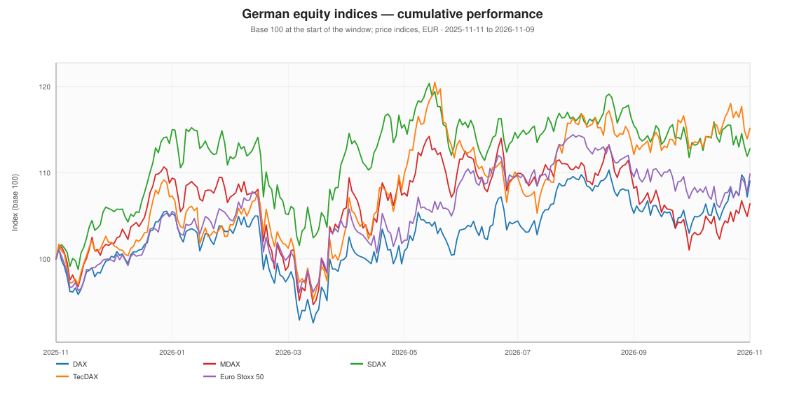
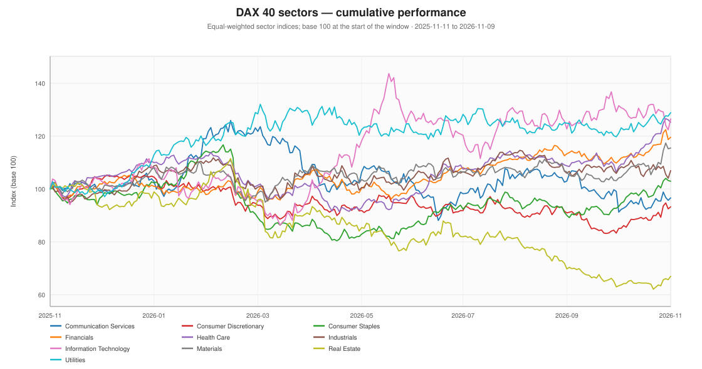
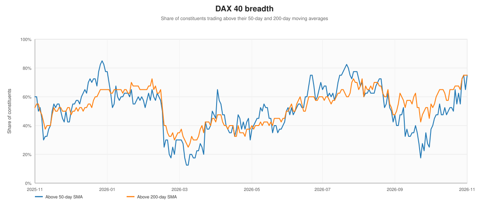

# German financial markets — overview

**As of:** 2026-11-09  
**Analysis window:** 2025-11-11 to 2026-11-09 (252 trading sessions)  
**Coverage:** 47 series, 40 DAX 40 companies, 63 sector/industry/NACE groups

## Key facts

- The **DAX** returned **+9.6%** over the last 12 months, **+7.3%** year-to-date, with annualised volatility of **16.3%** and a maximum drawdown of **-12.3%**.
- The strongest index was **TecDAX** (+16.8%); the weakest was **MDAX** (+6.6%).
- At the sector level, **Utilities** led (+28.2%) and **Real Estate** lagged (-31.4%).
- **Breadth:** 75% of DAX 40 constituents traded above their 50-day moving average and 75% above their 200-day average.
- **28 of 40** companies had a positive year-to-date return; the cross-sectional dispersion of one-year returns was **27.9%**.
- The **German 10-year Bund yield** closed at **3.27%**, **+61 bps** over 12 months and **+41 bps** year-to-date.
- **EUR/USD** closed at **1.1224**, -2.9% over 12 months.

## Index dashboard

| Index | Last | 1D | 1M | 3M | YTD | 1Y | Vol | Max DD | Trend | From 52w high |
| :--- | ---: | ---: | ---: | ---: | ---: | ---: | ---: | ---: | :--- | ---: |
| TecDAX | 4,048.14 | +1.1% | +1.8% | -0.5% | +11.8% | +16.8% | 18.7% | -12.7% | Uptrend | -4.4% |
| SDAX | 17,983.74 | +0.8% | -0.6% | -2.8% | +4.7% | +12.5% | 17.5% | -11.8% | Mixed | -6.3% |
| Euro Stoxx 50 | 6,290.45 | +1.9% | +1.9% | -3.7% | +8.5% | +11.1% | 15.9% | -10.9% | Uptrend | -4.0% |
| DAX | 26,267.19 | +1.7% | +4.7% | -0.2% | +7.3% | +9.6% | 16.3% | -12.3% | Uptrend | -1.1% |
| MDAX | 31,072.75 | +1.4% | +3.6% | -3.9% | +1.5% | +6.6% | 19.0% | -14.4% | Downtrend | -6.8% |

## Sector dashboard

| Sector | n | 1D | 1M | 3M | YTD | 1Y | Vol | Max DD | % > 50d | % > 200d |
| :--- | ---: | ---: | ---: | ---: | ---: | ---: | ---: | ---: | ---: | ---: |
| Utilities | 2 | +1.0% | +6.4% | +3.1% | +24.9% | +28.2% | 21.3% | -10.0% | 100% | 100% |
| Health Care | 6 | -0.7% | +15.5% | +11.8% | +16.6% | +27.9% | 17.7% | -19.7% | 100% | 100% |
| Information Technology | 2 | +3.4% | -3.8% | -2.2% | +22.1% | +27.7% | 32.5% | -22.6% | 50% | 50% |
| Financials | 6 | +0.8% | +8.0% | +7.5% | +13.7% | +20.0% | 16.5% | -10.3% | 83% | 100% |
| Materials | 3 | +0.3% | +10.8% | +7.7% | +13.1% | +17.1% | 20.1% | -13.7% | 100% | 100% |
| Industrials | 8 | +2.8% | -0.5% | -6.0% | +7.0% | +6.8% | 20.9% | -14.6% | 62% | 75% |
| Consumer Staples | 2 | -0.3% | +10.2% | +7.9% | +4.9% | +3.1% | 23.2% | -31.1% | 100% | 100% |
| Communication Services | 1 | +1.0% | +5.9% | -7.1% | -5.4% | -2.0% | 28.9% | -30.0% | 0% | 0% |
| Consumer Discretionary | 9 | +0.8% | +9.6% | +2.1% | -11.0% | -6.1% | 20.5% | -21.2% | 56% | 44% |
| Real Estate | 1 | +2.0% | +5.6% | -17.8% | -29.8% | -31.4% | 29.6% | -44.3% | 100% | 0% |

## Breadth

Breadth measures the share of the 40 DAX constituents trading above a moving average. It is a simple, factual gauge of whether the index move is broad or narrow. The latest reading is 75% above the 50-day SMA and 75% above the 200-day SMA.

## Rates and FX

| Series | Last | 1D change | 1M change | YTD change | 1Y change | Trend |
| :--- | ---: | ---: | ---: | ---: | ---: | :--- |
| German 10Y Bund Yield | 3.27% | +1 bps | -22 bps | +41 bps | +61 bps | Uptrend |
| EUR/USD | 1.1224 | +0.7% | +0.2% | -4.4% | -2.9% | Downtrend |

## Read next

- [Sectors, industries and NACE groups](sectors.md)
- [DAX 40 companies](companies.md)
- [Forward-looking base rates](outlook.md)
- [Risk, drawdowns and correlations](risk.md)
- [Data quality and coverage](data_quality.md)

_Past performance is not a reliable indicator of future results. See the disclaimer in the report index._
