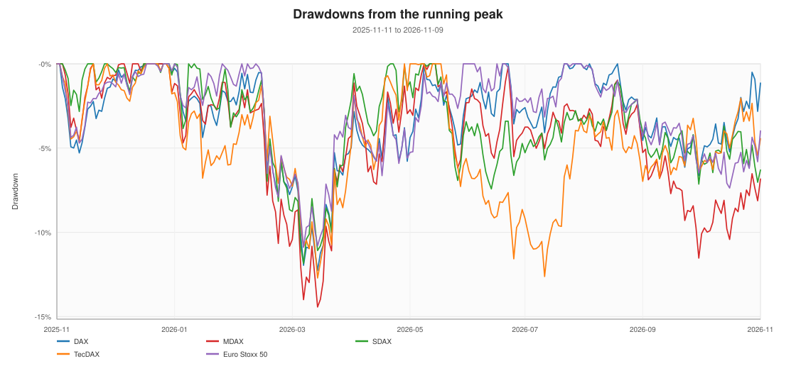
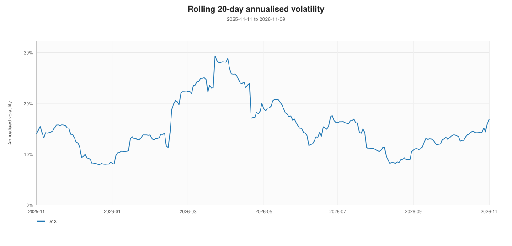
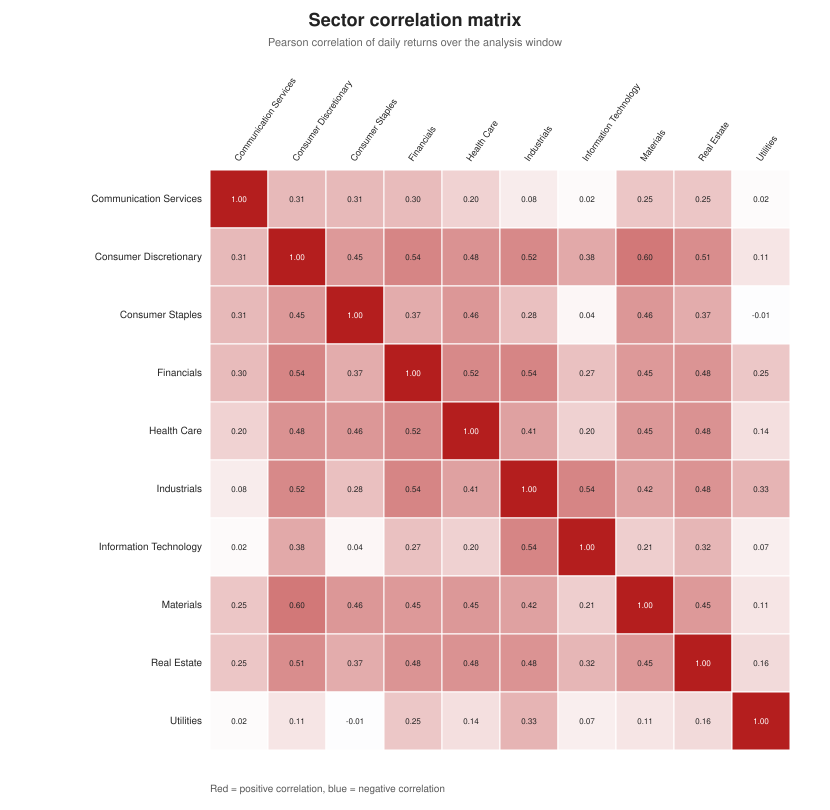

# Risk, drawdowns and correlations

**As of:** 2026-11-09  
**Window:** 2025-11-11 to 2026-11-09

## Volatility and drawdowns

| Series | Level | Ann. vol | Max drawdown | Drawdown peak | Drawdown trough | VaR 95 | CVaR 95 |
| :--- | :--- | ---: | ---: | :--- | :--- | ---: | ---: |
| Information Technology | sector | 32.5% | -22.6% | 2026-01-13 | 2026-03-27 | -3.0% | -4.2% |
| Real Estate | sector | 29.6% | -44.3% | 2026-02-27 | 2026-10-29 | -2.9% | -4.6% |
| Communication Services | sector | 28.9% | -30.0% | 2026-02-27 | 2026-06-30 | -2.8% | -4.2% |
| Consumer Staples | sector | 23.2% | -31.1% | 2026-02-24 | 2026-05-04 | -2.0% | -3.2% |
| Utilities | sector | 21.3% | -10.0% | 2026-03-17 | 2026-06-24 | -2.2% | -2.8% |
| Industrials | sector | 20.9% | -14.6% | 2026-02-18 | 2026-03-20 | -2.2% | -2.8% |
| Consumer Discretionary | sector | 20.5% | -21.2% | 2026-01-02 | 2026-10-02 | -2.1% | -2.8% |
| Materials | sector | 20.1% | -13.7% | 2026-02-10 | 2026-03-19 | -2.1% | -2.9% |
| MDAX | index | 19.0% | -14.4% | 2026-01-12 | 2026-03-27 | -1.9% | -2.4% |
| TecDAX | index | 18.7% | -12.7% | 2026-01-12 | 2026-03-27 | -1.7% | -2.4% |
| Health Care | sector | 17.7% | -19.7% | 2026-02-17 | 2026-05-05 | -1.7% | -2.2% |
| SDAX | index | 17.5% | -11.8% | 2026-01-26 | 2026-03-20 | -1.7% | -2.3% |
| Financials | sector | 16.5% | -10.3% | 2026-04-21 | 2026-06-03 | -1.6% | -2.1% |
| DAX | index | 16.3% | -12.3% | 2026-01-13 | 2026-03-27 | -1.6% | -2.1% |
| Euro Stoxx 50 | index | 15.9% | -10.9% | 2026-02-25 | 2026-03-20 | -1.5% | -2.0% |

## Rolling volatility

## Company risk ranking

**Highest annualised volatility**

| Company | Sector | Vol | Max DD | 1Y return |
| :--- | :--- | ---: | ---: | ---: |
| Infineon Technologies | Information Technology | 55.9% | -48.0% | +45.8% |
| Siemens Energy | Industrials | 52.6% | -39.3% | +16.5% |
| Rheinmetall | Industrials | 50.3% | -57.7% | -52.7% |
| Bayer | Health Care | 43.6% | -30.9% | +113.7% |
| Zalando | Consumer Discretionary | 42.4% | -29.0% | +21.4% |
| SAP | Information Technology | 40.9% | -41.2% | -2.1% |
| Heidelberg Materials | Materials | 38.2% | -41.5% | -10.5% |
| MTU Aero Engines | Industrials | 35.3% | -32.1% | -3.7% |
| Commerzbank | Financials | 35.0% | -18.9% | +17.1% |
| Scout24 | Consumer Discretionary | 34.0% | -31.4% | -4.5% |

**Deepest maximum drawdowns**

| Company | Sector | Max DD | Peak | Trough | 1Y return |
| :--- | :--- | ---: | :--- | :--- | ---: |
| Rheinmetall | Industrials | -57.7% | 2026-01-19 | 2026-11-06 | -52.7% |
| Infineon Technologies | Information Technology | -48.0% | 2026-06-02 | 2026-11-06 | +45.8% |
| BMW | Consumer Discretionary | -46.4% | 2025-12-09 | 2026-10-08 | -32.3% |
| Vonovia | Real Estate | -44.3% | 2026-02-27 | 2026-10-29 | -31.4% |
| Heidelberg Materials | Materials | -41.5% | 2026-01-27 | 2026-10-08 | -10.5% |
| SAP | Information Technology | -41.2% | 2025-11-12 | 2026-07-23 | -2.1% |
| Porsche SE | Consumer Discretionary | -40.4% | 2025-12-11 | 2026-10-05 | -27.0% |
| Qiagen | Health Care | -39.4% | 2026-01-26 | 2026-05-08 | +14.7% |
| Siemens Energy | Industrials | -39.3% | 2026-04-24 | 2026-11-05 | +16.5% |
| Volkswagen Group | Consumer Discretionary | -38.7% | 2025-12-12 | 2026-10-08 | -26.6% |

## Correlation and diversification

The average pairwise correlation of daily sector returns was **0.32**. A higher average means sectors moved together and diversification was weaker.

**Most correlated sector pairs**

| Pair | Correlation |
| :--- | ---: |
| Consumer Discretionary / Materials | 0.60 |
| Financials / Industrials | 0.54 |
| Consumer Discretionary / Financials | 0.54 |
| Industrials / Information Technology | 0.54 |
| Financials / Health Care | 0.52 |

**Least correlated sector pairs**

| Pair | Correlation |
| :--- | ---: |
| Consumer Staples / Utilities | -0.01 |
| Communication Services / Utilities | 0.02 |
| Communication Services / Information Technology | 0.02 |
| Consumer Staples / Information Technology | 0.04 |
| Information Technology / Utilities | 0.07 |

## Sector concentration

Index weights are the published DAX weights from the composition source. They show which sectors dominate the index and therefore the index-level risk. The source does not publish weights for GEA and Scout24; the table therefore sums to 99.5%.

| Sector | Constituents | Index weight |
| :--- | ---: | ---: |
| Industrials | 8 | 26.9% |
| Financials | 6 | 21.6% |
| Information Technology | 2 | 16.7% |
| Consumer Discretionary | 9 | 10.5% |
| Communication Services | 1 | 7.5% |
| Health Care | 6 | 5.6% |
| Materials | 3 | 5.0% |
| Utilities | 2 | 3.1% |
| Consumer Staples | 2 | 1.5% |
| Real Estate | 1 | 1.1% |
| **Total** | 40 | **99.5%** |

## Rates risk

The 10-year Bund yield had an annualised daily-change volatility of **59 bps** and moved **+61 bps** over 12 months. Bond yields are a key discount-rate input for equity valuations.

## Notes

- VaR 95 is the 5th percentile of daily returns; CVaR 95 is the average of returns at or below it.
- Maximum drawdown is measured on daily closes within the analysis window.
- Company statistics use roughly one year of sessions and are therefore noisy.
