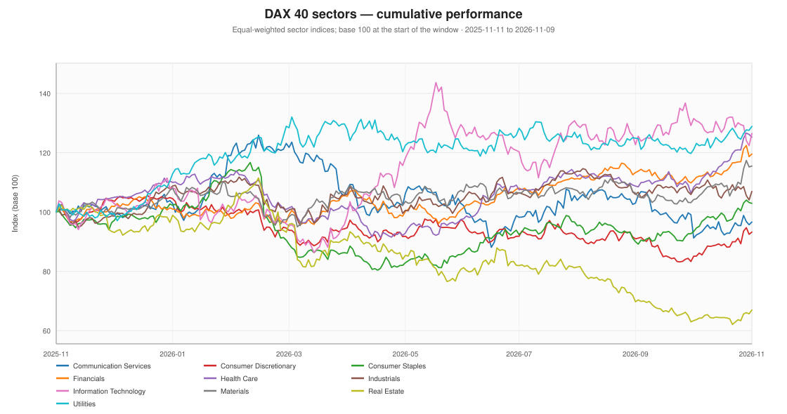
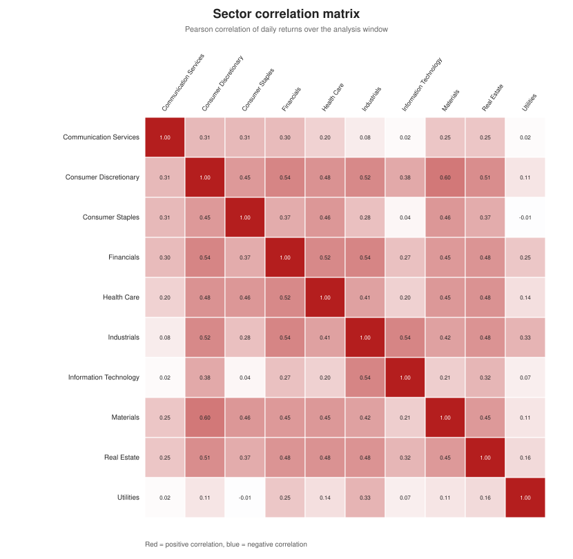

# Sectors, industries and NACE groups

**As of:** 2026-11-09  
**Window:** 2025-11-11 to 2026-11-09

The analysis uses three complementary classifications:

1. **Broad sector** — a GICS-like grouping used for the dashboard.
2. **Industry** — the Prime Standard sector published alongside the DAX composition.
3. **NACE** — the official EU statistical classification of economic activities (NACE Rev. 2.1), at section and division level. NACE describes what a company does, not how it trades; conglomerates are assigned by their primary activity.

## Sector ranking

| Sector | n | 1M | 3M | YTD | 1Y | Vol | Max DD | % > 50d | Median 1Y |
| :--- | ---: | ---: | ---: | ---: | ---: | ---: | ---: | ---: | ---: |
| Utilities | 2 | +6.4% | +3.1% | +24.9% | +28.2% | 21.3% | -10.0% | 100% | +27.3% |
| Health Care | 6 | +15.5% | +11.8% | +16.6% | +27.9% | 17.7% | -19.7% | 100% | +12.1% |
| Information Technology | 2 | -3.8% | -2.2% | +22.1% | +27.7% | 32.5% | -22.6% | 50% | +21.9% |
| Financials | 6 | +8.0% | +7.5% | +13.7% | +20.0% | 16.5% | -10.3% | 83% | +14.7% |
| Materials | 3 | +10.8% | +7.7% | +13.1% | +17.1% | 20.1% | -13.7% | 100% | +25.2% |
| Industrials | 8 | -0.5% | -6.0% | +7.0% | +6.8% | 20.9% | -14.6% | 62% | +13.4% |
| Consumer Staples | 2 | +10.2% | +7.9% | +4.9% | +3.1% | 23.2% | -31.1% | 100% | +2.9% |
| Communication Services | 1 | +5.9% | -7.1% | -5.4% | -2.0% | 28.9% | -30.0% | 0% | -2.0% |
| Consumer Discretionary | 9 | +9.6% | +2.1% | -11.0% | -6.1% | 20.5% | -21.2% | 56% | -4.5% |
| Real Estate | 1 | +5.6% | -17.8% | -29.8% | -31.4% | 29.6% | -44.3% | 100% | -31.4% |

## NACE sections

NACE section level aggregates the DAX 40 by the first letter of the NACE code. Some sections contain only one or two companies; the `n` column makes this explicit.

| NACE section | n | 1M | 3M | YTD | 1Y | Vol | Max DD | % > 50d |
| :--- | ---: | ---: | ---: | ---: | ---: | ---: | ---: | ---: |
| NACE H — Transportation and storage | 1 | +4.7% | +6.0% | +25.5% | +33.3% | 25.1% | -14.3% | 100% |
| NACE G — Wholesale and retail trade; repair of motor vehicles and motorcycles | 2 | +6.7% | +7.3% | +18.6% | +30.0% | 27.8% | -18.0% | 50% |
| NACE D — Electricity, gas, steam and air conditioning supply | 2 | +6.4% | +3.1% | +24.9% | +28.2% | 21.3% | -10.0% | 100% |
| NACE K — Financial and insurance activities | 7 | +7.5% | +5.4% | +5.4% | +12.2% | 15.9% | -10.9% | 71% |
| NACE C — Manufacturing | 22 | +5.9% | +0.7% | +4.6% | +9.3% | 17.1% | -15.8% | 73% |
| NACE Q — Human health and social work activities | 2 | +16.5% | +6.1% | +4.9% | +5.6% | 22.9% | -22.4% | 100% |
| NACE J — Information and communication | 3 | +12.9% | +9.6% | +2.9% | +0.2% | 24.4% | -23.7% | 67% |
| NACE L — Real estate activities | 1 | +5.6% | -17.8% | -29.8% | -31.4% | 29.6% | -44.3% | 100% |

## NACE divisions

Division level is more granular (2-digit NACE). Some divisions contain only one company, so the aggregate is effectively that company; the `n` column makes this explicit.

| NACE division | n | 1Y | Vol | Max DD | % > 50d | Median 1Y |
| :--- | ---: | ---: | ---: | ---: | ---: | ---: |
| NACE 21 — Manufacture of basic pharmaceutical products and pharmaceutical preparations | 2 | +74.4% | 29.3% | -20.8% | 100% | +74.8% |
| NACE 66 — Activities auxiliary to financial services and insurance activities | 1 | +51.1% | 22.8% | -11.8% | 100% | +51.1% |
| NACE 53 — Postal and courier activities | 1 | +33.3% | 25.1% | -14.3% | 100% | +33.3% |
| NACE 46 — Wholesale trade, except of motor vehicles and motorcycles | 1 | +31.7% | 29.0% | -24.5% | 0% | +31.7% |
| NACE 35 — Electricity, gas, steam and air conditioning supply | 2 | +28.2% | 21.3% | -10.0% | 100% | +27.3% |
| NACE 26 — Manufacture of computer, electronic and optical products | 2 | +26.2% | 30.1% | -17.7% | 50% | +22.7% |
| NACE 47 — Retail trade, except of motor vehicles and motorcycles | 1 | +21.4% | 42.4% | -29.0% | 100% | +21.4% |
| NACE 28 — Manufacture of machinery and equipment n.e.c. | 3 | +18.7% | 28.9% | -14.2% | 67% | +16.5% |
| NACE 20 — Manufacture of chemicals and chemical products | 4 | +16.6% | 19.2% | -18.3% | 100% | +20.1% |
| NACE 65 — Insurance, reinsurance and pension funding, except compulsory social security | 3 | +14.9% | 17.2% | -16.4% | 100% | +12.3% |
| NACE 32 — Other manufacturing | 1 | +14.7% | 32.5% | -39.4% | 100% | +14.7% |
| NACE 14 — Manufacture of wearing apparel | 1 | +13.2% | 33.0% | -24.5% | 100% | +13.2% |
| NACE 86 — Human health activities | 2 | +5.6% | 22.9% | -22.4% | 100% | +4.5% |
| NACE 61 — Telecommunications | 1 | -2.0% | 28.9% | -30.0% | 0% | -2.0% |
| NACE 58 — Publishing activities | 1 | -2.1% | 40.9% | -41.2% | 100% | -2.1% |
| NACE 30 — Manufacture of other transport equipment | 2 | -2.2% | 29.9% | -26.5% | 100% | -3.1% |
| NACE 64 — Financial service activities, except insurance and pension funding | 3 | -3.5% | 25.8% | -21.7% | 33% | +0.1% |
| NACE 63 — Information service activities | 1 | -4.5% | 34.0% | -31.4% | 100% | -4.5% |
| NACE 23 — Manufacture of other non-metallic mineral products | 1 | -10.5% | 38.2% | -41.5% | 100% | -10.5% |
| NACE 29 — Manufacture of motor vehicles, trailers and semi-trailers | 5 | -13.1% | 23.4% | -26.7% | 40% | -26.6% |
| NACE 68 — Real estate activities | 1 | -31.4% | 29.6% | -44.3% | 100% | -31.4% |
| NACE 25 — Manufacture of fabricated metal products, except machinery and equipment | 1 | -52.7% | 50.3% | -57.7% | 0% | -52.7% |

## Industries

| Industry | n | 1Y | Vol | Max DD | % > 50d | Median 1Y |
| :--- | ---: | ---: | ---: | ---: | ---: | ---: |
| Pharmaceuticals | 2 | +74.4% | 29.3% | -20.8% | 100% | +74.8% |
| Logistics | 1 | +33.3% | 25.1% | -14.3% | 100% | +33.3% |
| Distribution | 1 | +31.7% | 29.0% | -24.5% | 0% | +31.7% |
| Chemicals | 2 | +30.2% | 21.2% | -9.6% | 100% | +28.6% |
| Utilities | 2 | +28.2% | 21.3% | -10.0% | 100% | +27.3% |
| Technology | 2 | +27.7% | 32.5% | -22.6% | 50% | +21.9% |
| Financial Services | 5 | +21.1% | 17.8% | -10.3% | 80% | +17.1% |
| Mechanical Engineering | 1 | +18.5% | 22.4% | -18.5% | 100% | +18.5% |
| Energy technology | 1 | +16.5% | 52.6% | -39.3% | 0% | +16.5% |
| Consumer Goods | 1 | +14.9% | 20.4% | -26.8% | 100% | +14.9% |
| Biotech | 1 | +14.7% | 32.5% | -39.4% | 100% | +14.7% |
| Apparel | 1 | +13.2% | 33.0% | -24.5% | 100% | +13.2% |
| Insurance | 1 | +12.3% | 20.4% | -19.3% | 100% | +12.3% |
| E-Commerce | 2 | +10.7% | 30.3% | -24.8% | 100% | +8.4% |
| Industrials | 1 | +10.3% | 33.5% | -22.2% | 100% | +10.3% |
| Healthcare | 2 | +5.6% | 22.9% | -22.4% | 100% | +4.5% |
| Medical Equipment | 1 | -0.5% | 23.7% | -29.0% | 100% | -0.5% |
| Telecommunication | 1 | -2.0% | 28.9% | -30.0% | 0% | -2.0% |
| Consumer goods | 1 | -9.1% | 31.3% | -38.7% | 100% | -9.1% |
| Construction Materials | 1 | -10.5% | 38.2% | -41.5% | 100% | -10.5% |
| Automotive | 6 | -15.4% | 23.0% | -27.7% | 33% | -26.8% |
| Aerospace & Defence | 3 | -20.9% | 29.6% | -31.2% | 67% | -3.7% |
| Real Estate | 1 | -31.4% | 29.6% | -44.3% | 100% | -31.4% |

## Sector correlations

The average pairwise correlation of daily sector returns was **0.32**. Higher values mean sector diversification was less effective during the window.

**Most correlated pairs**

| Pair | Correlation |
| :--- | ---: |
| Consumer Discretionary / Materials | 0.60 |
| Financials / Industrials | 0.54 |
| Consumer Discretionary / Financials | 0.54 |
| Industrials / Information Technology | 0.54 |
| Financials / Health Care | 0.52 |

**Least correlated pairs**

| Pair | Correlation |
| :--- | ---: |
| Consumer Staples / Utilities | -0.01 |
| Communication Services / Utilities | 0.02 |
| Communication Services / Information Technology | 0.02 |
| Consumer Staples / Information Technology | 0.04 |
| Information Technology / Utilities | 0.07 |

## What the facts show

- Leadership was concentrated in **Utilities**; the weakest sector was **Real Estate**.
- At NACE section level, **NACE H — Transportation and storage** led and **NACE L — Real estate activities** lagged over 12 months.
- **7 of 10** sectors had a positive year-to-date return.
- **7 of 10** sectors had at least half of their constituents above the 200-day moving average.

> NACE is a statistical activity classification. It is not an investment sector classification and does not account for revenue mix, geography or valuation. The mapping used here is documented in `config/nace_map.tsv`.
